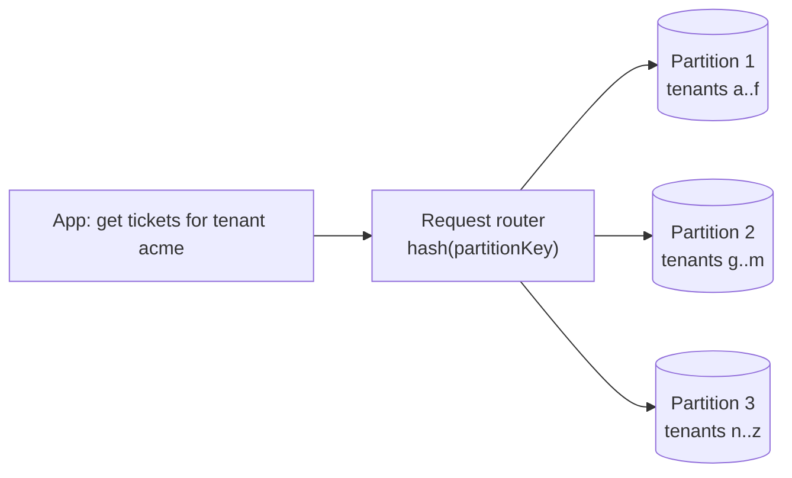

# NoSQL: DynamoDB and Cosmos DB

## Introduction

Relational databases are flexible: you can ask almost any question with SQL. The price of that flexibility is that, at very large scale, performance becomes harder to predict. **Amazon DynamoDB** and **Azure Cosmos DB** make the opposite trade. You design your data around the questions you will ask, and in return you get consistent single-digit-millisecond reads and writes at almost any scale, with no servers to manage.

A good analogy is a **coat check**. You hand over your coat and get a ticket number. Getting the coat back with the ticket is instant, no matter how many coats are stored. Asking "please find all the blue coats" is slow, because the system was not built for that question. Partition keys are the ticket numbers of NoSQL.

On this page you will learn:

- The **core concepts** shared by DynamoDB and Cosmos DB: items, partition keys, capacity, consistency
- How to **model data** around access patterns
- How to **create tables and containers** with the CLI and use them from Python
- How **billing** works (request units, on-demand vs provisioned, serverless)
- When **not** to use a NoSQL database

:::warning Cost warning
Tables and containers bill for storage and throughput. On-demand and serverless modes only charge for requests you make, which is safest for labs. Provisioned throughput bills every hour even when idle. Follow the **Cleanup** section when you finish. See the [DynamoDB pricing](https://aws.amazon.com/dynamodb/pricing/) and [Cosmos DB pricing](https://azure.microsoft.com/pricing/details/cosmos-db/) pages for current rates.
:::

## Core Concepts Side by Side

| Concept | DynamoDB | Cosmos DB for NoSQL |
| --- | --- | --- |
| Top-level resource | Table (in an account and region) | Account, then database, then container |
| Record | Item (up to 400 KB) | Item / document (JSON, up to 2 MB) |
| Partitioning | Partition key (plus optional sort key) | Partition key path, for example `/tenantId` |
| Primary lookup | Partition key + sort key | `id` + partition key value |
| Query language | Key condition expressions; PartiQL | SQL-like query language over JSON |
| Secondary access | Global and local secondary indexes | Automatic indexing of all properties (configurable) |
| Throughput unit | Read and write request units (on-demand) or capacity units (provisioned) | Request Units (RU), billed per request (serverless) or provisioned RU/s |
| Change feed | DynamoDB Streams | Change feed |
| Multi-region | Global tables | Multi-region accounts, optional multi-region writes |

Cosmos DB is a **multi-model** service. Besides the NoSQL API used on this page, an account can expose MongoDB, Apache Cassandra, Apache Gremlin (graph), Table or PostgreSQL APIs. You choose the API when you create the account and cannot change it afterwards. The **NoSQL API** is the native one and gets new features first, so use it for new applications unless you need wire compatibility with an existing database.

## Partition Keys: The Most Important Decision

Both services spread data across many physical partitions using a hash of the **partition key**. Every read or write that includes the partition key goes straight to one partition. That is why they scale.



A good partition key:

- Has **many distinct values** (customer ID, device ID, order ID).
- Spreads **traffic evenly**, so no single value becomes a "hot partition".
- Appears in **most of your queries**, so they stay single-partition.

Bad choices are low-cardinality or time-based values such as `status` ("open" or "closed") or today's date. All traffic lands on a few partitions, and you hit throttling while most capacity sits idle.

### Design from access patterns

Write down your queries first. For a helpdesk ticket store:

| Access pattern | Key design |
| --- | --- |
| Get one ticket | PK = `TENANT#acme`, SK = `TICKET#1042` |
| List a tenant's tickets, newest first | PK = `TENANT#acme`, SK begins with `TICKET#`, scan backward (use time-sortable IDs) |
| List tickets assigned to an agent | Global secondary index: PK = `agentId`, SK = `updatedAt` |

In DynamoDB, the **sort key** lets one partition hold an ordered collection. Cosmos DB has no separate sort key, but you can `ORDER BY` within a partition, and composite indexes make that efficient.

:::tip Do not overdo single-table design
"Single-table design" (many entity types in one DynamoDB table) is powerful, but it makes the data harder to understand for newcomers. Start with one table per bounded context and access patterns you can explain on a whiteboard.
:::

## Capacity Modes and Billing

### On AWS

- **On-demand mode** (`PAY_PER_REQUEST`): pay per read and write request, and DynamoDB scales automatically. The best default for new or spiky workloads.
- **Provisioned mode**: you set read and write capacity units, optionally with auto scaling. Cheaper per request for steady, predictable traffic, and reservations can lower it further.
- Item size matters: larger items consume more units per read or write. Strongly consistent reads cost more than eventually consistent ones, and transactional operations cost more again.

### On Azure

- Every operation costs **Request Units (RU)**. A point read of a small item is the cheapest operation; queries, writes and large items cost more. The SDK returns the RU charge of each request, which you should log while tuning.
- **Serverless** account: pay per RU consumed. Good for dev, test and low or bursty traffic.
- **Provisioned throughput**: reserve RU/s on a container or database, either **manual** or **autoscale** (scales between 10% and 100% of a maximum you set).

The billing dimensions are similar on both clouds: request units, GB-month of storage (including indexes), backups, and replication to extra regions. Run your expected traffic through the pricing calculators before choosing a mode.

## Consistency Choices

Distributed databases must choose between fresher reads and lower latency.

| Level | DynamoDB | Cosmos DB |
| --- | --- | --- |
| Always latest | Strongly consistent reads (single region); multi-Region strong consistency (MRSC) for global tables | Strong |
| Bounded lag | - | Bounded staleness |
| Read your own writes | - | Session (the default) |
| In-order, may lag | - | Consistent prefix |
| May lag, cheapest | Eventually consistent reads (the default) | Eventual |

**Session** consistency in Cosmos DB means a client always sees its own writes, which matches what most users expect from a web app. In DynamoDB, you choose consistency per read with `ConsistentRead=True`.

## Creating Resources with the CLI

### On AWS

Create an on-demand table with a partition key and sort key, plus point-in-time recovery:

```bash
aws dynamodb create-table \
  --table-name helpdesk-tickets \
  --attribute-definitions AttributeName=pk,AttributeType=S AttributeName=sk,AttributeType=S \
  --key-schema AttributeName=pk,KeyType=HASH AttributeName=sk,KeyType=RANGE \
  --billing-mode PAY_PER_REQUEST \
  --deletion-protection-enabled \
  --tags Key=project,Value=helpdesk

aws dynamodb wait table-exists --table-name helpdesk-tickets

aws dynamodb update-continuous-backups \
  --table-name helpdesk-tickets \
  --point-in-time-recovery-specification PointInTimeRecoveryEnabled=true
```

Example output of `create-table` (trimmed):

```text
{
    "TableDescription": {
        "TableName": "helpdesk-tickets",
        "TableStatus": "CREATING",
        "BillingModeSummary": { "BillingMode": "PAY_PER_REQUEST" },
        "DeletionProtectionEnabled": true
    }
}
```

### On Azure

Create a serverless Cosmos DB account with local (key-based) auth still enabled for the moment, then a database and container:

```bash
az group create --name rg-helpdesk-nosql --location eastus

az cosmosdb create \
  --name cosmos-helpdesk-4821 \
  --resource-group rg-helpdesk-nosql \
  --locations regionName=eastus failoverPriority=0 isZoneRedundant=False \
  --capabilities EnableServerless \
  --default-consistency-level Session

az cosmosdb sql database create \
  --account-name cosmos-helpdesk-4821 \
  --resource-group rg-helpdesk-nosql \
  --name helpdesk

az cosmosdb sql container create \
  --account-name cosmos-helpdesk-4821 \
  --resource-group rg-helpdesk-nosql \
  --database-name helpdesk \
  --name tickets \
  --partition-key-path "/tenantId"
```

Example output of the container command (trimmed):

```text
{
  "name": "tickets",
  "resource": {
    "id": "tickets",
    "indexingPolicy": { "automatic": true, "indexingMode": "consistent" },
    "partitionKey": { "kind": "Hash", "paths": [ "/tenantId" ] }
  }
}
```

Now grant **your identity** data-plane access through Cosmos DB's own RBAC, using the built-in *Data Contributor* role (ID ending in `...0002`), so the app never needs the account keys:

```bash
PRINCIPAL_ID=$(az ad signed-in-user show --query id -o tsv)

az cosmosdb sql role assignment create \
  --account-name cosmos-helpdesk-4821 \
  --resource-group rg-helpdesk-nosql \
  --role-definition-id 00000000-0000-0000-0000-000000000002 \
  --principal-id "$PRINCIPAL_ID" \
  --scope "/"
```

Once every client uses Entra ID, set `disableLocalAuth: true` on the account (in Bicep, Terraform or the portal) so the primary keys stop working. See [Configure role-based access control with Microsoft Entra ID](https://learn.microsoft.com/en-us/azure/cosmos-db/how-to-setup-rbac).

## Using the Databases from Python

### On AWS with boto3

```python
import boto3
from boto3.dynamodb.conditions import Key

table = boto3.resource("dynamodb", region_name="us-east-1").Table("helpdesk-tickets")

# Write two tickets for one tenant
for ticket_id, title in [("0001042", "Login fails"), ("0001043", "Invoice missing")]:
    table.put_item(Item={
        "pk": "TENANT#acme",
        "sk": f"TICKET#{ticket_id}",
        "title": title,
        "status": "open",
    })

# Point read: cheapest operation
item = table.get_item(Key={"pk": "TENANT#acme", "sk": "TICKET#0001042"})["Item"]
print("get:", item["title"])

# Query one partition, newest ticket first
resp = table.query(
    KeyConditionExpression=Key("pk").eq("TENANT#acme") & Key("sk").begins_with("TICKET#"),
    ScanIndexForward=False,
    ReturnConsumedCapacity="TOTAL",
)
for t in resp["Items"]:
    print("query:", t["sk"], t["title"])
print("consumed:", resp["ConsumedCapacity"]["CapacityUnits"])
```

Output:

```text
get: Login fails
query: TICKET#0001043 Invoice missing
query: TICKET#0001042 Login fails
consumed: 0.5
```

### On Azure with azure-cosmos

Install `azure-cosmos` and `azure-identity`. `DefaultAzureCredential` uses your `az login` session locally and the app's managed identity in Azure:

```python
from azure.cosmos import CosmosClient
from azure.identity import DefaultAzureCredential

ENDPOINT = "https://cosmos-helpdesk-4821.documents.azure.com:443/"

client = CosmosClient(ENDPOINT, credential=DefaultAzureCredential())
container = client.get_database_client("helpdesk").get_container_client("tickets")

for ticket_id, title in [("1042", "Login fails"), ("1043", "Invoice missing")]:
    container.upsert_item({"id": ticket_id, "tenantId": "acme", "title": title, "status": "open"})

# Point read: id + partition key
item = container.read_item(item="1042", partition_key="acme")
print("read:", item["title"])
print("RU charge:", container.client_connection.last_response_headers["x-ms-request-charge"])

# Single-partition query
query = "SELECT c.id, c.title FROM c WHERE c.tenantId = @t ORDER BY c.id DESC"
for t in container.query_items(query, parameters=[{"name": "@t", "value": "acme"}],
                               partition_key="acme"):
    print("query:", t["id"], t["title"])
```

Output:

```text
read: Login fails
RU charge: 1
query: 1043 Invoice missing
query: 1042 Login fails
```

Notice the parallel structure: both point reads need the full key, and both queries are scoped to one partition. A query *without* the partition key (a DynamoDB `Scan`, or a Cosmos DB cross-partition query) reads far more data and costs far more.

## Going Global

Both services can replicate a table or account to several regions:

- **DynamoDB global tables** replicate to the regions you add. The default mode, **multi-Region eventual consistency (MREC)**, replicates asynchronously, usually within a second, and resolves conflicting writes with "last writer wins". The newer **multi-Region strong consistency (MRSC)** mode needs exactly three regions (or two replicas plus a witness), gives an RPO of zero, and has higher write latency and some feature limits (no TTL, no transactions). See [How global tables work](https://docs.aws.amazon.com/amazondynamodb/latest/developerguide/V2globaltables_HowItWorks.html).
- **Cosmos DB** accounts can add read regions, or enable **multi-region writes**, with conflict resolution policies (last writer wins by default, or a custom procedure).

Replication bills extra writes and storage in every region, plus data transfer. Only go multi-region when you need lower global latency or regional disaster recovery (see [Database High Availability and Backups](./4-cloud-database-ha-and-backups.mdx)).

## Real-World Scenario

Your team runs a **mobile game** with a few million players. Each player has a profile, an inventory and progress per level. The game reads and writes a player's own data constantly, traffic spikes 10x when a new season launches, and players are spread over North America and Europe.

### The solution

- Use **DynamoDB** (if you are on AWS) or **Cosmos DB for NoSQL** (on Azure) with `playerId` as the partition key.
- Store profile, inventory and progress as items in the player's partition (sort keys like `PROFILE`, `INV#sword`, `LEVEL#12` on DynamoDB, or separate item types in the same partition on Cosmos DB).
- Start with **on-demand** (DynamoDB) or **autoscale** RU/s (Cosmos DB) to absorb launch spikes.
- Add a second region (global table or Cosmos DB read/write region) for European players once latency data shows the need.
- For leaderboards, which need "top N across all players", use a **cache** with sorted sets ([Managed Caching](./3-cloud-caching.mdx)) rather than scanning the database.

### Why this approach

- Every hot path is "get or update this player's data", which is a perfect single-partition access pattern.
- On-demand or autoscale capacity follows seasonal spikes without manual resizing.
- There are no joins across players in the hot path.

### When to use it, and when not to

Use DynamoDB or Cosmos DB when access patterns are **known, key-based and high-volume**, or when you want serverless billing for a small app. Avoid them as the main store when users need **ad hoc reporting**, many-to-many relationships, or complex transactions across many entities. A relational database fits better there, and you can stream changes from NoSQL to a warehouse for analytics.

### Alternatives and trade-offs

| Approach | Pros | Cons | Best for |
| --- | --- | --- | --- |
| DynamoDB | Fully serverless, predictable latency, deep AWS integration (Lambda, Streams) | Design-up-front; limited query flexibility; 400 KB item limit | Key-based workloads on AWS |
| Cosmos DB for NoSQL | Rich SQL-like queries, automatic indexing, five consistency levels, multi-model | RU tuning takes practice; indexing everything can raise write cost | Key-based and document workloads on Azure |
| Managed PostgreSQL with `jsonb` | Flexible queries and joins plus JSON | Vertical scaling limits, more operational tuning | Moderate scale with evolving queries |
| MongoDB-compatible (DocumentDB, Azure DocumentDB) | Familiar MongoDB drivers and tooling | Compatibility is high but not 100% | Migrating existing MongoDB apps |

## Common Mistakes

- **Low-cardinality partition keys.** Keys like `status`, `country` or the current date create hot partitions and throttling.
- **Using Scan or cross-partition queries in hot paths.** They read huge amounts of data and cost accordingly. Add an index or rethink the key.
- **Ignoring item size.** Large items cost more per operation. Store big blobs in object storage ([Amazon S3](../6-cloud-storage/1-cloud-s3.mdx) or [Azure Blob Storage](../6-cloud-storage/2-cloud-azure-blob.mdx)) and keep a reference.
- **Indexing everything by default in Cosmos DB.** Exclude properties you never filter on to reduce write RU charges.
- **Using account keys in application code.** Use IAM roles on AWS and Cosmos DB data-plane RBAC with managed identities on Azure, then disable key-based auth.
- **Leaving provisioned throughput on idle dev containers.** Use serverless or on-demand for development.

## Cleanup

### On AWS

```bash
aws dynamodb update-table --table-name helpdesk-tickets --no-deletion-protection-enabled
aws dynamodb delete-table --table-name helpdesk-tickets
```

Example output (trimmed):

```text
{
    "TableDescription": {
        "TableName": "helpdesk-tickets",
        "TableStatus": "DELETING"
    }
}
```

### On Azure

```bash
az group delete --name rg-helpdesk-nosql --yes --no-wait
```

## Summary

- DynamoDB and Cosmos DB trade query flexibility for **predictable performance at scale** and serverless operations.
- The **partition key** decides scalability: choose high-cardinality keys that appear in most queries.
- Billing is based on **request units** (on-demand / serverless) or **provisioned capacity**, plus storage, backups and replication.
- Cosmos DB offers five **consistency levels** and several APIs; DynamoDB offers eventual or strong reads and two global-table modes.
- Use **identity-based access** (IAM, Entra ID with Cosmos DB RBAC) instead of keys.
- Choose NoSQL for known, key-based access patterns; choose relational when you need ad hoc queries and joins.

## Exercises

1. Write the access patterns for an online store's shopping cart and design the DynamoDB keys and the Cosmos DB partition key for it.
2. Create the `helpdesk-tickets` table or `tickets` container, insert ten items for two tenants, and compare the consumed capacity (or RU charge) of a point read, a single-partition query and a full scan.
3. Add a global secondary index on `status` to the DynamoDB table and explain why querying it for `open` tickets across all tenants might create a hot partition.
4. Enable Cosmos DB data-plane RBAC for a managed identity, then disable local auth and confirm that a key-based client is rejected.

### Related pages

- [Choosing a Cloud Database](./0-cloud-database-options.mdx)
- [Managed Caching: ElastiCache and Azure Cache for Redis](./3-cloud-caching.mdx)
- [Event Sources and Triggers](../4-cloud-serverless/3-cloud-serverless-triggers.mdx)
- [NoSQL concepts in the Database Fundamentals tutorial](/docs/fundamental/database)
- [MongoDB tutorial](/docs/database/mongodb)
