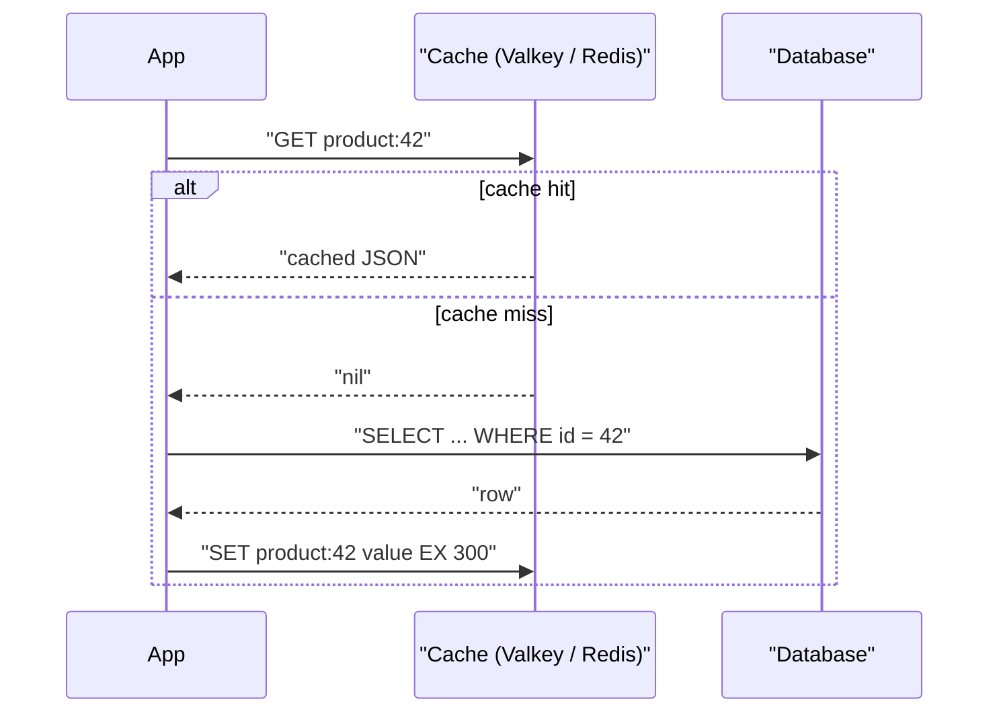

# Managed Caching: ElastiCache and Azure Cache for Redis

## Introduction

A **cache** keeps a copy of frequently used data in memory so your app does not have to ask the database (or a slow API) every time. Memory is much faster than disk and network round trips to a busy database, so a good cache can cut response times dramatically and take a big load off your primary database.

Think of a busy coffee shop. The barista keeps the most popular pastries on the counter instead of walking to the back storeroom for every order. The counter is small, things on it go stale, and occasionally someone needs to restock it. That is exactly the trade-off of caching: speed in exchange for managing freshness and limited space.

In the cloud you rarely run Redis yourself. Both providers offer managed, in-memory data stores:

- **AWS:** Amazon ElastiCache (Valkey, Redis OSS and Memcached engines), plus Amazon MemoryDB for a durable, Redis-compatible primary database
- **Azure:** **Azure Managed Redis**, the successor to Azure Cache for Redis

This page covers caching patterns, the managed services, secure setup with the CLI, Python code for the cache-aside pattern, and the pitfalls that cause stale data or outages.

:::warning Cost warning
Managed caches bill while they exist, not only while you use them. Node-based clusters bill per node-hour; ElastiCache Serverless bills for data stored (GB-hours) and processing units (ECPUs); Azure Managed Redis bills per instance size per hour. Create the smallest size, and run the **Cleanup** commands when finished. Check the [ElastiCache pricing](https://aws.amazon.com/elasticache/pricing/) and [Azure Managed Redis pricing](https://azure.microsoft.com/pricing/details/managed-redis/) pages.
:::

## Important: Azure Cache for Redis Is Being Retired

Microsoft has announced the retirement of **Azure Cache for Redis**:

| Tier | Retirement date |
| --- | --- |
| Enterprise and Enterprise Flash | March 31, 2027 |
| Basic, Standard and Premium | September 30, 2028 |

Microsoft recommends **Azure Managed Redis** for all new caches and migration of existing ones. Azure Managed Redis is built on Redis Enterprise software, is zone redundant by default, uses Microsoft Entra ID authentication by default, and is clustered by default. Details are in the [retirement FAQ](https://learn.microsoft.com/en-us/azure/azure-cache-for-redis/retirement-faq). This page uses Azure Managed Redis for every Azure example.

## Caching Patterns

### Cache-aside (lazy loading)

The app checks the cache first. On a **miss** it reads the database, then stores the result in the cache with a **time to live (TTL)**.



It is the most common pattern because the cache only holds data that someone actually asked for, and a cache outage degrades performance rather than breaking the app.

### Other patterns

| Pattern | How it works | Good for | Watch out for |
| --- | --- | --- | --- |
| Cache-aside | App reads cache, falls back to DB, fills cache | General read-heavy data | Stale data until TTL or invalidation |
| Write-through | App writes DB and cache together | Data read right after writing | Extra write latency; caches data nobody reads |
| Write-behind | App writes cache; cache is flushed to DB later | Very high write rates | Data loss risk if the cache fails |
| Session store | Store user sessions with a TTL | Stateless web servers | Plan for eviction and failover |
| Rate limiting / counters | `INCR` with an expiry per user or IP | APIs, login throttling | Use atomic commands |
| Leaderboards | Sorted sets (`ZADD`, `ZREVRANGE`) | Games, rankings | Memory grows with members |

### TTLs and invalidation

There are two classic ways to keep cached data fresh:

1. **Expire it.** Every key gets a TTL. Short TTLs (seconds) keep data fresh; long TTLs (hours) reduce database load. Pick per data type.
2. **Delete on write.** When the app updates the database, it deletes the related cache key, so the next read reloads fresh data.

Most systems combine both: delete on write for correctness, plus a TTL as a safety net.

## The Managed Services

| Feature | Amazon ElastiCache | Azure Managed Redis |
| --- | --- | --- |
| Engines | Valkey, Redis OSS, Memcached | Redis Enterprise based (Redis-compatible) |
| Deployment styles | Serverless cache, or node-based cluster | Instance sizes in four tiers |
| Sizing | Serverless: limits on data and ECPUs; node-based: node type and count | Memory Optimized, Balanced, Compute Optimized, Flash Optimized tiers with a size (for example `Balanced_B0`) |
| High availability | Multi-AZ replicas; serverless is multi-AZ by design | Zone redundant by default; HA can be disabled for dev |
| Authentication | IAM auth (Valkey and Redis OSS 7 or later), AUTH tokens, RBAC users | Microsoft Entra ID by default; access keys disabled by default |
| Default port | 6379 | 10000 |
| Multi-region | Global Datastore | Active geo-replication |
| Durable primary database option | Amazon MemoryDB | Persistence options (RDB/AOF) on the instance |

### On AWS

- **ElastiCache Serverless** is the easiest start: you name the cache, it scales memory and compute automatically, and you can set maximum limits for data and ECPUs per second to cap spend.
- **Node-based clusters** give fine-grained control (node types, cluster mode, shard count, maintenance windows) and can be more economical for steady, large workloads.
- **Valkey** is the open-source, Linux Foundation fork of Redis. It is protocol compatible with Redis OSS clients, and it is a common choice for new ElastiCache caches.

### On Azure

- **Azure Managed Redis** tiers trade memory against vCPUs: *Memory Optimized* (high memory-to-vCPU ratio, good for dev/test and large datasets), *Balanced* (general purpose), *Compute Optimized* (maximum throughput) and *Flash Optimized* (moves cold keys to NVMe storage).
- Choose a **clustering policy** at creation time and you cannot change it later: *OSS* (the default, clients must be cluster-aware), *Enterprise* (needed for modules like RediSearch) or *Non-clustered* for smaller instances.

## Creating a Cache with the CLI

### On AWS: ElastiCache Serverless with Valkey

```bash
aws elasticache create-serverless-cache \
  --serverless-cache-name helpdesk-cache \
  --engine valkey \
  --cache-usage-limits 'DataStorage={Maximum=5,Unit=GB},ECPUPerSecond={Maximum=5000}' \
  --subnet-ids subnet-0123456789abcdef0 subnet-0fedcba9876543210 \
  --security-group-ids sg-0123456789abcdef0 \
  --tags Key=project,Value=helpdesk
```

Example output (trimmed):

```text
{
    "ServerlessCache": {
        "ServerlessCacheName": "helpdesk-cache",
        "Status": "creating",
        "Engine": "valkey",
        "Endpoint": {
            "Address": "helpdesk-cache-abc123.serverless.use1.cache.amazonaws.com",
            "Port": 6379
        },
        "SecurityGroupIds": ["sg-0123456789abcdef0"]
    }
}
```

The usage limits are your **cost guardrail**: the cache will not grow beyond them. The security group should allow port 6379 only from your application's security group. Serverless caches always use TLS (encryption in transit), so clients must connect with TLS enabled.

### On Azure: Azure Managed Redis

Azure Managed Redis is managed through the `az redisenterprise` command group (it installs as a CLI extension on first use):

```bash
az group create --name rg-helpdesk-cache --location eastus

az redisenterprise create \
  --cluster-name redis-helpdesk-4821 \
  --resource-group rg-helpdesk-cache \
  --location eastus \
  --sku Balanced_B0 \
  --minimum-tls-version 1.2 \
  --clustering-policy OSSCluster \
  --eviction-policy AllKeysLRU \
  --public-network-access Disabled
```

Example output (trimmed):

```text
{
  "hostName": "redis-helpdesk-4821.eastus.redis.azure.net",
  "name": "redis-helpdesk-4821",
  "provisioningState": "Succeeded",
  "sku": { "name": "Balanced_B0" }
}
```

Connections then go through a **private endpoint** in your virtual network (see [Private Endpoints, Peering and Transit](../8-cloud-networking/7-cloud-private-connectivity.mdx)). Access keys are disabled by default; grant your app's managed identity an **access policy assignment** on the database instead (`az redisenterprise database access-policy-assignment create`, currently in preview in the CLI). SKU names and preview status change, so check the [Azure Managed Redis documentation](https://learn.microsoft.com/en-us/azure/redis/overview) before scripting it.

:::note Eviction policy
When the cache is full, the eviction policy decides what to drop. `AllKeysLRU` (least recently used) suits a pure cache. `NoEviction` makes writes fail when memory is full, which is right only if the store holds data you must not lose.
:::

## Cache-Aside in Python

You can try the pattern locally with a Valkey container before using a managed cache:

```bash
docker run -d --name valkey -p 6379:6379 valkey/valkey:8
pip install redis
```

```python
import json
import time

import redis

cache = redis.Redis(host="localhost", port=6379, decode_responses=True)

FAKE_DB = {42: {"id": 42, "name": "Ergonomic Keyboard", "price_cents": 5900}}


def load_product_from_db(product_id: int) -> dict:
    time.sleep(0.2)                      # pretend this is a slow query
    return FAKE_DB[product_id]


def get_product(product_id: int, ttl_seconds: int = 300) -> dict:
    key = f"product:{product_id}"
    cached = cache.get(key)
    if cached is not None:
        return json.loads(cached)        # cache hit
    product = load_product_from_db(product_id)
    cache.set(key, json.dumps(product), ex=ttl_seconds)
    return product


def update_price(product_id: int, price_cents: int) -> None:
    FAKE_DB[product_id]["price_cents"] = price_cents   # write to the database first
    cache.delete(f"product:{product_id}")              # then invalidate


for label in ["first call", "second call"]:
    start = time.perf_counter()
    p = get_product(42)
    print(f"{label}: {p['name']} {p['price_cents']} in {(time.perf_counter() - start) * 1000:.0f} ms")

update_price(42, 4900)
print("after update:", get_product(42)["price_cents"])
print("ttl left:", cache.ttl("product:42"), "seconds")
```

Output:

```text
first call: Ergonomic Keyboard 5900 in 203 ms
second call: Ergonomic Keyboard 5900 in 1 ms
after update: 4900
ttl left: 300 seconds
```

The same code works against a managed cache once you change the connection settings.

### Connecting to the managed caches

For **ElastiCache Serverless**, enable TLS. The serverless endpoint behaves like a single endpoint, so a normal client works:

```python
import redis

cache = redis.Redis(
    host="helpdesk-cache-abc123.serverless.use1.cache.amazonaws.com",
    port=6379,
    ssl=True,
    decode_responses=True,
)
```

For **Azure Managed Redis**, use port 10000 with TLS, a cluster-aware client for the OSS clustering policy, and a Microsoft Entra ID token as the password. Microsoft publishes a helper package for redis-py (`redis-entraid`) that fetches and refreshes tokens from `DefaultAzureCredential`. Follow the current sample in [Use Microsoft Entra ID for cache authentication](https://learn.microsoft.com/en-us/azure/azure-cache-for-redis/cache-azure-active-directory-for-authentication), because the helper API has changed between versions.

For **ElastiCache with IAM authentication**, you create an ElastiCache user with IAM auth enabled and sign a short-lived token with SigV4. AWS documents the token format in [Authenticating with IAM](https://docs.aws.amazon.com/AmazonElastiCache/latest/dg/auth-iam.html).

## Monitoring a Cache

A cache that is too small, or full of the wrong keys, quietly sends traffic back to the database. Watch a few metrics from day one:

| What to watch | ElastiCache (CloudWatch) | Azure Managed Redis (Azure Monitor) | What it tells you |
| --- | --- | --- | --- |
| Hit ratio | `CacheHitRate`, or `CacheHits` vs `CacheMisses` | Cache hits and cache misses | Whether the cache is actually saving database work |
| Memory pressure | `BytesUsedForCache`, `DatabaseMemoryUsagePercentage` | Used memory percentage | Whether you need a bigger size or shorter TTLs |
| Evictions | `Evictions` | Evicted keys | Keys removed early because memory is full |
| Load | `ElastiCacheProcessingUnits` (serverless), `EngineCPUUtilization` (node-based) | Server load, CPU | Whether compute, not memory, is the bottleneck |
| Connections | `CurrConnections`, `NewConnections` | Connected clients | Connection leaks or missing client-side pooling |

A healthy read cache usually shows a steady, high hit ratio and few evictions. A sudden drop in hit ratio right after a deploy often means the key format changed, so every lookup misses. Set alarms on evictions and memory percentage, and route them to the same channel as your database alerts (see [Alerting and Dashboards](../12-cloud-observability-and-security/3-cloud-alerting.mdx)).

Metric names differ between engines, node-based and serverless caches, and service versions, so confirm them in the [ElastiCache metrics reference](https://docs.aws.amazon.com/AmazonElastiCache/latest/dg/CacheMetrics.html) and the [Azure Managed Redis monitoring docs](https://learn.microsoft.com/en-us/azure/redis/monitor-cache) before you build dashboards.

## Real-World Scenario

Your team runs a **product catalog API** for an online store. The product table has 50,000 rows and changes a few hundred times a day, but the API serves thousands of product reads per second during sales. The database CPU spikes during every promotion, and page load times climb.

### The solution

1. Add a managed cache: **ElastiCache Serverless (Valkey)** on AWS or **Azure Managed Redis (Balanced tier)** on Azure, in the same region and network as the API.
2. Use **cache-aside** for product reads with a 5-minute TTL.
3. When the admin tool updates a product, **delete the key** after committing the database change.
4. Add a small random jitter to TTLs (for example 300 plus or minus 30 seconds), so thousands of keys do not expire at once.
5. Monitor **hit ratio**, memory usage and evictions (CloudWatch or Azure Monitor). A hit ratio that keeps falling means TTLs are too short or the cache is too small.

### Why this approach

- The workload is extremely read-heavy with rare writes, the ideal case for caching.
- Cache-aside keeps the database as the source of truth. If the cache fails, the API is slower, but correct.
- Managed caches handle patching, failover and scaling, which a small team should not run by hand.

### When to use it, and when not to

Use a cache when the **same data is read many times** and a short window of staleness is acceptable. Do **not** add a cache to hide a missing database index (fix the query first), for data that must always be exactly current (account balances during payment), or when your traffic is too low for the extra component to pay off.

### Alternatives and trade-offs

| Approach | Pros | Cons | Best for |
| --- | --- | --- | --- |
| Managed Valkey / Redis cache | Very fast, rich data structures, shared across app instances | Another service to secure and pay for; staleness to manage | Read-heavy shared data, sessions, counters |
| In-process memory cache | Zero network hops, free | Not shared between instances; lost on restart | Small, rarely changing reference data |
| Database read replicas | No staleness logic in app code | Slower than memory; replica lag | Heavy read queries that must use SQL |
| CDN caching | Caches at the edge, close to users | Only for HTTP responses; invalidation is coarse | Public, cacheable API responses and assets |
| DynamoDB Accelerator (DAX) | Drop-in cache for DynamoDB APIs | DynamoDB only | DynamoDB read-heavy workloads on AWS |

## Common Mistakes

- **No TTLs.** Keys without expiry fill memory and serve stale data forever. Give every cache key a TTL.
- **Cache stampede.** When a hot key expires, hundreds of requests hit the database at once. Use TTL jitter, or a short lock so only one request reloads the key.
- **Treating the cache as the source of truth.** Unless you deliberately use a durable store like MemoryDB, plan for the cache to be emptied at any time.
- **Big keys and blocking commands.** Very large values and commands like `KEYS *` stall the server. Use `SCAN` and keep values small.
- **Ignoring cluster mode.** Azure Managed Redis with the OSS policy, and sharded ElastiCache clusters, need cluster-aware clients, and multi-key commands only work when keys share a hash slot (use hash tags like `user:{42}:cart`).
- **Public endpoints and static passwords.** Keep caches in private networks, require TLS, and prefer IAM or Entra ID authentication.

## Cleanup

### On AWS

```bash
aws elasticache delete-serverless-cache --serverless-cache-name helpdesk-cache
```

Example output (trimmed):

```text
{
    "ServerlessCache": {
        "ServerlessCacheName": "helpdesk-cache",
        "Status": "deleting"
    }
}
```

### On Azure

```bash
az group delete --name rg-helpdesk-cache --yes --no-wait
```

### Local container

```bash
docker rm -f valkey
```

## Summary

- A cache stores hot data in memory to cut latency and database load; you trade some freshness for speed.
- **Cache-aside** with TTLs plus delete-on-write is the safest default pattern.
- On AWS, use **ElastiCache** (Valkey recommended, serverless or node-based); for a durable Redis-compatible database, use **MemoryDB**.
- On Azure, use **Azure Managed Redis**. **Azure Cache for Redis** retires in 2027 (Enterprise tiers) and 2028 (Basic, Standard, Premium).
- Secure caches with private networking, TLS and identity-based auth; monitor hit ratio and evictions.

## Exercises

1. Run the local Valkey example, then add TTL jitter and a simple lock (`SET key value NX EX 10`) so only one caller reloads an expired key.
2. Implement a per-user rate limiter (100 requests per minute) using `INCR` and `EXPIRE`, and test it with a loop.
3. Create an ElastiCache Serverless cache with tight usage limits, connect from an EC2 instance or Lambda in the same VPC, then delete it.
4. Read the Azure Managed Redis tier guidance and decide which tier and clustering policy you would pick for a 3 GB session store and for a search workload that needs RediSearch.

### Related pages

- [Choosing a Cloud Database](./0-cloud-database-options.mdx)
- [NoSQL: DynamoDB and Cosmos DB](./2-cloud-dynamodb-cosmosdb.mdx)
- [CDNs: CloudFront and Azure Front Door](../8-cloud-networking/6-cloud-cdn.mdx)
- [Scalability Patterns](../13-cloud-architecture/3-cloud-scalability-patterns.mdx)
- [Monitoring: CloudWatch and Azure Monitor](../12-cloud-observability-and-security/0-cloud-monitoring.mdx)
