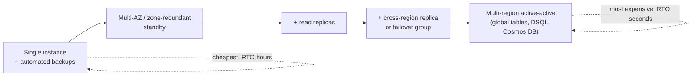
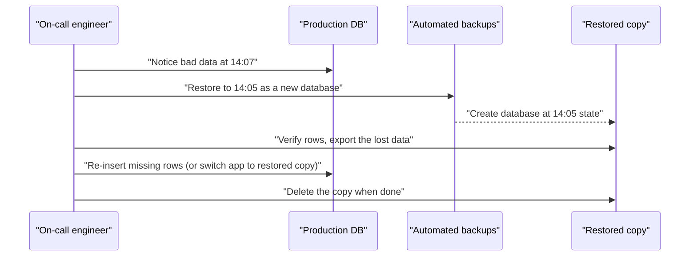

# Database High Availability and Backups

## Introduction

Databases fail in two very different ways:

1. **Something breaks.** A server dies, a disk fails, an Availability Zone loses power. You need the database *available* again within seconds or minutes. That is **high availability (HA)**.
2. **Something is wrong with the data.** A bad deploy deletes rows, someone runs `UPDATE` without a `WHERE`, ransomware encrypts tables. Replicas faithfully copy the mistake within milliseconds. You need to go *back in time*. That is **backup and restore**.

A common beginner mistake is thinking one solves the other. A synchronous standby does nothing against an accidental `DROP TABLE`, and a nightly backup does nothing to keep your app online during a hardware failure. You need both.

An analogy: HA is the spare tire in your trunk, which gets you moving again quickly. Backups are your insurance policy, which helps you recover from something much worse, but slowly.

This page explains:

- **RPO** and **RTO**, the two numbers that drive every design
- HA options on AWS (Multi-AZ, Aurora replicas, global databases) and Azure (zone redundancy, failover groups, flexible server HA)
- Backups: automated backups, point-in-time restore (PITR), snapshots, long-term retention
- How to **practice restores** so they work when you need them

:::warning Cost warning
HA standbys, replicas and extra regions roughly multiply compute and storage costs. Long backup retention adds backup storage charges, and cross-region copies add data transfer. Commands on this page that create replicas or restore databases create **new billable resources**. Delete restored test copies right after checking them.
:::

## RPO and RTO

| Term | Question it answers | Example target |
| --- | --- | --- |
| **RPO** (Recovery Point Objective) | How much data can we afford to lose? | "At most 5 minutes of orders" |
| **RTO** (Recovery Time Objective) | How long can we be down? | "Back online within 1 hour" |

Lower numbers cost more. A single-AZ database with daily snapshots is cheap but may lose a day of data. A synchronous multi-zone setup plus a cross-region replica can get RPO close to zero for hardware failures, at several times the cost. Agree on targets with the business *before* choosing technology. [Disaster Recovery Strategies](../13-cloud-architecture/2-cloud-disaster-recovery.mdx) covers the wider DR picture; this page focuses on the database layer.



## High Availability Within a Region

### On AWS

- **RDS Multi-AZ DB instance deployment.** RDS keeps a synchronous standby in another Availability Zone. The standby does **not** serve reads. On failure, RDS flips the DNS name to the standby, so apps reconnect to the same endpoint.
- **RDS Multi-AZ DB cluster deployment.** One writer and **two readable standbys** in three AZs. Standbys can serve read traffic, and failovers are typically faster than with the single-standby design. Supported for MySQL and PostgreSQL.
- **Aurora.** Storage is always replicated across three AZs. You add **Aurora Replicas** (up to 15) in other AZs; if the writer fails, Aurora promotes a replica. A cluster with only one instance still keeps its data safe, but it has to recreate compute on failure, which takes longer.

Turning on Multi-AZ for an existing RDS instance:

```bash
aws rds modify-db-instance \
  --db-instance-identifier helpdesk-dev \
  --multi-az \
  --apply-immediately
```

Example output (trimmed):

```text
{
    "DBInstance": {
        "DBInstanceIdentifier": "helpdesk-dev",
        "MultiAZ": false,
        "PendingModifiedValues": { "MultiAZ": true }
    }
}
```

`PendingModifiedValues` shows the change is in progress. Converting to Multi-AZ takes a snapshot and builds the standby, which can briefly raise I/O latency.

### On Azure

- **Azure SQL Database.** Every database already has built-in redundancy inside a datacenter. **Zone redundancy** (`--zone-redundant true`) spreads replicas across availability zones. The Business Critical and Hyperscale tiers can also expose **read-only replicas** using `ApplicationIntent=ReadOnly` in the connection string.
- **Azure Database for PostgreSQL / MySQL flexible server.** High availability adds a **warm standby** with synchronous replication, either in the same zone or in a different zone (zone-redundant). In recent CLI versions the PostgreSQL flag is `--zonal-resiliency Enabled` together with `--zone` and `--standby-zone`; older versions used `--high-availability ZoneRedundant`. Check `az postgres flexible-server update --help` for your CLI version.

Making an Azure SQL database zone redundant:

```bash
az sql db update \
  --resource-group rg-helpdesk-dev \
  --server sql-helpdesk-dev-4821 \
  --name helpdesk \
  --zone-redundant true
```

Example output (trimmed):

```text
{
  "name": "helpdesk",
  "status": "Online",
  "zoneRedundant": true
}
```

### Mapping table

| Capability | AWS | Azure |
| --- | --- | --- |
| Synchronous standby in another zone | RDS Multi-AZ (instance or cluster) | Azure SQL zone redundancy; flexible server zone-redundant HA |
| Readable copies in the same region | RDS read replicas, Multi-AZ cluster readers, Aurora Replicas | Azure SQL read scale-out, named replicas (Hyperscale); flexible server read replicas |
| Connection pooling to survive failovers | RDS Proxy | Built-in PgBouncer (PostgreSQL flexible server) |
| Stable endpoint after failover | Instance or cluster DNS endpoint | Server DNS name; failover group listener |

## Surviving a Regional Outage

Within-region HA does not help if a whole region has a problem. Cross-region options are **asynchronous**, so RPO is usually seconds, not zero.

| Option | AWS | Azure |
| --- | --- | --- |
| Cross-region read replica | RDS cross-region read replica (promote manually) | Flexible server cross-region read replica; Azure SQL active geo-replication |
| Managed group failover with stable endpoints | Aurora Global Database (switchover and failover) | Azure SQL **failover groups** |
| Multi-region NoSQL | DynamoDB global tables | Cosmos DB multi-region accounts |
| Restore in another region from backups | Cross-region automated backup replication, snapshot copy | Geo-restore from geo-redundant backups |

### Azure SQL failover groups

A failover group replicates a set of databases to a server in another region and gives you two DNS listeners that stay the same after failover:

- Read-write: `fog-name.database.windows.net`
- Read-only: `fog-name.secondary.database.windows.net`

```bash
az sql failover-group create \
  --name fog-helpdesk-4821 \
  --resource-group rg-helpdesk-dev \
  --server sql-helpdesk-dev-4821 \
  --partner-server sql-helpdesk-dr-4821 \
  --add-db helpdesk \
  --failover-policy Manual
```

Microsoft recommends the **customer-managed** policy (`Manual` in the CLI), so *you* decide when to fail over and can run drills. With the Microsoft-managed policy, failover only happens for wide regional outages after a grace period of at least one hour. A planned drill, which waits for full synchronization so no data is lost, is run against the secondary server:

```bash
az sql failover-group set-primary \
  --name fog-helpdesk-4821 \
  --resource-group rg-helpdesk-dev \
  --server sql-helpdesk-dr-4821
```

### Aurora Global Database

Aurora Global Database adds secondary clusters in other regions, replicated at the storage layer. A **switchover** (planned, no data loss) or **failover** (unplanned, may lose recent writes) promotes a secondary region. See [Using Amazon Aurora Global Database](https://docs.aws.amazon.com/AmazonRDS/latest/AuroraUserGuide/aurora-global-database.html).

## Backups and Point-in-Time Restore

Managed databases take backups automatically. The important questions are **how far back** you can go and **where** the backups live.

| Feature | AWS | Azure |
| --- | --- | --- |
| Automated backups + PITR | RDS and Aurora: retention 1 to 35 days (RDS can also be set to 0, which disables automated backups) | Azure SQL: 1 to 35 days, default 7 (Basic tier: up to 7); flexible server: 7 to 35 days |
| Restore granularity | To any second within the window, as a **new** instance or cluster | To any point within the window, as a **new** database or server |
| Manual / long-term | Manual snapshots (kept until deleted); AWS Backup plans | Azure SQL long-term retention (LTR) up to 10 years |
| Cross-region | Snapshot copy, automated backup replication, AWS Backup copy rules | Geo-redundant backup storage and geo-restore |
| NoSQL | DynamoDB PITR, recovery period 1 to 35 days; on-demand backups | Cosmos DB continuous backup (7, 30 or 35 day tiers) or periodic backups |
| Immutability | AWS Backup Vault Lock | Immutable LTR backups (Azure SQL) |

A key fact: **restores create a new database.** You then point the app at it, or copy back the rows you need. Plan for new endpoints, new firewall rules and new credentials in your runbooks.



### On AWS: restore RDS to a point in time

```bash
aws rds restore-db-instance-to-point-in-time \
  --source-db-instance-identifier helpdesk-dev \
  --target-db-instance-identifier helpdesk-dev-restore-1405 \
  --restore-time 2026-10-11T14:05:00Z \
  --db-instance-class db.t4g.micro \
  --no-publicly-accessible
```

Example output (trimmed):

```text
{
    "DBInstance": {
        "DBInstanceIdentifier": "helpdesk-dev-restore-1405",
        "DBInstanceStatus": "creating",
        "Engine": "postgres"
    }
}
```

Set backup retention explicitly when you create or modify instances (for example `--backup-retention-period 14`). For DynamoDB, restore with `aws dynamodb restore-table-to-point-in-time`, which also creates a new table.

### On Azure: restore Azure SQL to a point in time

```bash
az sql db restore \
  --resource-group rg-helpdesk-dev \
  --server sql-helpdesk-dev-4821 \
  --name helpdesk \
  --dest-name helpdesk-restore-1405 \
  --time "2026-10-11T14:05:00Z"
```

Add long-term retention for compliance, for example keep weekly backups 4 weeks, monthly 12 months and the first backup of each year 5 years:

```bash
az sql db ltr-policy set \
  --resource-group rg-helpdesk-dev \
  --server sql-helpdesk-dev-4821 \
  --database helpdesk \
  --weekly-retention P4W \
  --monthly-retention P12M \
  --yearly-retention P5Y \
  --week-of-year 1
```

Example output (trimmed):

```text
{
  "monthlyRetention": "P12M",
  "weekOfYear": 1,
  "weeklyRetention": "P4W",
  "yearlyRetention": "P5Y"
}
```

### Centralized backup services

**AWS Backup** and **Azure Backup** let you define backup plans across many services (databases, volumes, file systems) with schedules, retention, cross-region and cross-account copies, and immutability locks. They help when auditors ask "prove every production database is backed up for 35 days". The [Backup and Archive](../6-cloud-storage/7-cloud-backup-and-archive.mdx) page covers them in more depth.

## Testing Restores Automatically

A backup you have never restored is a hope, not a plan. This small script checks a restored copy against expectations. It uses SQLite so you can run it anywhere; in practice you would point the two connections at production and the restored database.

```python
import sqlite3


def table_counts(conn, tables):
    return {t: conn.execute(f"SELECT COUNT(*) FROM {t}").fetchone()[0] for t in tables}


def latest_timestamp(conn):
    return conn.execute("SELECT MAX(created_at) FROM tickets").fetchone()[0]


def make_db(rows):
    conn = sqlite3.connect(":memory:")
    conn.execute("CREATE TABLE tickets (id INTEGER PRIMARY KEY, created_at TEXT)")
    conn.executemany("INSERT INTO tickets (created_at) VALUES (?)", [(r,) for r in rows])
    return conn


prod = make_db(["2026-10-11T13:59", "2026-10-11T14:03", "2026-10-11T14:06"])
restored = make_db(["2026-10-11T13:59", "2026-10-11T14:03"])  # restored to 14:05

expected_point = "2026-10-11T14:05"
checks = {
    "restored has tables": table_counts(restored, ["tickets"])["tickets"] > 0,
    "no rows after restore point": latest_timestamp(restored) <= expected_point,
    "lost rows identified": table_counts(prod, ["tickets"])["tickets"]
                            - table_counts(restored, ["tickets"])["tickets"] == 1,
}
for name, ok in checks.items():
    print(f"{'PASS' if ok else 'FAIL'}  {name}")
```

Output:

```text
PASS  restored has tables
PASS  no rows after restore point
PASS  lost rows identified
```

Schedule a real version monthly: restore last night's state to a temporary instance, run checks like these, record the time it took (your *measured* RTO), then delete the copy.

## Real-World Scenario

You run the database for a **B2B invoicing SaaS**. Contracts promise customers that invoices are never lost (RPO under 5 minutes for a regional disaster, near zero for hardware failure) and that the service is back within one hour (RTO). Auditors also require 7 years of monthly backups.

### The solution

On **Azure**:

- Azure SQL Database, Business Critical or General Purpose with **zone redundancy** for in-region failures.
- A **failover group** to a server in the paired region with the customer-managed policy, and apps connecting through the read-write listener.
- PITR retention of **35 days**, plus **LTR** monthly backups for 7 years (`--monthly-retention P7Y`), stored immutably.

On **AWS**:

- Aurora PostgreSQL with a writer and one replica in different AZs.
- **Aurora Global Database** with a secondary region for regional DR.
- Backup retention of **35 days**, plus an **AWS Backup** plan with monthly backups kept 7 years, copied to a separate backup account and protected with Vault Lock.

On both: a quarterly **failover drill** and a monthly **restore test** with measured times.

### Why this approach

- Zone redundancy and in-region replicas handle the common failures with near-zero data loss and automatic recovery.
- Asynchronous cross-region replication meets a 5-minute RPO for rare regional events.
- Long-term, immutable backups satisfy auditors and protect against ransomware or a malicious admin.
- Drills turn RTO from a guess into a measured number.

### When to use it, and when not to

This level of protection fits revenue-critical systems with contractual obligations. For an internal tool or a dev database, **single-zone with 7-day PITR** is usually enough, and multi-region would waste money.

### Alternatives and trade-offs

| Approach | Pros | Cons | Best for |
| --- | --- | --- | --- |
| Single zone + automated backups | Cheapest, simple | Downtime during failures; RTO in hours | Dev, test, internal tools |
| Multi-AZ / zone redundant | Automatic failover, near-zero RPO in region | Higher cost; no protection from bad data or regional outage | Most production databases |
| Cross-region replica / failover group | Survives regional outages | Asynchronous (RPO seconds); doubled cost; failover runbooks | Critical customer-facing systems |
| Multi-region active-active (global tables, DSQL, Cosmos DB) | Lowest RTO, local latency worldwide | Conflict handling or higher write latency; most expensive | Global apps with strict uptime needs |
| Backups only, restore to new region | Low cost | RTO in hours; RPO depends on backup copy frequency | Non-critical systems with a budget limit |

## Common Mistakes

- **Treating replicas as backups.** Replicas copy deletes and corruption instantly. Always keep PITR and separate backups.
- **Never testing restores.** Teams discover missing permissions, wrong parameter groups or a 6-hour restore time during the real incident.
- **Keeping backups in the same account and region only.** One compromised admin or one regional event can take out both data and backups. Copy critical backups to another account or subscription and region.
- **Hard-coding instance endpoints.** Use cluster endpoints, failover group listeners or DNS names that follow failover.
- **No connection retry logic.** Failovers drop connections for seconds. Apps need retries with backoff.
- **Forgetting restored copies.** Restored databases are full-price resources. Delete them after the test.
- **Deleting a server and expecting backups to remain.** On Azure, deleting a logical server deletes its databases' short-term backups (LTR backups remain). On AWS, deleting an instance removes automated backups unless you retain them or take a final snapshot.

## Cleanup

### On AWS

```bash
aws rds delete-db-instance \
  --db-instance-identifier helpdesk-dev-restore-1405 \
  --skip-final-snapshot --delete-automated-backups
```

If you enabled Multi-AZ only for practice, turn it off with `aws rds modify-db-instance --db-instance-identifier helpdesk-dev --no-multi-az --apply-immediately`.

### On Azure

```bash
az sql db delete --resource-group rg-helpdesk-dev --server sql-helpdesk-dev-4821 \
  --name helpdesk-restore-1405 --yes
az sql failover-group delete --name fog-helpdesk-4821 \
  --resource-group rg-helpdesk-dev --server sql-helpdesk-dev-4821
```

Deleting the failover group does not delete the secondary databases; remove the DR server or resource group too if you created them only for practice.

## Summary

- **HA** keeps the database running through infrastructure failures; **backups** let you recover from bad data. You need both.
- Drive designs from **RPO** and **RTO** targets agreed with the business.
- In-region HA: RDS Multi-AZ, Aurora replicas, Azure SQL zone redundancy, flexible server HA.
- Cross-region: RDS and flexible server cross-region replicas, Aurora Global Database, Azure SQL failover groups, DynamoDB global tables, Cosmos DB multi-region.
- PITR windows go up to 35 days on most services; use snapshots, AWS Backup or Azure SQL LTR for longer retention.
- **Restores create new databases**; practice them regularly and measure the time.

## Exercises

1. Write down RPO and RTO targets for three systems you know (for example a blog, a payment service and an internal wiki) and pick an HA and backup design for each from the trade-off table.
2. Create a small RDS or Azure SQL database, insert rows, wait a few minutes, delete some rows, and restore to a point before the delete. Record how long the restore took.
3. Extend the restore-check script to compare per-table row counts and a checksum of one column across both databases.
4. Set up an Azure SQL failover group (or an RDS cross-region read replica) in a lab subscription, perform a planned failover, and note what your app's connection string needed (or did not need) to change.

### Related pages

- [Managed Relational Databases: RDS, Aurora and Azure SQL](./1-cloud-rds-and-azure-sql.mdx)
- [High Availability Design](../13-cloud-architecture/1-cloud-high-availability.mdx)
- [Disaster Recovery Strategies](../13-cloud-architecture/2-cloud-disaster-recovery.mdx)
- [Backup and Archive](../6-cloud-storage/7-cloud-backup-and-archive.mdx)
- [Regions, Availability Zones and Edge Locations](../0-cloud-fundamentals/4-cloud-regions-and-zones.mdx)
