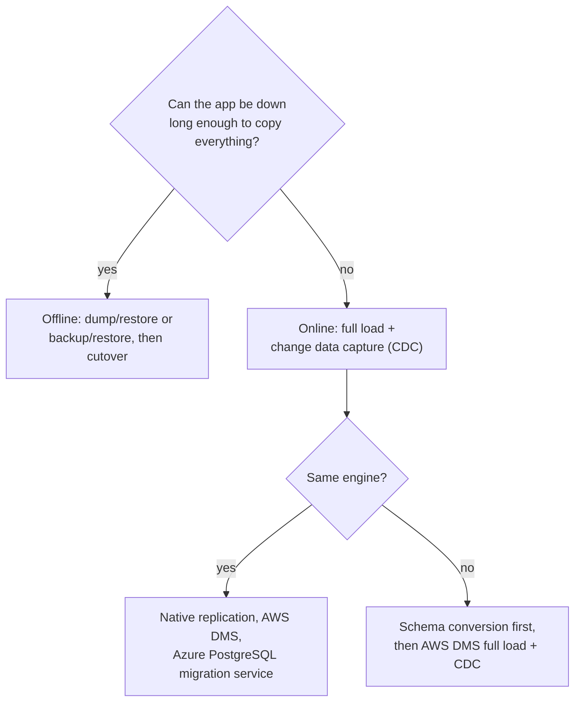
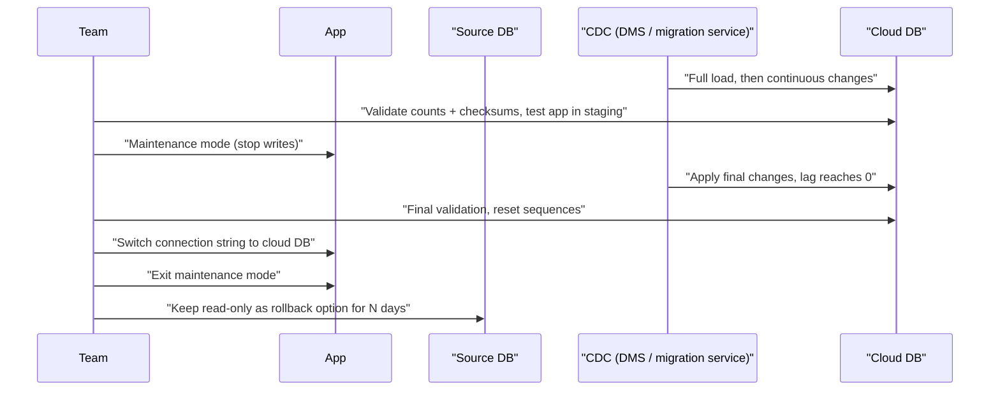

# Migrating Databases to the Cloud

## Introduction

Moving application code to the cloud is mostly a deployment problem. Moving the **database** is harder, because data has gravity. It is large, it changes every second, other systems depend on it, and mistakes are expensive. A good database migration is boring: data arrives intact, the app switches over during a short, planned window, and nobody notices.

Think of it like moving house while still living in it. You can pack everything, close the old house for a weekend and move in one go (an **offline migration**). Or you can move most things early, keep both houses in sync for a while, and switch your address on one evening (an **online migration** with change data capture). The second is less disruptive but needs more coordination.

On this page you will learn:

- How to **assess** a database before moving it
- **Homogeneous** vs **heterogeneous** and **offline** vs **online** migrations
- The tools on each cloud: native dump and restore, **AWS DMS**, **Azure Database Migration Service**, and the **migration service in Azure Database for PostgreSQL**
- How to **validate** data and run a safe **cutover**

The broader application-level strategies (rehost, replatform, refactor and so on) are covered in [Migration Strategies: The 7 Rs](../13-cloud-architecture/6-cloud-migration-strategies.mdx). This page zooms in on the data.

:::warning Cost warning
Migration resources bill while they run: AWS DMS replication instances or DMS Serverless capacity, target databases, and data transfer out of your current environment. Online migrations can run for days or weeks. Stop and delete replication resources as soon as cutover is complete, and see the **Cleanup** section.
:::

## Step 1: Assess Before You Move

Collect these facts for every database:

| Question | Why it matters |
| --- | --- |
| Engine and version | Decides whether the move is homogeneous and which target versions are supported |
| Size and growth rate | Drives transfer time, tool choice and target storage |
| Change rate (writes per second, log volume) | Decides whether CDC can keep up |
| Downtime the business accepts | Offline vs online migration |
| Engine-specific features | Stored procedures, triggers, extensions, SQL Agent jobs, linked servers |
| Who connects | Apps, reports, ETL jobs, cron scripts that all need new connection strings |
| Security and compliance | Encryption, data residency, network path |

Then choose the **target**:

- Same engine, managed (PostgreSQL to RDS or flexible server, SQL Server to Azure SQL). This is the most common and lowest-risk path.
- Different engine (Oracle or SQL Server to PostgreSQL). This needs schema and code conversion, so plan more time.
- Different model (relational to DynamoDB or Cosmos DB). This is really an application redesign, not a migration.

:::tip Move first, modernize second
If the deadline is tight, migrate to the **same engine** first (for example SQL Server to Azure SQL Managed Instance or RDS for SQL Server). Once you are stable in the cloud, consider changing engines as a separate project. Doing both at once doubles the risk.
:::

## Step 2: Pick a Migration Type



| Type | How it works | Downtime | Complexity |
| --- | --- | --- | --- |
| Offline (dump and restore) | Stop writes, export, import, switch | Hours, depending on size | Low |
| Offline (backup and restore) | Restore native backups in the cloud (for example `.bak` files to SQL Managed Instance or RDS for SQL Server) | Hours | Low |
| Online (full load + CDC) | Copy existing data while the source is live, then stream ongoing changes until cutover | Minutes | Medium to high |
| Native replication | Use the engine's own replication (PostgreSQL logical replication, MySQL binlog replication) to the cloud target | Minutes | Medium |

**Change data capture (CDC)** reads the source's transaction log (PostgreSQL WAL, MySQL binlog, SQL Server transaction log, Oracle redo) and replays each change on the target. It lets the source keep serving traffic while the copy catches up.

## The Tools

### On AWS

- **Native tools.** `pg_dump` / `pg_restore`, `mysqldump`, and native SQL Server backup and restore to RDS (from S3). Simple and reliable for smaller databases or generous downtime windows.
- **AWS Database Migration Service (DMS).** Copies data between many sources and targets. Task types are `full-load`, `cdc` and `full-load-and-cdc`. You can run it on a **replication instance** you size yourself, or use **DMS Serverless**, which scales capacity automatically.
- **DMS Schema Conversion** (in the console) and the downloadable **AWS Schema Conversion Tool (SCT)** convert schemas and code (procedures, functions) for heterogeneous moves, such as Oracle to Aurora PostgreSQL, and report what they cannot convert.
- **DMS Fleet Advisor** inventories on-premises databases to help plan large programs.
- **Homogeneous data migrations** in DMS use native tools under the hood for same-engine moves to RDS and Aurora.

### On Azure

- **Native tools.** The same dump and restore tools, plus `.bak` restore to Azure SQL Managed Instance, and BACPAC import for Azure SQL Database.
- **Azure Database Migration Service (DMS).** Focused on **SQL Server** moves to Azure SQL Database (offline), Azure SQL Managed Instance and SQL Server on Azure VMs (online and offline). Driven from the Azure portal, PowerShell or the Azure CLI (`az datamigration`).
- **Migration service in Azure Database for PostgreSQL.** A built-in, managed service for moving PostgreSQL from on-premises, Azure VMs, Amazon RDS for PostgreSQL, Amazon Aurora PostgreSQL or Google Cloud SQL into flexible server, with **offline** and **online** modes. It uses the open-source `pgcopydb` tool under the hood. See the [migration service overview](https://learn.microsoft.com/en-us/azure/postgresql/migrate/migration-service/overview-migration-service-postgresql).
- **Azure Arc** assessments help with SQL Server inventory and target sizing.

:::info Tooling moves quickly
Microsoft has moved SQL Server migration experiences between tools several times (Data Migration Assistant, the Azure Data Studio extension, the Azure portal and Azure Arc). Check the [Azure Database Migration Service documentation](https://learn.microsoft.com/en-us/azure/dms/dms-overview) for the current recommended path before you start.
:::

### Mapping table

| Task | AWS | Azure |
| --- | --- | --- |
| Inventory and assessment | DMS Fleet Advisor | Azure Migrate, Azure Arc assessments |
| Schema conversion (different engines) | DMS Schema Conversion, AWS SCT | Manual tools and partner tools; SQL Server Migration Assistant for Oracle, Db2 and others to SQL |
| SQL Server to managed | Native backup/restore to RDS, AWS DMS | Azure DMS, `.bak` restore to Managed Instance |
| PostgreSQL to managed | Native tools, DMS homogeneous migrations, logical replication | Migration service in Azure Database for PostgreSQL |
| Continuous replication (CDC) | AWS DMS `full-load-and-cdc` tasks | Azure DMS online (SQL), PostgreSQL migration service online mode |
| Bulk offline transfer of huge files | AWS DataSync, AWS Snowball | AzCopy, Azure Data Box |

## A Small Offline Migration with Native Tools

For a PostgreSQL database of a few gigabytes with a maintenance window, native tools are the simplest option. The same commands work for RDS and for flexible server; only the target host and login change.

```bash
# 1. Stop writes on the source (put the app in maintenance mode), then dump
pg_dump --host=onprem-db.internal --username=app --format=custom \
        --no-owner --file=helpdesk.dump helpdesk

# 2. Create the database on the cloud target and restore with 4 parallel jobs
createdb --host="$TARGET_HOST" --username="$TARGET_USER" helpdesk
pg_restore --host="$TARGET_HOST" --username="$TARGET_USER" --dbname=helpdesk \
           --no-owner --jobs=4 helpdesk.dump

# 3. Refresh planner statistics on the target
psql --host="$TARGET_HOST" --username="$TARGET_USER" --dbname=helpdesk -c "ANALYZE;"
```

Example output of step 3:

```text
ANALYZE
```

For the target password, use a short-lived token (an RDS IAM token or a Microsoft Entra ID access token, as shown in [Managed Relational Databases](./1-cloud-rds-and-azure-sql.mdx)) exported as `PGPASSWORD`, not a long-lived password typed into scripts.

## An Online Migration with AWS DMS

For a larger or busier database, the outline with DMS looks like this. Endpoints describe the source and target; a replication task runs the copy.

```bash
# Source endpoint: on-premises PostgreSQL (credentials kept in Secrets Manager)
aws dms create-endpoint \
  --endpoint-identifier helpdesk-src \
  --endpoint-type source \
  --engine-name postgres \
  --postgre-sql-settings '{"SecretsManagerSecretId":"arn:aws:secretsmanager:us-east-1:123456789012:secret:helpdesk-src","SecretsManagerAccessRoleArn":"arn:aws:iam::123456789012:role/dms-secrets-access","DatabaseName":"helpdesk"}'

# Target endpoint: Aurora PostgreSQL
aws dms create-endpoint \
  --endpoint-identifier helpdesk-tgt \
  --endpoint-type target \
  --engine-name aurora-postgresql \
  --postgre-sql-settings '{"SecretsManagerSecretId":"arn:aws:secretsmanager:us-east-1:123456789012:secret:helpdesk-tgt","SecretsManagerAccessRoleArn":"arn:aws:iam::123456789012:role/dms-secrets-access","DatabaseName":"helpdesk"}'
```

Example output (trimmed):

```text
{
    "Endpoint": {
        "EndpointIdentifier": "helpdesk-src",
        "EndpointType": "SOURCE",
        "EngineName": "postgres",
        "Status": "active"
    }
}
```

Then create a replication task (or a DMS Serverless replication config) with migration type `full-load-and-cdc` and table mappings that select the schemas to copy. A minimal table-mapping file:

```json
{
  "rules": [
    {
      "rule-type": "selection",
      "rule-id": "1",
      "rule-name": "include-public",
      "object-locator": { "schema-name": "public", "table-name": "%" },
      "rule-action": "include"
    }
  ]
}
```

The exact flags for replication instances, serverless configs and task settings are long and change between releases, so follow the [AWS DMS getting started guide](https://docs.aws.amazon.com/dms/latest/userguide/CHAP_GettingStarted.html) for the current steps. Remember the source prerequisites: for PostgreSQL CDC you need logical replication enabled (`wal_level = logical`) and primary keys on replicated tables.

## Validating the Data

Never declare success because the tool said "100% loaded". Compare source and target yourself. This script compares row counts and an order-independent checksum per table. It uses SQLite so it runs anywhere; swap in `psycopg` or `pyodbc` connections for real databases.

```python
import hashlib
import sqlite3


def table_fingerprint(conn, table, key):
    rows = conn.execute(f"SELECT * FROM {table} ORDER BY {key}").fetchall()
    digest = hashlib.sha256()
    for row in rows:
        digest.update(repr(row).encode())
    return len(rows), digest.hexdigest()[:12]


def build(rows):
    conn = sqlite3.connect(":memory:")
    conn.execute("CREATE TABLE tickets (id INTEGER PRIMARY KEY, title TEXT, status TEXT)")
    conn.executemany("INSERT INTO tickets VALUES (?, ?, ?)", rows)
    return conn


source = build([(1, "Login fails", "open"), (2, "Invoice missing", "closed"), (3, "Slow page", "open")])
target = build([(1, "Login fails", "open"), (2, "Invoice missing", "open"), (3, "Slow page", "open")])

for table, key in [("tickets", "id")]:
    src = table_fingerprint(source, table, key)
    tgt = table_fingerprint(target, table, key)
    status = "OK" if src == tgt else "MISMATCH"
    print(f"{table}: source={src} target={tgt} -> {status}")
```

Output:

```text
tickets: source=(3, 'b424c6c52e5a') target=(3, '22284a6ef9dc') -> MISMATCH
```

The row counts match, but the checksum catches that ticket 2's status differs. AWS DMS also has a built-in **data validation** option for tasks, and for very large tables you would compare checksums per key range instead of whole tables.

## Step 3: Cutover



A cutover checklist:

1. Rehearse the whole cutover in a staging environment first, and time it.
2. Lower DNS TTLs in advance if apps connect via DNS names you control.
3. Stop writes, wait for replication lag to reach zero, and run the validation script.
4. Fix things CDC tools often skip: **sequences and identity values**, users and grants, scheduled jobs, and some secondary objects.
5. Switch connection strings (ideally from a secrets store, see [Secrets Management](../11-cloud-devops/4-cloud-secrets-management.mdx)).
6. Keep the source **read-only** for a rollback period, and decide in advance what triggers a rollback.

## Real-World Scenario

A logistics company runs a 600 GB **PostgreSQL 13** database in its data center for its shipment-tracking app. The business allows at most **15 minutes** of downtime. The team is choosing between AWS and Azure and wants a plan that works on either.

### The solution

- **Target:** Aurora PostgreSQL (AWS) or Azure Database for PostgreSQL flexible server (Azure), on a current major version. Upgrading from 13 during the move is acceptable because both tools copy logically, but the team tests the app on the new version first.
- **Method:** online migration. On AWS, an **AWS DMS** `full-load-and-cdc` task. On Azure, the **migration service in Azure Database for PostgreSQL** in online mode.
- **Network:** a site-to-site VPN or private connection (see [Hybrid Connectivity](../8-cloud-networking/8-cloud-hybrid-connectivity.mdx)) so data never crosses the public internet.
- **Validation:** nightly row-count and checksum comparisons while CDC runs for a week.
- **Cutover:** a rehearsed Saturday-night window: maintenance mode, wait for zero lag, final validation, reset sequences, switch secrets, reopen.

### Why this approach

- 600 GB takes too long to dump and restore inside a 15-minute window, so CDC is required.
- Same engine family keeps application changes to a minimum.
- A week of parallel running surfaces surprises (missing primary keys, unsupported extensions) before cutover day.

### When to use it, and when not to

Online migration is worth its complexity when downtime is expensive and the database is large. For small databases, internal systems, or when a weekend outage is acceptable, a rehearsed **offline dump and restore** is simpler and has fewer failure modes.

### Alternatives and trade-offs

| Approach | Pros | Cons | Best for |
| --- | --- | --- | --- |
| Offline dump/restore | Simple, uses well-known tools, exact copy | Downtime grows with size | Small or non-critical databases |
| Native backup/restore (SQL Server `.bak`) | Fast, keeps engine objects intact | Same-engine only; downtime | SQL Server to Managed Instance or RDS |
| AWS DMS full load + CDC | Minimal downtime, many source and target engines | Setup effort; some objects not migrated; cost while running | Large or busy databases moving to AWS |
| Azure PostgreSQL migration service | Managed, built into flexible server, online option | PostgreSQL to flexible server only | PostgreSQL moving to Azure |
| Native logical replication | No extra service, fine-grained control | Manual setup and monitoring | Teams with strong PostgreSQL or MySQL skills |

## Common Mistakes

- **Skipping the assessment.** Unsupported extensions, missing primary keys or huge LOB columns appear mid-migration and blow up the timeline.
- **No rehearsal.** The first cutover should never be the production one.
- **Forgetting sequences, users and jobs.** Data arrives, but inserts fail with duplicate keys, or nightly jobs silently stop.
- **Migrating over the public internet without encryption.** Use TLS and private connectivity.
- **Leaving replication running.** DMS instances and CDC slots on the source keep costing money, and an abandoned PostgreSQL replication slot can fill the source's disk with WAL.
- **No rollback plan.** Decide in advance how long the old database stays available and who decides to roll back.

## Cleanup

### On AWS

```bash
aws dms delete-replication-task --replication-task-arn "$TASK_ARN"
aws dms delete-endpoint --endpoint-arn "$SOURCE_ENDPOINT_ARN"
aws dms delete-endpoint --endpoint-arn "$TARGET_ENDPOINT_ARN"
aws dms delete-replication-instance --replication-instance-arn "$REPL_INSTANCE_ARN"
```

Example output (trimmed):

```text
{
    "ReplicationInstance": {
        "ReplicationInstanceIdentifier": "helpdesk-dms",
        "ReplicationInstanceStatus": "deleting"
    }
}
```

### On Azure

Delete the migration resources (and any test target servers) by deleting their resource group, for example:

```bash
az group delete --name rg-helpdesk-migration --yes --no-wait
```

### On the source

Drop replication slots or publications created for CDC, for example in PostgreSQL:

```sql
SELECT slot_name, active FROM pg_replication_slots;
SELECT pg_drop_replication_slot('dms_slot_name');
```

## Summary

- **Assess** engine, size, change rate, features and downtime tolerance before choosing a method.
- **Offline** migrations (dump/restore, backup/restore) are simple; **online** migrations (full load + CDC) minimize downtime.
- AWS offers native tools, **AWS DMS** (with DMS Serverless and Schema Conversion) and **SCT**; Azure offers native tools, **Azure DMS** for SQL Server and the **migration service in Azure Database for PostgreSQL**.
- Always **validate** with counts and checksums, **rehearse** the cutover, and fix sequences, users and jobs.
- Clean up replication resources and slots promptly.

## Exercises

1. Fill in the assessment table for a database you know, and decide between offline and online migration.
2. Run `pg_dump` and `pg_restore` between two local PostgreSQL containers, time it, and estimate how long a 100 GB database would take.
3. Extend the validation script to compare checksums in chunks of 1,000 primary-key values, and print only the mismatching ranges.
4. Write a one-page cutover runbook for the logistics scenario, including rollback triggers and who approves each step.

### Related pages

- [Migration Strategies: The 7 Rs](../13-cloud-architecture/6-cloud-migration-strategies.mdx)
- [Managed Relational Databases: RDS, Aurora and Azure SQL](./1-cloud-rds-and-azure-sql.mdx)
- [Database High Availability and Backups](./4-cloud-database-ha-and-backups.mdx)
- [Hybrid Connectivity: VPN and Direct Connect/ExpressRoute](../8-cloud-networking/8-cloud-hybrid-connectivity.mdx)
- [PostgreSQL tutorial](/docs/database/postgresql)
