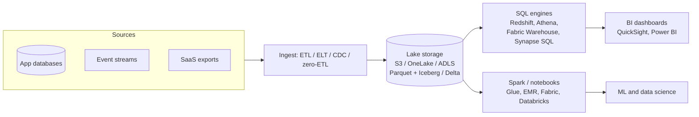

# Data Warehouses and Analytics Services

## Introduction

Your application database is built to answer small questions very quickly: "show order 1042", "add this comment". Business people ask different questions: "what was revenue per region per month for the last three years?" or "which customers churned after the price change?". Those queries scan millions or billions of rows. Running them on the production database slows down your customers, and row-oriented databases are not designed for them anyway.

That is what **data warehouses** and **analytics services** are for. They store data in a **columnar** format, spread work across many machines, and are optimized for scanning and aggregating huge tables.

An analogy: your operational database is the cash register at a shop, fast for each sale. The warehouse is the accountant's office in the back, which collects every receipt and produces the monthly reports. You would not ask the cashier to compile the annual report in the middle of the lunch rush.

This page covers:

- **OLTP vs OLAP**, and **warehouse vs data lake vs lakehouse**
- The services on **AWS** (Amazon Redshift, Athena, Glue, Lake Formation) and **Azure** (Microsoft Fabric, Azure Synapse Analytics, Azure Databricks)
- How each is **billed**, and how to keep costs under control
- A **local lakehouse demo** you can run on your laptop, and Python code for querying Athena
- A scenario with trade-offs

:::warning Cost warning
Analytics services can get expensive quickly because a single careless query can scan terabytes. Provisioned warehouses bill per hour while running; serverless options bill for compute used or data scanned. Set usage limits, pause capacity you are not using, and run the **Cleanup** section after experiments. Use the [AWS Pricing Calculator](https://calculator.aws/) and the [Azure Pricing Calculator](https://azure.microsoft.com/pricing/calculator/) for estimates.
:::

## Key Concepts

### OLTP vs OLAP

| Aspect | OLTP (operational) | OLAP (analytical) |
| --- | --- | --- |
| Typical query | Read or write a few rows by key | Scan and aggregate millions of rows |
| Users | Applications, many concurrent users | Analysts, dashboards, data scientists |
| Storage layout | Row-oriented | Column-oriented, compressed |
| Schema | Normalized | Denormalized star or snowflake schemas |
| Examples | RDS, Azure SQL, DynamoDB, Cosmos DB | Redshift, Fabric Warehouse, Synapse, Athena |

Columnar storage is the key trick. A query that needs `region` and `amount` reads only those two columns, which compress very well, instead of reading every full row. The [Data Warehousing section of the Database Fundamentals tutorial](/docs/fundamental/database) explains star schemas, fact tables and dimensions in depth.

### Warehouse, lake and lakehouse

- **Data warehouse:** structured tables loaded into a dedicated engine. Fast, governed SQL. Data must be loaded (ETL or ELT) first.
- **Data lake:** files (CSV, JSON, Parquet) in cheap object storage such as [Amazon S3](../6-cloud-storage/1-cloud-s3.mdx) or [Azure Data Lake Storage](../6-cloud-storage/2-cloud-azure-blob.mdx). Flexible and cheap, but raw files alone lack transactions and governance.
- **Lakehouse:** open table formats (**Apache Iceberg**, **Delta Lake**) on top of lake files add transactions, schema evolution and time travel, so warehouse-style SQL and Spark can share the same data.



## The Services

### On AWS

- **Amazon Redshift** is AWS's data warehouse. **Provisioned** clusters use RA3 nodes with managed storage that scales separately from compute. **Redshift Serverless** bills compute in **Redshift Processing Units (RPUs)** per second (with a 60-second minimum) only while queries run, plus managed storage per GB-month. Redshift can also query S3 data directly (Redshift Spectrum) and receive data from Aurora, RDS and DynamoDB through **zero-ETL integrations**.
- **Amazon Athena** runs serverless SQL directly over files in S3. For SQL queries you pay by the **amount of data scanned**, so Parquet, compression and partitioning directly cut cost. Athena also supports Apache Spark sessions and provisioned capacity.
- **AWS Glue** provides the **Data Catalog** (table definitions that Athena, Redshift and EMR share), crawlers that infer schemas, and serverless Spark ETL jobs.
- **AWS Lake Formation** adds fine-grained permissions (table, column and row level) over the lake.
- **Amazon QuickSight** is AWS's BI and dashboard service (AWS has been folding it into its newer Amazon Quick Suite branding, so check the current name in the console).
- **Amazon EMR** runs open-source big data frameworks (Spark, Hive, Trino) when you need full control.

### On Azure

- **Microsoft Fabric** is Microsoft's all-in-one SaaS analytics platform: Data Factory pipelines, Lakehouse, **Warehouse**, Spark data engineering, Real-Time Intelligence and Power BI, all storing data in **OneLake** in the open Delta Lake format. Compute is bought as **capacity** (F SKUs such as F2, F4, F64) billed per second while running; you can pause pay-as-you-go capacity or reserve it for a discount. **Mirroring** continuously replicates Azure SQL, Cosmos DB, PostgreSQL and other sources into OneLake.
- **Azure Synapse Analytics** combines dedicated SQL pools (provisioned data warehouse), a serverless SQL pool (pay per data processed, over files in the lake), Spark pools and pipelines. It remains supported, but Microsoft's new analytics investments are in Fabric and it publishes [migration guidance from Synapse dedicated SQL pools to Fabric Data Warehouse](https://learn.microsoft.com/en-us/fabric/data-warehouse/migration-synapse-dedicated-sql-pool-planning). For new projects, evaluate Fabric first.
- **Azure Databricks** is a first-party Azure service for the Databricks lakehouse platform (Spark, Delta Lake, SQL warehouses), popular with data engineering and ML teams.
- **Azure Data Explorer** (and Eventhouse in Fabric) is optimized for log, telemetry and time-series analytics with the KQL language.
- **Power BI** is the BI layer, built into Fabric.

### Mapping table

| Need | AWS | Azure |
| --- | --- | --- |
| Managed data warehouse | Amazon Redshift (provisioned or Serverless) | Fabric Warehouse; Synapse dedicated SQL pools |
| Serverless SQL over lake files | Amazon Athena | Fabric Lakehouse SQL analytics endpoint; Synapse serverless SQL pool |
| Data catalog and governance | AWS Glue Data Catalog, Lake Formation | OneLake catalog, Microsoft Purview |
| ETL / pipelines | AWS Glue, Amazon MWAA, Step Functions | Fabric Data Factory, Azure Data Factory |
| Spark | Glue, EMR, Athena for Spark | Fabric Spark, Synapse Spark, Azure Databricks |
| Replicate operational data without pipelines | Zero-ETL integrations to Redshift | Fabric Mirroring |
| Lake storage | Amazon S3 (Iceberg, S3 Tables) | OneLake, Azure Data Lake Storage Gen2 (Delta) |
| BI dashboards | Amazon QuickSight | Power BI |
| Log and time-series analytics | Amazon OpenSearch Service, Timestream | Azure Data Explorer, Fabric Real-Time Intelligence |

### The biggest difference in approach

AWS offers **separate building blocks** (S3, Glue, Athena, Redshift, QuickSight, Lake Formation) that you assemble and secure yourself. Microsoft Fabric offers **one SaaS platform** with a single storage layer, a shared security model and capacity-based billing. Fabric is faster to start and easier for a small team; the AWS approach gives finer control over each component and its cost. Both are converging on open table formats (Iceberg and Delta), which reduces lock-in at the storage layer.

## How Analytics Is Billed

| Model | Examples | You pay for | Cost lever |
| --- | --- | --- | --- |
| Data scanned | Athena SQL, Synapse serverless SQL pool | Bytes read per query | Columnar formats, compression, partitions, selecting fewer columns |
| Serverless compute | Redshift Serverless (RPU-seconds) | Compute while queries run, plus storage | Base and maximum capacity, usage limits |
| Provisioned compute | Redshift provisioned, Synapse dedicated pools | Nodes or DWUs per hour while running | Right-size, pause when idle, reservations |
| Capacity | Microsoft Fabric F SKUs | Capacity per second while active, plus OneLake storage | Pick the smallest SKU that works, pause, reserve |

Rates vary by region and change over time, so check the official pricing pages for [Redshift](https://aws.amazon.com/redshift/pricing/), [Athena](https://aws.amazon.com/athena/pricing/) and [Microsoft Fabric](https://azure.microsoft.com/pricing/details/microsoft-fabric/).

## Try the Lakehouse Idea Locally

You do not need a cloud account to understand why Parquet plus partitions is fast. This script uses [DuckDB](https://duckdb.org/) as a stand-in for Athena or a serverless SQL endpoint. It writes 300,000 fake orders to Parquet files partitioned by month, then queries one month directly from the files (`pip install duckdb`).

```python
import os

import duckdb

os.makedirs("lake", exist_ok=True)
con = duckdb.connect()

# 1. Fake "raw" order events, like an export from the operational database
con.execute("""
    CREATE TABLE orders AS
    SELECT
        i AS order_id,
        DATE '2026-01-01' + CAST(i % 270 AS INTEGER) AS order_date,
        ['EU', 'US', 'APAC'][1 + i % 3] AS region,
        ROUND(10 + (i * 37 % 500) / 3.0, 2) AS amount
    FROM range(1, 300001) t(i)
""")

# 2. Write it to the "lake" as Parquet, partitioned by month (like S3 or OneLake folders)
con.execute("""
    COPY (SELECT *, strftime(order_date, '%Y-%m') AS month FROM orders)
    TO 'lake/orders' (FORMAT parquet, PARTITION_BY (month), OVERWRITE_OR_IGNORE)
""")

# 3. Query the files directly, the way Athena or a serverless SQL pool does
result = con.execute("""
    SELECT region, COUNT(*) AS orders, ROUND(SUM(amount), 2) AS revenue
    FROM read_parquet('lake/orders/*/*.parquet', hive_partitioning = true)
    WHERE month = '2026-03'
    GROUP BY region
    ORDER BY revenue DESC
""").fetchall()

for region, orders, revenue in result:
    print(f"{region:5} {orders:6} orders  revenue {revenue:12,.2f}")
```

Output:

```text
APAC   12221 orders  revenue 1,137,559.18
US     11110 orders  revenue 1,034,838.26
EU     11110 orders  revenue 1,034,814.92
```

Look at the folder layout it created: `lake/orders/month=2026-01/`, `month=2026-02/` and so on. The filter `month = '2026-03'` lets the engine skip every other folder (**partition pruning**), and Parquet lets it read only the `region` and `amount` columns. On Athena, the same layout in S3 means you pay to scan a small fraction of the data.

## Querying the Lake on AWS with Athena

Athena needs a table definition in the Glue Data Catalog. You can create it with SQL in Athena itself:

```sql
CREATE EXTERNAL TABLE analytics.orders (
  order_id   bigint,
  order_date date,
  region     string,
  amount     double
)
PARTITIONED BY (month string)
STORED AS PARQUET
LOCATION 's3://my-company-lake/orders/';

MSCK REPAIR TABLE analytics.orders;
```

`MSCK REPAIR TABLE` discovers the `month=...` folders as partitions. (For data that keeps changing, consider Apache Iceberg tables, which Athena and Redshift support natively.)

Then run queries from Python with `boto3`. The workgroup controls where results go and can enforce a per-query data-scan limit:

```python
import time

import boto3

athena = boto3.client("athena", region_name="us-east-1")

run = athena.start_query_execution(
    QueryString="""
        SELECT region, SUM(amount) AS revenue
        FROM orders WHERE month = '2026-03'
        GROUP BY region ORDER BY revenue DESC
    """,
    QueryExecutionContext={"Database": "analytics"},
    WorkGroup="analytics-team",
)
qid = run["QueryExecutionId"]

while True:
    info = athena.get_query_execution(QueryExecutionId=qid)["QueryExecution"]
    state = info["Status"]["State"]
    if state in ("SUCCEEDED", "FAILED", "CANCELLED"):
        break
    time.sleep(1)

print("state:", state)
print("scanned MB:", round(info["Statistics"]["DataScannedInBytes"] / 1_000_000, 2))
rows = athena.get_query_results(QueryExecutionId=qid)["ResultSet"]["Rows"]
for row in rows[1:]:  # first row is the header
    print([col.get("VarCharValue") for col in row["Data"]])
```

Example output:

```text
state: SUCCEEDED
scanned MB: 0.41
['APAC', '1137559.18']
['US', '1034838.26']
['EU', '1034814.92']
```

Create the workgroup with a scan limit so one bad query cannot scan your whole lake:

```bash
aws athena create-work-group \
  --name analytics-team \
  --configuration '{
    "ResultConfiguration": {"OutputLocation": "s3://my-company-athena-results/"},
    "EnforceWorkGroupConfiguration": true,
    "BytesScannedCutoffPerQuery": 10000000000
  }'
```

`BytesScannedCutoffPerQuery` cancels any query that would scan more than the limit (here about 10 GB).

## Warehouses with Cost Guardrails

### On AWS: Redshift Serverless

```bash
aws redshift-serverless create-namespace \
  --namespace-name analytics \
  --admin-username admin \
  --manage-admin-password \
  --db-name analytics

aws redshift-serverless create-workgroup \
  --workgroup-name analytics-wg \
  --namespace-name analytics \
  --base-capacity 8 \
  --no-publicly-accessible
```

Example output of `create-workgroup` (trimmed):

```text
{
    "workgroup": {
        "workgroupName": "analytics-wg",
        "namespaceName": "analytics",
        "baseCapacity": 8,
        "status": "CREATING"
    }
}
```

The base capacity sets the starting RPUs; lower values cost less per second but run large queries more slowly. Add a **usage limit** on RPU-hours (`aws redshift-serverless create-usage-limit`) with an action such as logging, alerting or turning off user queries when the limit is hit. Also end idle transactions and avoid chatty connection-pool health checks: AWS notes that every query, including `SELECT 1` keep-alives, is billable activity.

### On Azure: Microsoft Fabric capacity

A Fabric capacity is an Azure resource. The `az fabric` commands come from the `microsoft-fabric` CLI extension, which installs automatically on first use:

```bash
az group create --name rg-analytics --location eastus

az fabric capacity create \
  --resource-group rg-analytics \
  --capacity-name fabricanalytics4821 \
  --sku "{name:F2,tier:Fabric}" \
  --administration "{members:[alice@contoso.com]}" \
  --location eastus

# Pause when nobody is using it (for example, nights and weekends)
az fabric capacity suspend --resource-group rg-analytics --capacity-name fabricanalytics4821
az fabric capacity resume  --resource-group rg-analytics --capacity-name fabricanalytics4821
```

Example output of `create` (trimmed):

```text
{
  "name": "fabricanalytics4821",
  "provisioningState": "Succeeded",
  "sku": { "name": "F2", "tier": "Fabric" },
  "state": "Active"
}
```

You then assign the capacity to a Fabric **workspace** in the Fabric portal and create a Lakehouse or Warehouse in it. While a capacity is suspended, its workspaces cannot run queries or refresh reports, so schedule pauses around business hours.

## Real-World Scenario

A 40-person e-commerce company runs its store on **Aurora PostgreSQL** (or **Azure SQL Database**). Finance wants daily revenue dashboards, marketing wants campaign attribution, and someone already brought the production database to a crawl by running a year-long report at noon.

### The solution

On **AWS**:

1. Set up a **zero-ETL integration** from Aurora PostgreSQL to **Redshift Serverless**, so new orders appear in the warehouse within seconds without pipelines.
2. Land clickstream events in **S3** as Parquet (partitioned by date) and catalog them in **Glue**. Query them with **Athena**, or from Redshift with Spectrum.
3. Build dashboards in QuickSight, and give marketing read access through Lake Formation permissions.
4. Guardrails: Athena workgroup scan limits, Redshift Serverless usage limits, and a budget alert ([Budgets and Billing Alerts](../1-cloud-getting-started/7-cloud-budgets-and-alerts.mdx)).

On **Azure**:

1. Create an **F-SKU Fabric capacity** and a workspace.
2. Use **Fabric Mirroring** to replicate the Azure SQL Database into OneLake continuously.
3. Land clickstream files in a **Lakehouse** and model a star schema in a **Warehouse**.
4. Build **Power BI** reports directly on the data, and pause the capacity outside business hours if reporting is not needed then.

### Why this approach

- Analytics moves off the production database, so customers are never slowed by reports.
- Zero-ETL and Mirroring remove most of the pipeline code a small team would otherwise maintain.
- Serverless or pausable capacity matches a small company's daytime-only reporting pattern.

### When to use it, and when not to

A separate analytics platform is worth it when reports are slowing production, data comes from several sources, or many people need self-service dashboards. If you have one small database and a handful of reports, a **read replica** plus a BI tool is cheaper and simpler. Very large organizations with complex governance may prefer a dedicated lakehouse platform such as Databricks across clouds.

### Alternatives and trade-offs

| Approach | Pros | Cons | Best for |
| --- | --- | --- | --- |
| Read replica + BI tool | Cheapest, no new skills | Row-store limits; still the same engine | Small data, few reports |
| Athena / serverless SQL over the lake | No infrastructure, pay per scan | Costly with unoptimized files; slower for complex joins | Ad hoc queries on S3 data |
| Redshift Serverless | Full warehouse, zero-ETL from AWS databases | Must manage RPU limits and data modeling | AWS-centric teams with growing analytics |
| Microsoft Fabric | One SaaS platform, Mirroring, built-in Power BI | Capacity sizing to learn; Microsoft-centric | Azure and Microsoft 365 organizations |
| Azure Synapse dedicated pools | Mature MPP warehouse | New investment is going to Fabric | Existing Synapse estates |
| Databricks (on either cloud) | Strong Spark, ML and open formats, multi-cloud | Another platform and bill to manage | Data engineering and ML-heavy teams |

## Common Mistakes

- **Querying CSV or JSON at scale.** Convert to Parquet with compression; scan-based billing punishes row formats.
- **No partitions, or too many tiny files.** Partition by common filters (date, region) and compact small files into larger ones.
- **`SELECT *` on wide tables.** Columnar engines charge for every column you read. Select only what you need.
- **Leaving provisioned capacity running.** Dedicated pools, provisioned clusters and Fabric capacities bill while active. Pause them or use serverless.
- **Running analytics on the primary database.** Use replicas, zero-ETL or Mirroring instead.
- **Ignoring governance.** Lakes quickly fill with copies of sensitive data. Use Lake Formation or Microsoft Purview, and classify personal data early.

## Cleanup

### On AWS

```bash
aws redshift-serverless delete-workgroup --workgroup-name analytics-wg
# Wait until the workgroup is gone, then:
aws redshift-serverless delete-namespace --namespace-name analytics
aws athena delete-work-group --work-group analytics-team --recursive-delete-option
```

Example output of `delete-workgroup` (trimmed):

```text
{
    "workgroup": {
        "workgroupName": "analytics-wg",
        "status": "DELETING"
    }
}
```

Also empty and delete any S3 buckets you created for the lake and query results.

### On Azure

```bash
az group delete --name rg-analytics --yes --no-wait
```

Deleting the capacity does not delete Fabric workspaces; remove test workspaces in the Fabric portal.

### Local demo

```bash
rm -rf lake
```

## Summary

- **OLTP** databases run the app; **OLAP** warehouses and lakehouses answer big analytical questions using columnar storage.
- **AWS** assembles analytics from building blocks: S3, Glue, Athena, Redshift (provisioned or Serverless), Lake Formation and QuickSight.
- **Azure** centers on **Microsoft Fabric** (OneLake, Lakehouse, Warehouse, Power BI, Mirroring); Synapse remains for existing estates, and Databricks is a strong option on both clouds.
- Billing is by data scanned, serverless compute, provisioned nodes or capacity. Parquet, partitions, usage limits and pausing are your main cost levers.
- Keep analytics off the production database with replicas, zero-ETL or Mirroring.

## Exercises

1. Run the DuckDB demo, then change the query to filter on `region` instead of `month`. Explain why partition pruning no longer helps and which partitioning scheme you would choose.
2. Upload the generated `lake/orders` folder to an S3 bucket, create the Athena table, run the revenue query and record the data scanned. Then query a CSV copy of the same data and compare.
3. Design a star schema (one fact table and three dimension tables) for the e-commerce scenario and write the `CREATE TABLE` statements.
4. Create the smallest Fabric capacity in a trial or lab subscription, mirror a small Azure SQL database into OneLake, build one Power BI report, then suspend and delete the capacity.

### Related pages

- [Choosing a Cloud Database](./0-cloud-database-options.mdx)
- [Streaming: Kinesis and Event Hubs](../9-cloud-messaging-and-integration/3-cloud-kinesis-and-event-hubs.mdx)
- [Storage Classes, Tiers and Lifecycle Policies](../6-cloud-storage/3-cloud-storage-classes.mdx)
- [Cost Optimization and FinOps](../13-cloud-architecture/4-cloud-cost-optimization.mdx)
- [Database Fundamentals: data warehousing concepts](/docs/fundamental/database)
