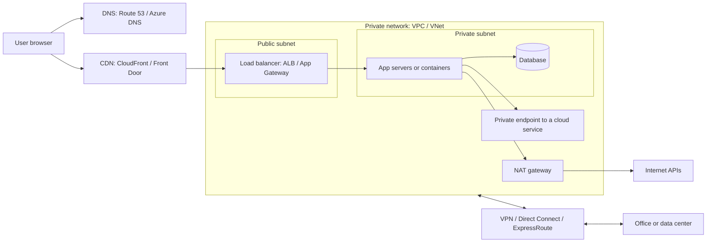
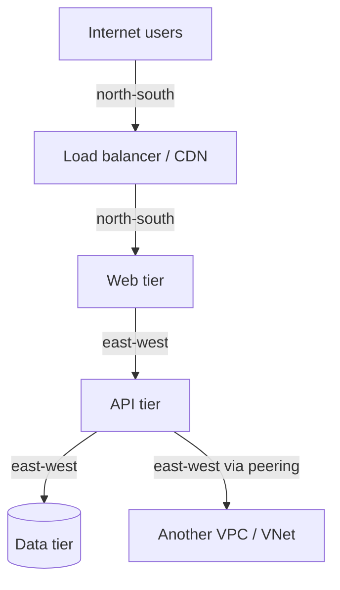

# Cloud Networking Introduction

## Introduction

When you start a virtual machine, a container or a database in the cloud, it has to live *somewhere* on a network. Someone has to decide which IP address it gets, who can reach it, how it reaches the internet, how users find it by name, and how it talks to your office or to other cloud networks.

In a traditional data center, a network team does this with physical switches, routers, firewalls and cables. In the cloud, all of those things are **software-defined**: you create them with an API call, a CLI command or a Terraform file, and they exist a few seconds later.

That is powerful, and it is also where many beginner mistakes happen:

- A database that was meant to be private ends up with a public IP address.
- Two networks that need to talk to each other were given the same IP range, and now they cannot be connected.
- A NAT gateway quietly adds a noticeable line to the monthly bill.
- A security rule allows `0.0.0.0/0` on port 22 "just for testing" and is never removed.

A helpful analogy is a **gated office park**:

| Office park | Cloud networking |
| --- | --- |
| The fenced property | Your private network (AWS **VPC**, Azure **VNet**) |
| Individual buildings | **Subnets** |
| Roads and signposts | **Route tables** |
| The main gate to the highway | **Internet gateway** |
| A mail room that sends letters out but never accepts visitors | **NAT gateway** |
| Security guards at each door | **Security groups** and **network security groups** |
| The receptionist who directs visitors to a free desk | **Load balancer** |
| The public directory listing | **DNS** |
| Branch shops in other cities that hold popular stock | **CDN** edge locations |
| Private tunnels to other office parks or to head office | **Peering**, **VPN**, **Direct Connect** and **ExpressRoute** |

This page gives you the big picture and the vocabulary. The rest of this section goes deep on each piece, always showing **both AWS and Azure**.

:::info Prerequisites
This section assumes you know what an IP address, a port and DNS are. If those are new, start with the [Computer Networks tutorial](/docs/fundamental/network) first. You should also have the [AWS CLI](../1-cloud-getting-started/2-cloud-aws-cli.mdx) and [Azure CLI](../1-cloud-getting-started/3-cloud-azure-cli.mdx) installed if you want to follow the commands.
:::

## The Big Picture

Here is how a request from a user typically travels to an application running in the cloud, and how that application reaches other things:



Reading the diagram from left to right:

1. **DNS** turns `shop.example.com` into an address.
2. A **CDN** serves cached files from a location near the user and forwards the rest.
3. A **load balancer** in a public subnet receives the request and picks a healthy server.
4. The **app servers** and the **database** sit in private subnets with no public IP addresses at all.
5. When the app needs to call an external API, it goes out through a **NAT gateway**.
6. When it needs a cloud service such as object storage or a secrets vault, it can use a **private endpoint** so the traffic never touches the public internet.
7. A **VPN** or a dedicated circuit connects the whole network to the company office.

Every box in this diagram has its own page in this section.

## The Building Blocks on AWS and Azure

The two clouds offer the same ideas under different names. This mapping table is worth bookmarking.

| Concept | AWS | Azure |
| --- | --- | --- |
| Private network | Virtual Private Cloud (VPC) | Virtual Network (VNet) |
| Network segment | Subnet (lives in one Availability Zone) | Subnet (spans all zones in the region) |
| Routing | Route table | System routes plus route table with user-defined routes (UDRs) |
| Internet access, inbound and outbound | Internet gateway + public IP | Public IP on a resource or load balancer |
| Outbound-only internet | NAT gateway (zonal or regional) | Azure NAT Gateway (Standard or StandardV2) |
| Instance-level firewall | Security group | Network security group (NSG) on a NIC |
| Subnet-level firewall | Network ACL (stateless) | NSG on a subnet (stateful) |
| Layer 7 load balancer | Application Load Balancer (ALB) | Application Gateway |
| Layer 4 load balancer | Network Load Balancer (NLB) | Azure Load Balancer |
| DNS hosting | Amazon Route 53 | Azure DNS, Azure Private DNS |
| DNS-based global routing | Route 53 routing policies | Azure Traffic Manager |
| CDN and global HTTP entry point | Amazon CloudFront | Azure Front Door |
| Private access to platform services | VPC endpoints (gateway and interface / AWS PrivateLink) | Private Endpoint (Azure Private Link), service endpoints |
| Network-to-network link | VPC peering | VNet peering |
| Hub for many networks | AWS Transit Gateway, AWS Cloud WAN | Azure Virtual WAN, hub VNet with Azure Firewall |
| Encrypted tunnel to on-premises | AWS Site-to-Site VPN | Azure VPN Gateway |
| Dedicated private circuit | AWS Direct Connect | Azure ExpressRoute |
| Traffic logs | VPC Flow Logs | Virtual network flow logs (Network Watcher) |

:::note Names change
Cloud providers rename, add and retire networking features regularly. For example, Azure NSG flow logs are being retired in favor of virtual network flow logs, and AWS added regional NAT gateways. The pages in this section call out recent changes, but always check the official [Amazon VPC documentation](https://docs.aws.amazon.com/vpc/) and [Azure networking documentation](https://learn.microsoft.com/azure/networking/) before you build something important.
:::

## Two Directions of Traffic

Network engineers talk about two directions of traffic. The terms help you reason about which tool to use.

- **North-south traffic** goes between your network and the outside world: users on the internet, partner APIs, your office. Load balancers, CDNs, internet gateways, NAT gateways, VPNs and dedicated circuits handle north-south traffic.
- **East-west traffic** stays inside your cloud estate: an app server calling a database, one microservice calling another, a VPC talking to another VPC. Subnets, route tables, security groups, peering and private endpoints handle east-west traffic.



Most security incidents involve north-south exposure, such as a database with a public endpoint. Most outages and surprises involve east-west plumbing, such as a missing route or a security group that blocks the database port.

## Who Manages What

Under the [shared responsibility model](../0-cloud-fundamentals/3-cloud-shared-responsibility.mdx), the provider and you split the networking work:

| The provider handles | You handle |
| --- | --- |
| Physical switches, cables and routers | Choosing address ranges and subnets |
| Redundancy of managed gateways and load balancers | Deciding which subnets are public or private |
| DDoS protection at the network layer (basic level) | Writing firewall rules (security groups, NSGs) |
| Keeping tenants isolated from each other | Routing between your own networks |
| Patching the software behind managed services | TLS certificates, DNS records, WAF rules |

In short, the provider guarantees the plumbing works. Whether the plumbing is connected safely is up to you. Most cloud network incidents come from configuration on the customer side, not from a failure in the provider's hardware.

## IP Addresses: The One Decision You Cannot Easily Undo

Every VPC and VNet gets one or more **address ranges** written in CIDR notation, such as `10.10.0.0/16`. The number after the slash says how many bits are fixed. The smaller that number, the bigger the range.

| CIDR | Addresses | Typical use |
| --- | --- | --- |
| `/16` | 65,536 | A whole VPC or VNet |
| `/20` | 4,096 | A large subnet, for example for containers |
| `/24` | 256 | A common subnet size |
| `/28` | 16 | The smallest subnet AWS allows |

You should almost always use **private address ranges** from RFC 1918: `10.0.0.0/8`, `172.16.0.0/12` and `192.168.0.0/16`.

The single most important rule: **do not let ranges overlap** with any network you might ever want to connect. Two networks with overlapping ranges cannot be peered or routed to each other without awkward NAT tricks. Changing a VPC's main range later usually means rebuilding everything inside it.

You can catch overlaps before you build anything, using nothing but the Python standard library:

```python
import ipaddress
from itertools import combinations

networks = {
    "office-lan": "10.0.0.0/16",
    "aws-prod-vpc": "10.10.0.0/16",
    "aws-dev-vpc": "10.11.0.0/16",
    "azure-prod-vnet": "10.20.0.0/16",
    "azure-dev-vnet": "10.10.128.0/17",   # oops
}

parsed = {name: ipaddress.ip_network(cidr) for name, cidr in networks.items()}

for (a, net_a), (b, net_b) in combinations(parsed.items(), 2):
    if net_a.overlaps(net_b):
        print(f"OVERLAP: {a} {net_a} and {b} {net_b}")

for name, net in parsed.items():
    print(f"{name:16} {str(net):16} {net.num_addresses:>6} addresses, private={net.is_private}")
```

Output:

```text
OVERLAP: aws-prod-vpc 10.10.0.0/16 and azure-dev-vnet 10.10.128.0/17
office-lan       10.0.0.0/16       65536 addresses, private=True
aws-prod-vpc     10.10.0.0/16      65536 addresses, private=True
aws-dev-vpc      10.11.0.0/16      65536 addresses, private=True
azure-prod-vnet  10.20.0.0/16      65536 addresses, private=True
azure-dev-vnet   10.10.128.0/17    32768 addresses, private=True
```

Someone picked a range for the Azure dev VNet that sits inside the AWS production VPC. If the company later wants a VPN between the two clouds, those two networks cannot be connected cleanly. Larger organizations avoid this with an IP address management tool, such as **Amazon VPC IP Address Manager (IPAM)** or **Azure Virtual Network Manager IP address pools**, or at least a shared spreadsheet that every team must update.

## Looking at Your Network from the CLI

Both clouds create some networking for you. A new AWS account has a **default VPC** in every Region, with a public subnet in each Availability Zone. Azure has no default VNet; when you create a VM in the portal, it offers to create one for you.

These read-only commands are free and safe to run.

### On AWS

```bash
# List VPCs in the current Region
aws ec2 describe-vpcs \
  --query "Vpcs[].{Id:VpcId,Cidr:CidrBlock,Default:IsDefault}" \
  --output table

# List the subnets of the default VPC
aws ec2 describe-subnets \
  --filters "Name=default-for-az,Values=true" \
  --query "Subnets[].{Id:SubnetId,AZ:AvailabilityZone,Cidr:CidrBlock}" \
  --output table
```

Example output (trimmed):

```text
-----------------------------------------------------
|                   DescribeVpcs                    |
+----------------+---------+------------------------+
|      Cidr      | Default |          Id            |
+----------------+---------+------------------------+
|  172.31.0.0/16 |  True   |  vpc-0a1b2c3d4e5f67890 |
+----------------+---------+------------------------+
---------------------------------------------------------------
|                       DescribeSubnets                       |
+-------------+-----------------+-----------------------------+
|     AZ      |      Cidr       |             Id              |
+-------------+-----------------+-----------------------------+
|  us-east-1a |  172.31.0.0/20  |  subnet-0123456789abcdef0   |
|  us-east-1b |  172.31.16.0/20 |  subnet-0fedcba9876543210   |
+-------------+-----------------+-----------------------------+
```

### On Azure

```bash
# List all virtual networks in the current subscription
az network vnet list \
  --query "[].{Name:name, RG:resourceGroup, Location:location, Space:addressSpace.addressPrefixes[0]}" \
  --output table

# List subnets of one VNet
az network vnet subnet list \
  --resource-group rg-demo --vnet-name vnet-demo \
  --query "[].{Name:name, Prefix:addressPrefix}" \
  --output table
```

Example output (trimmed):

```text
Name       RG       Location    Space
---------  -------  ----------  ------------
vnet-demo  rg-demo  westeurope  10.20.0.0/16

Name     Prefix
-------  ------------
web      10.20.1.0/24
app      10.20.2.0/24
```

:::tip
The AWS default VPC is convenient for experiments, but every subnet in it is public. For anything that will hold real data, create your own VPC with private subnets, as shown in [VPCs and VNets](./1-cloud-vpc-and-vnet.mdx).
:::

## How Networking Is Billed

Networking costs surprise many teams because they are spread across many small meters. Exact prices vary by region and change over time, so check the [AWS Pricing Calculator](https://calculator.aws/) or the [Azure Pricing Calculator](https://azure.microsoft.com/pricing/calculator/). What matters at this stage is knowing *what* is billed:

| What you pay for | Examples | Billed by |
| --- | --- | --- |
| Data leaving the cloud (egress) | Users downloading files, API responses | Per GB, tiered by volume |
| Data crossing zones or regions | App in zone A calling a database in zone B, cross-region replication | Per GB |
| Hourly managed gateways | NAT gateways, VPN gateways, interface endpoints, load balancers, firewalls | Per hour, plus per GB processed |
| Public IPv4 addresses | Elastic IPs, public IPs on VMs and load balancers | Per address per hour on both clouds |
| Load balancer capacity | ALB and NLB capacity units, Application Gateway capacity units | Per hour of capacity used |
| DNS | Hosted zones, queries, health checks | Per zone per month, per million queries |
| CDN | Data transferred from edge, requests | Per GB and per request, or a flat-rate plan |
| Dedicated circuits | Direct Connect ports, ExpressRoute circuits | Per port hour or per month, plus data |

Data coming **into** the cloud is generally free on both platforms; data going **out** is not.

:::warning Cost trap
A NAT gateway is billed every hour it exists *and* for every gigabyte it processes. A common surprise is a private subnet that pulls container images or large datasets from the internet, or from the cloud's own storage service, through a NAT gateway. Use VPC endpoints or private endpoints for cloud services, and delete NAT gateways in lab environments when you finish. See [Subnets, Route Tables and Gateways](./2-cloud-subnets-and-routing.mdx).
:::

## Real-World Scenario

Your team runs a small SaaS helpdesk product. Today it is one VM with a public IP address that runs the web app and a PostgreSQL database. Customers are growing, a large customer's security review flagged "database reachable from the internet", and the company has just bought another startup that runs on Azure.

### The plan

1. **Plan addresses first.** Reserve `10.10.0.0/16` for AWS production, `10.11.0.0/16` for AWS staging, and `10.20.0.0/16` for the acquired Azure workloads. Check that none overlaps the office network.
2. **Create a VPC with public and private subnets in two Availability Zones.** Only the load balancer goes in public subnets.
3. **Move the database to a managed service in a private subnet**, reachable only from the app's security group.
4. **Put an Application Load Balancer in front of two app instances**, with a health check.
5. **Point DNS at the load balancer** with a Route 53 alias record.
6. **Later, connect AWS and Azure** with a site-to-site VPN, which works only because the ranges don't overlap.

### Why this approach

- It fixes the security finding: nothing except the load balancer is reachable from the internet.
- It adds high availability: two zones, two app instances, a health-checked load balancer.
- Planning addresses first keeps the cross-cloud VPN possible later.

### When to use it and when not to

- Use this layered design for any application that holds customer data or must stay available.
- Do not over-build for a weekend prototype. A single PaaS service such as App Service or a serverless function, which handles much of the networking for you, may be enough. See [Choosing a Compute Option](../3-cloud-compute/0-cloud-compute-options.mdx).

### Alternatives and trade-offs

| Approach | Pros | Cons | Best for |
| --- | --- | --- | --- |
| Single VM with public IP | Simplest, cheapest | Exposed, single point of failure | Throwaway experiments |
| PaaS with built-in networking (App Service, Lambda, Container Apps) | Little network setup, managed TLS | Less control, private networking can be an add-on | Small teams, standard web apps |
| Custom VPC/VNet with public and private subnets | Full control, strong isolation | More to design and pay for (NAT, LB) | Production apps with data |
| Hub-and-spoke with central firewall | Central inspection and governance | Highest cost and complexity | Larger organizations, regulated workloads |

## Common Mistakes

- **Overlapping IP ranges.** Plan ranges for every environment and every cloud up front.
- **Making everything public.** Put only entry points (load balancers, bastion services) in public subnets.
- **Opening `0.0.0.0/0` to SSH or RDP.** Use AWS Systems Manager Session Manager or Azure Bastion instead.
- **Ignoring data transfer costs.** Cross-zone, cross-region and internet egress traffic all cost money.
- **Click-ops networking.** Networks built by hand in the console are hard to reproduce. Use infrastructure as code from the start. See [Infrastructure as Code in the Cloud](../10-cloud-infrastructure-as-code/0-cloud-iac-introduction.mdx).
- **Assuming AWS and Azure behave the same.** For example, AWS subnets live in one Availability Zone, while Azure subnets span all zones in a region. Each page in this section highlights differences like this one.

## Summary

- Cloud networks are software-defined: VPCs on AWS and VNets on Azure are private networks you create through an API.
- Subnets, route tables, gateways and firewalls control where traffic can go. Load balancers, DNS and CDNs control how users reach you.
- Private endpoints, peering, transit hubs, VPNs and dedicated circuits connect networks to each other and to on-premises sites.
- Plan non-overlapping private IP ranges before building anything.
- Networking is billed through many small meters: egress, gateways, public IPs, cross-zone traffic. Learn what is billed, then check current prices in the official calculators.

## Further Learning

### Exercises

1. Extend the overlap checker so it reads CIDR ranges from a CSV file and also warns when a range is *not* in RFC 1918 private space.
2. Run `aws ec2 describe-vpcs` or `az network vnet list` in your account. Write down every network you find, its range and whether you still need it.
3. Draw the request path for an app you use at work, using the big-picture diagram on this page as a template. Mark each hop as north-south or east-west.
4. Using the mapping table, write one sentence each explaining what an AWS network ACL does and why Azure has no separate equivalent.

### Next pages in this section

- [VPCs and VNets](./1-cloud-vpc-and-vnet.mdx)
- [Subnets, Route Tables and Gateways](./2-cloud-subnets-and-routing.mdx)
- [Security Groups and Network Security Groups](./3-cloud-security-groups-nsgs.mdx)
- [Load Balancers](./4-cloud-load-balancers.mdx)
- [DNS: Route 53 and Azure DNS](./5-cloud-dns.mdx)
- [CDNs: CloudFront and Azure Front Door](./6-cloud-cdn.mdx)
- [Private Endpoints, Peering and Transit](./7-cloud-private-connectivity.mdx)
- [Hybrid Connectivity: VPN and Direct Connect/ExpressRoute](./8-cloud-hybrid-connectivity.mdx)
