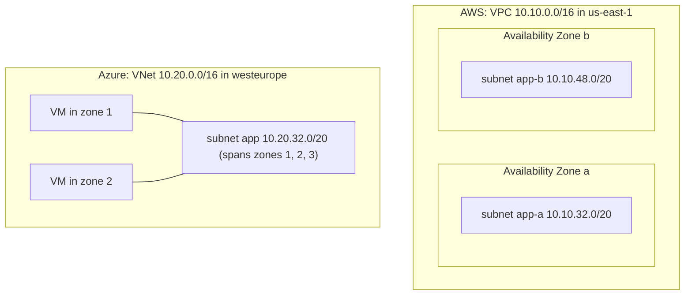

# VPCs and VNets

## Introduction

A **Virtual Private Cloud (VPC)** on AWS and a **Virtual Network (VNet)** on Azure are the same basic idea: a private, isolated network that you own inside the cloud provider's data centers. Everything with a private IP address, such as virtual machines, containers, managed databases, internal load balancers and private endpoints, lives inside one of them.

Think of it as buying a plot of land in a huge business park. The park (the cloud) provides roads, electricity and security at the gate. Your plot (the VPC or VNet) has a fence around it, an address range you choose, and nothing else until you build on it. You then divide the plot into buildings (subnets), put up signs (route tables) and hire guards (security groups).

In this page you will learn:

- What a VPC and a VNet are, and how their scope differs
- How to plan an address range so you never have to rebuild a network
- How to create both with the CLI, Terraform and Bicep
- How to grow a network later, and what you cannot change
- When to use one network, many networks or a shared network

:::tip Cost
A VPC or VNet by itself is free on both clouds, and so are subnets and route tables. Costs start when you add things such as NAT gateways, public IP addresses, VPN gateways, endpoints and the resources inside the network. The examples on this page create only free resources, but still clean up at the end.
:::

## Scope: Region, Zones and Subnets

Both a VPC and a VNet belong to **one region**. They cannot stretch across regions; to connect regions you use peering or a transit hub (see [Private Endpoints, Peering and Transit](./7-cloud-private-connectivity.mdx)).

The big difference is how **subnets** relate to **Availability Zones**:

- On **AWS**, every subnet lives in exactly **one Availability Zone**. To spread an application across three zones, you create at least three subnets per tier.
- On **Azure**, a subnet is **regional** and spans all zones. You choose the zone on the resource (VM, scale set, zone-redundant service), not on the subnet.



This difference shapes your design. AWS designs usually have **more, smaller subnets** (tier x zone). Azure designs usually have **fewer subnets, one per tier**, plus special subnets that some services require, such as `GatewaySubnet` for VPN gateways and `AzureBastionSubnet` for Azure Bastion.

| Property | AWS VPC | Azure VNet |
| --- | --- | --- |
| Scope | One Region | One region |
| Subnet scope | One Availability Zone | Whole region (all zones) |
| Primary IPv4 range size | `/16` to `/28` | Any size you can fit; `/16` is common |
| Extra ranges later | Secondary CIDR blocks | Additional address prefixes |
| Reserved IPs per subnet | 5 (first four and last) | 5 (first four and last) |
| Created for you | A default VPC in each Region | None |
| Contains | Subnets, route tables, gateways, endpoints | Subnets; route tables and NSGs are separate resources you associate |
| Lives in | An AWS account | A resource group in a subscription |

## Planning the Address Range

The [introduction](./0-cloud-networking-introduction.mdx) showed why overlapping ranges are dangerous. The next question is **how big** each network and subnet should be.

Some rules of thumb:

- Give each VPC or VNet a `/16` unless you have a reason not to. It costs nothing and leaves room to grow.
- Size subnets for the **largest** thing that might live there. Container platforms such as Amazon EKS and AKS with Azure CNI can use one IP address per pod, so they need large subnets.
- Leave unused space at the end of the range for subnets you have not thought of yet.
- Keep a written plan (or an IPAM tool) covering every environment and every cloud.

This short script carves a `/16` into equal `/20` subnets, one per tier per zone, and shows what is left over:

```python
import ipaddress

def plan_subnets(vnet_cidr: str, new_prefix: int, tiers: list[str], zones: list[str]):
    """Carve a VPC/VNet range into equal subnets: one per tier per zone."""
    network = ipaddress.ip_network(vnet_cidr)
    blocks = network.subnets(new_prefix=new_prefix)
    plan = []
    for tier in tiers:
        for zone in zones:
            block = next(blocks)
            usable = block.num_addresses - 5   # AWS and Azure both reserve 5 per subnet
            plan.append((tier, zone, str(block), usable))
    spare = list(blocks)
    return plan, spare

plan, spare = plan_subnets("10.10.0.0/16", 20, ["public", "app", "data"], ["zone-a", "zone-b"])
for tier, zone, cidr, usable in plan:
    print(f"{tier:7} {zone:7} {cidr:15} usable={usable}")
print(f"spare blocks left for later: {len(spare)} (first: {spare[0]})")
```

Output:

```text
public  zone-a  10.10.0.0/20    usable=4091
public  zone-b  10.10.16.0/20   usable=4091
app     zone-a  10.10.32.0/20   usable=4091
app     zone-b  10.10.48.0/20   usable=4091
data    zone-a  10.10.64.0/20   usable=4091
data    zone-b  10.10.80.0/20   usable=4091
spare blocks left for later: 10 (first: 10.10.96.0/20)
```

For Azure you would call it with a single zone name such as `["regional"]`, because Azure subnets are not tied to zones.

:::note Why 5 reserved addresses?
On AWS, the first four addresses and the last one in each subnet are reserved for the network address, the VPC router, the Amazon DNS server and future use. Azure also reserves the first four and the last address in each subnet for the network address, the default gateway, Azure DNS mapping and broadcast. A `/24` therefore gives you 251 usable addresses on either cloud.
:::

## Creating a Network from the CLI

The commands below create a network with two subnets. They are free, but run them in a sandbox account or subscription.

### On AWS

```bash
export AWS_REGION=us-east-1

# 1. Create the VPC with a Name tag
VPC_ID=$(aws ec2 create-vpc \
  --cidr-block 10.10.0.0/16 \
  --tag-specifications 'ResourceType=vpc,Tags=[{Key=Name,Value=demo-vpc},{Key=env,Value=lab}]' \
  --query Vpc.VpcId --output text)
echo "VPC: $VPC_ID"

# 2. Turn on DNS hostnames (needed for private DNS on endpoints)
aws ec2 modify-vpc-attribute --vpc-id "$VPC_ID" --enable-dns-hostnames '{"Value":true}'

# 3. One subnet per Availability Zone
aws ec2 create-subnet --vpc-id "$VPC_ID" \
  --cidr-block 10.10.32.0/20 --availability-zone us-east-1a \
  --tag-specifications 'ResourceType=subnet,Tags=[{Key=Name,Value=app-a}]' \
  --query Subnet.SubnetId --output text

aws ec2 create-subnet --vpc-id "$VPC_ID" \
  --cidr-block 10.10.48.0/20 --availability-zone us-east-1b \
  --tag-specifications 'ResourceType=subnet,Tags=[{Key=Name,Value=app-b}]' \
  --query Subnet.SubnetId --output text
```

Example output:

```text
VPC: vpc-0c1d2e3f4a5b6c7d8
subnet-0aa11bb22cc33dd44
subnet-0ee55ff66aa77bb88
```

The AWS console also has a **VPC and more** wizard that creates the VPC, public and private subnets in several zones, route tables, an internet gateway and optional NAT gateways in one step. It is a good way to see a complete design, but remember that NAT gateways cost money every hour.

### On Azure

```bash
az group create --name rg-net-lab --location westeurope

# 1. Create the VNet with a first subnet
az network vnet create \
  --resource-group rg-net-lab \
  --name vnet-lab \
  --address-prefixes 10.20.0.0/16 \
  --subnet-name app \
  --subnet-prefixes 10.20.32.0/20 \
  --tags env=lab

# 2. Add a second subnet, explicitly private (no default outbound access)
az network vnet subnet create \
  --resource-group rg-net-lab \
  --vnet-name vnet-lab \
  --name data \
  --address-prefixes 10.20.64.0/20 \
  --default-outbound false

az network vnet subnet list --resource-group rg-net-lab --vnet-name vnet-lab \
  --query "[].{Name:name, Prefix:addressPrefix, DefaultOutbound:defaultOutboundAccess}" -o table
```

Example output (trimmed):

```text
Name    Prefix          DefaultOutbound
------  --------------  -----------------
app     10.20.32.0/20
data    10.20.64.0/20   False
```

:::info Recent change: private subnets by default on Azure
Historically, Azure VMs without an explicit outbound method got a hidden "default outbound access" public IP. Microsoft is retiring that behavior. For the networking API versions released after March 31, 2026, subnets in **new** VNets default to `defaultOutboundAccess = false` (private), and the portal already defaults to private subnets. Existing VNets are not changed. Older API versions, and tools pinned to them, may still create non-private subnets, so set the property explicitly as shown above. See [Default outbound access in Azure](https://learn.microsoft.com/azure/virtual-network/ip-services/default-outbound-access).
:::

## The Same Network as Code

You should build real networks with infrastructure as code so they are reviewable and repeatable. The [Infrastructure as Code section](../10-cloud-infrastructure-as-code/0-cloud-iac-introduction.mdx) covers the tools in depth; here is the minimal version for each cloud.

### Terraform for AWS

```hcl
provider "aws" {
  region = "us-east-1"
}

resource "aws_vpc" "main" {
  cidr_block           = "10.10.0.0/16"
  enable_dns_support   = true
  enable_dns_hostnames = true
  tags = { Name = "demo-vpc", env = "lab" }
}

locals {
  app_subnets = {
    "us-east-1a" = "10.10.32.0/20"
    "us-east-1b" = "10.10.48.0/20"
  }
}

resource "aws_subnet" "app" {
  for_each          = local.app_subnets
  vpc_id            = aws_vpc.main.id
  availability_zone = each.key
  cidr_block        = each.value
  tags = { Name = "app-${each.key}" }
}
```

### Terraform for Azure

```hcl
provider "azurerm" {
  features {}
}

resource "azurerm_resource_group" "net" {
  name     = "rg-net-lab"
  location = "westeurope"
}

resource "azurerm_virtual_network" "main" {
  name                = "vnet-lab"
  location            = azurerm_resource_group.net.location
  resource_group_name = azurerm_resource_group.net.name
  address_space       = ["10.20.0.0/16"]
  tags                = { env = "lab" }
}

resource "azurerm_subnet" "app" {
  name                            = "app"
  resource_group_name             = azurerm_resource_group.net.name
  virtual_network_name            = azurerm_virtual_network.main.name
  address_prefixes                = ["10.20.32.0/20"]
  default_outbound_access_enabled = false
}
```

### Bicep for Azure

```bicep
param location string = resourceGroup().location

resource vnet 'Microsoft.Network/virtualNetworks@2024-05-01' = {
  name: 'vnet-lab'
  location: location
  properties: {
    addressSpace: {
      addressPrefixes: [ '10.20.0.0/16' ]
    }
    subnets: [
      {
        name: 'app'
        properties: {
          addressPrefix: '10.20.32.0/20'
          defaultOutboundAccess: false
        }
      }
    ]
  }
}
```

Deploy it with:

```bash
az deployment group create --resource-group rg-net-lab --template-file vnet.bicep
```

:::note
Provider and API versions move quickly. Check the current `azurerm` provider version and the latest `Microsoft.Network` API version before copying these examples into a real project. The `defaultOutboundAccess` property needs a recent API version to take effect.
:::

## Growing a Network Later

You can add address space after creation on both clouds, but you cannot shrink or freely change the original range.

### On AWS

```bash
# Add a secondary IPv4 range to an existing VPC
aws ec2 associate-vpc-cidr-block --vpc-id "$VPC_ID" --cidr-block 10.12.0.0/16

# Add an Amazon-provided IPv6 /56 for dual-stack subnets
aws ec2 associate-vpc-cidr-block --vpc-id "$VPC_ID" --amazon-provided-ipv6-cidr-block
```

Secondary ranges have restrictions; for example, they must not overlap existing routes, and some ranges cannot be combined with others. See [VPC CIDR blocks](https://docs.aws.amazon.com/vpc/latest/userguide/vpc-cidr-blocks.html).

### On Azure

```bash
# Replace the list of address prefixes with the old one plus a new one
az network vnet update --resource-group rg-net-lab --name vnet-lab \
  --address-prefixes 10.20.0.0/16 10.21.0.0/16
```

You can resize a subnet only when nothing in it would fall outside the new range. In practice, it is easier to create a new subnet and move resources than to resize a busy one.

## Guardrails at the Account Level

A single misconfigured route table can expose a private workload. Both clouds offer controls above the individual network:

- **AWS VPC Block Public Access** is a Region-level account setting that can block traffic through internet gateways for all VPCs, with explicit exclusions for the subnets that really need it. See [Block public access to VPCs and subnets](https://docs.aws.amazon.com/vpc/latest/userguide/security-vpc-bpa.html).
- **Azure Policy** can deny the creation of public IP addresses, require NSGs on subnets, or require private subnets. See [Policies and Governance](../12-cloud-observability-and-security/7-cloud-compliance-and-governance.mdx).
- **Azure Virtual Network Manager** can push security admin rules and connectivity settings to many VNets at once.

## Real-World Scenario

Your company runs an online booking platform on AWS with three environments (dev, staging, production) and is starting a reporting project on Azure. Today all environments share one AWS VPC created by hand in 2019, with the range `172.31.0.0/16`, the same as every AWS default VPC.

### The solution

1. Write an address plan: `10.10.0.0/16` for AWS production, `10.11.0.0/16` for staging, `10.12.0.0/16` for dev, `10.20.0.0/16` for Azure production, `10.21.0.0/16` for Azure non-production. Reserve `10.0.0.0/14` for offices.
2. Build **one VPC per environment** with Terraform, each with public, app and data subnets in three Availability Zones.
3. Build the Azure VNets with Bicep or Terraform, with one subnet per tier and private subnets by default.
4. Migrate workloads environment by environment, then delete the old shared VPC.

### Why this approach

- **One network per environment** gives a hard boundary: a mistake in dev cannot route to production.
- **Non-default, non-overlapping ranges** make later peering or VPNs possible. Every default VPC uses `172.31.0.0/16`, so two default VPCs can never be peered.
- **Code** means staging and production look the same.

### When to use it and when not to

- Use separate networks per environment or per team when isolation and blast radius matter.
- A single network with many subnets is simpler for a small team with one app. You can split later, but plan the ranges as if you will.

### Alternatives and trade-offs

| Approach | Pros | Cons | Best for |
| --- | --- | --- | --- |
| One network for everything | Simple routing, fewer resources | Weak isolation, hard to split later | Very small teams, prototypes |
| One network per environment | Clear blast radius, easy cleanup | More networks to connect and pay for (NAT, endpoints) | Most production teams |
| One network per application or team | Strong ownership boundaries | Needs a hub or transit design to connect | Larger organizations |
| Shared network (AWS VPC sharing with AWS RAM, Azure subnets shared across subscriptions) | Central network team, app teams just deploy | Needs mature governance | Platform teams in multi-account setups, see [Multi-Account and Landing Zone Strategy](../2-cloud-identity/7-cloud-multi-account-strategy.mdx) |

## Cleanup

Delete the lab resources when you finish.

### On AWS

```bash
# Delete subnets first, then the VPC
for SUBNET in $(aws ec2 describe-subnets --filters "Name=vpc-id,Values=$VPC_ID" \
    --query "Subnets[].SubnetId" --output text); do
  aws ec2 delete-subnet --subnet-id "$SUBNET"
done
aws ec2 delete-vpc --vpc-id "$VPC_ID"
```

If you created resources with Terraform, run `terraform destroy` instead.

### On Azure

```bash
az group delete --name rg-net-lab --yes --no-wait
```

## Common Mistakes

- **Using the default VPC for production.** All its subnets are public, and its range is the same in every account.
- **Picking a `/24` for the whole network.** You will run out of addresses, especially with containers.
- **Forgetting the AWS subnet-per-zone rule.** A single subnet means a single Availability Zone, which means no zone redundancy.
- **Copying AWS designs to Azure literally.** Creating one Azure subnet per zone adds complexity without benefit, because Azure subnets already span zones.
- **Leaving subnets with default outbound access on Azure.** Make outbound internet explicit with a NAT gateway or firewall.
- **Not tagging networks.** Tag with environment, owner and cost center from day one. See [Tagging Strategies](../1-cloud-getting-started/6-cloud-tagging.mdx).

## Summary

- A VPC (AWS) or VNet (Azure) is a regional, private network with address ranges you choose.
- AWS subnets live in one Availability Zone; Azure subnets span the whole region.
- Plan large, non-overlapping private ranges; both clouds reserve five addresses in every subnet.
- Create networks with code (Terraform, CloudFormation, Bicep), not by hand.
- On Azure, new subnets are moving to private by default; set `defaultOutboundAccess` explicitly.
- The network itself is free; the gateways and resources inside it are not. Clean up labs.

## Exercises

1. Change the planner script to produce three zones on AWS and one regional subnet per tier for Azure. Add a `/26` `GatewaySubnet` block for Azure at the end of the range.
2. Write Terraform that creates the same three-tier network in both clouds from one `locals` map of tiers and ranges.
3. In a sandbox AWS account, compare the default VPC's subnets with the ones from your Terraform VPC. Which settings differ (for example, "auto-assign public IPv4")?
4. Find out which Azure services in your organization need a **delegated subnet** (for example, Azure Container Apps or Azure SQL Managed Instance) and add them to your address plan.

Next, give your subnets a way in and out with [Subnets, Route Tables and Gateways](./2-cloud-subnets-and-routing.mdx).
