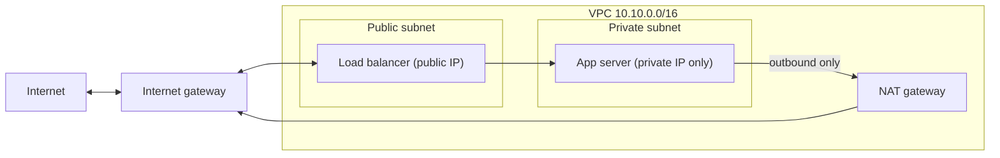

# Subnets, Route Tables and Gateways

## Introduction

A [VPC or VNet](./1-cloud-vpc-and-vnet.mdx) with subnets is like a set of buildings with no roads. The buildings exist, but nothing can leave the property and no visitor can find the front door. **Routing** builds the roads.

Three ideas do most of the work:

1. **Route tables** decide where a packet goes next, based on its destination address.
2. **Gateways** are the exits: an **internet gateway** for two-way internet traffic, a **NAT gateway** for outbound-only traffic, and VPN or transit gateways for private networks.
3. **Public and private subnets** are simply subnets whose routes do or do not lead straight to the internet.

The two clouds approach this differently:

- **AWS** gives you nothing by default in a new VPC except a "local" route. You add an internet gateway and routes yourself.
- **Azure** gives every subnet a set of **system routes**, including a default route to the internet. You override them with **user-defined routes (UDRs)** when you need something different, and Azure is now making outbound internet access explicit rather than automatic.

By the end of this page you will be able to read a route table, design public and private subnets on both clouds, and avoid the most common (and most expensive) routing mistakes.

## How a Route Table Decides

A route table is a list of rules: *destination range* and *next hop*. When a packet leaves a resource, the network looks for every route whose destination contains the packet's destination address and picks the **most specific** one. This is called **longest prefix match**.

Here is the idea in a few lines of Python:

```python
import ipaddress

# A private subnet's route table (AWS style). Azure UDRs work the same way.
route_table = [
    ("10.10.0.0/16", "local"),            # everything inside the VPC
    ("10.0.0.0/8", "tgw-0abc (to corporate network)"),
    ("0.0.0.0/0", "nat-0123 (NAT gateway)"),
    ("52.95.0.0/16", "vpce-s3 (S3 gateway endpoint)"),
]

def next_hop(destination: str) -> str:
    dest = ipaddress.ip_address(destination)
    matches = [
        (ipaddress.ip_network(cidr), target)
        for cidr, target in route_table
        if dest in ipaddress.ip_network(cidr)
    ]
    # Longest prefix match: the most specific route wins.
    best_net, best_target = max(matches, key=lambda m: m[0].prefixlen)
    return f"{destination:15} -> {best_target:35} (matched {best_net})"

for ip in ["10.10.42.7", "10.0.5.20", "52.95.140.1", "142.250.80.46"]:
    print(next_hop(ip))
```

Output:

```text
10.10.42.7      -> local                               (matched 10.10.0.0/16)
10.0.5.20       -> tgw-0abc (to corporate network)     (matched 10.0.0.0/8)
52.95.140.1     -> vpce-s3 (S3 gateway endpoint)       (matched 52.95.0.0/16)
142.250.80.46   -> nat-0123 (NAT gateway)              (matched 0.0.0.0/0)
```

Notice that `10.10.42.7` also falls inside `10.0.0.0/8`, but the `/16` local route is more specific, so it wins. `0.0.0.0/0` is the **default route**: it matches everything, so it only applies when nothing more specific does.

:::note
A real S3 gateway endpoint route uses a **managed prefix list** (an ID like `pl-63a5400a`) rather than a single CIDR, because S3 has many address ranges. The idea is the same.
:::

## Public and Private Subnets



| Subnet type | What makes it that type on AWS | What makes it that type on Azure | Put here |
| --- | --- | --- | --- |
| Public | Its route table has `0.0.0.0/0` pointing at an internet gateway | Resources have public IPs or sit behind a public load balancer | Load balancers, NAT gateways (zonal, AWS), bastion services |
| Private with outbound | `0.0.0.0/0` points at a NAT gateway or firewall | Subnet is private and has a NAT gateway or a UDR to a firewall | App servers, containers, functions with VNet integration |
| Isolated | No `0.0.0.0/0` route at all | Private subnet with no outbound method, plus NSG rules | Databases, caches, internal-only services |

The key insight: on AWS, "public" is a property of the **route table**. A subnet becomes public the moment its route table gets a route to an internet gateway. Resources still need a public IP to be reachable, but the route is what opens the door.

## Routing on AWS

### Building blocks

- **Local route:** every VPC route table has an unremovable route for the VPC's own range with target `local`.
- **Main route table:** created with the VPC. Any subnet that you do not explicitly associate with another table uses it. Keep the main table private and create separate public tables.
- **Internet gateway (IGW):** a horizontally scaled, free resource that you attach to one VPC. It does one-to-one translation for resources that have public IPv4 addresses.
- **NAT gateway:** lets private resources start outbound connections to the internet, while refusing unsolicited inbound connections.
- **Egress-only internet gateway:** the IPv6 equivalent of outbound-only access. IPv6 addresses are globally unique, so there is no address translation, just a stateful block on inbound connections.

### Zonal vs regional NAT gateways

AWS now offers two **availability modes** for NAT gateways:

| | Zonal NAT gateway (the classic model) | Regional NAT gateway (newer) |
| --- | --- | --- |
| Where it lives | In one public subnet, in one Availability Zone | At the VPC level; no public subnet needed |
| High availability | You create one per zone and one route table per zone | Expands and contracts across zones automatically |
| Routes | Each private subnet points at the NAT in its own zone | All private subnets can point at the same NAT ID |
| Private NAT (to other networks) | Supported | Not supported; use zonal mode |

Regional NAT gateways simplify designs and remove the need for public subnets just to host NAT. AWS notes that expanding to a newly used zone can take some time, during which traffic is processed by the NAT in another zone. See [Regional NAT gateways](https://docs.aws.amazon.com/vpc/latest/userguide/nat-gateways-regional.html).

### Building it with the AWS CLI

This continues from the VPC created on the previous page (`$VPC_ID`), with a public subnet `$PUB_SUBNET` and a private subnet `$PRIV_SUBNET`.

:::warning Cost
NAT gateways are billed for every hour they exist and for every GB they process, whether or not you use them. Public IPv4 addresses, including Elastic IPs, are also billed hourly. Run this only in a sandbox and follow the cleanup steps at the end. Check current rates in the [AWS Pricing Calculator](https://calculator.aws/).
:::

```bash
# Internet gateway for the public subnet
IGW_ID=$(aws ec2 create-internet-gateway --query InternetGateway.InternetGatewayId --output text)
aws ec2 attach-internet-gateway --vpc-id "$VPC_ID" --internet-gateway-id "$IGW_ID"

# Public route table: default route to the internet gateway
PUB_RT=$(aws ec2 create-route-table --vpc-id "$VPC_ID" --query RouteTable.RouteTableId --output text)
aws ec2 create-route --route-table-id "$PUB_RT" --destination-cidr-block 0.0.0.0/0 --gateway-id "$IGW_ID"
aws ec2 associate-route-table --route-table-id "$PUB_RT" --subnet-id "$PUB_SUBNET"

# Regional NAT gateway (no subnet or Elastic IP needed in automatic mode)
NAT_ID=$(aws ec2 create-nat-gateway --vpc-id "$VPC_ID" --availability-mode regional \
  --query NatGateway.NatGatewayId --output text)
aws ec2 wait nat-gateway-available --nat-gateway-ids "$NAT_ID"

# Private route table: default route to the NAT gateway
PRIV_RT=$(aws ec2 create-route-table --vpc-id "$VPC_ID" --query RouteTable.RouteTableId --output text)
aws ec2 create-route --route-table-id "$PRIV_RT" --destination-cidr-block 0.0.0.0/0 --nat-gateway-id "$NAT_ID"
aws ec2 associate-route-table --route-table-id "$PRIV_RT" --subnet-id "$PRIV_SUBNET"
```

For a classic zonal NAT gateway, you would instead allocate an Elastic IP with `aws ec2 allocate-address --domain vpc` and run `aws ec2 create-nat-gateway --subnet-id "$PUB_SUBNET" --allocation-id <eipalloc-id>`, once per Availability Zone.

Check the result:

```bash
aws ec2 describe-route-tables --route-table-ids "$PRIV_RT" \
  --query "RouteTables[].Routes[].[DestinationCidrBlock,GatewayId,NatGatewayId,State]" \
  --output table
```

Example output:

```text
---------------------------------------------------------------
|                     DescribeRouteTables                     |
+--------------+---------+-------------------------+----------+
|  10.10.0.0/16|  local  |  None                   |  active  |
|  0.0.0.0/0   |  None   |  nat-0f1e2d3c4b5a69788  |  active  |
+--------------+---------+-------------------------+----------+
```

## Routing on Azure

### System routes

Azure creates **system routes** for every subnet automatically. You can't delete them, but you can override them. The most important ones:

| Destination | Next hop type | Meaning |
| --- | --- | --- |
| The VNet's address space | Virtual network | Traffic stays inside the VNet |
| `0.0.0.0/0` | Internet | Traffic to the internet (subject to outbound rules below) |
| Reserved private ranges not in your VNet | None | Dropped |
| Peered VNet ranges | VNet peering | Added when you create a peering |
| On-premises ranges learned by BGP | Virtual network gateway | Added by VPN or ExpressRoute gateways |

### User-defined routes (UDRs)

To change routing, you create a **route table** resource, add routes, and associate it with subnets. The usual reason is to send all traffic through a firewall:

| Next hop type | Use it for |
| --- | --- |
| `VirtualAppliance` | A firewall or network virtual appliance at a specific IP, such as Azure Firewall |
| `VirtualNetworkGateway` | Force traffic to on-premises through a VPN or ExpressRoute gateway |
| `VnetLocal` | Keep traffic inside the VNet |
| `Internet` | Send directly to the internet |
| `None` | Drop the traffic (a black hole) |

When routes overlap, Azure uses longest prefix match first. If two routes have the same prefix, a UDR beats a BGP route, which beats a system route.

### Outbound internet: explicit is the new default

A `0.0.0.0/0` route with next hop `Internet` doesn't by itself guarantee internet access. A VM needs an **outbound method**. Azure documents this order of precedence for outbound internet traffic:

1. A UDR that sends `0.0.0.0/0` to a virtual appliance or virtual network gateway
2. A NAT gateway on the subnet
3. A public IP address on the VM's network interface
4. Outbound rules on a Standard public load balancer
5. Default outbound access (being retired)

New VNets created with the networking API versions released after March 31, 2026 get **private subnets** by default, with no default outbound access. Some things that used to "just work", such as Windows activation and OS updates, need an explicit method in private subnets. Azure NAT Gateway is Microsoft's recommended method for most cases.

Azure NAT Gateway comes in two SKUs:

- **Standard** is zonal (or "no zone"), supports IPv4 only.
- **StandardV2** is zone-redundant, adds IPv6, higher throughput and flow logs, and requires StandardV2 public IPs. You cannot upgrade Standard to StandardV2 in place. A few regions don't support StandardV2 yet.

Unlike AWS, an Azure NAT gateway is **attached to the subnet**. You do not add a route for it.

### Building it with the Azure CLI

:::warning Cost
NAT gateways and public IP addresses are billed hourly, and NAT gateways also by data processed. Check the [Azure Pricing Calculator](https://azure.microsoft.com/pricing/calculator/) and delete the resource group when you finish.
:::

```bash
RG=rg-net-lab
az group create --name $RG --location eastus

az network vnet create --resource-group $RG --name vnet-lab \
  --address-prefixes 10.20.0.0/16 --subnet-name app --subnet-prefixes 10.20.32.0/20

# Zone-redundant public IP and NAT gateway (StandardV2)
az network public-ip create --resource-group $RG --name pip-nat \
  --sku StandardV2 --allocation-method Static --version IPv4 --zone 1 2 3

az network nat gateway create --resource-group $RG --name nat-lab \
  --public-ip-addresses pip-nat --idle-timeout 4 --sku StandardV2 --zone 1 2 3

# Attach it to the subnet and make the subnet private
az network vnet subnet update --resource-group $RG --vnet-name vnet-lab --name app \
  --nat-gateway nat-lab --default-outbound false
```

Now add a UDR that sends traffic for the corporate network to a firewall appliance at `10.20.0.4`:

```bash
az network route-table create --resource-group $RG --name rt-app

az network route-table route create --resource-group $RG --route-table-name rt-app \
  --name to-corp --address-prefix 10.0.0.0/8 \
  --next-hop-type VirtualAppliance --next-hop-ip-address 10.20.0.4

az network vnet subnet update --resource-group $RG --vnet-name vnet-lab --name app \
  --route-table rt-app
```

To see what a specific VM actually uses, ask Azure for the **effective routes** of its network interface (the VM must be running):

```bash
az network nic show-effective-route-table --resource-group $RG --name vm-app-nic -o table
```

Example output (trimmed):

```text
Source    State    Address Prefix    Next Hop Type     Next Hop IP
--------  -------  ----------------  ----------------  -------------
Default   Active   10.20.0.0/16      VnetLocal
User      Active   10.0.0.0/8        VirtualAppliance  10.20.0.4
Default   Active   0.0.0.0/0         Internet
```

Effective routes are the fastest way to debug "why can't my VM reach X?" on Azure. On AWS, use **VPC Reachability Analyzer**, which traces a path between two resources and tells you which route table, security group or ACL blocks it.

## Side-by-Side Summary

| Task | AWS | Azure |
| --- | --- | --- |
| Make a subnet public | Route `0.0.0.0/0` to an internet gateway | Give resources public IPs or a public load balancer |
| Outbound-only internet | NAT gateway + route (zonal or regional) | NAT gateway attached to the subnet |
| Send traffic through a firewall | Route to a firewall endpoint or Gateway Load Balancer endpoint | UDR with next hop `VirtualAppliance` |
| Block internet entirely | No `0.0.0.0/0` route, VPC Block Public Access | Private subnet, no outbound method, UDR to `None` |
| See actual routes | `describe-route-tables`, Reachability Analyzer | `show-effective-route-table`, Network Watcher next hop |

## Real-World Scenario

Your team runs a payroll API in private subnets. It must call a partner bank's API, and the bank allows only requests from **a short list of fixed IP addresses**. It also downloads large monthly reports from the cloud's object storage.

### The solution

1. Place the app in **private subnets** across zones.
2. Add a **NAT gateway** (regional mode on AWS, StandardV2 on Azure) with a static public IP. Send that IP to the bank for their allowlist.
3. Send storage traffic through a **VPC gateway endpoint for S3** on AWS, or a **private endpoint** for Azure Storage, so the large downloads do not pass through the NAT gateway. See [Private Endpoints, Peering and Transit](./7-cloud-private-connectivity.mdx).
4. Keep database subnets **isolated** with no default route.

### Why this approach

- The NAT gateway gives every instance the same predictable outbound IP, which is exactly what an allowlist needs.
- Private subnets mean nothing can connect to the app from the internet.
- Bypassing the NAT for storage traffic avoids paying NAT data processing charges on large downloads.

### When to use it and when not to

- Use a managed NAT gateway when private workloads need internet access and you want no servers to patch.
- If you need to inspect or filter outbound traffic by domain name (for example, allow only `api.bank.example`), a NAT gateway is not enough. Use a firewall such as AWS Network Firewall or Azure Firewall.
- If a workload only talks to cloud services, you may not need NAT at all; endpoints are often enough.

### Alternatives and trade-offs

| Approach | Pros | Cons | Best for |
| --- | --- | --- | --- |
| Managed NAT gateway | No servers, scales automatically, static IPs | Hourly and per-GB charges | Most private workloads |
| Public IP on every VM | No extra gateway | Each VM is exposed; many IPs to allowlist | Rarely a good idea |
| NAT instance or self-managed appliance | Cheaper at tiny scale, full control | You patch, scale and make it highly available | Very cost-sensitive labs |
| Firewall (AWS Network Firewall, Azure Firewall) | Domain filtering, inspection, central logging | Highest cost, more complexity | Regulated or enterprise egress |
| Endpoints only, no internet | Smallest attack surface, no NAT cost | Can't reach third-party APIs | Workloads that talk only to cloud services |

## Cleanup

### On AWS

```bash
aws ec2 delete-nat-gateway --nat-gateway-id "$NAT_ID"
aws ec2 wait nat-gateway-deleted --nat-gateway-ids "$NAT_ID"
aws ec2 disassociate-route-table --association-id \
  "$(aws ec2 describe-route-tables --route-table-ids "$PRIV_RT" \
     --query 'RouteTables[0].Associations[0].RouteTableAssociationId' --output text)"
aws ec2 delete-route-table --route-table-id "$PRIV_RT"
aws ec2 detach-internet-gateway --internet-gateway-id "$IGW_ID" --vpc-id "$VPC_ID"
aws ec2 delete-internet-gateway --internet-gateway-id "$IGW_ID"
```

Also release any Elastic IPs you allocated with `aws ec2 release-address --allocation-id <eipalloc-id>`, then delete the public route table, subnets and VPC as shown on the [previous page](./1-cloud-vpc-and-vnet.mdx).

### On Azure

```bash
az group delete --name rg-net-lab --yes --no-wait
```

## Common Mistakes

- **One NAT gateway for all zones (zonal mode).** If that zone fails, every private subnet loses internet access. Use one per zone or a regional NAT gateway.
- **Adding public routes to the main route table on AWS.** Every new subnet then becomes public by accident.
- **Pulling container images and data through NAT.** Use endpoints for ECR, S3, ACR and Storage to cut cost.
- **Assuming Azure VMs have internet access.** New private subnets don't. Add NAT before you deploy VMs that need updates.
- **Overriding `0.0.0.0/0` on Azure without thinking about NAT.** A UDR to a firewall takes precedence over the NAT gateway.
- **Forgetting return routes.** Traffic through a firewall must come back through the same firewall, or stateful inspection drops it.

## Summary

- Route tables choose a next hop by longest prefix match; `0.0.0.0/0` is the fallback.
- On AWS, a subnet is public when its route table points to an internet gateway. Private subnets use a NAT gateway, now available in zonal and regional modes.
- On Azure, system routes exist by default and UDRs override them. Outbound internet now needs an explicit method; NAT Gateway (Standard or zone-redundant StandardV2) is the recommended one.
- NAT gateways and public IPs cost money every hour. Use endpoints for cloud service traffic and clean up labs.
- Debug with VPC Reachability Analyzer on AWS and effective routes on Azure.

## Exercises

1. Extend the Python route simulator to support a "blackhole" next hop and to print a warning when two routes have the same prefix.
2. On AWS, redesign a two-zone VPC that uses zonal NAT gateways so that it uses one regional NAT gateway. How many route tables can you remove?
3. On Azure, create a private subnet with no NAT gateway, start a small Linux VM in it, and confirm that `curl https://example.com` fails. Then attach a NAT gateway and try again. Delete everything afterwards.
4. Write Terraform for a private subnet with a NAT gateway on both clouds, and compare how the NAT is wired in (route versus subnet association).

Next, control *which* traffic is allowed with [Security Groups and Network Security Groups](./3-cloud-security-groups-nsgs.mdx).
