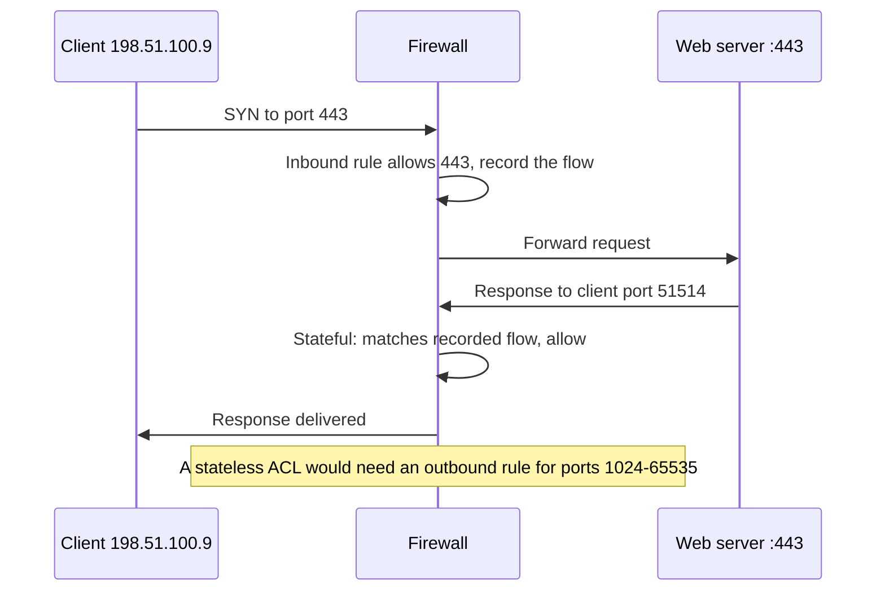
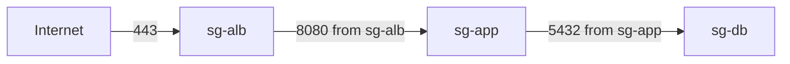

# Security Groups and Network Security Groups

## Introduction

Routing decides *where* a packet **can** go. Firewall rules decide whether it is **allowed** to go there. In the cloud, the first line of defense is a virtual firewall that the platform enforces on every network interface:

- On **AWS**, this is the **security group**, with an optional second layer called a **network ACL** at the subnet boundary.
- On **Azure**, this is the **network security group (NSG)**, which you attach to a subnet, a network interface, or both.

Think of a hotel. The front desk (network ACL or subnet NSG) checks everyone who enters the floor. Each room (security group or NIC NSG) has its own lock that decides who gets in. A good hotel uses both, but the room lock is the one that really protects you.

These tools are free on both clouds, and misconfiguring them is one of the most common causes of cloud security incidents. A single rule that allows `0.0.0.0/0` on port 22, 3389 or 5432 can expose a server to automated attacks within minutes of creation.

On this page you will learn how each service evaluates rules, how to write rules that refer to *groups of servers* instead of IP addresses, and how to debug blocked traffic.

## Stateful vs Stateless Filtering

The most important concept is **state**.

- A **stateful** firewall remembers connections. If it allows a request in, it automatically allows the response out, and the other way around. You only write rules for the side that *starts* the connection.
- A **stateless** firewall checks every packet on its own. You must allow both the request and the response, including the high "ephemeral" ports that clients use for replies.



| Filter | Stateful? | Allow rules | Deny rules | Attached to |
| --- | --- | --- | --- | --- |
| AWS security group | Yes | Yes | No | Network interfaces (EC2, RDS, Lambda in VPC, endpoints, load balancers) |
| AWS network ACL | No | Yes | Yes | Subnets |
| Azure NSG | Yes | Yes | Yes | Subnets and network interfaces |

## AWS Security Groups

### How rules are evaluated

A security group is a list of **allow** rules. There is no order and no deny: AWS evaluates all rules and allows traffic if **any** rule matches. Anything else is dropped.

- A **new** security group has **no inbound rules** (deny all inbound) and **one outbound rule** that allows all traffic.
- Each VPC also has a **default security group** whose inbound rule allows traffic from other members of the same group. Avoid using it for real workloads.
- A network interface can have several security groups; their rules are combined.
- Rules can name a source or destination as a CIDR range, a **managed prefix list**, or **another security group**.

That last option is the most powerful feature. Instead of "allow port 5432 from `10.10.32.0/20`", you write "allow port 5432 from anything that carries the `app` security group". When the app tier scales from 2 to 20 instances, the rule still works and never needs updating.



### Creating the chain with the AWS CLI

```bash
ALB_SG=$(aws ec2 create-security-group --vpc-id "$VPC_ID" \
  --group-name alb-sg --description "Public HTTPS to load balancer" \
  --query GroupId --output text)
APP_SG=$(aws ec2 create-security-group --vpc-id "$VPC_ID" \
  --group-name app-sg --description "App tier" --query GroupId --output text)
DB_SG=$(aws ec2 create-security-group --vpc-id "$VPC_ID" \
  --group-name db-sg --description "Database tier" --query GroupId --output text)

# Internet -> load balancer on 443
aws ec2 authorize-security-group-ingress --group-id "$ALB_SG" \
  --protocol tcp --port 443 --cidr 0.0.0.0/0

# Load balancer -> app on 8080, referencing the ALB's security group
aws ec2 authorize-security-group-ingress --group-id "$APP_SG" \
  --protocol tcp --port 8080 --source-group "$ALB_SG"

# App -> database on 5432, referencing the app's security group
aws ec2 authorize-security-group-ingress --group-id "$DB_SG" \
  --protocol tcp --port 5432 --source-group "$APP_SG"
```

Example output of the last command (trimmed):

```text
{
    "Return": true,
    "SecurityGroupRules": [
        {
            "SecurityGroupRuleId": "sgr-0a9b8c7d6e5f43210",
            "GroupId": "sg-0db1234567890abcd",
            "IsEgress": false,
            "IpProtocol": "tcp",
            "FromPort": 5432,
            "ToPort": 5432,
            "ReferencedGroupInfo": { "GroupId": "sg-0app234567890abcd" }
        }
    ]
}
```

### Network ACLs: the optional second layer

Network ACLs are **stateless**, have **numbered rules evaluated in order** (lowest first, first match wins), support **deny**, and apply to a whole subnet. The default network ACL allows everything, which is why many teams never touch it.

Use custom network ACLs for coarse, subnet-wide guardrails, such as "the data subnets never accept traffic from the public subnets", or to quickly block a known bad IP range. Remember that, because they are stateless, you need to allow return traffic on ephemeral ports:

```bash
NACL_ID=$(aws ec2 create-network-acl --vpc-id "$VPC_ID" --query NetworkAcl.NetworkAclId --output text)

# Inbound: allow PostgreSQL from the app subnets only
aws ec2 create-network-acl-entry --network-acl-id "$NACL_ID" --ingress \
  --rule-number 100 --protocol tcp --port-range From=5432,To=5432 \
  --cidr-block 10.10.32.0/19 --rule-action allow

# Outbound: allow replies to the app subnets on ephemeral ports
aws ec2 create-network-acl-entry --network-acl-id "$NACL_ID" --egress \
  --rule-number 100 --protocol tcp --port-range From=1024,To=65535 \
  --cidr-block 10.10.32.0/19 --rule-action allow
```

Everything not matched falls through to the final `*` rule, which denies.

## Azure Network Security Groups

### How rules are evaluated

An NSG is an **ordered** list of rules with **priorities from 100 to 4096**. Azure processes rules from the lowest number upward and **stops at the first match**. Rules can allow or deny, and NSGs are stateful.

Every NSG also contains **default rules** with priorities 65000 and above that you cannot delete, only override:

| Direction | Name | Priority | Effect |
| --- | --- | --- | --- |
| Inbound | AllowVNetInBound | 65000 | Allow from `VirtualNetwork` to `VirtualNetwork` |
| Inbound | AllowAzureLoadBalancerInBound | 65001 | Allow Azure Load Balancer health probes |
| Inbound | DenyAllInBound | 65500 | Deny everything else |
| Outbound | AllowVnetOutBound | 65000 | Allow to `VirtualNetwork` |
| Outbound | AllowInternetOutBound | 65001 | Allow to `Internet` |
| Outbound | DenyAllOutBound | 65500 | Deny everything else |

Note that `AllowVNetInBound` is broad: the `VirtualNetwork` service tag includes your VNet, peered VNets and connected on-premises ranges. If you want real segmentation between tiers, add explicit deny rules above it.

Here is a small simulator of NSG evaluation, so you can see "first match by priority" in action:

```python
import ipaddress
from dataclasses import dataclass

@dataclass
class Rule:
    name: str
    priority: int
    source: str      # CIDR or "*"
    port: str        # "443", "1024-65535" or "*"
    action: str      # "Allow" or "Deny"

def port_matches(rule_port: str, port: int) -> bool:
    if rule_port == "*":
        return True
    if "-" in rule_port:
        low, high = map(int, rule_port.split("-"))
        return low <= port <= high
    return int(rule_port) == port

def source_matches(rule_source: str, ip: str) -> bool:
    return rule_source == "*" or ipaddress.ip_address(ip) in ipaddress.ip_network(rule_source)

def evaluate(rules: list[Rule], src_ip: str, port: int) -> str:
    # Azure NSG: lowest priority number first, first match wins.
    for rule in sorted(rules, key=lambda r: r.priority):
        if source_matches(rule.source, src_ip) and port_matches(rule.port, port):
            return f"{rule.action:5} by {rule.name} (priority {rule.priority})"
    return "Deny  (no match)"

inbound = [
    Rule("allow-https", 100, "*", "443", "Allow"),
    Rule("allow-ssh-office", 110, "203.0.113.0/24", "22", "Allow"),
    Rule("deny-ssh-all", 120, "*", "22", "Deny"),
    Rule("AllowVNetInBound", 65000, "10.0.0.0/8", "*", "Allow"),   # simplified default
    Rule("DenyAllInBound", 65500, "*", "*", "Deny"),
]

tests = [("198.51.100.9", 443), ("203.0.113.50", 22), ("198.51.100.9", 22),
         ("10.20.3.4", 5432), ("198.51.100.9", 5432)]
for ip, port in tests:
    print(f"{ip:14} :{port:<5} {evaluate(inbound, ip, port)}")
```

Output:

```text
198.51.100.9   :443   Allow by allow-https (priority 100)
203.0.113.50   :22    Allow by allow-ssh-office (priority 110)
198.51.100.9   :22    Deny  by deny-ssh-all (priority 120)
10.20.3.4      :5432  Allow by AllowVNetInBound (priority 65000)
198.51.100.9   :5432  Deny  by DenyAllInBound (priority 65500)
```

If you swapped the priorities of `allow-ssh-office` and `deny-ssh-all`, the office would be locked out, because the deny would match first. Leave gaps between priorities (100, 110, 120) so you can insert rules later.

### Subnet NSG plus NIC NSG

You can attach an NSG to a subnet, to a network interface, or both. When both exist, traffic must be allowed by **both**: for inbound traffic, the subnet NSG is evaluated first and then the NIC NSG; for outbound, the NIC NSG first and then the subnet NSG. Most teams use **one NSG per subnet** and avoid NIC-level NSGs to keep things understandable.

### Service tags and application security groups

Two features keep NSG rules readable:

- **Service tags** are Microsoft-maintained names for groups of IP ranges, such as `Internet`, `VirtualNetwork`, `AzureLoadBalancer`, `Storage.WestEurope` or `AzureFrontDoor.Backend`. Microsoft updates the ranges for you.
- **Application security groups (ASGs)** let you group network interfaces by role (`asg-web`, `asg-db`) and use those groups as source or destination. They play the same role as security group references on AWS.

### Creating rules with the Azure CLI

```bash
RG=rg-net-lab
az network nsg create --resource-group $RG --name nsg-app

az network asg create --resource-group $RG --name asg-web
az network asg create --resource-group $RG --name asg-db

# Allow HTTPS from the internet to web servers
az network nsg rule create --resource-group $RG --nsg-name nsg-app \
  --name allow-https-web --priority 100 --direction Inbound --access Allow \
  --protocol Tcp --source-address-prefixes Internet \
  --destination-asgs asg-web --destination-port-ranges 443

# Allow PostgreSQL only from web servers to database servers
az network nsg rule create --resource-group $RG --nsg-name nsg-app \
  --name allow-pg-web-to-db --priority 110 --direction Inbound --access Allow \
  --protocol Tcp --source-asgs asg-web \
  --destination-asgs asg-db --destination-port-ranges 5432

# Deny all other VNet traffic to the database servers (overrides AllowVNetInBound)
az network nsg rule create --resource-group $RG --nsg-name nsg-app \
  --name deny-vnet-to-db --priority 4000 --direction Inbound --access Deny \
  --protocol '*' --source-address-prefixes VirtualNetwork \
  --destination-asgs asg-db --destination-port-ranges '*'

# Attach the NSG to the subnet
az network vnet subnet update --resource-group $RG --vnet-name vnet-lab \
  --name app --network-security-group nsg-app

az network nsg rule list --resource-group $RG --nsg-name nsg-app -o table
```

Example output (trimmed):

```text
Name                Priority    Direction    Access    Protocol    DestinationPortRange
------------------  ----------  -----------  --------  ----------  ----------------------
allow-https-web     100         Inbound      Allow     Tcp         443
allow-pg-web-to-db  110         Inbound      Allow     Tcp         5432
deny-vnet-to-db     4000        Inbound      Deny      *           *
```

A VM's NIC joins an ASG with `az network nic ip-config update --application-security-groups asg-web` (plus the NIC and resource group names).

## The Same Rules as Code

### Terraform for AWS

The AWS provider recommends separate rule resources rather than inline `ingress` blocks:

```hcl
resource "aws_security_group" "db" {
  name        = "db-sg"
  description = "Database tier"
  vpc_id      = aws_vpc.main.id
}

resource "aws_vpc_security_group_ingress_rule" "db_from_app" {
  security_group_id            = aws_security_group.db.id
  referenced_security_group_id = aws_security_group.app.id
  ip_protocol                  = "tcp"
  from_port                    = 5432
  to_port                      = 5432
}
```

### Bicep for Azure

```bicep
resource nsg 'Microsoft.Network/networkSecurityGroups@2024-05-01' = {
  name: 'nsg-app'
  location: resourceGroup().location
  properties: {
    securityRules: [
      {
        name: 'allow-https'
        properties: {
          priority: 100
          direction: 'Inbound'
          access: 'Allow'
          protocol: 'Tcp'
          sourceAddressPrefix: 'Internet'
          sourcePortRange: '*'
          destinationAddressPrefix: '*'
          destinationPortRange: '443'
        }
      }
    ]
  }
}
```

## Seeing What Was Blocked: Flow Logs

When something cannot connect, logs beat guessing.

- **AWS VPC Flow Logs** record accepted and rejected flows for a VPC, subnet or network interface, delivered to CloudWatch Logs, S3 or Firehose.
- **Azure virtual network flow logs** (part of Network Watcher) record flows for a VNet, subnet or NIC. The older **NSG flow logs** no longer accept new configurations and retire on September 30, 2027, so use VNet flow logs for anything new.

Both are billed by volume ingested and stored, so enable them deliberately. See [Centralized Logging](../12-cloud-observability-and-security/1-cloud-logging.mdx).

## Real-World Scenario

Your team runs an internal HR portal with a web tier and a PostgreSQL database, plus a small admin team that sometimes needs shell access. A recent audit flagged that port 22 was open to the internet "temporarily" for six months.

### The solution

1. **Reference groups, not IPs.** Load balancer group to app group to database group, as in the diagrams above (security group references on AWS, ASGs on Azure).
2. **Remove SSH and RDP from the internet entirely.** Use **AWS Systems Manager Session Manager** or **EC2 Instance Connect Endpoint** on AWS, and **Azure Bastion** on Azure. Neither needs an inbound rule from the internet.
3. **Add explicit denies on Azure** above `AllowVNetInBound` so that only the web tier can reach the database.
4. **Turn on flow logs** for the data subnet so the next audit can see who connected.
5. **Enforce it with policy**: AWS Config rules or Security Hub controls to detect `0.0.0.0/0` on admin ports, and Azure Policy to deny such rules.

### Why this approach

- Group references survive autoscaling and IP changes, so the rules stay correct without updates.
- Removing admin ports from the internet eliminates the most attacked entry point.
- Policy turns a one-time fix into a permanent guardrail.

### When to use it and when not to

- Use security groups and NSGs on every workload; they are free and always on.
- Do not try to make them do **application-level** filtering. They don't understand URLs, domain names or SQL injection. Use a WAF or a firewall for that.

### Alternatives and trade-offs

| Approach | Pros | Cons | Best for |
| --- | --- | --- | --- |
| Security groups / NSGs only | Free, stateful, simple | Layer 3 and 4 only | Every workload as the baseline |
| Plus network ACLs (AWS) | Subnet-wide deny lists | Stateless, easy to break return traffic | Coarse guardrails, emergency IP blocks |
| Plus Azure Virtual Network Manager security admin rules | Central rules that NSGs can't override | Needs central governance | Organizations with many VNets |
| Plus cloud firewall (AWS Network Firewall, Azure Firewall) | FQDN filtering, IDS/IPS, central logs | Significant cost, routing changes | Regulated and enterprise environments |
| Plus WAF on the load balancer or CDN | Blocks web attacks (layer 7) | Needs tuning to avoid false positives | Public web apps and APIs |

## Common Mistakes

- **`0.0.0.0/0` on SSH, RDP or database ports.** Use Session Manager, Instance Connect Endpoint or Azure Bastion instead.
- **Using IP ranges where group references would do.** IPs change; groups don't.
- **Forgetting ephemeral ports in AWS network ACLs.** Replies are silently dropped.
- **Relying on Azure's `AllowVNetInBound`.** It allows every tier, peered network and VPN-connected site to reach everything.
- **Conflicting subnet and NIC NSGs on Azure.** Traffic needs to pass both; prefer one level.
- **Never reviewing rules.** Rules accumulate. Tag them with an owner and review them regularly.

## Summary

- AWS security groups are stateful, allow-only and order-free; any matching rule allows traffic. They can reference other security groups.
- AWS network ACLs are stateless, ordered and support deny; use them sparingly at subnet level.
- Azure NSGs are stateful, ordered by priority (100 to 4096), first match wins, and support allow and deny. Default rules at 65000 and above can't be deleted, only overridden.
- Service tags and application security groups keep Azure rules readable.
- Use flow logs to debug and audit, and policy to stop risky rules from coming back.

## Exercises

1. Add an "Outbound" direction to the Python simulator and model Azure's `AllowInternetOutBound` default rule. Then add a rule that denies outbound traffic to the internet except port 443.
2. On AWS, create the three-tier security group chain from this page with Terraform, then change the app tier's port and confirm only one rule needs editing.
3. On Azure, write an NSG that lets only `asg-web` reach `asg-db` on 5432 and explain why the `deny-vnet-to-db` rule is needed.
4. Find every security group or NSG in a sandbox account that allows `0.0.0.0/0` (or `Internet`) on a port other than 80 or 443. Hint: `aws ec2 describe-security-groups` with a JMESPath filter, or `az network nsg list`.

Next, spread traffic across healthy servers with [Load Balancers](./4-cloud-load-balancers.mdx).
