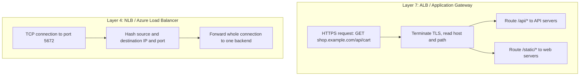

# Load Balancers

## Introduction

As soon as you run more than one copy of an application, something has to decide **which copy handles each request**, and stop sending traffic to copies that are broken. That something is a **load balancer**.

A good analogy is a restaurant host. Guests (requests) arrive at one door. The host knows which waiters (servers) are on shift, which ones are swamped, and which one just went home sick (failed a health check), and seats each guest accordingly. Guests never need to know any waiter's name in advance.

Load balancers give you:

- **High availability:** if a server or a whole Availability Zone fails, traffic goes to the healthy ones.
- **Scalability:** add servers behind the load balancer without changing DNS or clients.
- **A stable entry point:** one DNS name or IP address, plus TLS termination in one place.
- **Safer deployments:** shift traffic gradually between old and new versions (see [Deployment Strategies in the Cloud](../11-cloud-devops/2-cloud-deployment-strategies.mdx)).

Both clouds offer several load balancers, and choosing the wrong one is a common, costly mistake. This page explains the differences and shows how to set up the most common ones.

## Layer 4 vs Layer 7

The first question is how much of the request the load balancer looks at.

- A **Layer 4** (transport) load balancer sees IP addresses, ports and protocol (TCP or UDP). It forwards connections without reading their contents. It is very fast, supports any TCP or UDP protocol, and can preserve the client IP address.
- A **Layer 7** (application) load balancer understands HTTP. It terminates TLS, reads the host name, path and headers, and can route `/api/*` to one group of servers and `/images/*` to another. It can also add a web application firewall (WAF).



## The Options on Each Cloud

### On AWS (Elastic Load Balancing)

| Load balancer | Layer | Use it for | Notes |
| --- | --- | --- | --- |
| **Application Load Balancer (ALB)** | 7 | HTTP, HTTPS, gRPC, WebSockets | Path and host routing, Lambda and IP targets, AWS WAF integration. Needs at least two Availability Zones. |
| **Network Load Balancer (NLB)** | 4 | TCP, UDP, TLS, very high throughput, static IPs | One static IP per zone (optionally an Elastic IP); can preserve client IP |
| **Gateway Load Balancer (GWLB)** | 3 | Inserting third-party firewalls or inspection appliances | Uses the GENEVE protocol on port 6081 |
| Classic Load Balancer | 4 and 7 | Legacy only | Don't use for new work |

ALBs and NLBs consist of a **listener** (protocol and port the load balancer accepts), **rules** (ALB only), and **target groups** (sets of instances, IPs, containers or Lambda functions with a health check).

Cross-zone load balancing is always on at the load balancer level for ALBs (you can turn it off per target group), and **off by default** for NLBs and GWLBs. With it off, each zone's load balancer node only sends traffic to targets in its own zone, so uneven numbers of targets per zone lead to uneven load.

### On Azure

| Service | Layer | Scope | Use it for |
| --- | --- | --- | --- |
| **Azure Load Balancer (Standard)** | 4 | Regional (or cross-region tier) | TCP and UDP to VMs and scale sets, internal or public |
| **Application Gateway (v2)** | 7 | Regional | HTTP(S) routing inside a VNet, TLS offload, WAF |
| **Application Gateway for Containers** | 7 | Regional | HTTP routing for AKS workloads |
| **Azure Front Door** | 7 | Global | Global HTTP entry point with CDN and WAF (see [CDNs](./6-cloud-cdn.mdx)) |
| **Traffic Manager** | DNS | Global | DNS-based routing between regions or clouds for any protocol |

Microsoft's architecture guide sorts these along two axes: **global vs regional** and **HTTP(S) vs non-HTTP(S)**. That is a useful way to choose. See [Load balancing options](https://learn.microsoft.com/azure/architecture/guide/technology-choices/load-balancing-overview).

:::info Retired SKUs
Azure retired the **Basic** Load Balancer and Basic public IP SKUs in September 2025, and the **v1** Application Gateway SKUs in 2026. Use Standard Load Balancer, Standard public IPs and Application Gateway Standard_v2 or WAF_v2. If you find old tutorials using `--sku Basic`, update them.
:::

### Mapping table

| Need | AWS | Azure |
| --- | --- | --- |
| Regional HTTP(S) load balancing | ALB | Application Gateway |
| Regional TCP/UDP load balancing | NLB | Azure Load Balancer (Standard) |
| Internal (private) load balancer | ALB or NLB with `internal` scheme | Internal Load Balancer, private Application Gateway frontend |
| Global HTTP entry point | CloudFront in front of ALBs | Azure Front Door |
| Global non-HTTP / DNS-based | Route 53 routing policies, AWS Global Accelerator | Traffic Manager, cross-region Load Balancer |
| Inline security appliances | Gateway Load Balancer | Gateway Load Balancer (Azure) or UDRs to an NVA |
| Web application firewall | AWS WAF on ALB or CloudFront | WAF on Application Gateway or Front Door |

## Health Checks: The Part That Matters Most

A load balancer is only as good as its health checks. If the check is too shallow, it keeps sending traffic to a server whose database connection is broken. If it is too deep, a slow dependency can make *every* server look unhealthy at once and take the whole site down.

A common pattern is to expose two endpoints:

- **Liveness** (`/health/live`): "the process is running". Cheap, no dependencies.
- **Readiness** (`/health/ready`): "this instance can serve requests right now". Checks critical dependencies quickly, with short timeouts.

Point the load balancer at the readiness endpoint. Here is a minimal standard-library server that implements both:

```python
import json
import os
import socket
from http.server import BaseHTTPRequestHandler, HTTPServer

DB_HOST = os.environ.get("DB_HOST", "127.0.0.1")
DB_PORT = int(os.environ.get("DB_PORT", "5432"))

def database_reachable(timeout: float = 0.5) -> bool:
    try:
        with socket.create_connection((DB_HOST, DB_PORT), timeout=timeout):
            return True
    except OSError:
        return False

class Handler(BaseHTTPRequestHandler):
    def do_GET(self):
        if self.path == "/health/live":
            # Liveness: the process is up. Keep it cheap and dependency-free.
            self._reply(200, {"status": "ok"})
        elif self.path == "/health/ready":
            # Readiness: can this instance actually serve traffic?
            ok = database_reachable()
            self._reply(200 if ok else 503, {"status": "ok" if ok else "degraded", "db": ok})
        else:
            self._reply(200, {"message": f"hello from {socket.gethostname()}"})

    def _reply(self, code, body):
        data = json.dumps(body).encode()
        self.send_response(code)
        self.send_header("Content-Type", "application/json")
        self.send_header("Content-Length", str(len(data)))
        self.end_headers()
        self.wfile.write(data)

    def log_message(self, fmt, *args):
        pass  # keep the demo output quiet

if __name__ == "__main__":
    HTTPServer(("0.0.0.0", 8080), Handler).serve_forever()
```

Run it with no database listening on port 5999 and query both endpoints:

```bash
DB_PORT=5999 python3 health_server.py &
curl -i -s localhost:8080/health/live | head -1; curl -s localhost:8080/health/live; echo
curl -i -s localhost:8080/health/ready | head -1; curl -s localhost:8080/health/ready; echo
```

Output:

```text
HTTP/1.0 200 OK
{"status": "ok"}
HTTP/1.0 503 Service Unavailable
{"status": "degraded", "db": false}
```

A load balancer that sees `503` from the readiness check marks the instance unhealthy after a few failures (the **unhealthy threshold**) and stops routing to it. When it passes again for a few checks (the **healthy threshold**), traffic returns.

:::tip
If *all* targets fail their health checks, ALB and Azure Load Balancer behave differently. An ALB "fails open" and routes to all targets anyway; Azure Load Balancer stops sending new flows to unhealthy backends. Design readiness checks so that one shared dependency does not mark every instance unhealthy at the same moment.
:::

## Creating a Load Balancer from the CLI

:::warning Cost
Load balancers are billed per hour plus a usage-based unit: Load Balancer Capacity Units (LCUs) for ALB, NLCUs for NLB, rules and data processed for Azure Load Balancer, and capacity units for Application Gateway v2. Public IPv4 addresses are billed too. Check the [AWS Pricing Calculator](https://calculator.aws/) or [Azure Pricing Calculator](https://azure.microsoft.com/pricing/calculator/), and delete everything when you finish.
:::

### On AWS: an internet-facing ALB

This assumes two public subnets (`$PUB_A`, `$PUB_B`), the `alb-sg` security group from the [previous page](./3-cloud-security-groups-nsgs.mdx), two running instances, and a certificate in AWS Certificate Manager (`$CERT_ARN`).

```bash
TG_ARN=$(aws elbv2 create-target-group --name app-tg \
  --protocol HTTP --port 8080 --vpc-id "$VPC_ID" --target-type instance \
  --health-check-path /health/ready --health-check-interval-seconds 15 \
  --healthy-threshold-count 2 --unhealthy-threshold-count 3 \
  --query "TargetGroups[0].TargetGroupArn" --output text)

aws elbv2 register-targets --target-group-arn "$TG_ARN" \
  --targets Id=i-0aaa1111bbbb2222c Id=i-0ddd3333eeee4444f

ALB_ARN=$(aws elbv2 create-load-balancer --name app-alb --type application \
  --scheme internet-facing --subnets "$PUB_A" "$PUB_B" --security-groups "$ALB_SG" \
  --query "LoadBalancers[0].LoadBalancerArn" --output text)

# HTTPS listener that forwards to the target group
aws elbv2 create-listener --load-balancer-arn "$ALB_ARN" \
  --protocol HTTPS --port 443 --certificates CertificateArn="$CERT_ARN" \
  --default-actions Type=forward,TargetGroupArn="$TG_ARN"

# HTTP listener that redirects to HTTPS
aws elbv2 create-listener --load-balancer-arn "$ALB_ARN" --protocol HTTP --port 80 \
  --default-actions '[{"Type":"redirect","RedirectConfig":{"Protocol":"HTTPS","Port":"443","StatusCode":"HTTP_301"}}]'

aws elbv2 describe-target-health --target-group-arn "$TG_ARN" \
  --query "TargetHealthDescriptions[].[Target.Id,TargetHealth.State]" --output table
```

Example output of the last command:

```text
-------------------------------------
|       DescribeTargetHealth        |
+-----------------------+-----------+
|  i-0aaa1111bbbb2222c  |  healthy  |
|  i-0ddd3333eeee4444f  |  unhealthy|
+-----------------------+-----------+
```

Path-based routing is a listener rule: for example, `aws elbv2 create-rule --listener-arn <arn> --priority 10 --conditions Field=path-pattern,Values='/api/*' --actions Type=forward,TargetGroupArn=<api-tg-arn>`.

### On Azure: a Standard public Load Balancer

```bash
RG=rg-net-lab
az network public-ip create --resource-group $RG --name pip-lb \
  --sku Standard --allocation-method Static --zone 1 2 3

az network lb create --resource-group $RG --name lb-app --sku Standard \
  --public-ip-address pip-lb --frontend-ip-name fe-public --backend-pool-name be-app

az network lb probe create --resource-group $RG --lb-name lb-app --name hp-ready \
  --protocol Http --port 8080 --path /health/ready

az network lb rule create --resource-group $RG --lb-name lb-app --name http \
  --protocol Tcp --frontend-port 80 --backend-port 8080 \
  --frontend-ip-name fe-public --backend-pool-name be-app --probe-name hp-ready \
  --disable-outbound-snat true
```

You then add VM network interfaces (or a scale set) to the `be-app` backend pool. The `--disable-outbound-snat` flag tells Azure not to use this load balancer's IP for outbound traffic; use a NAT gateway for that instead, as explained in [Subnets, Route Tables and Gateways](./2-cloud-subnets-and-routing.mdx).

### On Azure: an Application Gateway for HTTP

Application Gateway v2 needs its **own dedicated subnet**:

```bash
az network vnet subnet create --resource-group $RG --vnet-name vnet-lab \
  --name snet-agw --address-prefixes 10.20.250.0/24

az network public-ip create --resource-group $RG --name pip-agw \
  --sku Standard --allocation-method Static --zone 1 2 3

az network application-gateway create --resource-group $RG --name agw-app \
  --sku Standard_v2 --capacity 2 --vnet-name vnet-lab --subnet snet-agw \
  --public-ip-address pip-agw --frontend-port 80 --priority 100 \
  --http-settings-port 8080 --http-settings-protocol Http \
  --servers 10.20.32.4 10.20.32.5
```

Application Gateway can take several minutes to provision. Add a custom health probe, an HTTPS listener with a certificate from Key Vault, and path-based rules as your next steps. Use the `WAF_v2` SKU if you need a web application firewall.

## The Same ALB as Code

Here is the core of the AWS example in Terraform. The Azure equivalents are `azurerm_lb` with `azurerm_lb_probe` and `azurerm_lb_rule`, or `azurerm_application_gateway`.

```hcl
resource "aws_lb_target_group" "app" {
  name        = "app-tg"
  port        = 8080
  protocol    = "HTTP"
  vpc_id      = aws_vpc.main.id
  target_type = "instance"

  health_check {
    path                = "/health/ready"
    interval            = 15
    healthy_threshold   = 2
    unhealthy_threshold = 3
  }

  deregistration_delay = 30
}

resource "aws_lb" "app" {
  name               = "app-alb"
  load_balancer_type = "application"
  internal           = false
  subnets            = [aws_subnet.public_a.id, aws_subnet.public_b.id]
  security_groups    = [aws_security_group.alb.id]
}

resource "aws_lb_listener" "https" {
  load_balancer_arn = aws_lb.app.arn
  port              = 443
  protocol          = "HTTPS"
  certificate_arn   = var.certificate_arn

  default_action {
    type             = "forward"
    target_group_arn = aws_lb_target_group.app.arn
  }
}
```

`deregistration_delay` gives in-flight requests 30 seconds to finish when an instance is removed, which matters during deployments and scale-in.

## Routing Algorithms, Stickiness and TLS

A few more settings come up in almost every design:

- **Algorithm.** ALB target groups default to round robin and also offer least outstanding requests and a weighted random mode. NLB and Azure Load Balancer hash connection details (source and destination IP, port, protocol) so each connection sticks to one backend.
- **Session affinity ("sticky sessions").** ALB can pin a client to a target with a cookie; Application Gateway has cookie-based affinity; Azure Load Balancer can use client IP affinity. Stickiness makes scaling and deployments harder, so prefer storing session state in a shared cache such as Redis. See [Managed Caching](../7-cloud-databases/3-cloud-caching.mdx).
- **TLS termination.** Terminating TLS at the load balancer centralizes certificates (AWS Certificate Manager, Azure Key Vault). If your compliance rules require encryption all the way to the server, re-encrypt to the backends (HTTPS target groups, end-to-end TLS on Application Gateway) or use TLS passthrough on a Layer 4 load balancer.
- **Client IP.** Layer 7 load balancers add an `X-Forwarded-For` header with the original client IP. Make sure your application logs that header, not the load balancer's address.

## Real-World Scenario

Your company runs three things behind one domain: a public web storefront (HTTP), a mobile API (HTTP, needs WAF), and an MQTT broker for IoT devices (TCP on 8883, devices need a fixed IP to put in their firewall allowlists).

### The solution

| Workload | AWS | Azure |
| --- | --- | --- |
| Storefront and API | One ALB with host rules: `www` to web target group, `api` to API target group; AWS WAF attached | One Application Gateway WAF_v2 with multi-site listeners |
| MQTT over TLS | NLB with an Elastic IP per zone, TCP listener on 8883 | Standard Load Balancer with a static public IP, rule on 8883 |
| Health checks | `/health/ready` on web and API; TCP checks on the broker | Same, using HTTP and TCP probes |

### Why this approach

- HTTP workloads benefit from Layer 7 features (host routing, TLS, WAF), and one ALB or Application Gateway can serve several hostnames.
- MQTT is not HTTP, and IoT devices need static IPs, which Layer 4 load balancers provide.
- Separate health checks per workload prevent a broker problem from affecting the storefront.

### When to use it and when not to

- Use a regional load balancer when the application runs in one region.
- For users across continents, put a global layer in front: CloudFront or Front Door for HTTP, Global Accelerator, Traffic Manager or DNS policies for other protocols.
- For a single small container app, the platform may already include load balancing: Azure Container Apps, App Service and AWS App Runner do this for you.

### Alternatives and trade-offs

| Approach | Pros | Cons | Best for |
| --- | --- | --- | --- |
| Layer 7 (ALB, Application Gateway) | Path/host routing, TLS offload, WAF | HTTP only, adds a little latency | Web apps and APIs |
| Layer 4 (NLB, Azure Load Balancer) | Any TCP/UDP, very fast, static IPs | No HTTP awareness, no WAF | Databases, MQTT, gaming, custom protocols |
| Global HTTP (CloudFront, Front Door) | Edge TLS, caching, fast failover between regions | Another service to configure and pay for | Multi-region or global audiences |
| DNS-based (Route 53 policies, Traffic Manager) | Works for any protocol, cheap | Failover limited by DNS caching and TTLs | Active-passive DR across regions |
| Platform built-in (App Service, Container Apps, App Runner) | Nothing to manage | Less control | Small teams, standard web apps |

## Common Mistakes

- **Health checks that hit the home page.** Use a dedicated readiness endpoint with fast timeouts.
- **Deep health checks on a shared dependency.** One slow database can mark every instance unhealthy simultaneously.
- **Uneven targets per zone with cross-zone load balancing off (NLB).** Some targets get far more traffic than others.
- **Exposing backends directly.** Backends should accept traffic only from the load balancer's security group or subnet.
- **Using Basic SKUs or Classic Load Balancers in new designs.** They are retired or legacy.
- **Forgetting connection draining.** Configure a deregistration delay (AWS) or connection draining (Application Gateway) so deployments don't cut active requests.

## Summary

- Layer 7 load balancers (ALB, Application Gateway) understand HTTP; Layer 4 ones (NLB, Azure Load Balancer) handle any TCP or UDP traffic.
- Global entry points (CloudFront, Front Door, Traffic Manager, Global Accelerator) sit in front of regional load balancers for multi-region apps.
- Health checks decide everything. Use a quick readiness endpoint and sensible thresholds.
- Load balancers are billed per hour plus usage units; delete lab load balancers when you finish.
- Basic Azure SKUs and AWS Classic Load Balancers are not for new work.

## Exercises

1. Extend the Python health server so `/health/ready` returns `503` while a file named `maintenance` exists. Use it to drain one instance before a deployment.
2. Sketch the listener, rules and target groups for an ALB that serves `www.example.com`, `api.example.com` and `/admin/*` (admin only from the office IP range). Then write the same as Application Gateway listeners and rules.
3. Explain, using the cross-zone example from this page, why an NLB with 2 targets in zone A and 8 in zone B sends 25 percent of traffic to each zone A target when cross-zone load balancing is off.
4. Decide which load balancer you would use for: a PostgreSQL read replica pool, a GraphQL API, a multiplayer game server on UDP, and a global marketing site. Justify each choice.

Next, give your load balancer a friendly name with [DNS: Route 53 and Azure DNS](./5-cloud-dns.mdx).
