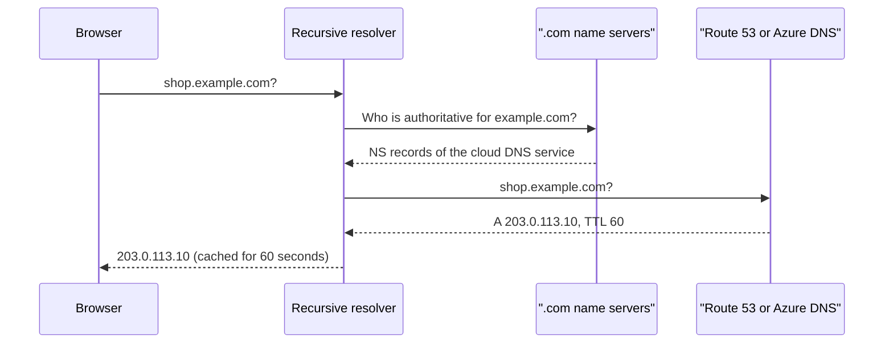

# DNS: Route 53 and Azure DNS

## Introduction

Users don't type `52.95.110.1` or `app-alb-1234567890.us-east-1.elb.amazonaws.com`. They type `shop.example.com`. The **Domain Name System (DNS)** turns that name into an address, and in the cloud it does a lot more:

- Points your domain at load balancers, CDNs and static sites, even at the bare domain (`example.com`, the "zone apex").
- Sends users to the closest or healthiest region.
- Shifts a percentage of traffic to a new version during a release.
- Gives private names such as `db.internal.example.com` to resources that should never be visible on the internet.

Each cloud has a managed DNS service:

- **Amazon Route 53** hosts public and private zones, includes traffic routing policies and health checks, and can also register domains.
- **Azure DNS** hosts public zones, **Azure Private DNS** hosts private zones for VNets, and **Azure Traffic Manager** adds DNS-based traffic routing across regions.

Think of DNS as the phone book plus the switchboard operator. The phone book (zone records) lists who lives where. The operator (routing policies, Traffic Manager) can say "the London office is closed today, let me put you through to Dublin".

:::info Prerequisite
If records, TTLs and resolvers are new to you, read the DNS pages in the [Computer Networks tutorial](/docs/fundamental/network) first. This page focuses on what the clouds add.
:::

## Core Concepts in 60 Seconds

| Term | Meaning |
| --- | --- |
| Zone (hosted zone) | The set of records for a domain, such as `example.com` |
| Name servers (NS) | The servers that answer authoritatively for a zone; your registrar must point to them |
| A / AAAA | Name to IPv4 / IPv6 address |
| CNAME | Name to another name; not allowed at the zone apex |
| MX, TXT, CAA | Mail servers, verification and policy text, which CAs may issue certificates |
| TTL | How many seconds resolvers may cache an answer |
| Resolver | The server that looks names up on behalf of clients (in a VPC or VNet, the cloud provides one) |



## Public Zones

### On AWS: Route 53 hosted zone

```bash
aws route53 create-hosted-zone --name example.com \
  --caller-reference "lab-$(date +%s)" \
  --query "[HostedZone.Id, DelegationSet.NameServers]" --output json
```

Example output:

```text
[
    "/hostedzone/Z0123456789ABCDEFGHIJ",
    [
        "ns-1234.awsdns-26.org",
        "ns-567.awsdns-06.net",
        "ns-1890.awsdns-44.co.uk",
        "ns-89.awsdns-11.com"
    ]
]
```

You then update the domain's name servers at your registrar to these four values. Until you do, the zone exists but nobody on the internet asks it anything.

### On Azure: DNS zone

```bash
az group create --name rg-dns-lab --location westeurope
az network dns zone create --resource-group rg-dns-lab --name example.com \
  --query nameServers -o tsv
```

Example output:

```text
ns1-01.azure-dns.com.
ns2-01.azure-dns.net.
ns3-01.azure-dns.org.
ns4-01.azure-dns.info.
```

Azure DNS hosts zones but doesn't sell domains in this flow; you register the domain elsewhere (or through App Service Domains) and delegate to these name servers.

## Alias Records: Pointing the Apex at Cloud Resources

DNS rules don't allow a CNAME at the zone apex, yet you want `example.com` (not only `www.example.com`) to reach a load balancer whose IP addresses change over time. Both clouds solve this with **alias records**, which behave like an A record but follow a cloud resource automatically.

| | Route 53 alias record | Azure DNS alias record set |
| --- | --- | --- |
| Targets | ALB/NLB, CloudFront, API Gateway, S3 website endpoints, other records in the zone, and more | Public IP addresses, Traffic Manager profiles, Azure Front Door, other record sets in the zone |
| Works at apex | Yes | Yes |
| Follows IP changes | Yes | Yes; also removes the record if the target is deleted, preventing dangling records |

### On AWS

```bash
# Look up the ALB's DNS name and the hosted zone ID that belongs to the ALB
read ALB_DNS ALB_ZONE < <(aws elbv2 describe-load-balancers --names app-alb \
  --query "LoadBalancers[0].[DNSName,CanonicalHostedZoneId]" --output text)

cat > alias.json <<EOF
{
  "Comment": "apex to ALB",
  "Changes": [{
    "Action": "UPSERT",
    "ResourceRecordSet": {
      "Name": "example.com",
      "Type": "A",
      "AliasTarget": {
        "HostedZoneId": "$ALB_ZONE",
        "DNSName": "dualstack.$ALB_DNS",
        "EvaluateTargetHealth": true
      }
    }
  }]
}
EOF

aws route53 change-resource-record-sets \
  --hosted-zone-id Z0123456789ABCDEFGHIJ --change-batch file://alias.json
```

Example output (trimmed):

```text
{
    "ChangeInfo": {
        "Id": "/change/C0987654321ZYXWVUTSRQ",
        "Status": "PENDING",
        "SubmittedAt": "2026-10-11T09:15:02.123Z"
    }
}
```

`PENDING` becomes `INSYNC` once all Route 53 name servers have the change, usually within a minute or so.

### On Azure

```bash
PIP_ID=$(az network public-ip show --resource-group rg-net-lab --name pip-agw --query id -o tsv)

# Apex alias to a public IP (for example, an Application Gateway frontend)
az network dns record-set a create --resource-group rg-dns-lab --zone-name example.com \
  --name "@" --target-resource "$PIP_ID"

# A normal record and a CNAME
az network dns record-set a add-record --resource-group rg-dns-lab --zone-name example.com \
  --record-set-name status --ipv4-address 203.0.113.25
az network dns record-set cname set-record --resource-group rg-dns-lab --zone-name example.com \
  --record-set-name www --cname example.com
```

Verify from any machine with `dig` (or `nslookup` on Windows):

```bash
dig +short www.example.com
dig +short NS example.com
```

## Routing Traffic with DNS

### Route 53 routing policies

Route 53 attaches a **routing policy** to each record:

| Policy | What it does | Typical use |
| --- | --- | --- |
| Simple | One answer | Most records |
| Weighted | Splits answers by weight | Canary and blue/green releases |
| Latency | Answers with the Region that has the lowest latency for the user | Multi-region apps |
| Failover | Primary answer while healthy, otherwise secondary | Active-passive disaster recovery |
| Geolocation | Answers by user's country or continent | Legal or content restrictions |
| Geoproximity | By distance, with a bias to shift traffic | Gradual regional shifts |
| IP-based | By the client's IP ranges that you list | ISP or customer-specific routing |
| Multivalue answer | Up to eight healthy records at random | Simple client-side load spreading |

Records can be tied to **Route 53 health checks**, so unhealthy endpoints drop out of answers automatically.

A weighted release is just several records with the same name, different `SetIdentifier` values and weights. Generating the change batch in code avoids JSON typos:

```python
import json

def weighted_change_batch(name: str, targets: dict[str, int], ttl: int = 60) -> dict:
    """Build a Route 53 change batch that splits traffic by weight."""
    changes = []
    for ip, weight in targets.items():
        changes.append({
            "Action": "UPSERT",
            "ResourceRecordSet": {
                "Name": name,
                "Type": "A",
                "SetIdentifier": f"target-{ip}",
                "Weight": weight,
                "TTL": ttl,
                "ResourceRecords": [{"Value": ip}],
            },
        })
    return {"Comment": f"weighted split for {name}", "Changes": changes}

batch = weighted_change_batch("api.example.com", {"192.0.2.10": 90, "192.0.2.20": 10})
with open("weighted.json", "w") as f:
    json.dump(batch, f, indent=2)

total = sum(c["ResourceRecordSet"]["Weight"] for c in batch["Changes"])
for c in batch["Changes"]:
    rrs = c["ResourceRecordSet"]
    print(f'{rrs["ResourceRecords"][0]["Value"]:12} weight={rrs["Weight"]:3} '
          f'~{rrs["Weight"] / total:.0%} of answers')
```

Output:

```text
192.0.2.10   weight= 90 ~90% of answers
192.0.2.20   weight= 10 ~10% of answers
```

Apply it with `aws route53 change-resource-record-sets --hosted-zone-id <zone-id> --change-batch file://weighted.json`. You could also call `boto3.client("route53").change_resource_record_sets(HostedZoneId=..., ChangeBatch=batch)` directly.

### Azure Traffic Manager

Azure DNS zones themselves answer with static records. For DNS-based traffic routing, you put a **Traffic Manager profile** in between. It has its own name (`something.trafficmanager.net`) that you point to from your zone with an alias or CNAME record. Its routing methods map closely to Route 53 policies:

| Traffic Manager method | Closest Route 53 policy |
| --- | --- |
| Priority | Failover |
| Weighted | Weighted |
| Performance | Latency |
| Geographic | Geolocation |
| MultiValue | Multivalue answer |
| Subnet | IP-based |

```bash
az network traffic-manager profile create --resource-group rg-dns-lab --name tm-shop \
  --routing-method Priority --unique-dns-name shop-tm-lab-4821 --ttl 30 \
  --protocol HTTPS --port 443 --path /health/ready

az network traffic-manager endpoint create --resource-group rg-dns-lab \
  --profile-name tm-shop --name primary-westeurope --type azureEndpoints \
  --target-resource-id "$PIP_ID" --priority 1
```

An Azure public IP used as a Traffic Manager endpoint needs a DNS name label. For HTTP workloads that need fast failover, Microsoft generally recommends **Azure Front Door** over Traffic Manager, because Front Door doesn't depend on clients respecting DNS TTLs. The same applies on AWS: CloudFront with origin failover reacts faster than DNS failover. See [CDNs: CloudFront and Azure Front Door](./6-cloud-cdn.mdx).

:::caution DNS failover is only as fast as caches allow
Even with a 60-second TTL, some resolvers and clients cache answers longer. Plan for a few minutes of mixed traffic during any DNS-based failover or release.
:::

## Private DNS

Internal names, such as `db.internal.example.com` or the private address of a storage account, should resolve only inside your networks.

### On AWS

A **private hosted zone** is associated with one or more VPCs. Resources in those VPCs resolve it through the built-in **Route 53 Resolver** (at the VPC range base address plus two, also reachable at `169.254.169.253`).

```bash
aws route53 create-hosted-zone --name internal.example.com \
  --caller-reference "priv-$(date +%s)" \
  --vpc VPCRegion=us-east-1,VPCId="$VPC_ID" \
  --hosted-zone-config Comment="internal names",PrivateZone=true
```

### On Azure

An **Azure Private DNS zone** is linked to VNets. With **auto-registration** enabled, VMs in the linked VNet get records automatically. VNets use Azure's built-in resolver at `168.63.129.16` by default.

```bash
az network private-dns zone create --resource-group rg-dns-lab --name internal.example.com

az network private-dns link vnet create --resource-group rg-dns-lab \
  --zone-name internal.example.com --name link-vnet-lab \
  --virtual-network "$(az network vnet show -g rg-net-lab -n vnet-lab --query id -o tsv)" \
  --registration-enabled true
```

Private DNS zones are also how **private endpoints** work on Azure (zones such as `privatelink.blob.core.windows.net`). That is covered in [Private Endpoints, Peering and Transit](./7-cloud-private-connectivity.mdx).

### Hybrid DNS

Offices and data centers usually have their own DNS servers. To resolve names in both directions you use managed resolver endpoints:

| Need | AWS | Azure |
| --- | --- | --- |
| On-premises resolves cloud private names | Route 53 Resolver **inbound endpoint** | Azure DNS Private Resolver **inbound endpoint** |
| Cloud resolves on-premises names | Route 53 Resolver **outbound endpoint** + forwarding rules | DNS Private Resolver **outbound endpoint** + forwarding ruleset |
| Block malicious domains | Route 53 Resolver DNS Firewall | Azure DNS security policies |

These endpoints are billed per hour per endpoint IP, so they cost money even when idle. See [Hybrid Connectivity](./8-cloud-hybrid-connectivity.mdx).

## How DNS Is Billed

Prices vary and change; check the [Route 53 pricing page](https://aws.amazon.com/route53/pricing/) and [Azure DNS pricing page](https://azure.microsoft.com/pricing/details/dns/). The billing model is similar on both clouds:

- A monthly charge **per hosted zone**.
- A charge **per million queries**, with different rates for some routing policies. Route 53 doesn't charge for queries to alias records that point at many AWS resources.
- **Health checks** and **Traffic Manager endpoints** are billed per month, with extra for HTTPS, fast intervals or external endpoints.
- **Resolver endpoints** are billed per hour.

## Real-World Scenario

Your startup's domain `example.com` is hosted at the registrar's free DNS. You are moving the website to an ALB on AWS (or an Application Gateway on Azure) and want to release a new API version to 10 percent of users first.

### The solution

1. **Lower TTLs first.** A day before the move, lower the TTL of the records you will change to 60 seconds at the old DNS provider, so caches expire quickly.
2. **Copy every record** (including MX and TXT for email and verification) into a new Route 53 hosted zone or Azure DNS zone. Missing MX records is the classic migration outage.
3. **Switch name servers** at the registrar to the cloud zone's NS records.
4. **Point the apex** at the load balancer with an alias record.
5. **Canary the API** with weighted records (Route 53) or a weighted Traffic Manager profile (Azure): 90 to the current version, 10 to the new one, then raise the weight.
6. **Raise TTLs** again (for example to 300 or 3600 seconds) once things are stable.

### Why this approach

- Alias records make the apex work with resources whose IPs change.
- Weighted DNS is a cheap, protocol-independent way to do a canary.
- Lowering TTLs in advance turns a risky switch into a quick one.

### When to use it and when not to

- Use cloud DNS when your infrastructure lives in that cloud: aliases, health checks and IaC integration make life easier.
- Prefer a Layer 7 global entry point (CloudFront, Front Door) or load balancer weights for canaries when you need precise, instant control; DNS weights are approximate and cached.

### Alternatives and trade-offs

| Approach | Pros | Cons | Best for |
| --- | --- | --- | --- |
| Route 53 | Aliases to AWS resources, rich routing policies, health checks | AWS-centric | Workloads on AWS |
| Azure DNS + Traffic Manager | Native aliases, Private DNS for endpoints | Routing needs a separate service | Workloads on Azure |
| Third-party DNS (for example, a CDN provider's DNS) | Cloud-neutral, often bundled with CDN and DDoS | Another vendor; fewer native aliases | Multi-cloud, existing CDN users |
| Registrar's free DNS | Free, simple | Few features, no IaC, no health checks | Parked domains, tiny sites |

## Cleanup

### On AWS

Delete all records except the default NS and SOA records, then the zone:

```bash
aws route53 delete-hosted-zone --id Z0123456789ABCDEFGHIJ
```

### On Azure

```bash
az group delete --name rg-dns-lab --yes --no-wait
```

## Common Mistakes

- **Forgetting MX and TXT records during a migration.** Email and domain verification break.
- **Changing records with a long TTL already cached.** Lower TTLs before the change, not during.
- **CNAME at the zone apex.** Use an alias record instead.
- **Dangling records.** A CNAME or A record that still points at a deleted cloud resource can let an attacker claim that resource name and serve content on your domain (subdomain takeover). Azure alias records help; on both clouds, delete DNS records when you delete resources.
- **Private zone not linked or associated.** Records exist but VMs in the VPC or VNet can't resolve them.
- **Relying on DNS failover for fast recovery.** Client caching makes it slower than you expect.

## Summary

- Route 53 and Azure DNS host public zones; delegate to them by setting name servers at your registrar.
- Alias records let the zone apex point at load balancers, CDNs and public IPs that change over time.
- Route 53 has routing policies built in; on Azure, Traffic Manager provides DNS-based routing.
- Private hosted zones (AWS) and Private DNS zones (Azure) give internal names; resolver endpoints connect DNS with on-premises networks.
- DNS is billed by zone, queries, health checks and resolver endpoints. TTLs and caching limit how fast DNS changes take effect.

## Exercises

1. Extend the Python change-batch builder to produce a **failover** pair (`Failover: PRIMARY` and `SECONDARY` with a `HealthCheckId`) and validate the JSON with `json.loads`.
2. Write the Traffic Manager commands for a **Weighted** profile with two endpoints at 90 and 10, and explain how you would move to 50/50.
3. List every record type you would need to copy when moving a domain that uses Microsoft 365 or Google Workspace for email.
4. Design private DNS for a VPC and a VNet connected by VPN, so that `db.aws.internal.example.com` and `app.azure.internal.example.com` both resolve from both clouds. Which resolver endpoints do you need?

Next, cache content close to users with [CDNs: CloudFront and Azure Front Door](./6-cloud-cdn.mdx).
