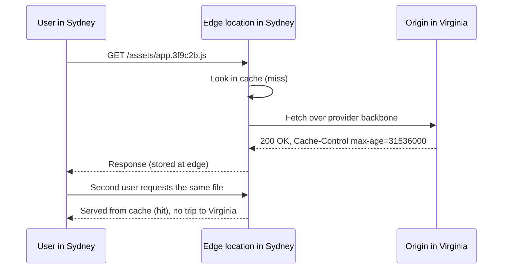

# CDNs: CloudFront and Azure Front Door

## Introduction

When a user in Sydney loads a website hosted in Virginia, every request crosses the planet. Each round trip adds latency, and every image, script and font needs one. A **content delivery network (CDN)** fixes this by keeping copies of content in **edge locations** (points of presence) close to users, and by fetching anything else from your **origin** over the provider's fast private backbone.

Think of a bakery chain. The central bakery (origin) makes everything. Branch shops (edge locations) keep popular bread on the shelves. Most customers buy from their local branch immediately (a **cache hit**). If a branch runs out or gets an unusual order, it phones the central bakery (a **cache miss**), and then keeps some on the shelf for the next customer.

Modern cloud CDNs do much more than caching:

- **TLS at the edge** with free managed certificates
- **A web application firewall (WAF)** and DDoS protection in front of your app
- **Routing and failover** between multiple origins or regions
- **Edge logic** such as redirects, header rewrites and A/B tests
- **Private origins**, so your storage bucket or app can't be reached except through the CDN

The two services this page covers:

- **Amazon CloudFront** on AWS
- **Azure Front Door** (Standard and Premium tiers) on Azure, which now combines Azure's CDN and global load balancing in one service

## How a CDN Request Works



The **cache key** (by default the host and path, optionally plus some query strings, headers or cookies) decides whether two requests are "the same". The **TTL**, usually taken from the origin's `Cache-Control` header within limits you configure, decides how long a copy stays fresh.

## The Building Blocks

| Concept | Amazon CloudFront | Azure Front Door (Standard/Premium) |
| --- | --- | --- |
| Top-level resource | Distribution | Profile, containing endpoints |
| Default hostname | `d111111abcdef8.cloudfront.net` | `name-hash.z01.azurefd.net` |
| Backend | Origin (and origin groups for failover) | Origin group with origins, health probes and weights |
| Path-to-origin mapping | Cache behaviors (path patterns) | Routes (patterns, protocols, origin group) |
| Cache settings | Cache policies and origin request policies | Caching settings on the route, rule sets |
| Edge logic | CloudFront Functions, Lambda@Edge | Rules engine (rule sets) |
| Private storage origin | Origin access control (OAC) for S3 | Private Link to Storage (Premium) or storage firewall rules |
| Private app origin | VPC origins (ALB, NLB, EC2 in private subnets) | Private Link origins (Premium) |
| WAF | AWS WAF web ACL | Azure WAF policy (managed rule sets need Premium) |
| DDoS | AWS Shield Standard included | Layer 3 and 4 protection included |
| Purge cache | Invalidation | Purge |

:::info Retirements on Azure
Azure is consolidating its CDN products into Front Door Standard and Premium. **Azure Front Door (classic)** retires on March 31, 2027, and no longer supports creating new profiles. **Azure CDN Standard from Microsoft (classic)** retires on September 30, 2027 and no longer accepts new profiles. **Azure CDN from Edgio** was retired in January 2025. Build new solutions on Front Door Standard or Premium, and note that its resources live under the `Microsoft.Cdn` namespace and the `az afd` CLI group. See [Front Door tier migration](https://learn.microsoft.com/azure/frontdoor/tier-migration).
:::

## Controlling What Gets Cached

The most important CDN skill is setting good `Cache-Control` headers at the origin. A common strategy for static sites built with tools like Vite or webpack:

- **Fingerprinted assets** (`app.3f9c2b.js`) never change in place, so cache them for a year and mark them `immutable`.
- **HTML pages** reference the current asset names, so give them a short TTL.
- **Everything else** gets a moderate default.

```python
from pathlib import PurePosixPath

def cache_control_for(key: str) -> str:
    """Pick a Cache-Control header for a static asset based on its name."""
    path = PurePosixPath(key)
    if path.name == "index.html" or path.suffix == ".html":
        # HTML points at the current asset versions, so revalidate it often.
        return "public, max-age=60"
    if any(part.startswith("assets") for part in path.parts) and "." in path.stem:
        # Fingerprinted files like assets/app.3f9c2b.js never change in place.
        return "public, max-age=31536000, immutable"
    return "public, max-age=3600"

for key in ["index.html", "docs/pricing.html", "assets/app.3f9c2b.js",
            "assets/logo.8d1e.svg", "robots.txt"]:
    print(f"{key:24} {cache_control_for(key)}")
```

Output:

```text
index.html               public, max-age=60
docs/pricing.html        public, max-age=60
assets/app.3f9c2b.js     public, max-age=31536000, immutable
assets/logo.8d1e.svg     public, max-age=31536000, immutable
robots.txt               public, max-age=3600
```

When you upload a site to object storage, set the header on each object. With `boto3` for S3 and `azure-storage-blob` for Blob Storage (save the function above as `cache_rules.py`):

```python
import mimetypes
from pathlib import Path

import boto3
from azure.identity import DefaultAzureCredential
from azure.storage.blob import BlobServiceClient, ContentSettings

from cache_rules import cache_control_for   # the function shown above

SITE_DIR = Path("dist")

def upload_to_s3(bucket: str) -> None:
    s3 = boto3.client("s3")   # credentials from SSO or a role, never hard-coded keys
    for path in SITE_DIR.rglob("*"):
        if path.is_file():
            key = path.relative_to(SITE_DIR).as_posix()
            s3.upload_file(str(path), bucket, key, ExtraArgs={
                "ContentType": mimetypes.guess_type(key)[0] or "application/octet-stream",
                "CacheControl": cache_control_for(key),
            })

def upload_to_blob(account_url: str, container: str) -> None:
    service = BlobServiceClient(account_url, credential=DefaultAzureCredential())
    client = service.get_container_client(container)
    for path in SITE_DIR.rglob("*"):
        if path.is_file():
            key = path.relative_to(SITE_DIR).as_posix()
            with path.open("rb") as data:
                client.upload_blob(key, data, overwrite=True, content_settings=ContentSettings(
                    content_type=mimetypes.guess_type(key)[0] or "application/octet-stream",
                    cache_control=cache_control_for(key),
                ))
```

Install the packages with `pip install boto3 azure-identity azure-storage-blob`. Both functions use short-lived credentials from your SSO session, role or managed identity, as described in [Using Cloud SDKs from Code](../1-cloud-getting-started/4-cloud-sdks.mdx).

:::tip Never cache personal data
Responses that depend on the logged-in user (account pages, API calls with an `Authorization` header) must not be cached as shared content. Send `Cache-Control: private, no-store` from the origin, and use a "caching disabled" policy for API paths.
:::

## Setting Up a CDN

:::warning Cost
CDNs are billed mainly by **data transferred from edge locations to users** and by **number of requests**, with rates that vary by geography. Front Door Standard and Premium also have a **monthly base fee per profile**, and Premium costs more. CloudFront also offers **flat-rate pricing plans** (Free, Pro, Business and Premium tiers) that bundle the CDN with WAF, DDoS protection, Route 53 DNS and other features for a monthly price with usage allowances, as an alternative to pay-as-you-go. Compare options in the [AWS Pricing Calculator](https://calculator.aws/) and [Azure Pricing Calculator](https://azure.microsoft.com/pricing/calculator/), and delete lab resources when done.
:::

### On AWS: CloudFront in front of a private S3 bucket

The recommended way to serve a private S3 bucket is **origin access control (OAC)**. CloudFront signs its requests to S3, and a bucket policy allows only your distribution. OAC replaced the older origin access identity (OAI), which doesn't support SSE-KMS encryption, newer Regions or `PUT` requests.

```bash
# 1. Create an origin access control
OAC_ID=$(aws cloudfront create-origin-access-control \
  --origin-access-control-config \
  Name=site-oac,SigningProtocol=sigv4,SigningBehavior=always,OriginAccessControlOriginType=s3 \
  --query OriginAccessControl.Id --output text)

# 2. Create the distribution from a config file that references the bucket and the OAC
aws cloudfront create-distribution --distribution-config file://distribution.json \
  --query "Distribution.[Id,DomainName,Status]" --output text
```

A trimmed `distribution.json`:

```json
{
  "CallerReference": "site-2026-10-11",
  "Comment": "static site",
  "Enabled": true,
  "DefaultRootObject": "index.html",
  "Origins": {
    "Quantity": 1,
    "Items": [{
      "Id": "site-bucket",
      "DomainName": "my-site-bucket.s3.us-east-1.amazonaws.com",
      "OriginAccessControlId": "E2ABCDEF123456",
      "S3OriginConfig": { "OriginAccessIdentity": "" }
    }]
  },
  "DefaultCacheBehavior": {
    "TargetOriginId": "site-bucket",
    "ViewerProtocolPolicy": "redirect-to-https",
    "CachePolicyId": "658327ea-f89d-4fab-a63d-7e88639e58f6"
  }
}
```

The `CachePolicyId` above is the AWS managed **CachingOptimized** policy. Example output of the create command:

```text
E1A2B3C4D5E6F7    d111111abcdef8.cloudfront.net    InProgress
```

Then allow only this distribution to read the bucket:

```json
{
  "Version": "2012-10-17",
  "Statement": [{
    "Sid": "AllowCloudFrontServicePrincipalReadOnly",
    "Effect": "Allow",
    "Principal": { "Service": "cloudfront.amazonaws.com" },
    "Action": "s3:GetObject",
    "Resource": "arn:aws:s3:::my-site-bucket/*",
    "Condition": {
      "StringEquals": {
        "AWS:SourceArn": "arn:aws:cloudfront::111122223333:distribution/E1A2B3C4D5E6F7"
      }
    }
  }]
}
```

```bash
aws s3api put-bucket-policy --bucket my-site-bucket --policy file://bucket-policy.json
```

Keep **S3 Block Public Access** turned on; the bucket stays private and only CloudFront can read it. A full walkthrough with a custom domain and certificate is in [Project: Static Website with CDN and HTTPS](../14-cloud-projects/0-cloud-project-static-site.mdx).

### On Azure: Front Door in front of an App Service or storage origin

```bash
RG=rg-cdn-lab
az group create --name $RG --location westeurope

az afd profile create --resource-group $RG --profile-name afd-lab \
  --sku Standard_AzureFrontDoor

az afd endpoint create --resource-group $RG --profile-name afd-lab \
  --endpoint-name shop-lab --enabled-state Enabled

az afd origin-group create --resource-group $RG --profile-name afd-lab \
  --origin-group-name og-web --probe-request-type GET --probe-protocol Https \
  --probe-interval-in-seconds 60 --probe-path /health/ready \
  --sample-size 4 --successful-samples-required 3 --additional-latency-in-milliseconds 50

az afd origin create --resource-group $RG --profile-name afd-lab \
  --origin-group-name og-web --origin-name web-weu \
  --host-name shop-weu.azurewebsites.net --origin-host-header shop-weu.azurewebsites.net \
  --priority 1 --weight 1000 --enabled-state Enabled --http-port 80 --https-port 443

az afd route create --resource-group $RG --profile-name afd-lab \
  --endpoint-name shop-lab --route-name default --origin-group og-web \
  --supported-protocols Http Https --https-redirect Enabled \
  --forwarding-protocol HttpsOnly --link-to-default-domain Enabled

az afd endpoint show --resource-group $RG --profile-name afd-lab \
  --endpoint-name shop-lab --query hostName -o tsv
```

Example output of the last command:

```text
shop-lab-b7f3c2dka9e4f6gh.z01.azurefd.net
```

Configuration takes a few minutes to reach all edge locations. Add a second origin in another region with `--priority 2` for active-passive failover, or the same priority with weights for active-active.

To make the App Service accept traffic **only** from your Front Door, restrict it with the `AzureFrontDoor.Backend` service tag and check the `X-Azure-FDID` header for your profile's ID, or use Premium with a **Private Link origin** so the app has no public endpoint at all.

### Purging cached content

```bash
# AWS: invalidate everything (invalidations are billed beyond a monthly free allowance)
aws cloudfront create-invalidation --distribution-id E1A2B3C4D5E6F7 --paths "/*"

# Azure: purge everything on an endpoint
az afd endpoint purge --resource-group $RG --profile-name afd-lab \
  --endpoint-name shop-lab --content-paths "/*"
```

With fingerprinted asset names, you rarely need to purge: new deployments use new file names, and only short-TTL HTML changes.

## Real-World Scenario

Your company sells a project-management SaaS. The marketing site and the single-page app are static files; the API runs in one region. Customers in Asia complain the app feels slow, and the security team wants a WAF in front of everything.

### The solution

1. Put the static site and SPA in a private bucket or storage account, uploaded with the `Cache-Control` rules above.
2. Create one CloudFront distribution or Front Door profile with two paths:
   - `/*` to the static origin, **cached** with long TTLs for fingerprinted assets.
   - `/api/*` to the regional load balancer, **not cached**, forwarding the headers and cookies the API needs.
3. Attach AWS WAF or an Azure WAF policy with managed rule sets and a rate limit.
4. Lock down the origins: OAC for S3, VPC origins for a private ALB, or Private Link origins on Front Door Premium.
5. Use a custom domain with a managed certificate, and point it with an alias record (see [DNS](./5-cloud-dns.mdx)).

### Why this approach

- Static files load from a nearby edge, which fixes most of the "slow app" complaints.
- API calls still benefit: TLS ends close to the user and the rest of the trip runs on the provider's backbone instead of the public internet.
- One entry point means one place for WAF, TLS and logging.

### When to use it and when not to

- Use a CDN for any public website or API with users outside one metro area, and for any public static content.
- A CDN adds little for internal-only apps used from one office, or for APIs whose every response is personalized and uncacheable, unless you need the WAF or edge TLS.

### Alternatives and trade-offs

| Approach | Pros | Cons | Best for |
| --- | --- | --- | --- |
| CloudFront | Deep AWS integration (S3 OAC, VPC origins, Lambda@Edge), flat-rate plan option | AWS-centric configuration model | Workloads on AWS |
| Azure Front Door Standard | CDN plus global load balancing and custom WAF rules | Base fee per profile | Workloads on Azure |
| Azure Front Door Premium | Managed WAF rules, bot protection, Private Link origins | Higher base fee | Security-sensitive Azure apps |
| Third-party CDN | Cloud-neutral, often strong edge compute | Another vendor and bill | Multi-cloud estates |
| No CDN | Simplest | Slower for distant users, no edge WAF | Internal tools, single-region audiences |

## Cleanup

### On AWS

A distribution must be disabled before it can be deleted:

```bash
DIST_ID=E1A2B3C4D5E6F7
aws cloudfront get-distribution-config --id $DIST_ID > dist.json
ETAG=$(jq -r .ETag dist.json)
jq '.DistributionConfig.Enabled = false | .DistributionConfig' dist.json > disabled.json
aws cloudfront update-distribution --id $DIST_ID --if-match "$ETAG" \
  --distribution-config file://disabled.json
aws cloudfront wait distribution-deployed --id $DIST_ID
ETAG=$(aws cloudfront get-distribution --id $DIST_ID --query ETag --output text)
aws cloudfront delete-distribution --id $DIST_ID --if-match "$ETAG"
```

Then delete the origin access control and, if you no longer need it, the bucket.

### On Azure

```bash
az group delete --name rg-cdn-lab --yes --no-wait
```

## Common Mistakes

- **Caching personalized responses.** One user's account page served to another user is a data breach. Use `private, no-store` and disable caching on API paths.
- **Leaving the origin public.** Attackers can bypass the CDN and its WAF. Use OAC, VPC origins, Private Link or origin restrictions.
- **Long TTLs on HTML.** Users see old pages after a release. Use short TTLs on HTML and long ones on fingerprinted assets.
- **Forwarding all headers, cookies and query strings.** Every variation becomes a separate cache entry and your hit ratio collapses. Include only what the origin needs.
- **Building new things on classic Azure CDN or Front Door (classic).** Use Front Door Standard or Premium.
- **Relying on invalidation as a deployment strategy.** Use versioned file names instead.

## Summary

- A CDN caches content in edge locations near users and carries the rest over the provider's backbone.
- CloudFront uses distributions, origins and cache behaviors; Azure Front Door Standard/Premium uses profiles, endpoints, origin groups and routes.
- `Cache-Control` headers from the origin drive what is cached and for how long.
- Keep origins private with S3 origin access control, CloudFront VPC origins or Front Door Private Link origins, and add a WAF.
- CDNs are billed mainly by data out and requests; Front Door adds a base fee per profile, and CloudFront offers flat-rate plans as an alternative.

## Exercises

1. Extend `cache_control_for` to return `no-store` for any key under `api/` or `account/`, and add tests for it.
2. Write the CloudFront `distribution.json` for two cache behaviors: `/api/*` with the managed **CachingDisabled** policy pointing at an ALB, and the default behavior pointing at S3 with OAC.
3. Add a second Front Door origin in another region and explain the difference between using `--priority` and `--weight` for it.
4. Calculate, for your own website, how many requests per page view hit the origin with and without a CDN. Which file types benefit most?

Next, keep traffic off the internet entirely with [Private Endpoints, Peering and Transit](./7-cloud-private-connectivity.mdx).
