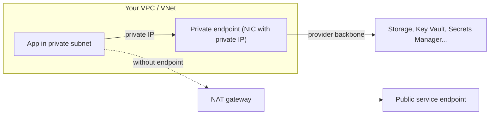
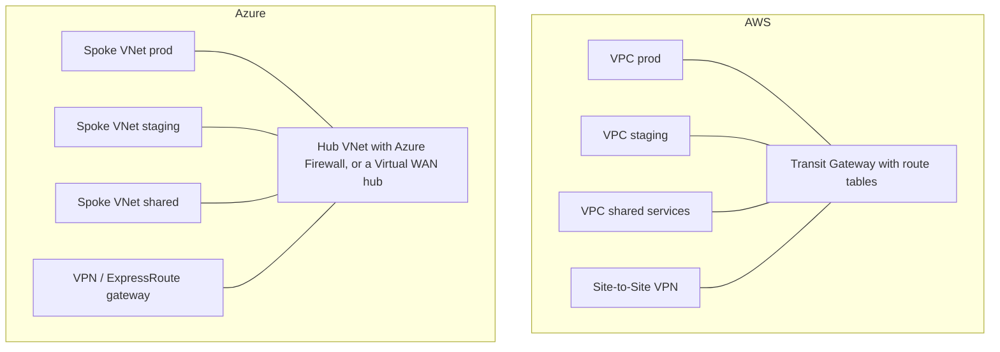

# Private Endpoints, Peering and Transit

## Introduction

So far, your app servers sit in private subnets and reach the internet through a NAT gateway. But much of what they talk to isn't really "the internet":

- Object storage (S3, Blob Storage), secrets (Secrets Manager, Key Vault), queues and databases offered as managed services
- Other VPCs and VNets owned by your company: a shared services network, another team's API, the staging environment
- Services that a partner or another business unit exposes to you

Sending this traffic through NAT to public endpoints works, but it costs NAT processing fees, needs internet access you might not otherwise want, and means your storage account or vault must accept connections from public networks.

This page covers three tools that keep traffic private:

1. **Private access to cloud services:** VPC endpoints and AWS PrivateLink on AWS; service endpoints and Private Endpoints (Azure Private Link) on Azure.
2. **Peering:** a direct, private link between two networks.
3. **Transit hubs:** AWS Transit Gateway and Cloud WAN, Azure Virtual WAN and hub-and-spoke designs, for connecting many networks.

An analogy: a private endpoint is a **dedicated internal door** from your office into the bank branch next door, so you never walk out onto the street. Peering is a **corridor** between two buildings. A transit hub is a **central lobby** that every building connects to.

## Part 1: Private Access to Cloud Services



### The options

| | AWS gateway endpoint | AWS interface endpoint (PrivateLink) | Azure service endpoint | Azure Private Endpoint |
| --- | --- | --- | --- | --- |
| Services | S3 and DynamoDB only | Most AWS services, plus partner and your own services | Many Azure PaaS services | Most Azure PaaS services, plus your own via Private Link service |
| How it works | Route table entry with a prefix list | Network interface with a private IP in your subnet | Subnet setting; traffic uses an optimized route on the backbone | Network interface with a private IP in your subnet |
| Service has a private IP in your network | No | Yes | No (service keeps its public IP) | Yes |
| Reachable from peered networks and on-premises | No | Yes | No | Yes |
| DNS changes | None | Private DNS for the service name | None | Private DNS zone such as `privatelink.blob.core.windows.net` |
| Cost | No additional charge | Per hour per AZ, plus per GB | No additional charge | Per hour, plus per GB |

The rule of thumb: use the **free options** (AWS gateway endpoints, Azure service endpoints) when traffic only comes from inside one network; use **interface endpoints / Private Endpoints** when you need a private IP that peered networks or on-premises sites can reach, or when you want to switch off the service's public access entirely.

### On AWS

A **gateway endpoint for S3** is free and takes one command. It adds a route to the route tables you list:

```bash
aws ec2 create-vpc-endpoint --vpc-id "$VPC_ID" \
  --vpc-endpoint-type Gateway \
  --service-name com.amazonaws.us-east-1.s3 \
  --route-table-ids "$PRIV_RT" \
  --policy-document file://ep-policy.json
```

The optional **endpoint policy** limits what can be done through the endpoint, for example only your company's buckets, which helps prevent data exfiltration to a personal bucket:

```json
{
  "Statement": [{
    "Sid": "OnlyOurBuckets",
    "Effect": "Allow",
    "Principal": "*",
    "Action": ["s3:GetObject", "s3:PutObject", "s3:ListBucket"],
    "Resource": [
      "arn:aws:s3:::payroll-reports-111122223333",
      "arn:aws:s3:::payroll-reports-111122223333/*"
    ]
  }]
}
```

An **interface endpoint** for AWS Secrets Manager places a network interface in each subnet you choose (one per Availability Zone). With private DNS enabled, the normal service hostname resolves to these private IPs, so SDKs work without code changes. The VPC needs DNS hostnames and DNS support turned on.

:::warning Cost
Interface endpoints are billed per hour for each Availability Zone they are in, plus per GB processed. A handful of endpoints in three zones across several VPCs adds up. Check the [AWS PrivateLink pricing page](https://aws.amazon.com/privatelink/pricing/) and delete lab endpoints.
:::

```bash
aws ec2 create-vpc-endpoint --vpc-id "$VPC_ID" \
  --vpc-endpoint-type Interface \
  --service-name com.amazonaws.us-east-1.secretsmanager \
  --subnet-ids "$PRIV_A" "$PRIV_B" \
  --security-group-ids "$ENDPOINT_SG" \
  --private-dns-enabled \
  --query "VpcEndpoint.[VpcEndpointId,State]" --output text
```

Example output:

```text
vpce-0a1b2c3d4e5f60718    pending
```

The endpoint's security group must allow inbound HTTPS (443) from your app's security group.

### On Azure

A **Private Endpoint** gives a PaaS resource a private IP inside your VNet. The key part that people forget is **DNS**: the resource's normal name (for example `mystorage.blob.core.windows.net`) must resolve to the private IP, which you achieve with a Private DNS zone linked to the VNet.

:::warning Cost
Private Endpoints are billed per hour plus per GB of inbound and outbound data processed, and Private DNS zones have a small monthly charge. Check the [Azure Pricing Calculator](https://azure.microsoft.com/pricing/calculator/) and delete the resource group when you finish.
:::

```bash
RG=rg-net-lab
SA_ID=$(az storage account show --resource-group $RG --name stpayrolllab01 --query id -o tsv)

# 1. Private endpoint for the blob sub-resource of the storage account
az network private-endpoint create --resource-group $RG --name pe-blob \
  --vnet-name vnet-lab --subnet app \
  --private-connection-resource-id "$SA_ID" --group-id blob \
  --connection-name pe-blob-conn

# 2. Private DNS zone for blob private endpoints, linked to the VNet
az network private-dns zone create --resource-group $RG \
  --name "privatelink.blob.core.windows.net"
az network private-dns link vnet create --resource-group $RG \
  --zone-name "privatelink.blob.core.windows.net" --name link-vnet-lab \
  --virtual-network vnet-lab --registration-enabled false

# 3. Let the endpoint manage its own DNS record in that zone
az network private-endpoint dns-zone-group create --resource-group $RG \
  --endpoint-name pe-blob --name default \
  --private-dns-zone "privatelink.blob.core.windows.net" --zone-name blob

# 4. Turn off public network access to the storage account
az storage account update --resource-group $RG --name stpayrolllab01 \
  --public-network-access Disabled
```

From a VM inside the VNet, the name now resolves to a private address:

```bash
nslookup stpayrolllab01.blob.core.windows.net
```

Example output:

```text
Server:   127.0.0.53
Address:  127.0.0.53#53

Non-authoritative answer:
stpayrolllab01.blob.core.windows.net  canonical name = stpayrolllab01.privatelink.blob.core.windows.net.
Name:     stpayrolllab01.privatelink.blob.core.windows.net
Address:  10.20.32.8
```

Each sub-resource needs its own endpoint and DNS zone: `blob`, `file`, `queue`, `dfs` for storage; `vault` for Key Vault (`privatelink.vaultcore.azure.net`); `sqlServer` for Azure SQL (`privatelink.database.windows.net`), and so on.

### Exposing your own service privately

Both clouds let you publish **your own** service to other networks without peering:

- **AWS PrivateLink endpoint service:** put your service behind a Network Load Balancer (or Gateway Load Balancer), create an endpoint service, and let consumers in other accounts create interface endpoints to it.
- **Azure Private Link service:** put your service behind a Standard Load Balancer and let consumers create Private Endpoints to it.

This is ideal for SaaS providers and platform teams: consumers see a single private IP, overlapping address ranges don't matter, and only the one service is exposed, not the whole network.

## Part 2: Peering Two Networks

**Peering** connects two VPCs or two VNets directly over the provider's backbone, as if they were one network for routing purposes. Both clouds support peering within a region and across regions (AWS inter-Region VPC peering, Azure global VNet peering), and across accounts or subscriptions.

Two rules apply on both clouds:

1. **Address ranges must not overlap.**
2. **Peering is not transitive.** If A peers with B, and B peers with C, A **cannot** reach C through B.

The second rule surprises almost everyone. This small model shows the difference between peering and a hub router:

```python
from collections import deque

# Each peering is a direct, two-way link. Peering is NOT transitive.
peerings = {("hub", "spoke-a"), ("hub", "spoke-b"), ("hub", "shared-services")}

def peered(a: str, b: str) -> bool:
    return (a, b) in peerings or (b, a) in peerings

def can_talk_with_peering(src: str, dst: str) -> bool:
    # Only a direct peering works; traffic never hops through a third network.
    return peered(src, dst)

def can_talk_with_hub_router(src: str, dst: str) -> bool:
    # With a transit gateway / virtual hub / firewall that routes between attachments,
    # any two networks attached to it can reach each other (if route tables allow).
    nodes = {n for pair in peerings for n in pair}
    seen, queue = {src}, deque([src])
    while queue:
        node = queue.popleft()
        if node == dst:
            return True
        for nxt in nodes:
            if nxt not in seen and peered(node, nxt):
                seen.add(nxt)
                queue.append(nxt)
    return False

for src, dst in [("spoke-a", "hub"), ("spoke-a", "spoke-b"), ("spoke-b", "shared-services")]:
    print(f"{src:8} -> {dst:16} peering only: {str(can_talk_with_peering(src, dst)):5}  "
          f"via hub router: {can_talk_with_hub_router(src, dst)}")
```

Output:

```text
spoke-a  -> hub              peering only: True   via hub router: True
spoke-a  -> spoke-b          peering only: False  via hub router: True
spoke-b  -> shared-services  peering only: False  via hub router: True
```

With pure peering, spokes reach the hub but not each other. To let spokes talk, you either add more peerings (a mesh) or put a **router** in the middle: a Transit Gateway on AWS, or an Azure Firewall or Virtual WAN hub on Azure.

### On AWS

```bash
PCX_ID=$(aws ec2 create-vpc-peering-connection --vpc-id "$VPC_A" --peer-vpc-id "$VPC_B" \
  --query VpcPeeringConnection.VpcPeeringConnectionId --output text)
aws ec2 accept-vpc-peering-connection --vpc-peering-connection-id "$PCX_ID"

# Routes are needed on BOTH sides
aws ec2 create-route --route-table-id "$RT_A" --destination-cidr-block 10.11.0.0/16 \
  --vpc-peering-connection-id "$PCX_ID"
aws ec2 create-route --route-table-id "$RT_B" --destination-cidr-block 10.10.0.0/16 \
  --vpc-peering-connection-id "$PCX_ID"
```

For cross-account or cross-Region peering, add `--peer-owner-id` or `--peer-region`, and the other side accepts the request. Security groups must still allow the traffic.

### On Azure

A VNet peering is created **from each side**:

```bash
HUB_ID=$(az network vnet show -g rg-hub -n vnet-hub --query id -o tsv)
SPOKE_ID=$(az network vnet show -g rg-spoke -n vnet-spoke --query id -o tsv)

az network vnet peering create --resource-group rg-hub --name hub-to-spoke \
  --vnet-name vnet-hub --remote-vnet "$SPOKE_ID" \
  --allow-vnet-access --allow-forwarded-traffic --allow-gateway-transit

az network vnet peering create --resource-group rg-spoke --name spoke-to-hub \
  --vnet-name vnet-spoke --remote-vnet "$HUB_ID" \
  --allow-vnet-access --allow-forwarded-traffic --use-remote-gateways

az network vnet peering show --resource-group rg-spoke --vnet-name vnet-spoke \
  --name spoke-to-hub --query peeringState -o tsv
```

Example output:

```text
Connected
```

Azure adds routes automatically (no route table edits needed). `--allow-gateway-transit` and `--use-remote-gateways` let the spoke use the hub's VPN or ExpressRoute gateway, covered in [Hybrid Connectivity](./8-cloud-hybrid-connectivity.mdx). `--use-remote-gateways` only works once the hub actually has a gateway.

## Part 3: Transit Hubs for Many Networks

With 3 networks, a full mesh needs 3 peerings. With 20 networks it needs 190. That is where hubs come in.



| Need | AWS | Azure |
| --- | --- | --- |
| Regional hub routing between networks | **Transit Gateway** (attachments plus route tables) | **Hub-and-spoke**: hub VNet with Azure Firewall or an NVA plus UDRs in spokes; or **Azure Virtual WAN** hub |
| Global, policy-based network | **AWS Cloud WAN** | **Virtual WAN** with hubs in several regions |
| Manage peering and security rules for many networks centrally | AWS RAM sharing, Network Manager | **Azure Virtual Network Manager** (hub-and-spoke or mesh connectivity configurations, security admin rules) |
| Service-to-service connectivity without network-level routing | **Amazon VPC Lattice** | Private Link service, API Management |

A minimal Transit Gateway setup:

```bash
TGW_ID=$(aws ec2 create-transit-gateway --description "org hub" \
  --query TransitGateway.TransitGatewayId --output text)

aws ec2 create-transit-gateway-vpc-attachment --transit-gateway-id "$TGW_ID" \
  --vpc-id "$VPC_A" --subnet-ids "$TGW_SUBNET_A1" "$TGW_SUBNET_A2"

# In VPC A, send traffic for the rest of the company to the transit gateway
aws ec2 create-route --route-table-id "$RT_A" --destination-cidr-block 10.0.0.0/8 \
  --transit-gateway-id "$TGW_ID"
```

Transit Gateway **route tables** let you segment: for example, production and development VPCs can both reach shared services but not each other.

:::warning Cost
Transit Gateway is billed per attachment per hour plus per GB processed. Azure Firewall and Virtual WAN hubs are billed per hour plus data processed, and VNet peering is billed per GB in both directions. These are some of the largest networking line items in big estates. Model them in the [AWS Pricing Calculator](https://calculator.aws/) or [Azure Pricing Calculator](https://azure.microsoft.com/pricing/calculator/) first.
:::

## Real-World Scenario

A fintech company has 12 AWS accounts and 6 Azure subscriptions. Today, teams peer networks ad hoc, every service reaches S3, Blob Storage and Key Vault over the internet via NAT, and an auditor asks for "no PaaS data paths over the public internet" and "production isolated from development".

### The solution

1. **Private service access everywhere.** Gateway endpoints for S3 and DynamoDB in every VPC (free). Interface endpoints for Secrets Manager, KMS, ECR and CloudWatch Logs in a shared services VPC, shared through central private DNS. On Azure, Private Endpoints for Storage, Key Vault and SQL, with Private DNS zones in a central subscription and public network access disabled.
2. **Hubs instead of meshes.** One Transit Gateway per Region with separate route tables for prod, non-prod and shared. On Azure, a hub VNet with Azure Firewall (or Virtual WAN), with Azure Virtual Network Manager creating the spoke peerings.
3. **PrivateLink for cross-team APIs.** The payments team exposes its API as a PrivateLink endpoint service and an Azure Private Link service, so consumers get access to one API and nothing else.

### Why this approach

- Endpoints satisfy "no public data paths" and cut NAT processing charges.
- Hubs scale linearly as networks are added, and route tables or firewall rules enforce environment isolation.
- PrivateLink exposes services, not networks, which shrinks the blast radius and tolerates overlapping IP ranges.

### When to use it and when not to

- Two or three networks that need full connectivity: peering is simpler and has no hourly hub cost.
- Many networks, central inspection or on-premises connectivity shared by all: use a hub.
- One service consumed by many networks: PrivateLink or Private Link service.

### Alternatives and trade-offs

| Approach | Pros | Cons | Best for |
| --- | --- | --- | --- |
| VPC / VNet peering | Low latency, no hourly charge, simple | Not transitive, mesh explodes with scale, no overlapping ranges | A few networks |
| Transit Gateway / Virtual WAN | Central routing, segmentation, scales to many networks | Hourly and per-GB costs | Medium to large estates |
| Hub VNet with Azure Firewall | Central inspection and logging | Firewall cost, UDRs to manage | Regulated Azure environments |
| PrivateLink / Private Link service | Exposes one service, overlapping ranges OK | Per-hour and per-GB, one-directional | SaaS, platform APIs |
| Public endpoints with firewall rules | No extra network resources | Traffic on public endpoints, larger attack surface | Prototypes |

## Cleanup

```bash
# AWS
aws ec2 delete-vpc-endpoints --vpc-endpoint-ids vpce-0a1b2c3d4e5f60718
aws ec2 delete-vpc-peering-connection --vpc-peering-connection-id "$PCX_ID"
# Delete transit gateway attachments first, then the transit gateway:
aws ec2 delete-transit-gateway-vpc-attachment --transit-gateway-attachment-id <tgw-attach-id>
aws ec2 delete-transit-gateway --transit-gateway-id "$TGW_ID"

# Azure
az group delete --name rg-net-lab --yes --no-wait
```

## Common Mistakes

- **Creating a Private Endpoint without the DNS zone.** The name still resolves to the public IP and traffic either fails or goes the public way.
- **Leaving public network access enabled** after adding a Private Endpoint, which defeats much of the purpose.
- **Expecting transitive peering.** Spoke-to-spoke traffic needs a hub router or direct peering.
- **Interface endpoints in every VPC for every service.** Centralize common endpoints in a shared VPC when it makes sense, or the hourly charges multiply.
- **Overlapping ranges** that block peering and transit later. See [VPCs and VNets](./1-cloud-vpc-and-vnet.mdx).
- **Asymmetric routing through firewalls.** Make sure both directions of a flow pass the same firewall.

## Summary

- Gateway endpoints (AWS) and service endpoints (Azure) are free and keep traffic to cloud services on the backbone from within one network.
- Interface endpoints and Azure Private Endpoints give services a private IP in your network, reachable from peers and on-premises; they cost per hour and per GB, and need private DNS.
- Peering links two networks directly but is not transitive, and ranges must not overlap.
- Transit Gateway, Cloud WAN, Virtual WAN and hub-and-spoke designs connect many networks with central routing and inspection.
- PrivateLink and Azure Private Link service expose a single service privately to other networks.

## Exercises

1. Modify the Python model so it counts how many peerings a full mesh of `n` networks needs, and print the result for 3, 10 and 50 networks.
2. On Azure, list the private DNS zone names you would need for Private Endpoints to Blob Storage, Key Vault, Azure SQL Database and Azure Container Registry (check the "Azure Private Endpoint DNS configuration" page on Microsoft Learn).
3. Design Transit Gateway route tables so that `prod` and `dev` VPCs can both reach `shared`, but not each other. Write down each route table's associations and propagations.
4. Compare the monthly cost model (not the numbers) of 10 interface endpoints in 3 Availability Zones in each of 5 VPCs, versus the same endpoints centralized in one shared VPC.

Next, connect your offices and data centers with [Hybrid Connectivity: VPN and Direct Connect/ExpressRoute](./8-cloud-hybrid-connectivity.mdx).
