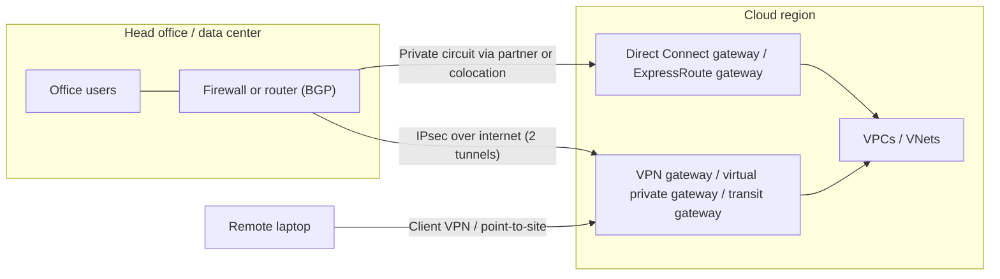

# Hybrid Connectivity: VPN and Direct Connect/ExpressRoute

## Introduction

Very few companies move everything to the cloud at once. For years, many will run a **hybrid** setup: some systems in a data center or office, some in AWS or Azure, and both sides need to talk privately. Common reasons:

- **Migration:** the database moves to the cloud first, while the old ERP system stays on-premises for another year.
- **Data that must stay put:** regulations, latency-sensitive factory systems or very large datasets.
- **Users in offices** who need to reach internal cloud applications without exposing them to the internet.
- **Disaster recovery:** the cloud acts as a standby site for the data center.

There are two families of hybrid connections:

1. **VPN over the internet:** an encrypted IPsec tunnel between your firewall or router and the cloud. Quick to set up (hours), relatively cheap, but performance depends on the internet.
2. **Dedicated private circuits:** **AWS Direct Connect** and **Azure ExpressRoute**. A physical connection, usually through a telecom partner or a colocation facility, that does not traverse the public internet. More predictable performance and higher bandwidth, but it takes weeks to order and costs more.

An analogy: a VPN is an **armored van on public roads**. It is secure, but stuck in the same traffic as everyone else. A dedicated circuit is a **private railway line** between your warehouse and the cloud. It is faster and more predictable, but you have to build (or lease) the track.

## The Big Picture



## Building Blocks on Each Cloud

| Concept | AWS | Azure |
| --- | --- | --- |
| Your device, described to the cloud | Customer gateway | Local network gateway |
| Cloud-side VPN endpoint | Virtual private gateway (one VPC) or Transit Gateway / Cloud WAN (many VPCs) | VPN Gateway (virtual network gateway in a `GatewaySubnet`), or Virtual WAN hub |
| Site-to-site VPN | AWS Site-to-Site VPN connection (always two tunnels) | VPN Gateway connection (active-standby or active-active) |
| Remote users | AWS Client VPN | VPN Gateway point-to-site (P2S), optionally with Microsoft Entra ID sign-in |
| Dedicated circuit | Direct Connect connection (dedicated or hosted) | ExpressRoute circuit (via provider) or ExpressRoute Direct |
| Logical links on the circuit | Virtual interfaces: private, public, transit | Peerings: private, Microsoft |
| Reach many VPCs/VNets or regions | Direct Connect gateway | ExpressRoute gateway per VNet, ExpressRoute Premium for global reach across geopolitical regions |
| Connect two on-premises sites through the cloud | Direct Connect SiteLink | ExpressRoute Global Reach |
| Routing protocol | BGP (static routes possible for VPN) | BGP (static routes possible for VPN) |

### Why BGP matters

Both clouds strongly prefer **dynamic routing with BGP** (Border Gateway Protocol). With BGP, your router and the cloud gateway tell each other which address ranges live on each side and automatically fail over to another tunnel or circuit when one goes down. Static routes work for simple VPNs, but every new subnet becomes a manual change on both sides, and failover is less automatic.

## Site-to-Site VPN

### On AWS

An AWS Site-to-Site VPN connection always has **two tunnels**, terminating on different AWS endpoints, for redundancy. Configure both on your device. A standard tunnel supports up to about 1.25 Gbps; for VPNs attached to a Transit Gateway or Cloud WAN, AWS also offers **large bandwidth tunnels** with higher per-tunnel throughput. **Accelerated VPN** routes the tunnels through AWS Global Accelerator for better performance over long distances (Transit Gateway only).

:::warning Cost
Site-to-Site VPN connections are billed per connection-hour while they exist, plus data transfer out. Accelerated VPN adds Global Accelerator charges. Check the [AWS VPN pricing page](https://aws.amazon.com/vpn/pricing/) and delete lab VPNs.
:::

```bash
# 1. Describe your on-premises device (its public IP and BGP ASN)
CGW_ID=$(aws ec2 create-customer-gateway --type ipsec.1 \
  --public-ip 203.0.113.12 --bgp-asn 65010 --device-name hq-firewall \
  --query CustomerGateway.CustomerGatewayId --output text)

# 2. Create a virtual private gateway and attach it to the VPC
VGW_ID=$(aws ec2 create-vpn-gateway --type ipsec.1 --amazon-side-asn 64512 \
  --query VpnGateway.VpnGatewayId --output text)
aws ec2 attach-vpn-gateway --vpn-gateway-id "$VGW_ID" --vpc-id "$VPC_ID"

# 3. Create the VPN connection with dynamic (BGP) routing
VPN_ID=$(aws ec2 create-vpn-connection --type ipsec.1 \
  --customer-gateway-id "$CGW_ID" --vpn-gateway-id "$VGW_ID" \
  --options '{"StaticRoutesOnly":false}' \
  --query VpnConnection.VpnConnectionId --output text)

# 4. Let BGP-learned routes appear in the private route table
aws ec2 enable-vgw-route-propagation --route-table-id "$PRIV_RT" --gateway-id "$VGW_ID"
```

Download the configuration file for your device vendor from the VPC console (or with `aws ec2 get-vpn-connection-device-sample-configuration`), apply it to your firewall, then check tunnel status:

```bash
aws ec2 describe-vpn-connections --vpn-connection-ids "$VPN_ID" \
  --query "VpnConnections[0].VgwTelemetry[].[OutsideIpAddress,Status,AcceptedRouteCount]" \
  --output table
```

Example output:

```text
-------------------------------------------
|         DescribeVpnConnections          |
+----------------+-------+----------------+
|  198.51.100.11 |  UP   |  3             |
|  198.51.100.75 |  UP   |  3             |
+----------------+-------+----------------+
```

To connect many VPCs, attach the VPN to a **Transit Gateway** instead of a virtual private gateway (`--transit-gateway-id` in place of `--vpn-gateway-id`). See [Private Endpoints, Peering and Transit](./7-cloud-private-connectivity.mdx).

### On Azure

An Azure VPN Gateway lives in a special subnet that **must be named `GatewaySubnet`**; Microsoft recommends `/27` or larger. Gateways take a while to deploy, often 30 to 45 minutes.

Azure is consolidating VPN Gateway SKUs: the **availability zone SKUs** (`VpnGw1AZ` to `VpnGw5AZ`) are recommended for all new gateways, while the non-AZ `VpnGw1` to `VpnGw5` SKUs are being migrated and should not be used for new deployments. The `Basic` SKU is only for dev and test (no BGP, no IPv6). See [About gateway SKUs](https://learn.microsoft.com/azure/vpn-gateway/about-gateway-skus).

:::warning Cost
VPN gateways are billed per hour from the moment they are created, whether or not any tunnel is connected, plus data transfer and public IP charges. Check the [Azure Pricing Calculator](https://azure.microsoft.com/pricing/calculator/) and delete the gateway when the lab is done.
:::

```bash
RG=rg-hub
az network vnet subnet create --resource-group $RG --vnet-name vnet-hub \
  --name GatewaySubnet --address-prefixes 10.20.255.0/27

az network public-ip create --resource-group $RG --name pip-vpngw \
  --sku Standard --allocation-method Static --zone 1 2 3

# Zone-redundant, route-based VPN gateway with BGP
az network vnet-gateway create --resource-group $RG --name vpngw-hub \
  --vnet vnet-hub --public-ip-addresses pip-vpngw \
  --gateway-type Vpn --vpn-type RouteBased --sku VpnGw1AZ --asn 65515 --no-wait

# Describe the on-premises side
az network local-gateway create --resource-group $RG --name lng-hq \
  --gateway-ip-address 203.0.113.12 --asn 65010 --bgp-peering-address 10.0.0.1

# Pre-shared key: generate it, store it in Key Vault, never commit it to Git
PSK=$(openssl rand -base64 32)
az keyvault secret set --vault-name kv-net-lab --name vpn-hq-psk --value "$PSK" > /dev/null

az network vpn-connection create --resource-group $RG --name cn-hq \
  --vnet-gateway1 vpngw-hub --local-gateway2 lng-hq --shared-key "$PSK" --enable-bgp

az network vpn-connection show --resource-group $RG --name cn-hq \
  --query "{status:connectionStatus, in:ingressBytesTransferred, out:egressBytesTransferred}"
```

Example output of the last command:

```text
{
  "in": 18342,
  "out": 20517,
  "status": "Connected"
}
```

For production, enable **active-active** mode (two gateway instances, two tunnels) so maintenance or a single instance failure doesn't drop the connection, and use two on-premises devices if you can. Peered spoke VNets can use this gateway via `--use-remote-gateways`, as shown on the previous page.

### Remote users

For individual laptops, use **AWS Client VPN** or Azure VPN Gateway **point-to-site**. On Azure, P2S can authenticate users with Microsoft Entra ID, so you get single sign-on and MFA; AWS Client VPN supports federated authentication through SAML as well as certificates. Many organizations now prefer identity-aware access proxies (zero-trust network access) for web apps instead of full-network VPNs, which reduces how much of the network each laptop can reach.

## Dedicated Circuits

### AWS Direct Connect

- **Dedicated connections** are physical ports (1, 10, 100 or 400 Gbps) in a Direct Connect location, ordered from AWS; you or a partner run fiber to them.
- **Hosted connections** are provisioned by an AWS Direct Connect partner at various speeds, often below 1 Gbps.
- On a connection you create **virtual interfaces (VIFs)**: **private** (to a VPC or a Direct Connect gateway), **public** (to AWS public services such as S3 over public IPs), and **transit** (to Transit Gateways via a Direct Connect gateway).
- A **Direct Connect gateway** lets one connection reach VPCs in many Regions and accounts.
- Billing: **port hours** (by speed and type) plus **data transfer out** over the connection, which is usually priced lower than internet egress. The partner or colocation provider bills separately.

```bash
# Request a dedicated connection at a Direct Connect location (location codes vary)
aws directconnect create-connection --location EqDC2 --bandwidth 10Gbps \
  --connection-name hq-dx-primary
```

The connection stays in a `requested` or `pending` state until the cross-connect is installed, which can take weeks.

### Azure ExpressRoute

- An **ExpressRoute circuit** is ordered with a **connectivity provider** at a **peering location**, at bandwidths from 50 Mbps to 10 Gbps. **ExpressRoute Direct** gives you dual 10, 100 or 400 Gbps ports directly into Microsoft's network.
- Each circuit has **two connections** to two Microsoft edge routers for built-in redundancy. For maximum resiliency, Microsoft recommends two circuits in **two different peering locations**.
- **Private peering** connects to your VNets (via an ExpressRoute gateway in each VNet's `GatewaySubnet`); **Microsoft peering** reaches Microsoft public services.
- SKUs: **Local** (data transfer included, only to nearby regions), **Standard** (regions in the same geopolitical area) and **Premium** (global, more routes and VNet links). Billing models: **metered** (outbound data charged per GB) or **unlimited**.
- **Global Reach** links two on-premises sites through Microsoft's network over their circuits.

```bash
az network express-route create --resource-group rg-hub --name er-hq \
  --bandwidth 1000 --peering-location "Amsterdam" --provider "Equinix" \
  --sku-family MeteredData --sku-tier Standard

az network express-route show --resource-group rg-hub --name er-hq \
  --query "{key:serviceKey, provider:serviceProviderProvisioningState}"
```

Example output:

```text
{
  "key": "0a1b2c3d-1111-2222-3333-444455556666",
  "provider": "NotProvisioned"
}
```

You give the **service key** to your connectivity provider, who provisions their side. Billing starts as soon as the circuit resource is created, so don't create it until you are ready to order.

:::caution Encryption
Neither Direct Connect nor ExpressRoute encrypts traffic by default; they are private, not encrypted. If you need encryption on the link, use **MACsec** (available on many dedicated Direct Connect ports and on ExpressRoute Direct), or run an **IPsec VPN over the private circuit**. Application-level TLS should be used regardless.
:::

## How Much Bandwidth Do You Need?

A quick calculation often settles the VPN versus circuit question, especially for migrations:

```python
def transfer_days(data_tb: float, link_gbps: float, efficiency: float = 0.7) -> float:
    """Rough time to move data over a link. Efficiency covers protocol overhead,
    shared bandwidth and retries; 0.7 is a planning guess, not a guarantee."""
    bits = data_tb * 8 * 10**12
    seconds = bits / (link_gbps * 10**9 * efficiency)
    return seconds / 86400

for name, gbps in [("Office internet VPN (0.5 Gbps usable)", 0.5),
                   ("VPN tunnel (~1.25 Gbps)", 1.25),
                   ("Dedicated 10 Gbps circuit", 10)]:
    print(f"{name:40} 50 TB takes about {transfer_days(50, gbps):5.1f} days")
```

Output:

```text
Office internet VPN (0.5 Gbps usable)    50 TB takes about  13.2 days
VPN tunnel (~1.25 Gbps)                  50 TB takes about   5.3 days
Dedicated 10 Gbps circuit                50 TB takes about   0.7 days
```

For a one-time bulk move, an offline device (AWS Snowball, Azure Data Box) can beat both. For ongoing replication, steady latency and daily volume matter more than peak speed. See [Migrating Databases to the Cloud](../7-cloud-databases/5-cloud-database-migration.mdx).

## Monitoring the Link

A hybrid link that fails silently is worse than none, because applications start timing out in confusing ways. Monitor it from day one:

| What to watch | AWS | Azure |
| --- | --- | --- |
| Tunnel up or down | CloudWatch metric `TunnelState` for Site-to-Site VPN | Azure Monitor metrics and resource health for the VPN Gateway connection |
| Throughput | `TunnelDataIn` / `TunnelDataOut` | Gateway bandwidth and connection ingress/egress bytes |
| Dedicated circuit health | Direct Connect `ConnectionState`, BGP session state on each VIF | ExpressRoute circuit metrics: BGP availability, ARP availability, bits in/out |
| End-to-end reachability | CloudWatch Network Monitor or synthetic checks from both sides | Network Watcher Connection Monitor |

Set alarms on tunnel state and on unusual drops in throughput, and send them to the same on-call channel as application alerts. See [Alerting and Dashboards](../12-cloud-observability-and-security/3-cloud-alerting.mdx).

A useful habit is a **failover test** every quarter: shut down one tunnel or one circuit during a quiet period and confirm that BGP moves traffic to the backup path within the time your applications can tolerate.

## Comparing the Options

| Option | Setup time | Bandwidth | Performance | Encryption | Cost model |
| --- | --- | --- | --- | --- | --- |
| Site-to-site VPN | Hours | Around 1 Gbps per tunnel (more with large tunnels, ECMP or higher Azure SKUs) | Varies with internet | IPsec built in | Hourly gateway/connection plus egress |
| Client VPN / P2S | Hours | Per user | Varies | Built in | Per connection or hourly gateway |
| Direct Connect / ExpressRoute via partner | Weeks | 50 Mbps to 10 Gbps | Consistent latency | Not by default | Port or circuit fee, data, plus partner fees |
| Direct Connect dedicated / ExpressRoute Direct | Weeks to months | 1 to 400 Gbps ports | Consistent, highest | MACsec optional | Highest fixed cost |

## Real-World Scenario

A retail company runs its warehouse system and a large Oracle database in its own data center. It is moving the web shop to the cloud now and the database within a year. Stores send sales data every few minutes, and the security team requires redundancy and encryption.

### The solution

1. **Week 1: site-to-site VPN with BGP.** An AWS Site-to-Site VPN to a Transit Gateway, or an active-active `VpnGw2AZ` gateway on Azure. Two tunnels from two firewalls. The web shop in the cloud can now call the warehouse API privately.
2. **Month 2: order a dedicated circuit** (Direct Connect via a partner, or ExpressRoute Standard with metered data) for predictable bandwidth during the database migration.
3. **Keep the VPN as backup.** BGP prefers the circuit (shorter AS path or higher local preference) and fails over to the VPN automatically. This is a common, cost-effective pattern recommended by both providers for non-critical resilience.
4. **Encrypt** with IPsec over the circuit, or MACsec if the port supports it, plus TLS in applications.
5. **After the migration**, reassess: if the data center closes, the circuit can be downsized or removed.

### Why this approach

- The VPN delivers value in days while the circuit is ordered.
- The circuit gives consistent throughput for the large database migration and replication.
- VPN backup provides redundancy without paying for a second circuit.

### When to use it and when not to

- VPN alone is enough for small offices, modest data volumes and non-latency-sensitive apps.
- Use dedicated circuits for steady high volumes, strict latency requirements, or when internet egress costs for large flows exceed the circuit's cost.
- For mission-critical workloads, use **two circuits at two locations** (maximum resiliency), not one circuit plus VPN.

### Alternatives and trade-offs

| Approach | Pros | Cons | Best for |
| --- | --- | --- | --- |
| VPN only | Fast, cheap, encrypted | Internet-dependent performance | Small sites, early migration |
| Circuit + VPN backup | Predictable primary, cheap redundancy | Backup is slower | Most mid-size hybrid setups |
| Two circuits, two locations | Highest resilience and performance | Highest cost, long lead time | Mission-critical, large data flows |
| SD-WAN into Virtual WAN or Cloud WAN | Many branch offices, central policy | Needs SD-WAN vendor and design | Retail chains, many branches |
| No network link (public APIs with mTLS) | No network plumbing | Exposes endpoints to the internet | SaaS-style integrations |

## Cleanup

```bash
# AWS
aws ec2 delete-vpn-connection --vpn-connection-id "$VPN_ID"
aws ec2 detach-vpn-gateway --vpn-gateway-id "$VGW_ID" --vpc-id "$VPC_ID"
aws ec2 delete-vpn-gateway --vpn-gateway-id "$VGW_ID"
aws ec2 delete-customer-gateway --customer-gateway-id "$CGW_ID"

# Azure (deletes gateway, connection, public IP and any circuit in the group)
az group delete --name rg-hub --yes --no-wait
```

Delete Direct Connect connections and ExpressRoute circuits only after coordinating with your provider, because they bill separately.

## Common Mistakes

- **Configuring only one of the two AWS tunnels.** AWS maintenance on one endpoint then takes you offline.
- **Overlapping on-premises and cloud ranges.** Routes conflict and traffic disappears. Plan addresses across all sites first.
- **A `GatewaySubnet` that is too small**, or putting other resources or an NSG on it, which can break the gateway.
- **Creating new gateways with non-AZ or Basic SKUs** for production on Azure.
- **Assuming private circuits are encrypted.** They aren't by default.
- **Hard-coding pre-shared keys** in scripts or Git. Store them in Secrets Manager or Key Vault.
- **Forgetting route propagation** (AWS) or gateway transit settings (Azure), so tunnels are up but no traffic flows.

## Summary

- Site-to-site VPNs (AWS Site-to-Site VPN, Azure VPN Gateway) are quick, encrypted and good for many hybrid needs; use BGP and redundant tunnels.
- AWS Site-to-Site VPN always has two tunnels; Azure VPN Gateway needs a `GatewaySubnet` and the AZ SKUs for new deployments.
- Direct Connect and ExpressRoute provide private, consistent, high-bandwidth links via partners or colocation, take weeks to provision and are not encrypted by default.
- A circuit with VPN backup is a common middle ground; two circuits at two locations is the resilient choice for critical workloads.
- All of these are billed hourly or monthly whether you use them or not; delete lab gateways promptly.

## Exercises

1. Use the transfer calculator to compare moving 200 TB over a 1 Gbps VPN, a 10 Gbps circuit, and an offline transfer device that takes 10 days end to end. Which would you pick and why?
2. Draw the BGP setup for a primary Direct Connect or ExpressRoute circuit with a VPN backup. Which BGP attribute would you use to make the circuit preferred?
3. Write the Azure CLI commands to switch the lab VPN gateway to active-active mode (hint: it needs a second public IP), and list what must change on the on-premises device.
4. Your company has 40 retail stores, each with a small router. Compare 40 individual site-to-site VPNs with an SD-WAN solution into Azure Virtual WAN or AWS Cloud WAN.

### Where to go next

You have now covered the whole Networking section. Continue with:

- [Choosing a Messaging Service](../9-cloud-messaging-and-integration/0-cloud-messaging-options.mdx) to connect applications instead of networks
- [High Availability Design](../13-cloud-architecture/1-cloud-high-availability.mdx) and [Disaster Recovery Strategies](../13-cloud-architecture/2-cloud-disaster-recovery.mdx) to see these networking pieces in full architectures
- [Project: Three-Tier Web Application](../14-cloud-projects/2-cloud-project-three-tier-app.mdx) to build a VPC or VNet with load balancer, private subnets and database end to end
