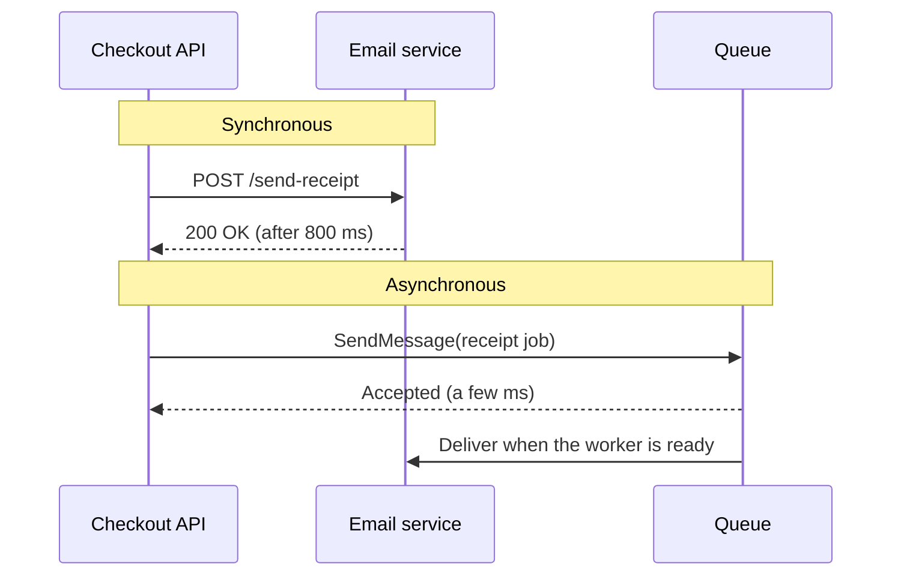
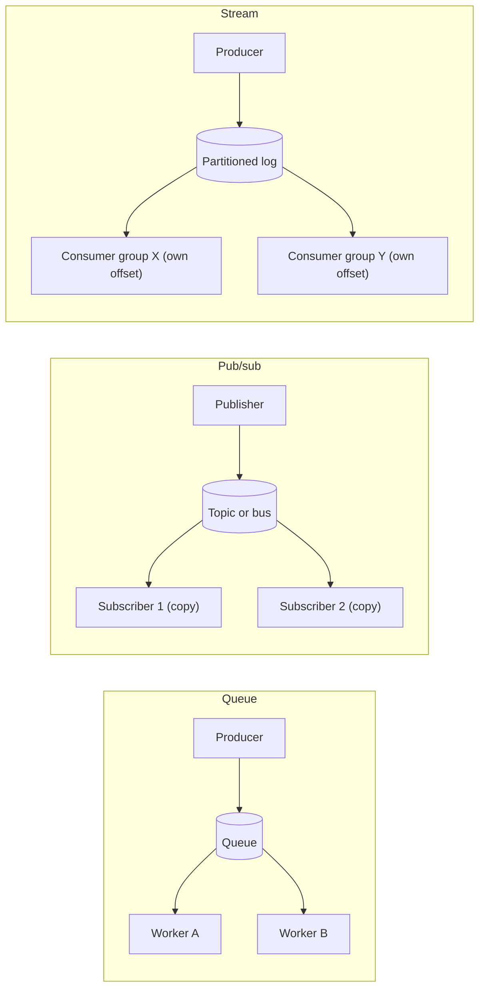
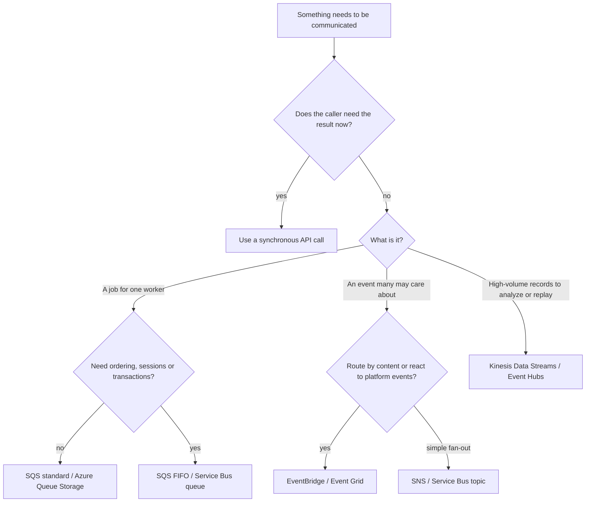
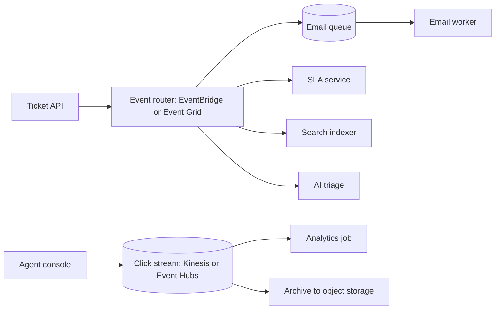

# Choosing a Messaging Service

## Introduction

Sooner or later, every cloud application needs one part of the system to tell another part that something happened, or that some work needs doing. You can do that with a direct HTTP call: the checkout service calls the email service, waits for an answer, and carries on. That works until the email service is slow, down, or overwhelmed, at which point checkout becomes slow, down, or overwhelmed too.

A **messaging service** puts a durable middleman between the two. The sender drops a message off and moves on; the receiver picks it up when it is ready. That one change gives you three big wins:

- **Decoupling**: the sender does not need to know who the receivers are, where they run, or whether they are online right now.
- **Load leveling**: a traffic spike fills up a buffer instead of knocking over the downstream service.
- **Resilience**: if a consumer crashes, the message waits and is retried instead of being lost.

The hard part is not *whether* to use messaging but *which kind*. AWS and Azure each offer half a dozen services with overlapping features. A useful analogy is the ways an office passes information around:

- A **queue** is the shared to-do tray. Each job is taken by exactly one worker, and it stays in the tray until someone finishes it.
- **Publish/subscribe (pub/sub)** is the office newsletter. Everyone who signed up gets their own copy of every issue.
- A **stream** is the security camera recording. Events are written to a log in order, kept for days, and anyone can rewind and watch from any point.

This page gives you the map. The following pages go deep on each family: [queues](./1-cloud-sqs-and-service-bus.mdx), [pub/sub](./2-cloud-sns-and-event-grid.mdx), [streams](./3-cloud-kinesis-and-event-hubs.mdx) and [event-driven patterns](./4-cloud-event-driven-patterns.mdx).

## Synchronous vs Asynchronous Communication

Before choosing a service, check that you need asynchronous messaging at all.



| Question | Synchronous call (HTTP, gRPC) | Asynchronous message |
| --- | --- | --- |
| Does the caller need the answer right now? | Yes, use this | No, use this |
| What happens if the receiver is down? | The caller fails or retries | The message waits |
| How do spikes affect the receiver? | Passed straight through | Absorbed by the buffer |
| How easy is it to debug? | Easier: one request, one trace | Harder: work happens later, elsewhere |
| Typical example | "Is this coupon valid?" | "Send the receipt email" |

A good rule of thumb: if the user is waiting on the screen for the result, use a synchronous call. If the work can happen a few seconds (or minutes) later, a message is usually the better fit.

## The Three Families of Messaging

### Queues: one message, one consumer

A queue holds **commands** or **jobs**: "resize this image", "charge this card", "send this email". Many workers can read from the same queue (the *competing consumers* pattern), but each message is handled by one of them. When a worker finishes, it deletes or completes the message. If it crashes, the message reappears and another worker tries again.

- **AWS**: Amazon SQS (standard and FIFO queues)
- **Azure**: Azure Service Bus queues, and the simpler Azure Queue Storage

### Pub/sub: one message, many subscribers

A topic or event bus holds **events**: "order placed", "file uploaded", "user signed up". The publisher does not know or care who is listening. Each subscriber gets its own copy and can filter for only the events it wants.

There are two flavors:

- **Notification fan-out**: push a message to many endpoints (queues, functions, HTTP, email). AWS: Amazon SNS. Azure: Service Bus topics.
- **Event routing**: a serverless router that matches events by content and sends them to targets, including events emitted by the cloud platform itself. AWS: Amazon EventBridge. Azure: Azure Event Grid.

### Streams: an ordered, replayable log

A stream holds a high-volume sequence of **records**: clicks, sensor readings, log lines, change events. Records are appended to partitions (shards), kept for a retention period, and *not* deleted when read. Each consumer tracks its own position, so several applications can read the same data independently, and any of them can rewind and replay.

- **AWS**: Amazon Kinesis Data Streams, and Amazon MSK (managed Apache Kafka)
- **Azure**: Azure Event Hubs (which also speaks the Kafka protocol)



## Seeing the Difference in Code

The fastest way to feel the difference is to simulate all three in plain Python. No cloud account needed.

```python
from collections import deque

# 1. Queue: each message goes to exactly one worker
queue = deque(["job-1", "job-2", "job-3", "job-4"])
workers = ["worker-A", "worker-B"]
i = 0
print("QUEUE")
while queue:
    job = queue.popleft()            # receive + delete
    print(f"  {workers[i % 2]} handled {job}")
    i += 1

# 2. Pub/sub: every subscriber gets a copy (optionally filtered)
subscribers = {
    "email-service": lambda e: True,
    "fraud-service": lambda e: e["total"] > 500,
}
print("PUB/SUB")
for event in [{"id": "o-1", "total": 40}, {"id": "o-2", "total": 900}]:
    for name, wants in subscribers.items():
        if wants(event):
            print(f"  {name} got {event['id']}")

# 3. Stream: records stay in the log; each consumer keeps its own offset
log = ["click-1", "click-2", "click-3"]
offsets = {"analytics": 0, "recommendations": 0}
print("STREAM")
for consumer in offsets:
    for record in log[offsets[consumer]:]:
        print(f"  {consumer} read {record}")
    offsets[consumer] = len(log)
offsets["analytics"] = 0             # rewind and replay
print(f"  analytics rewound, can re-read {len(log) - offsets['analytics']} records")
```

Output:

```text
QUEUE
  worker-A handled job-1
  worker-B handled job-2
  worker-A handled job-3
  worker-B handled job-4
PUB/SUB
  email-service got o-1
  email-service got o-2
  fraud-service got o-2
STREAM
  analytics read click-1
  analytics read click-2
  analytics read click-3
  recommendations read click-1
  recommendations read click-2
  recommendations read click-3
  analytics rewound, can re-read 3 records
```

Notice the key behaviors: the queue *removes* work as it is done, pub/sub *copies* each event to each interested subscriber, and the stream *keeps* records so any consumer can re-read them.

## AWS and Azure Service Map

| Need | AWS | Azure | Notes |
| --- | --- | --- | --- |
| Simple, massive-scale work queue | Amazon SQS standard queue | Azure Queue Storage | Both are cheap and simple; Queue Storage has fewer features |
| Queue with ordering, sessions, transactions | Amazon SQS FIFO queue | Azure Service Bus queue (Standard or Premium) | Service Bus is a full enterprise broker (AMQP, JMS, transactions) |
| Fan-out notifications | Amazon SNS | Azure Service Bus topics | SNS can push to SQS, Lambda, HTTP, email, SMS, mobile |
| Content-based event routing, platform events | Amazon EventBridge | Azure Event Grid | Both react to events from the cloud platform itself |
| High-throughput ordered stream | Amazon Kinesis Data Streams | Azure Event Hubs | Partitions/shards, retention, replay |
| Managed Kafka | Amazon MSK | Event Hubs Kafka endpoint (Standard tier and above) | Event Hubs speaks the Kafka protocol; it is not a Kafka cluster |
| Managed traditional broker (ActiveMQ, RabbitMQ) | Amazon MQ | No first-party equivalent; Service Bus covers most JMS needs | Useful for lift-and-shift of existing broker apps |
| Stream to storage or warehouse with no code | Amazon Data Firehose | Event Hubs Capture | Firehose was renamed from "Kinesis Data Firehose" in 2024 |
| Scheduled events | EventBridge Scheduler | Logic Apps recurrence, Functions timer trigger | |
| IoT and MQTT devices | AWS IoT Core | Event Grid namespaces (MQTT broker), Azure IoT Hub | |

:::note
Service names, tiers and limits change. In 2026, for example, EventBridge introduced a new **Custom Event Bus** alongside the original rules-based bus, which is now called **Custom Event Bus - Classic**. Check the [Amazon EventBridge user guide](https://docs.aws.amazon.com/eventbridge/latest/userguide/eb-what-is.html) and the [Azure messaging services comparison](https://learn.microsoft.com/en-us/azure/service-bus-messaging/compare-messaging-services) before you commit to a design.
:::

## The Questions That Decide It

### 1. Is it a command or an event?

- A **command** says "do this" and has one intended handler: `ResizeImage`, `ChargeCard`. Use a **queue**.
- An **event** says "this happened" and may interest many parties, including ones that do not exist yet: `OrderPlaced`, `BlobCreated`. Use **pub/sub**.
- A **telemetry record** is one of millions of small facts you analyze in bulk: a click, a temperature reading. Use a **stream**.

### 2. How many consumers, and do they need the history?

If a brand-new consumer next month needs to process last week's data, you need retention and replay. Queues and most pub/sub services delete a message once it is delivered. Streams keep it for the retention period. (EventBridge's new Custom Event Bus and SNS FIFO topics also offer retention and replay, which blurs the line a little.)

### 3. Does order matter?

Ordering is expensive, so services make you opt in:

| Service | Ordering |
| --- | --- |
| SQS standard | Best-effort only |
| SQS FIFO | Strict, per `MessageGroupId` |
| Service Bus queue | Strict per session when sessions are enabled |
| SNS FIFO topic | Strict per message group, delivered to SQS FIFO queues |
| EventBridge Classic, Event Grid | No ordering guarantee |
| Kinesis, Event Hubs | Strict per shard or partition (same partition key) |

You almost never need *global* order. You usually need order **per entity**: all events for order 42 in sequence. Every service that supports ordering does it by a key.

### 4. What delivery guarantee do you need?

Nearly every cloud messaging service is **at-least-once**: a message can be delivered more than once (after a timeout, a retry, or a network blip). Some offer deduplication windows (SQS FIFO, Service Bus duplicate detection), but you should still write **idempotent consumers** that can safely process the same message twice. The [event-driven patterns page](./4-cloud-event-driven-patterns.mdx) shows how.

### 5. How big, how fast, how far?

| Limit (check the docs, these change) | Typical value today |
| --- | --- |
| SQS maximum message size | 1 MiB (raised from 256 KiB in 2025) |
| SNS maximum message size | 256 KiB by default, configurable up to 1 MiB |
| Service Bus message size | 256 KB on Standard; up to 100 MB on Premium over AMQP |
| Event Grid event size | 1 MB |
| Kinesis record payload | Up to 10 MiB |
| Event Hubs event size | 256 KB on Basic, 1 MB on Standard and Premium |

For anything larger (videos, PDFs, big JSON documents), store the payload in object storage and send a reference. This is the **claim check** pattern.

## A Decision Flowchart



## How Messaging Is Billed

Prices vary by region and change over time, so always check the [AWS Pricing Calculator](https://calculator.aws/) and the [Azure Pricing Calculator](https://azure.microsoft.com/pricing/calculator/). What matters when designing is *how* each service bills:

| Service | Main billing dimensions |
| --- | --- |
| SQS | Per request (send, receive, delete), with each 64 KB chunk of payload counted as one request |
| SNS | Per publish, plus per delivery (varies by endpoint type: SQS and Lambda deliveries are billed differently from SMS or email) |
| EventBridge | Per event published to custom buses; many AWS service events on the default bus are free; extra for archive, replay, Pipes and Scheduler |
| Kinesis Data Streams | On-demand: per GB written and read plus a per-stream charge (On-demand Standard). Provisioned: per shard-hour plus PUT payload units |
| Service Bus | Basic and Standard: per operation, with a base charge on Standard. Premium: per messaging unit per hour |
| Event Grid | Per operation, with each 64 KB chunk counted as one operation |
| Event Hubs | Basic and Standard: per throughput unit per hour plus ingress events. Premium: per processing unit per hour. Dedicated: per capacity unit per hour |
| All of them | Data transfer out of the region or to the internet |

Two practical consequences:

- **Pay-per-request services** (SQS, SNS, EventBridge, Event Grid, Service Bus Basic) cost almost nothing when idle. Great for spiky or low-volume workloads.
- **Capacity-based services** (Kinesis provisioned, Event Hubs, Service Bus Premium) bill by the hour **even when nobody sends a message**. Do not leave test streams running.

## A Quick Look with the CLIs

You will create resources on the following pages. For now, here is how you list what exists in each cloud. These commands are read-only.

### On AWS

```bash
aws sqs list-queues
aws sns list-topics
aws events list-event-buses
aws kinesis list-streams
```

Example output (trimmed):

```text
{
    "QueueUrls": [
        "https://sqs.us-east-1.amazonaws.com/111122223333/orders-queue"
    ]
}
{
    "Topics": [
        { "TopicArn": "arn:aws:sns:us-east-1:111122223333:order-events" }
    ]
}
```

### On Azure

```bash
az servicebus namespace list --output table
az eventgrid topic list --output table
az eventhubs namespace list --output table
```

Example output (trimmed):

```text
Name              ResourceGroup    Location    Sku
----------------  ---------------  ----------  --------
helpdesk-sb-dev   rg-helpdesk-dev  eastus      Standard
```

## Real-World Scenario

Your team runs a SaaS helpdesk. Three new requirements land in the same sprint:

1. When a ticket is created, send a confirmation email to the customer. The email provider sometimes throttles you for a few minutes.
2. When a ticket is created, the SLA service, the search indexer and a new AI triage service all need to know. More teams will want this event later.
3. Product wants every click in the agent console for usage analytics, about a few thousand events per second at peak, with the ability to reprocess the last week of data when the analytics model changes.

Matching each requirement to a family:

| Requirement | Family | AWS | Azure |
| --- | --- | --- | --- |
| Confirmation email | Queue (command, one handler, retries) | SQS standard queue + Lambda | Service Bus queue + Azure Functions |
| `TicketCreated` to many services | Pub/sub (event, many handlers, filters) | EventBridge bus, one rule per consumer, or SNS to per-service SQS queues | Event Grid custom topic, or Service Bus topic with subscriptions |
| Click analytics | Stream (high volume, replay) | Kinesis Data Streams, on-demand mode | Event Hubs Standard with Capture to Blob Storage |



**Why this approach:** each requirement has different needs. The email job must survive provider throttling, so a queue with retries and a dead-letter queue fits. The ticket event has an open-ended set of consumers, so a router keeps the ticket API from knowing about any of them. Clicks are high-volume and need replay, which only a stream gives you cheaply.

**When to use it / when not to:** this split is worth it once you have more than one consumer or real reliability requirements. For a prototype with one service and one email, a single queue (or even a background thread) is fine. Do not add a stream "just in case": streams on capacity-based pricing cost money every hour.

**Alternatives and trade-offs:**

| Approach | Pros | Cons | Best for |
| --- | --- | --- | --- |
| One queue for everything | Simple, cheap | Every consumer competes for the same messages; no fan-out | One producer, one type of worker |
| SNS or Service Bus topic for everything | Fan-out, filtering | No replay, awkward at clickstream volume | Moderate-volume business events |
| EventBridge or Event Grid for everything | Content routing, platform events, schema discovery | Per-event cost adds up at very high volume; limited ordering on Classic buses | Business events across teams and accounts |
| Kafka (MSK, or Event Hubs Kafka endpoint) for everything | One log for all data, huge ecosystem, replay | Operational and conceptual weight, partitions to plan | Data-platform teams already invested in Kafka |
| Mix per requirement (shown above) | Each workload gets the right tool | More services to learn and monitor | Most real systems |

## Common Mistakes

- **Using a queue for fan-out.** Two services polling the same SQS queue do not both get every message; they *split* them. Use pub/sub or one queue per consumer.
- **Using a stream as a job queue.** Streams do not have per-message acknowledgment or visibility timeouts. One poison record can block a whole shard. Use a queue for jobs.
- **Assuming exactly-once delivery.** Design every consumer to be idempotent, even with FIFO or duplicate detection turned on.
- **Ignoring message size limits.** Put large payloads in S3 or Blob Storage and send a pointer.
- **Forgetting dead-letter queues.** Without one, a message that always fails either retries forever or quietly disappears.
- **Picking by familiarity alone.** "We know Kafka" is a fine reason, but count the cost of running partitions, consumer groups and schema management for a workload that a queue would handle.
- **Leaving capacity-billed resources running.** Delete test Kinesis streams, Event Hubs namespaces and Service Bus Premium namespaces when you are done.

## Summary

- Messaging decouples services, levels load and adds resilience; use synchronous calls when the caller needs the answer immediately.
- **Queues** (SQS, Service Bus queues, Queue Storage) deliver each job to one consumer.
- **Pub/sub** (SNS, EventBridge, Event Grid, Service Bus topics) delivers a copy of each event to every interested subscriber.
- **Streams** (Kinesis Data Streams, Event Hubs, MSK) keep an ordered, partitioned log that many consumers can read and replay.
- Ordering is per key, delivery is almost always at-least-once, and consumers must be idempotent.
- Billing is either per request (cheap when idle) or per unit of capacity (billed every hour); prices vary, so use the official calculators.

## Exercises

1. For each of these, decide queue, pub/sub or stream, and name the AWS and Azure service: (a) generating a monthly invoice PDF per customer, (b) notifying five microservices that a user deleted their account, (c) collecting GPS positions from 20,000 delivery vans every five seconds.
2. Extend the Python simulation so the queue section redelivers a job when a worker "crashes" (raises an exception) and moves it to a dead-letter list after three failures.
3. Pick a messaging service you have never used and find its current maximum message size and retention period in the official docs. Note where the limit lives so you can check it again later.
4. Sketch the helpdesk architecture for a system that must run in both AWS and Azure. Which parts would you keep cloud-specific, and which would you abstract?

Next, go deeper on each family:

- [Queues: SQS and Azure Service Bus](./1-cloud-sqs-and-service-bus.mdx)
- [Pub/Sub: SNS, EventBridge and Event Grid](./2-cloud-sns-and-event-grid.mdx)
- [Streaming: Kinesis and Event Hubs](./3-cloud-kinesis-and-event-hubs.mdx)
- [Event-Driven Patterns in the Cloud](./4-cloud-event-driven-patterns.mdx)
- Related: [Event Sources and Triggers](../4-cloud-serverless/3-cloud-serverless-triggers.mdx) and [Workflows: Step Functions and Durable Functions](../4-cloud-serverless/5-cloud-step-functions-durable.mdx)
