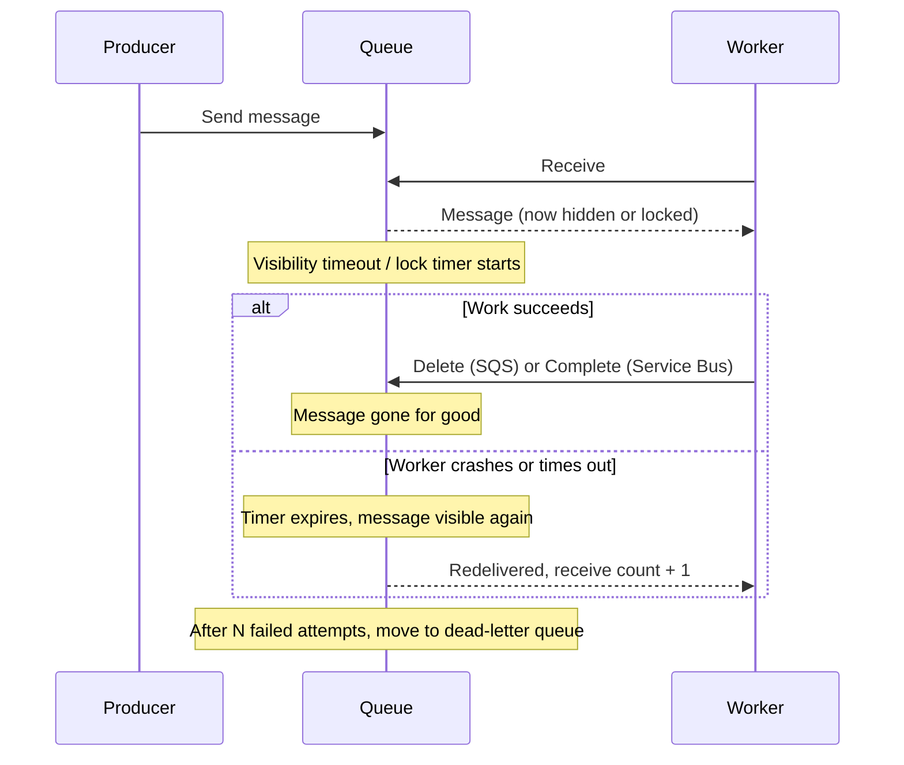
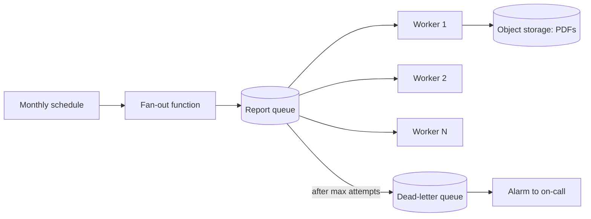

# Queues: SQS and Azure Service Bus

## Introduction

A queue is the simplest and most useful messaging tool in the cloud. One part of your system puts **jobs** in, another part takes them out and does the work. The two sides never talk directly, run at their own pace, and can fail independently.

Think of the order rail in a busy restaurant kitchen. Waiters clip tickets to the rail as orders come in. Cooks take the next ticket when they have a free hand. If the dinner rush brings fifty orders at once, the rail gets long, but nobody shouts at the waiters to stop taking orders. If a cook burns a dish, the ticket goes back on the rail. And if one ticket keeps failing ("we are out of truffles"), it gets pulled aside for the manager instead of blocking the kitchen.

That is exactly what a cloud queue gives you: buffering, retries, and a place for problem messages. In this page you will:

- Learn the receive, process, delete cycle that every cloud queue uses
- Create and use **Amazon SQS** queues (standard and FIFO) with the AWS CLI and `boto3`
- Create and use **Azure Service Bus** queues with the Azure CLI and `azure-servicebus`
- Configure **dead-letter queues**, choose timeouts, and write **idempotent** consumers
- Decide between SQS, Service Bus and Azure Queue Storage

If you have not read [Choosing a Messaging Service](./0-cloud-messaging-options.mdx), start there for the big picture.

## How a Cloud Queue Delivers Messages

Cloud queues do not hand a message to a consumer and forget it. They **lend** it. The consumer must confirm success, or the message comes back.



The two clouds use different words for the same idea:

| Concept | Amazon SQS | Azure Service Bus |
| --- | --- | --- |
| Hide a message while it is processed | Visibility timeout (default 30 seconds, max 12 hours) | Peek-lock with lock duration (default 1 minute, max 5 minutes, renewable) |
| Confirm success | `DeleteMessage` | Complete the message |
| Give up now, retry later | Change visibility to 0 | Abandon the message |
| Count of attempts | `ApproximateReceiveCount` | Delivery count |
| Move failures aside | Redrive policy to a separate DLQ queue, `maxReceiveCount` | Built-in `$deadletterqueue` subqueue, max delivery count (default 10) |
| Fire-and-forget read | Not available | Receive-and-delete mode |
| Message retention | 4 days default, 1 minute to 14 days | Time to live per message or queue default |
| Ordering | FIFO queues, per message group | Sessions, per session ID |
| Built-in deduplication | FIFO queues, 5-minute window | Duplicate detection, configurable window (default 10 minutes) |

Because a message can come back after a timeout, both services give you **at-least-once** delivery. Your consumer must handle duplicates. We will build an idempotent consumer later on this page.

## On AWS: Amazon SQS

SQS is a fully managed, pay-per-request queue. There are no servers or namespaces to size: you create a queue and start sending.

### Standard vs FIFO queues

| | Standard queue | FIFO queue |
| --- | --- | --- |
| Ordering | Best-effort | Strict within a `MessageGroupId` |
| Duplicates | Possible | Deduplicated within a 5-minute window |
| Throughput | Nearly unlimited | Limited per partition; high-throughput mode raises it a lot |
| Name | Any | Must end in `.fifo` |
| Use for | Most background jobs | Per-entity ordering: bank account events, inventory updates |

In 2025 AWS also added **fair queues** to standard queues: if you set a `MessageGroupId` on messages in a standard queue, SQS reduces the "noisy neighbor" effect so one busy tenant does not delay everyone else. It does not give FIFO ordering. See [SQS fair queues](https://docs.aws.amazon.com/AWSSimpleQueueService/latest/SQSDeveloperGuide/sqs-fair-queues.html).

:::warning Cost
SQS bills per request (each 64 KB chunk of payload counts as one request). A few test queues cost close to nothing, but a consumer polling an empty queue in a tight loop without long polling adds up. Delete test queues when you are done (cleanup commands are at the end of this section).
:::

### Create a queue with a dead-letter queue

First create the dead-letter queue (DLQ), then the main queue with a **redrive policy** that points to it.

```bash
# 1. Dead-letter queue: keep failed messages for the maximum 14 days
aws sqs create-queue \
  --queue-name helpdesk-email-dlq \
  --attributes MessageRetentionPeriod=1209600

DLQ_URL=$(aws sqs get-queue-url --queue-name helpdesk-email-dlq --query QueueUrl --output text)
DLQ_ARN=$(aws sqs get-queue-attributes --queue-url "$DLQ_URL" \
  --attribute-names QueueArn --query Attributes.QueueArn --output text)

# 2. Main queue: 20 s long polling, 60 s visibility, 5 attempts before the DLQ
cat > attrs.json <<EOF
{
  "ReceiveMessageWaitTimeSeconds": "20",
  "VisibilityTimeout": "60",
  "RedrivePolicy": "{\"deadLetterTargetArn\":\"$DLQ_ARN\",\"maxReceiveCount\":\"5\"}"
}
EOF
aws sqs create-queue --queue-name helpdesk-email --attributes file://attrs.json
```

Example output:

```text
{
    "QueueUrl": "https://sqs.us-east-1.amazonaws.com/111122223333/helpdesk-email-dlq"
}
{
    "QueueUrl": "https://sqs.us-east-1.amazonaws.com/111122223333/helpdesk-email"
}
```

Note that `RedrivePolicy` is a JSON **string** inside the attributes JSON, which is why the inner quotes are escaped.

### Send and receive from the CLI

```bash
Q_URL=$(aws sqs get-queue-url --queue-name helpdesk-email --query QueueUrl --output text)

aws sqs send-message --queue-url "$Q_URL" \
  --message-body '{"ticketId": "T-1001", "to": "ana@example.com"}'

aws sqs receive-message --queue-url "$Q_URL" \
  --max-number-of-messages 1 --wait-time-seconds 10
```

Example output (trimmed):

```text
{
    "MD5OfMessageBody": "4b3c...",
    "MessageId": "5fea7756-0ea4-451a-a703-a558b933e274"
}
{
    "Messages": [
        {
            "MessageId": "5fea7756-0ea4-451a-a703-a558b933e274",
            "ReceiptHandle": "AQEBzbVv...",
            "Body": "{\"ticketId\": \"T-1001\", \"to\": \"ana@example.com\"}"
        }
    ]
}
```

To finish the job, delete it using the `ReceiptHandle` (not the `MessageId`):

```bash
aws sqs delete-message --queue-url "$Q_URL" --receipt-handle "AQEBzbVv..."
```

### A worker in Python with boto3

A real worker runs in a loop with **long polling** (waiting up to 20 seconds for messages instead of returning immediately), processes a batch, and deletes only what succeeded.

```python
import json
import boto3

sqs = boto3.client("sqs")  # credentials come from SSO, a role, or the environment
QUEUE_URL = sqs.get_queue_url(QueueName="helpdesk-email")["QueueUrl"]


def send_email(job: dict) -> None:
    if "@" not in job["to"]:
        raise ValueError(f"bad address {job['to']}")
    print(f"sent receipt for {job['ticketId']} to {job['to']}")


def run_once() -> None:
    resp = sqs.receive_message(
        QueueUrl=QUEUE_URL,
        MaxNumberOfMessages=10,      # batch of up to 10
        WaitTimeSeconds=20,          # long polling
        MessageSystemAttributeNames=["ApproximateReceiveCount"],
    )
    for msg in resp.get("Messages", []):
        attempts = msg["Attributes"]["ApproximateReceiveCount"]
        try:
            send_email(json.loads(msg["Body"]))
            sqs.delete_message(QueueUrl=QUEUE_URL, ReceiptHandle=msg["ReceiptHandle"])
        except Exception as exc:
            # Do NOT delete: the message reappears after the visibility timeout
            print(f"attempt {attempts} failed: {exc}")


if __name__ == "__main__":
    while True:
        run_once()
```

Example output:

```text
sent receipt for T-1001 to ana@example.com
attempt 1 failed: bad address not-an-email
```

After five failed attempts, SQS moves the bad message to `helpdesk-email-dlq`. When you have fixed the cause, you can move messages back with a **DLQ redrive**:

```bash
aws sqs start-message-move-task --source-arn "$DLQ_ARN"
```

With no destination given, messages go back to the queue they originally came from.

### Let Lambda do the polling

In serverless designs you usually let Lambda poll the queue for you through an **event source mapping**. Turn on **partial batch responses** so one bad message does not force the whole batch to be retried.

```bash
aws lambda create-event-source-mapping \
  --function-name send-receipt \
  --event-source-arn arn:aws:sqs:us-east-1:111122223333:helpdesk-email \
  --batch-size 10 \
  --function-response-types ReportBatchItemFailures
```

The handler returns the IDs of the messages that failed:

```python
import json


def handler(event, context):
    failures = []
    for record in event["Records"]:
        try:
            job = json.loads(record["body"])
            print(f"sending receipt for {job['ticketId']}")
        except Exception:
            failures.append({"itemIdentifier": record["messageId"]})
    return {"batchItemFailures": failures}
```

:::tip
Set the queue's visibility timeout to at least six times the function timeout, as recommended in the [Lambda SQS configuration docs](https://docs.aws.amazon.com/lambda/latest/dg/services-sqs-configure.html), and a `maxReceiveCount` of at least 5 so Lambda has room to retry after throttling. Otherwise a message can reappear while a slow invocation is still working on it, and you get duplicate processing.
:::

### FIFO in one example

```bash
aws sqs create-queue --queue-name inventory.fifo \
  --attributes FifoQueue=true,ContentBasedDeduplication=true

aws sqs send-message \
  --queue-url https://sqs.us-east-1.amazonaws.com/111122223333/inventory.fifo \
  --message-body '{"sku": "MUG-01", "delta": -1}' \
  --message-group-id MUG-01
```

All messages with `--message-group-id MUG-01` are delivered in order, one batch at a time. Different SKUs use different groups and are processed in parallel.

### Cleanup on AWS

```bash
aws sqs delete-queue --queue-url "$Q_URL"
aws sqs delete-queue --queue-url "$DLQ_URL"
aws sqs delete-queue --queue-url https://sqs.us-east-1.amazonaws.com/111122223333/inventory.fifo
```

## On Azure: Azure Service Bus

Service Bus is a full enterprise message broker. You first create a **namespace** (a container with a tier and a DNS name like `mycompany.servicebus.windows.net`), then queues and topics inside it.

| Tier | What you get | Billing model |
| --- | --- | --- |
| Basic | Queues only, 256 KB messages | Per operation |
| Standard | Queues **and topics**, sessions, transactions, duplicate detection, 256 KB messages | Base charge plus per operation |
| Premium | Everything in Standard plus dedicated capacity, large messages (up to 100 MB over AMQP), private endpoints, geo-replication | Per messaging unit per hour |

:::warning Cost
A Standard namespace has a base charge for as long as it exists, and Premium bills every hour per messaging unit even with zero traffic. Use Basic or Standard for learning, put everything in one resource group, and delete the group when you finish.
:::

### Create a namespace and queue

```bash
RG=rg-helpdesk-dev
NS=helpdesk-sb-$RANDOM          # namespace names are globally unique

az group create --name $RG --location eastus
az servicebus namespace create --resource-group $RG --name $NS --sku Standard

az servicebus queue create \
  --resource-group $RG --namespace-name $NS --name email \
  --lock-duration PT1M \
  --max-delivery-count 5 \
  --default-message-time-to-live P7D \
  --enable-dead-lettering-on-message-expiration true
```

Example output (trimmed):

```text
{
  "deadLetteringOnMessageExpiration": true,
  "lockDuration": "PT1M",
  "maxDeliveryCount": 5,
  "name": "email",
  "status": "Active"
}
```

Durations use ISO 8601 format: `PT1M` is one minute, `P7D` is seven days. You do not create the dead-letter queue yourself: every queue has a `$deadletterqueue` subqueue.

### Grant access with Microsoft Entra ID, not keys

Service Bus supports shared access signature (SAS) keys and connection strings, but the recommended approach is **Microsoft Entra ID** with Azure RBAC. Your app then authenticates with a managed identity in Azure, or your developer login locally, and there is no secret to leak.

```bash
NS_ID=$(az servicebus namespace show -g $RG -n $NS --query id -o tsv)
ME=$(az ad signed-in-user show --query id -o tsv)

az role assignment create --assignee $ME \
  --role "Azure Service Bus Data Sender" --scope $NS_ID
az role assignment create --assignee $ME \
  --role "Azure Service Bus Data Receiver" --scope $NS_ID
```

Role assignments can take a few minutes to take effect.

### Send and receive in Python

Install the packages: `pip install azure-servicebus azure-identity`.

```python
import json
from azure.identity import DefaultAzureCredential
from azure.servicebus import ServiceBusClient, ServiceBusMessage

FQDN = "helpdesk-sb-12345.servicebus.windows.net"   # your namespace
QUEUE = "email"

credential = DefaultAzureCredential()   # az login locally, managed identity in Azure

with ServiceBusClient(FQDN, credential) as client:
    # Send
    with client.get_queue_sender(QUEUE) as sender:
        job = {"ticketId": "T-1001", "to": "ana@example.com"}
        sender.send_messages(ServiceBusMessage(json.dumps(job), message_id="T-1001-receipt"))
        print("sent")

    # Receive with peek-lock (the default mode)
    with client.get_queue_receiver(QUEUE, max_wait_time=5) as receiver:
        for msg in receiver:
            body = json.loads(str(msg))
            try:
                if "@" not in body["to"]:
                    raise ValueError("bad address")
                print(f"emailed {body['to']} (delivery count {msg.delivery_count})")
                receiver.complete_message(msg)          # success: remove it
            except ValueError as exc:
                receiver.dead_letter_message(           # hopeless: park it now
                    msg, reason="InvalidAddress", error_description=str(exc))
            except Exception:
                receiver.abandon_message(msg)           # transient: retry later
```

Example output:

```text
sent
emailed ana@example.com (delivery count 1)
```

Notice the three outcomes. **Complete** for success, **abandon** for a transient failure you expect to succeed later, and **dead-letter** for a message that will never succeed, so you do not waste the remaining retries. Always settle a message before you close the receiver; otherwise the lock expires and the delivery count goes up.

### Read the dead-letter queue

```python
from azure.identity import DefaultAzureCredential
from azure.servicebus import ServiceBusClient, ServiceBusSubQueue

FQDN = "helpdesk-sb-12345.servicebus.windows.net"

with ServiceBusClient(FQDN, DefaultAzureCredential()) as client:
    with client.get_queue_receiver("email", sub_queue=ServiceBusSubQueue.DEAD_LETTER,
                                   max_wait_time=5) as dlq:
        for msg in dlq:
            print(msg.dead_letter_reason, "-", msg.dead_letter_error_description)
            dlq.complete_message(msg)   # remove once you have handled it
```

Example output:

```text
InvalidAddress - bad address
```

System reasons you will see include `MaxDeliveryCountExceeded` and `TTLExpiredException`. The Service Bus Explorer in the Azure portal can also peek, edit and resend dead-lettered messages.

### Sessions for ordered processing

To process messages for the same entity in order, enable sessions and set a `session_id` on each message. A receiver locks a whole session, so all messages for `MUG-01` go to one receiver, in order.

```bash
az servicebus queue create -g $RG --namespace-name $NS --name inventory --enable-session true
```

```python
from azure.servicebus import ServiceBusMessage

msg = ServiceBusMessage('{"sku": "MUG-01", "delta": -1}', session_id="MUG-01")
```

### Azure Queue Storage: the lightweight option

Azure also has **Queue Storage**, part of a Storage account. It is very cheap and simple: messages up to 64 KB, no topics, sessions, transactions or built-in dead-lettering. Use it for simple background jobs where Service Bus features are overkill; it is the closer cousin of SQS standard. Microsoft's [Storage queues and Service Bus queues comparison](https://learn.microsoft.com/en-us/azure/service-bus-messaging/service-bus-azure-and-service-bus-queues-compared-contrasted) covers the details.

### Cleanup on Azure

```bash
az group delete --name $RG --yes --no-wait
```

## Writing an Idempotent Consumer

Both services can deliver the same message twice. The fix is not in the queue; it is in your consumer. Record what you have already processed and skip repeats. This runnable example uses SQLite as the "processed" store, but in the cloud you would use DynamoDB, Cosmos DB, or a unique constraint in your main database.

```python
import sqlite3

db = sqlite3.connect(":memory:")
db.execute("CREATE TABLE processed (message_id TEXT PRIMARY KEY)")
emails_sent = []


def handle(message_id: str, to: str) -> str:
    try:
        # The insert fails if we have seen this ID before
        with db:
            db.execute("INSERT INTO processed (message_id) VALUES (?)", (message_id,))
            emails_sent.append(to)          # the side effect, in the same transaction
        return "processed"
    except sqlite3.IntegrityError:
        return "duplicate, skipped"


for mid, to in [("m-1", "ana@example.com"), ("m-2", "li@example.com"), ("m-1", "ana@example.com")]:
    print(mid, handle(mid, to))
print("emails sent:", emails_sent)
```

Output:

```text
m-1 processed
m-2 processed
m-1 duplicate, skipped
emails sent: ['ana@example.com', 'li@example.com']
```

Use a **business key** as the ID when you can (for example `T-1001-receipt`), not only the broker's message ID. A producer that retries a send creates a new broker message ID, but the business key stays the same.

## Real-World Scenario

Your team runs a SaaS helpdesk that generates a PDF report for each customer at the end of every month: around 40,000 jobs that arrive in one burst at midnight UTC. Each job takes 5 to 60 seconds. A few customers have corrupted data that always makes generation fail.

**Solution on AWS:** a scheduler (EventBridge Scheduler) triggers a function that enqueues one SQS message per customer. A fleet of workers (Lambda, or ECS tasks for the longer reports) reads the queue with a visibility timeout comfortably above the slowest job. After 5 failed attempts (AWS recommends at least 5 when Lambda consumes the queue, because throttling also counts as a receive) a message moves to the DLQ, and an alarm on the DLQ's `ApproximateNumberOfMessagesVisible` metric notifies the on-call engineer.

**Solution on Azure:** a timer-triggered Azure Function enqueues one Service Bus message per customer into a Standard-tier queue with max delivery count 3. Workers in Azure Functions or Azure Container Apps (scaling on queue length) process them, using automatic lock renewal for jobs longer than the lock duration. An Azure Monitor alert fires on the dead-letter message count.



**Why this approach:** the queue turns a 40,000-job spike into a steady stream your workers can handle, retries transient failures automatically, and isolates the corrupt-data customers in the DLQ without blocking anyone else.

**When to use it / when not to:** this fits any batch of independent jobs. It does not fit if jobs depend on each other in a sequence with branching (use a workflow service like Step Functions or Durable Functions), or if each result must come back to a waiting user immediately.

**Alternatives and trade-offs:**

| Approach | Pros | Cons | Best for |
| --- | --- | --- | --- |
| SQS standard | Serverless, pay per request, near-unlimited throughput, deep Lambda integration | No sessions or transactions, best-effort order | Most AWS background jobs |
| SQS FIFO | Ordering per group, deduplication | Lower throughput per group, `.fifo` naming | Per-entity ordered processing on AWS |
| Service Bus Standard | Sessions, transactions, topics, duplicate detection, AMQP and JMS | Base charge per namespace; 256 KB messages | Enterprise workflows on Azure |
| Service Bus Premium | Dedicated capacity, big messages, private endpoints | Billed per messaging unit per hour | High-volume or regulated production on Azure |
| Azure Queue Storage | Very cheap, very simple | 64 KB messages, no DLQ, no ordering | Simple Azure background jobs |
| Database table as a queue | No new service | Polling load, locking bugs, no scaling help | Tiny apps only |

## Common Mistakes

- **Visibility timeout or lock shorter than the work.** The message reappears while the first worker is still busy, and two workers process it. Size the timeout from your slowest realistic job, or extend it (SQS `ChangeMessageVisibility`, Service Bus lock renewal).
- **Deleting before processing.** If you delete and then crash, the job is lost. Delete or complete *after* the work succeeds.
- **No dead-letter queue, or no alarm on it.** A DLQ nobody watches is just a slower way to lose data.
- **Short polling in a loop.** Without `WaitTimeSeconds`, an idle SQS worker makes many empty requests that you pay for.
- **Non-idempotent consumers.** Charging a card twice because a message was redelivered is a real incident. Deduplicate on a business key.
- **Connection strings in code.** Prefer Microsoft Entra ID and managed identities on Azure, and IAM roles on AWS. If you must use SAS keys, keep them in Key Vault.
- **Forgetting the namespace bill.** Deleting queues does not delete a Service Bus namespace. Delete the resource group.

## Summary

- Cloud queues lend a message to a consumer and expect a delete or complete; otherwise the message comes back.
- SQS uses visibility timeouts and a separate DLQ with a redrive policy; Service Bus uses peek-lock, delivery counts and a built-in dead-letter subqueue.
- SQS FIFO (message groups) and Service Bus sessions give per-key ordering.
- Use long polling on SQS, Entra ID roles on Service Bus, and Lambda partial batch responses for serverless consumers.
- Delivery is at-least-once: always build idempotent consumers.
- SQS is pay-per-request; Service Bus Standard and Premium have charges that run while the namespace exists, so clean up.

## Exercises

1. Create an SQS queue with a DLQ and `maxReceiveCount` of 2. Send a message, receive it three times without deleting it (use a visibility timeout of 5 seconds), and confirm it lands in the DLQ. Then redrive it back with `start-message-move-task`.
2. Rewrite the Service Bus receiver so that it renews the lock for long jobs using `AutoLockRenewer` from the `azure-servicebus` package. Check the SDK docs for the exact usage.
3. Change the idempotent consumer to store processed IDs with an expiry time, and explain why you might not want to keep them forever.
4. Your Lambda function times out at 60 seconds. What visibility timeout would you set on the SQS queue, and why?

Related pages:

- [Choosing a Messaging Service](./0-cloud-messaging-options.mdx)
- [Pub/Sub: SNS, EventBridge and Event Grid](./2-cloud-sns-and-event-grid.mdx)
- [Event-Driven Patterns in the Cloud](./4-cloud-event-driven-patterns.mdx)
- [AWS Lambda](../4-cloud-serverless/1-cloud-aws-lambda.mdx) and [Azure Functions](../4-cloud-serverless/2-cloud-azure-functions.mdx)
- [Workload Identity: Instance Roles and Managed Identities](../2-cloud-identity/4-cloud-workload-identity.mdx)
