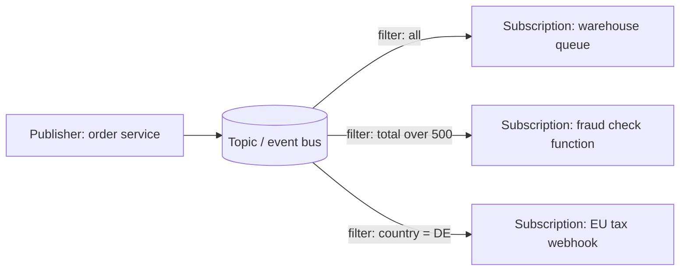
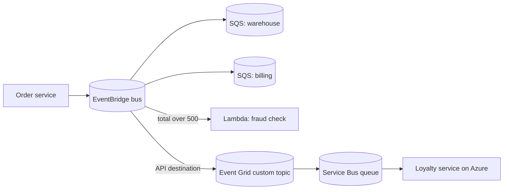

# Pub/Sub: SNS, EventBridge and Event Grid

## Introduction

A queue answers "who will do this job?" Publish/subscribe (pub/sub) answers a different question: "who needs to know that this happened?"

When a customer places an order, the warehouse needs to pick it, billing needs to invoice it, the analytics team wants to count it, and next quarter the loyalty team will want to award points for it. If the order service calls each of them directly, it has to change every time a new team shows up. With pub/sub, the order service **publishes** one `OrderPlaced` event and forgets about it. Each interested team **subscribes**, optionally filtering for the events it cares about, and gets its own copy.

It works like a magazine. The publisher prints one issue. The distributor sends a copy to every subscriber. Readers who only want the sports supplement can ask for just that. A new subscriber does not require the editor to change anything.

Both clouds offer two kinds of pub/sub service, and knowing which is which saves a lot of confusion:

| Kind | What it does | AWS | Azure |
| --- | --- | --- | --- |
| **Notification fan-out** | Push a copy of each message to many endpoints | Amazon SNS | Azure Service Bus topics |
| **Event routing** | Match events by content and route them to targets; also carries events emitted by the cloud platform itself | Amazon EventBridge | Azure Event Grid |

In this page you will set up each one, learn how filtering, retries and dead-lettering work, and see when to pick which.

## Core Pub/Sub Concepts



- **Topic or event bus**: the named place publishers send to.
- **Subscription, rule or event subscription**: a subscriber's registration, including where to deliver and what to filter.
- **Filter**: a condition on message attributes or content. Filtering in the broker is cheaper and simpler than every subscriber receiving everything and discarding most of it.
- **Push vs pull**: SNS, EventBridge and Event Grid (basic) **push** to targets. Service Bus topic subscriptions behave like queues that subscribers **pull** from.
- **Retries and dead-lettering**: when a push target is down, the service retries for a while, then drops or dead-letters the event.

:::tip
The most robust pattern on both clouds is **pub/sub into queues**: the topic fans out, and each subscriber gets its *own* queue. The queue absorbs bursts, survives subscriber outages, and gives you a dead-letter queue per consumer. You will see this "fan-out to queues" pattern again on the [event-driven patterns page](./4-cloud-event-driven-patterns.mdx).
:::

## On AWS: Amazon SNS

SNS is a push-based notification service. A topic can deliver to SQS queues, Lambda functions, HTTP(S) endpoints, Amazon Data Firehose, email, SMS and mobile push. Standard topics give best-effort ordering and very high throughput; FIFO topics give strict ordering per message group and deliver to SQS FIFO queues.

:::warning Cost
SNS bills per publish and per delivery, and the price depends on the endpoint type (SMS is billed very differently from SQS). Never subscribe phone numbers in a test that might loop. Cleanup commands are below.
:::

### Fan-out to two SQS queues with a filter

```bash
TOPIC_ARN=$(aws sns create-topic --name order-events --query TopicArn --output text)

aws sqs create-queue --queue-name warehouse-orders
aws sqs create-queue --queue-name fraud-checks
WH_ARN=arn:aws:sqs:us-east-1:111122223333:warehouse-orders
FR_ARN=arn:aws:sqs:us-east-1:111122223333:fraud-checks
```

SNS needs permission to write to each queue. Attach a queue policy that allows only this topic:

```json
{
  "Version": "2012-10-17",
  "Statement": [
    {
      "Effect": "Allow",
      "Principal": { "Service": "sns.amazonaws.com" },
      "Action": "sqs:SendMessage",
      "Resource": "arn:aws:sqs:us-east-1:111122223333:fraud-checks",
      "Condition": { "ArnEquals": { "aws:SourceArn": "arn:aws:sns:us-east-1:111122223333:order-events" } }
    }
  ]
}
```

Then subscribe both queues. The fraud queue only wants large orders, so it gets a **filter policy** that matches on the message body:

```bash
aws sns subscribe --topic-arn "$TOPIC_ARN" --protocol sqs \
  --notification-endpoint "$WH_ARN" \
  --attributes RawMessageDelivery=true

cat > fraud-sub.json <<'EOF'
{
  "RawMessageDelivery": "true",
  "FilterPolicyScope": "MessageBody",
  "FilterPolicy": "{\"total\": [{\"numeric\": [\">\", 500]}]}"
}
EOF
aws sns subscribe --topic-arn "$TOPIC_ARN" --protocol sqs \
  --notification-endpoint "$FR_ARN" --attributes file://fraud-sub.json
```

`RawMessageDelivery=true` delivers your JSON as-is instead of wrapping it in an SNS envelope, which makes the consumer code simpler.

Publish two orders:

```bash
aws sns publish --topic-arn "$TOPIC_ARN" --message '{"orderId": "o-1", "total": 40}'
aws sns publish --topic-arn "$TOPIC_ARN" --message '{"orderId": "o-2", "total": 900}'
```

Example output:

```text
{
    "MessageId": "a1b2c3d4-0001-4b6e-9d0e-111111111111"
}
{
    "MessageId": "a1b2c3d4-0002-4b6e-9d0e-222222222222"
}
```

The warehouse queue now has both orders; the fraud queue has only `o-2`.

### Publishing from Python

```python
import json
import boto3

sns = boto3.client("sns")
TOPIC_ARN = "arn:aws:sns:us-east-1:111122223333:order-events"

order = {"orderId": "o-3", "total": 120, "country": "DE"}
resp = sns.publish(
    TopicArn=TOPIC_ARN,
    Message=json.dumps(order),
    MessageAttributes={   # attributes can also be used for filtering
        "eventType": {"DataType": "String", "StringValue": "OrderPlaced"},
    },
)
print(resp["MessageId"])
```

Example output:

```text
c7e1a2f0-3b55-5d52-9f7e-0123456789ab
```

## On AWS: Amazon EventBridge

EventBridge is a serverless **event router**. It receives events from your applications, from more than a hundred AWS services (an EC2 instance changed state, an object was created in S3 when EventBridge notifications are on), and from SaaS partners. Rules match events by content and send them to targets such as Lambda, SQS, Step Functions, API destinations (any HTTPS API) and other event buses.

:::note
In 2026 AWS introduced a second kind of bus. The original rules-and-targets bus is now called **Custom Event Bus - Classic**, and the account's **default** bus (which receives AWS service events) works this way. The new **Custom Event Bus** routes to *subscribers*, retains events for a period you choose, supports ordered delivery and replay, and has its own CLI command (`aws eventsv2`). AWS recommends the new bus for new applications. This page teaches the Classic model, which you will meet in nearly every existing system and every AWS service integration; see [What is the EventBridge Custom Event Bus?](https://docs.aws.amazon.com/eventbridge/latest/userguide/eb-custom-bus-what-is.html) for the new one.
:::

### Anatomy of an event

Every EventBridge event has the same envelope. Your data goes in `detail`.

```json
{
  "version": "0",
  "id": "6a7e8feb-b491-4cf7-a9f1-bf3703467718",
  "detail-type": "TicketCreated",
  "source": "com.helpdesk.tickets",
  "account": "111122223333",
  "time": "2026-10-11T09:30:00Z",
  "region": "us-east-1",
  "resources": [],
  "detail": {
    "ticketId": "T-1001",
    "priority": "high",
    "plan": "enterprise"
  }
}
```

### Rules and event patterns

A rule's **event pattern** is a JSON document that the event must match. Fields you list must match one of the values given; fields you omit are ignored.

```json
{
  "source": ["com.helpdesk.tickets"],
  "detail-type": ["TicketCreated"],
  "detail": {
    "priority": ["high", "urgent"],
    "plan": [{ "prefix": "enterprise" }]
  }
}
```

Create a custom bus, a rule with that pattern, and an SQS target:

```bash
aws events create-event-bus --name helpdesk

aws events put-rule --name urgent-tickets --event-bus-name helpdesk \
  --event-pattern file://pattern.json

aws events put-targets --rule urgent-tickets --event-bus-name helpdesk \
  --targets Id=pager-queue,Arn=arn:aws:sqs:us-east-1:111122223333:pager-queue
```

Example output (trimmed):

```text
{
    "EventBusArn": "arn:aws:events:us-east-1:111122223333:event-bus/helpdesk"
}
{
    "RuleArn": "arn:aws:events:us-east-1:111122223333:rule/helpdesk/urgent-tickets"
}
{
    "FailedEntryCount": 0,
    "FailedEntries": []
}
```

As with SNS, the target queue needs a resource policy allowing `events.amazonaws.com` to send to it, conditioned on the rule ARN. (The console adds this for you; the CLI does not.)

### Publishing events

```python
import json
import boto3

events = boto3.client("events")

resp = events.put_events(Entries=[{
    "EventBusName": "helpdesk",
    "Source": "com.helpdesk.tickets",
    "DetailType": "TicketCreated",
    "Detail": json.dumps({"ticketId": "T-1001", "priority": "urgent", "plan": "enterprise-plus"}),
}])
print("failed:", resp["FailedEntryCount"], "id:", resp["Entries"][0].get("EventId"))
```

Example output:

```text
failed: 0 id: 3b2b1c11-7a0c-0d2e-1f4c-58f0e0b9a6d1
```

Always check `FailedEntryCount`. `PutEvents` can partially fail (up to 10 entries per request), and a failed entry is *not* retried for you.

### Test patterns without sending events

EventBridge can test a pattern against a sample event, which is handy in CI:

```bash
aws events test-event-pattern --event-pattern file://pattern.json --event file://event.json
```

Example output:

```text
{
    "Result": true
}
```

### Understanding pattern matching locally

This small Python matcher implements a subset of EventBridge pattern rules (exact values, `prefix` and `numeric`) so you can see how matching works. It is a teaching model, not a replacement for `test-event-pattern`.

```python
def matches(pattern: dict, event: dict) -> bool:
    for key, rule in pattern.items():
        if key not in event:
            return False
        value = event[key]
        if isinstance(rule, dict):                 # nested object, recurse
            if not isinstance(value, dict) or not matches(rule, value):
                return False
            continue
        if not any(match_one(cond, value) for cond in rule):   # list = OR
            return False
    return True                                    # all keys = AND


def match_one(cond, value) -> bool:
    if isinstance(cond, dict) and "prefix" in cond:
        return isinstance(value, str) and value.startswith(cond["prefix"])
    if isinstance(cond, dict) and "numeric" in cond:
        op, limit = cond["numeric"]
        return {">": value > limit, ">=": value >= limit,
                "<": value < limit, "<=": value <= limit, "=": value == limit}[op]
    return cond == value


pattern = {
    "source": ["com.helpdesk.tickets"],
    "detail": {"priority": ["high", "urgent"], "plan": [{"prefix": "enterprise"}]},
}
events = [
    {"source": "com.helpdesk.tickets", "detail": {"priority": "urgent", "plan": "enterprise-plus"}},
    {"source": "com.helpdesk.tickets", "detail": {"priority": "low", "plan": "enterprise"}},
    {"source": "com.helpdesk.billing", "detail": {"priority": "high", "plan": "enterprise"}},
]
for e in events:
    print(e["source"], e["detail"]["priority"], "->", matches(pattern, e))
```

Output:

```text
com.helpdesk.tickets urgent -> True
com.helpdesk.tickets low -> False
com.helpdesk.billing high -> False
```

### Retries, DLQs, Pipes and Scheduler

- **Retries**: on a Classic bus, each target has a retry policy (by default up to 24 hours and 185 attempts). Attach an SQS **dead-letter queue to the target** so events that never get delivered are kept.
- **Archive and replay**: Classic buses can archive events and replay them later.
- **EventBridge Pipes** connect one source (SQS, Kinesis, DynamoDB Streams, and others) to one target, with optional filtering and enrichment. Use them for point-to-point integrations without glue code.
- **EventBridge Scheduler** runs one-time or recurring (cron and rate) invocations of thousands of AWS API actions.

### Cleanup on AWS

```bash
aws events remove-targets --rule urgent-tickets --event-bus-name helpdesk --ids pager-queue
aws events delete-rule --name urgent-tickets --event-bus-name helpdesk
aws events delete-event-bus --name helpdesk
aws sns delete-topic --topic-arn "$TOPIC_ARN"
aws sqs delete-queue --queue-url https://sqs.us-east-1.amazonaws.com/111122223333/warehouse-orders
aws sqs delete-queue --queue-url https://sqs.us-east-1.amazonaws.com/111122223333/fraud-checks
```

## On Azure: Azure Event Grid

Event Grid is Azure's event router. It has two tiers that work quite differently:

| Tier | Resources | Delivery | Use for |
| --- | --- | --- | --- |
| **Basic** | System topics, custom topics, domains, partner topics | **Push** to handlers (Functions, webhooks, Service Bus, Event Hubs, Storage queues) | Reacting to Azure resource events and app events |
| **Standard** | Event Grid **namespaces** with namespace topics | **Pull** (HTTP) or push to Event Hubs; plus a built-in **MQTT broker** | High-scale app messaging, IoT devices over MQTT |

The basic tier is the one you will meet most. **System topics** carry events from Azure services, such as `Microsoft.Storage.BlobCreated` when a file lands in Blob Storage or resource-group write events from Azure Resource Manager. **Custom topics** carry your own application's events.

Event Grid delivers at least once with **no ordering guarantee**. By default it retries with exponential backoff for up to 30 attempts or 24 hours, whichever comes first. Dead-lettering is **off** until you point the subscription at a Blob Storage container.

:::warning Cost
Event Grid basic bills per operation (each 64 KB chunk counts as one), with a monthly free allowance; check the [pricing page](https://azure.microsoft.com/pricing/details/event-grid/) for current details. Namespaces in the Standard tier bill per throughput unit per hour. Delete the resource group when finished.
:::

### React to a platform event: Blob created

Subscribe a Service Bus queue (from the [previous page](./1-cloud-sqs-and-service-bus.mdx)) to "blob created" events on a storage account, but only for `.pdf` files in the `uploads` container:

```bash
RG=rg-helpdesk-dev
STORAGE_ID=$(az storage account show -g $RG -n helpdeskfiles123 --query id -o tsv)
QUEUE_ID=$(az servicebus queue show -g $RG --namespace-name $NS -n email --query id -o tsv)

az eventgrid event-subscription create \
  --name pdf-uploads \
  --source-resource-id "$STORAGE_ID" \
  --endpoint-type servicebusqueue \
  --endpoint "$QUEUE_ID" \
  --included-event-types Microsoft.Storage.BlobCreated \
  --subject-begins-with /blobServices/default/containers/uploads/ \
  --subject-ends-with .pdf
```

Example output (trimmed):

```text
{
  "destination": { "endpointType": "ServiceBusQueue" },
  "filter": {
    "includedEventTypes": [ "Microsoft.Storage.BlobCreated" ],
    "subjectBeginsWith": "/blobServices/default/containers/uploads/",
    "subjectEndsWith": ".pdf"
  },
  "name": "pdf-uploads",
  "provisioningState": "Succeeded"
}
```

Behind the scenes, Azure creates a **system topic** for the storage account.

### Publish your own events to a custom topic

Create a custom topic that accepts the vendor-neutral [CloudEvents](https://cloudevents.io/) 1.0 schema, and a subscription with an **advanced filter**, a retry policy and a dead-letter container:

```bash
az eventgrid topic create -g $RG -n helpdesk-events -l eastus \
  --input-schema cloudeventschemav1_0

TOPIC_ID=$(az eventgrid topic show -g $RG -n helpdesk-events --query id -o tsv)

az eventgrid event-subscription create \
  --name urgent-to-pager \
  --source-resource-id "$TOPIC_ID" \
  --endpoint-type servicebusqueue --endpoint "$QUEUE_ID" \
  --event-delivery-schema cloudeventschemav1_0 \
  --included-event-types com.helpdesk.ticket.created \
  --advanced-filter data.priority StringIn high urgent \
  --max-delivery-attempts 10 --event-ttl 120 \
  --deadletter-endpoint "$STORAGE_ID/blobServices/default/containers/deadletter"

# Let your identity publish
az role assignment create --assignee $(az ad signed-in-user show --query id -o tsv) \
  --role "EventGrid Data Sender" --scope "$TOPIC_ID"
```

Publish from Python with `pip install azure-eventgrid azure-identity`:

```python
from azure.core.messaging import CloudEvent
from azure.eventgrid import EventGridPublisherClient
from azure.identity import DefaultAzureCredential

ENDPOINT = "https://helpdesk-events.eastus-1.eventgrid.azure.net/api/events"  # from az eventgrid topic show

client = EventGridPublisherClient(ENDPOINT, DefaultAzureCredential())
event = CloudEvent(
    source="/helpdesk/tickets",
    type="com.helpdesk.ticket.created",
    data={"ticketId": "T-1001", "priority": "urgent"},
)
client.send([event])
print("published", event.id)
```

Example output:

```text
published 0b2c9a7e-3f61-4f0e-8d0a-2f4e5c1d9b77
```

### Service Bus topics: pull-based pub/sub with SQL filters

When subscribers want **queue semantics** (peek-lock, sessions, transactions, their own dead-letter queue), use a Service Bus topic. Each subscription is effectively a private queue fed by the topic. Topics need the Standard or Premium tier.

```bash
az servicebus topic create -g $RG --namespace-name $NS -n orders
az servicebus topic subscription create -g $RG --namespace-name $NS \
  --topic-name orders -n warehouse
az servicebus topic subscription create -g $RG --namespace-name $NS \
  --topic-name orders -n fraud

# Replace the fraud subscription's default "match everything" rule with a SQL filter
az servicebus topic subscription rule delete -g $RG --namespace-name $NS \
  --topic-name orders --subscription-name fraud -n '$Default'
az servicebus topic subscription rule create -g $RG --namespace-name $NS \
  --topic-name orders --subscription-name fraud -n big-orders \
  --filter-sql-expression "total > 500"
```

SQL filters run against **message application properties**, so the sender sets them:

```python
from azure.identity import DefaultAzureCredential
from azure.servicebus import ServiceBusClient, ServiceBusMessage

FQDN = "helpdesk-sb-12345.servicebus.windows.net"
with ServiceBusClient(FQDN, DefaultAzureCredential()) as client:
    with client.get_topic_sender("orders") as sender:
        msg = ServiceBusMessage('{"orderId": "o-2"}', application_properties={"total": 900})
        sender.send_messages(msg)
        print("sent o-2")
```

Example output:

```text
sent o-2
```

Receivers use `client.get_subscription_receiver("orders", "fraud")` and settle messages exactly as with a queue.

### Cleanup on Azure

```bash
az group delete --name $RG --yes --no-wait
```

## Side-by-Side Comparison

| Feature | Amazon SNS | EventBridge (Classic bus) | Azure Event Grid (basic) | Service Bus topics |
| --- | --- | --- | --- | --- |
| Delivery model | Push | Push | Push | Pull (subscribers receive) |
| Filtering | Filter policies on attributes or body | Rich event patterns on any field | Event type, subject prefix/suffix, advanced filters on data | SQL and correlation filters on properties |
| Platform events from the cloud | Some services publish to SNS | Yes, the default bus gets AWS service events | Yes, system topics | No |
| Ordering | FIFO topics per message group | No (new Custom Event Bus adds per-group FIFO) | No | Yes, with sessions |
| Retention and replay | FIFO topics can archive and replay | Archive and replay | Up to 1 day on topics, no replay | Until consumed or TTL expires |
| Dead-lettering | SQS DLQ per subscription | SQS DLQ per target | Blob Storage container per subscription | Built-in DLQ per subscription |
| Schema | Any string | EventBridge envelope | Event Grid schema or CloudEvents 1.0 | Any body plus properties |
| Billing | Per publish and per delivery | Per event published to custom buses | Per operation (64 KB chunks) | Per operation, or capacity on Premium |

## Real-World Scenario

Your company runs an online store on AWS and is acquiring a smaller business that runs on Azure. Every `OrderPlaced` event must reach the warehouse system, billing, a fraud check for orders over a threshold, and, after the acquisition, a loyalty service that lives in Azure.

**Solution:**

1. The order service publishes `OrderPlaced` to an **EventBridge** bus.
2. Rules route the event to per-consumer **SQS queues** (warehouse, billing) and to a **Lambda** fraud check, filtered with a numeric pattern on `detail.total`.
3. A rule with an **API destination** target forwards matching events over HTTPS to an **Event Grid** custom topic in Azure (authenticated with an API key or OAuth connection stored by EventBridge).
4. In Azure, an Event Grid subscription delivers to a **Service Bus queue** that the loyalty service consumes, with dead-lettering to Blob Storage.



**Why this approach:** the order service publishes once and never changes when consumers come and go. Per-consumer queues isolate failures: if billing is down for an hour, the warehouse is unaffected and billing catches up from its queue. The cross-cloud hop uses plain HTTPS and CloudEvents-style JSON, so neither side depends on the other's SDK.

**When to use it / when not to:** use an event router when you have many consumers, content-based routing, or platform events to react to. If you have exactly one producer and one consumer, a queue is simpler. If you need replay of weeks of history or very high throughput telemetry, use a [stream](./3-cloud-kinesis-and-event-hubs.mdx) instead.

**Alternatives and trade-offs:**

| Approach | Pros | Cons | Best for |
| --- | --- | --- | --- |
| SNS to per-consumer SQS queues | Simple, very high throughput, cheap fan-out | Filtering less expressive than EventBridge; no AWS service events | High-volume fan-out within AWS |
| EventBridge rules to targets | Rich patterns, AWS service events, SaaS sources, API destinations, archive and replay | Up to 5 targets per Classic rule; per-event pricing at very high volume | Business events across teams and accounts on AWS |
| Event Grid basic | Azure platform events, push to many handler types, CloudEvents | No ordering, 1-day retention, dead-letter only to Blob Storage | Reacting to Azure resource and app events |
| Service Bus topics | Queue semantics per subscriber, sessions, transactions, SQL filters | No platform events, namespace base cost | Enterprise integration on Azure |
| Kafka-style stream (Kinesis, Event Hubs) | Replay, many independent readers, high volume | Consumers manage offsets; no per-message routing | Telemetry and event sourcing |

## Common Mistakes

- **Pushing directly to fragile endpoints.** If a webhook is down longer than the retry window, events are dropped. Push into a queue first, or configure dead-lettering.
- **Forgetting resource policies.** SNS and EventBridge need permission to write to SQS queues and invoke Lambda functions. Missing policies fail silently from the publisher's point of view; check the target's metrics.
- **Not checking `FailedEntryCount`.** `PutEvents` returns HTTP 200 even when some entries fail.
- **Event Grid without dead-lettering.** It is off by default. Configure a dead-letter container for anything important.
- **Relying on order.** EventBridge Classic buses and Event Grid do not preserve order. Include a timestamp or version number in the event and let consumers handle out-of-order arrival.
- **Fat events by accident.** Sending entire database rows makes every consumer depend on your schema. Prefer a clear, versioned event contract.
- **Leaving the `$Default` rule on a Service Bus subscription.** It matches everything, so a filtered subscription still receives all messages until you remove it.

## Summary

- Pub/sub delivers a copy of each event to every interested subscriber, so publishers do not need to know their consumers.
- **SNS** and **Service Bus topics** are fan-out services; **EventBridge** and **Event Grid** are content-based event routers that also carry cloud platform events.
- Filtering in the broker (SNS filter policies, EventBridge patterns, Event Grid advanced filters, Service Bus SQL filters) keeps consumers simple.
- Push services retry for a limited time; configure dead-lettering and prefer delivering into queues.
- Ordering is generally *not* guaranteed, except SNS FIFO, Service Bus sessions and the new EventBridge Custom Event Bus.
- All are billed per operation or event, except capacity-based tiers; delete test resources.

## Exercises

1. Write an EventBridge pattern that matches `TicketCreated` events from `com.helpdesk.tickets` where `detail.plan` is not `free`. Look up the `anything-but` operator in the EventBridge docs and test it with `aws events test-event-pattern`.
2. Extend the local Python matcher to support `anything-but` and `exists`.
3. Set up an Event Grid subscription on a storage account that sends only `BlobDeleted` events for a `contracts` container to an Azure Storage queue. Which `--endpoint-type` do you need?
4. Your SNS topic fans out to six SQS queues. One consumer team wants to replay last Tuesday's events. What would you change in the design?

Related pages:

- [Queues: SQS and Azure Service Bus](./1-cloud-sqs-and-service-bus.mdx)
- [Streaming: Kinesis and Event Hubs](./3-cloud-kinesis-and-event-hubs.mdx)
- [Event-Driven Patterns in the Cloud](./4-cloud-event-driven-patterns.mdx)
- [Event Sources and Triggers](../4-cloud-serverless/3-cloud-serverless-triggers.mdx)
- [Project: Event-Driven Image Processing Pipeline](../14-cloud-projects/4-cloud-project-event-pipeline.mdx)
