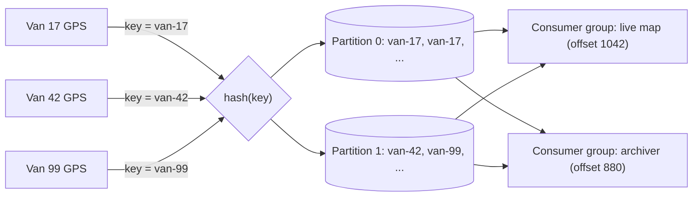
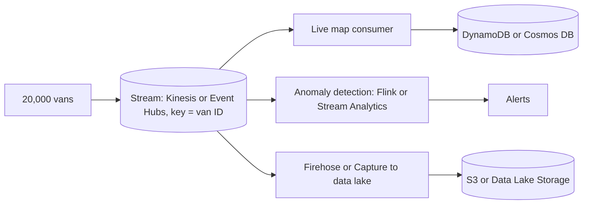

# Streaming: Kinesis and Event Hubs

## Introduction

Queues and pub/sub are built for **business messages**: a few to a few thousand per second, each one important on its own. Some data looks very different. A mobile game sends a position update for every player every second. A fleet of delivery vans reports GPS coordinates every five seconds. A web app logs every click. No single record matters much, but together they are a firehose that you want to analyze, store and react to in near real time.

That is what **event streaming** services are for. A stream is an append-only, partitioned **log**:

- Producers append records to the end of the log.
- Records stay in the log for a **retention period** (hours to months), whether or not anyone has read them.
- Each consumer keeps its own **position** (offset or sequence number) and reads forward at its own pace.
- Any consumer can **rewind** and replay old data, for example after fixing a bug.

Think of a DVR recording a live TV channel. The broadcast is recorded whether or not you are watching. You can watch live, start an hour behind, or rewind to catch something you missed, and your roommate can watch the same recording from a different point without affecting you.

The main managed streaming services are:

| | AWS | Azure |
| --- | --- | --- |
| Native streaming service | **Amazon Kinesis Data Streams** | **Azure Event Hubs** |
| Kafka-compatible | Amazon MSK (managed Apache Kafka clusters) | Event Hubs Kafka endpoint (Standard tier and above) |
| Deliver a stream to storage with no code | Amazon Data Firehose | Event Hubs Capture |
| Stream processing | Amazon Managed Service for Apache Flink, Lambda | Azure Stream Analytics, Azure Functions, Microsoft Fabric Real-Time Intelligence |

This page focuses on Kinesis Data Streams and Event Hubs, and shows how they map to each other.

## How a Partitioned Log Works

A single log on a single machine cannot take millions of writes per second, so streams are split into **partitions** (Event Hubs and Kafka) or **shards** (Kinesis). Each record carries a **partition key**. The service hashes the key to pick a partition, so all records with the same key land in the same partition, **in order**.



Key ideas:

| Concept | Kinesis Data Streams | Event Hubs |
| --- | --- | --- |
| Unit of parallelism and ordering | Shard | Partition |
| Position in the log | Sequence number | Offset and sequence number |
| Independent reader | Consumer application (each tracks its own position); Enhanced Fan-Out consumers get dedicated throughput | Consumer group (each tracks its own position) |
| Saving progress | Checkpoints in DynamoDB (Kinesis Client Library) or handled by Lambda | Checkpoints in Blob Storage (SDK checkpoint store) or handled by Azure Functions |
| Capacity | On-demand (auto-scaling) or provisioned shards | Throughput units (Basic, Standard), processing units (Premium), capacity units (Dedicated) |
| Retention | 24 hours by default, up to 365 days | 1 day (Basic), up to 7 days (Standard), up to 90 days (Premium and Dedicated) |

### Picking a partition key

Partition keys decide both **ordering** and **load distribution**. A good key:

- Groups records that must stay in order (all events for one device, one user, one order)
- Has many distinct values, so load spreads across partitions
- Does not have a few "celebrity" values that dominate traffic

This runnable simulation shows how a skewed key creates a **hot partition**:

```python
import hashlib
from collections import Counter

PARTITIONS = 4


def partition_for(key: str) -> int:
    # Kinesis uses an MD5 hash of the key; this mimics the idea
    return int(hashlib.md5(key.encode()).hexdigest(), 16) % PARTITIONS


# 1,000 events from 200 vans, evenly spread
good = Counter(partition_for(f"van-{i % 200}") for i in range(1000))

# Same 1,000 events keyed by customer, where one big customer sends 70%
keys = ["customer-bigco"] * 700 + [f"customer-{i}" for i in range(300)]
bad = Counter(partition_for(k) for k in keys)

print("key=van_id      ", dict(sorted(good.items())))
print("key=customer_id ", dict(sorted(bad.items())))
```

Output:

```text
key=van_id       {0: 240, 1: 305, 2: 240, 3: 215}
key=customer_id  {0: 763, 1: 68, 2: 93, 3: 76}
```

With the customer key, partition 0 takes over 75% of the traffic. It will hit its throughput limit long before the others, and adding partitions will not help, because all of `customer-bigco` still hashes to one place.

## On AWS: Amazon Kinesis Data Streams

### Capacity modes

Kinesis offers three modes. Prices vary by region and change; see [Kinesis Data Streams pricing](https://aws.amazon.com/kinesis/data-streams/pricing/) and the [capacity mode guide](https://docs.aws.amazon.com/streams/latest/dev/how-do-i-size-a-stream.html).

| Mode | How capacity works | How it is billed | Good for |
| --- | --- | --- | --- |
| **On-demand Standard** | Scales shards automatically, up to double the previous 30-day peak instantly | Per GB written and read, plus a per-stream hourly charge | Unpredictable or new workloads |
| **On-demand Advantage** | Account-level setting for all on-demand streams; adds warm throughput and more Enhanced Fan-Out consumers | Lower per-GB rates, no per-stream charge, but a minimum usage commitment | Accounts with steady, large streaming volume |
| **Provisioned** | You choose the shard count; each shard accepts up to 1 MB/s or 1,000 records/s of writes and serves 2 MB/s of reads | Per shard-hour plus PUT payload units | Predictable traffic, fine-grained control |

:::warning Cost
Kinesis streams bill **every hour they exist**, even with no traffic: per shard-hour in provisioned mode, and per stream-hour in On-demand Standard. Delete test streams as soon as you are done. Do not enable On-demand Advantage on a learning account; it commits the account to a minimum usage level.
:::

For provisioned mode, AWS documents a simple sizing formula. You can compute it in Python:

```python
import math


def shards_needed(avg_record_kb: float, records_per_sec: int, consumers: int) -> int:
    write_kb = avg_record_kb * records_per_sec
    read_kb = write_kb * consumers
    return math.ceil(max(write_kb / 1024, read_kb / 2048))


# 20,000 vans, one 0.5 KB record every 5 seconds, 3 consuming applications
print(shards_needed(avg_record_kb=1, records_per_sec=20_000 // 5, consumers=3))
```

Output:

```text
6
```

The record size is rounded up to the nearest 1 KB, as the formula requires. Leave headroom for peaks and for uneven key distribution.

### Create a stream and write records

```bash
aws kinesis create-stream --stream-name van-telemetry \
  --stream-mode-details StreamMode=ON_DEMAND

aws kinesis describe-stream-summary --stream-name van-telemetry \
  --query 'StreamDescriptionSummary.[StreamStatus,StreamModeDetails.StreamMode,RetentionPeriodHours,OpenShardCount]'
```

Example output:

```text
[
    "ACTIVE",
    "ON_DEMAND",
    24,
    4
]
```

Write a single record from the CLI. With AWS CLI v2 you need `--cli-binary-format raw-in-base64-out` to pass plain text data:

```bash
aws kinesis put-record --stream-name van-telemetry \
  --partition-key van-17 \
  --data '{"van": "van-17", "lat": 52.52, "lon": 13.40}' \
  --cli-binary-format raw-in-base64-out
```

Example output:

```text
{
    "ShardId": "shardId-000000000002",
    "SequenceNumber": "49654921347235482912318274891823749182374918237491823"
}
```

### Produce in batches from Python

Production producers batch records with `put_records` (up to 500 per call) and **retry the ones that failed**, because a batch can partially fail when a shard is throttled.

```python
import json
import random
import time
import boto3

kinesis = boto3.client("kinesis")
STREAM = "van-telemetry"


def send_batch(readings: list[dict]) -> None:
    records = [{"Data": json.dumps(r).encode(), "PartitionKey": r["van"]} for r in readings]
    for attempt in range(5):
        resp = kinesis.put_records(StreamName=STREAM, Records=records)
        if resp["FailedRecordCount"] == 0:
            print(f"sent {len(readings)} records")
            return
        # Keep only the failed ones and retry with backoff
        records = [rec for rec, res in zip(records, resp["Records"]) if "ErrorCode" in res]
        print(f"retrying {len(records)} throttled records")
        time.sleep(2 ** attempt * 0.1)
    raise RuntimeError("records still failing after retries")


readings = [{"van": f"van-{i}", "lat": 52.5 + random.random() / 100, "lon": 13.4} for i in range(200)]
send_batch(readings)
```

Example output:

```text
sent 200 records
```

### Consume the stream

You have three main options for consumers:

1. **AWS Lambda** with an event source mapping. Lambda polls each shard, sends batches to your function and tracks the position for you. Configure `--bisect-batch-on-function-error`, a maximum retry count and an on-failure destination so one bad record does not block a shard forever.
2. **Kinesis Client Library (KCL)** in a long-running app (for example on ECS). KCL balances shards across workers and stores checkpoints in a DynamoDB table.
3. **Managed services**: Amazon Data Firehose to deliver into S3, Redshift or OpenSearch with no code, or Amazon Managed Service for Apache Flink for windowed aggregations.

```bash
aws lambda create-event-source-mapping \
  --function-name update-live-map \
  --event-source-arn arn:aws:kinesis:us-east-1:111122223333:stream/van-telemetry \
  --starting-position LATEST \
  --batch-size 100 \
  --maximum-retry-attempts 3 \
  --bisect-batch-on-function-error \
  --destination-config '{"OnFailure": {"Destination": "arn:aws:sqs:us-east-1:111122223333:telemetry-failures"}}'
```

Kinesis records arrive in the Lambda event base64-encoded:

```python
import base64
import json


def handler(event, context):
    for record in event["Records"]:
        reading = json.loads(base64.b64decode(record["kinesis"]["data"]))
        print(f"{reading['van']} at {reading['lat']:.3f},{reading['lon']:.3f}")
```

### Cleanup on AWS

```bash
aws kinesis delete-stream --stream-name van-telemetry --enforce-consumer-deletion
```

## On Azure: Azure Event Hubs

Event Hubs is organized like Service Bus: a **namespace** (with a tier and capacity) contains one or more **event hubs**, each with a fixed number of partitions (in Basic and Standard) and one or more consumer groups.

| Tier | Max event size | Max retention | Partitions per event hub | Notable features |
| --- | --- | --- | --- | --- |
| Basic | 256 KB | 1 day | Up to 32 | 1 consumer group, no Kafka, no Capture |
| Standard | 1 MB | 7 days | Up to 32 | Kafka endpoint, Capture (billed separately), up to 20 consumer groups |
| Premium | 1 MB | 90 days | Up to 100 | Resource isolation, Capture included, dynamic partition scale-out |
| Dedicated | 20 MB | 90 days | Up to 1,024 | Single-tenant clusters |

Values are from the [Event Hubs quotas page](https://learn.microsoft.com/en-us/azure/event-hubs/event-hubs-quotas) and may change.

:::warning Cost
Event Hubs Basic and Standard bill per throughput unit per hour from the moment the namespace exists; Premium and Dedicated bill per processing or capacity unit per hour. Turn off auto-inflate in experiments, and delete the resource group when done.
:::

### Create a namespace and event hub

```bash
RG=rg-telemetry-dev
EH_NS=telemetry-eh-$RANDOM

az group create -n $RG -l eastus
az eventhubs namespace create -g $RG -n $EH_NS --sku Standard --capacity 1

az eventhubs eventhub create -g $RG --namespace-name $EH_NS -n van-telemetry \
  --partition-count 4 --cleanup-policy Delete --retention-time 24

az eventhubs eventhub consumer-group create -g $RG --namespace-name $EH_NS \
  --eventhub-name van-telemetry -n live-map
```

Example output (trimmed):

```text
{
  "name": "van-telemetry",
  "partitionCount": 4,
  "partitionIds": [ "0", "1", "2", "3" ],
  "retentionDescription": { "cleanupPolicy": "Delete", "retentionTimeInHours": 24 },
  "status": "Active"
}
```

In Basic and Standard, the partition count **cannot be changed later**, so choose it based on the maximum number of parallel readers you expect. `--capacity 1` is one throughput unit: about 1 MB/s or 1,000 events/s in and 2 MB/s out.

Grant your identity data access instead of using connection strings:

```bash
EH_ID=$(az eventhubs namespace show -g $RG -n $EH_NS --query id -o tsv)
ME=$(az ad signed-in-user show --query id -o tsv)
az role assignment create --assignee $ME --role "Azure Event Hubs Data Sender" --scope $EH_ID
az role assignment create --assignee $ME --role "Azure Event Hubs Data Receiver" --scope $EH_ID
```

### Produce events in Python

Install `pip install azure-eventhub azure-identity`.

```python
import json
from azure.eventhub import EventData, EventHubProducerClient
from azure.identity import DefaultAzureCredential

producer = EventHubProducerClient(
    fully_qualified_namespace="telemetry-eh-12345.servicebus.windows.net",
    eventhub_name="van-telemetry",
    credential=DefaultAzureCredential(),
)

with producer:
    # All events in a batch with the same partition key go to the same partition
    batch = producer.create_batch(partition_key="van-17")
    for i in range(3):
        batch.add(EventData(json.dumps({"van": "van-17", "seq": i, "lat": 52.52})))
    producer.send_batch(batch)
    print(f"sent {len(batch)} events for van-17")
```

Example output:

```text
sent 3 events for van-17
```

`create_batch` respects the tier's size limit for you; `batch.add` raises `ValueError` when the batch is full, so in a real producer you send the full batch and start a new one.

### Consume with checkpoints

The `EventHubConsumerClient` balances partitions across running instances of your app. With a **checkpoint store** in Blob Storage, it remembers where each partition was up to, so a restart resumes rather than re-reading everything. Install `pip install azure-eventhub-checkpointstoreblob-aio` and give your identity the "Storage Blob Data Contributor" role on the storage account.

```python
import asyncio
import json
from azure.eventhub.aio import EventHubConsumerClient
from azure.eventhub.extensions.checkpointstoreblobaio import BlobCheckpointStore
from azure.identity.aio import DefaultAzureCredential


async def on_event(partition_context, event):
    reading = json.loads(event.body_as_str())
    print(f"partition {partition_context.partition_id}: {reading['van']} seq {reading['seq']}")
    await partition_context.update_checkpoint(event)   # in production, checkpoint every N events


async def main():
    credential = DefaultAzureCredential()
    store = BlobCheckpointStore(
        blob_account_url="https://telemetrycheckpoints.blob.core.windows.net",
        container_name="live-map",
        credential=credential,
    )
    client = EventHubConsumerClient(
        fully_qualified_namespace="telemetry-eh-12345.servicebus.windows.net",
        eventhub_name="van-telemetry",
        consumer_group="live-map",
        checkpoint_store=store,
        credential=credential,
    )
    async with client:
        await client.receive(on_event=on_event, starting_position="-1")  # "-1" = from the start
    await credential.close()


if __name__ == "__main__":
    asyncio.run(main())
```

Example output:

```text
partition 2: van-17 seq 0
partition 2: van-17 seq 1
partition 2: van-17 seq 2
```

Checkpointing after every single event is simple but adds a storage write per event. In production, checkpoint every few hundred events or every few seconds, and make processing idempotent so the small amount of re-reading after a crash is harmless.

### Capture and Kafka

- **Event Hubs Capture** writes the stream to Blob Storage or Data Lake Storage as Avro files on a time or size window, with no code. (Parquet output is available through the Stream Analytics no-code editor.) It is the Azure counterpart of delivering a stream to S3 with Amazon Data Firehose.
- The **Kafka endpoint** (Standard and above) lets existing Kafka clients produce and consume by changing only their connection settings (port 9093, SASL over TLS). Event Hubs does not run Kafka brokers, so some Kafka features and tools behave differently; check [Event Hubs for Apache Kafka](https://learn.microsoft.com/en-us/azure/event-hubs/azure-event-hubs-apache-kafka-overview) before you migrate.

### Cleanup on Azure

```bash
az group delete -n $RG --yes --no-wait
```

## Real-World Scenario

A logistics company tracks 20,000 delivery vans. Each van sends a small GPS and engine-status reading every five seconds. They need:

1. A live dispatch map with a few seconds of delay
2. An alert when an engine temperature reading is abnormal
3. All raw data stored for a year for route-optimization models, which data scientists re-run every month

**Solution on AWS:** vans publish through AWS IoT Core (or an API) into a **Kinesis Data Stream** in on-demand mode, keyed by van ID. Three independent consumers read it: a Lambda function updates the live map in DynamoDB; Amazon Managed Service for Apache Flink computes rolling engine statistics and raises alerts; **Amazon Data Firehose** batches records into S3 as Parquet for the data scientists.

**Solution on Azure:** vans publish through Azure IoT Hub (or directly) into **Event Hubs** Standard with 8 partitions, keyed by van ID. A consumer group per application: Azure Functions updates the live map in Cosmos DB, Azure Stream Analytics detects temperature anomalies, and **Capture** writes raw Avro files to Data Lake Storage.



**Why this approach:** a stream lets three very different consumers read the same data at their own pace, without the producers knowing they exist. Keying by van ID keeps each van's readings in order, which the map and anomaly detection need. Retention means that if the map consumer has a bad deploy, it can rewind and catch up.

**When to use it / when not to:** use a stream for high-volume, append-only data with several consumers or a need for replay. Do not use it for individual jobs that need per-message retries and dead-lettering (use a [queue](./1-cloud-sqs-and-service-bus.mdx)), or for low-volume business events with content-based routing (use [EventBridge or Event Grid](./2-cloud-sns-and-event-grid.mdx)).

**Alternatives and trade-offs:**

| Approach | Pros | Cons | Best for |
| --- | --- | --- | --- |
| Kinesis Data Streams | Serverless, on-demand scaling, deep AWS integration (Lambda, Firehose, Flink) | AWS-specific API; per-stream charges in On-demand Standard | Streaming on AWS without running Kafka |
| Azure Event Hubs | Serverless-style namespaces, Kafka protocol support, Capture | Fixed partition count in Basic and Standard; TU-based capacity planning | Streaming on Azure, Kafka clients without brokers |
| Amazon MSK / self-managed Kafka | Full Kafka features and ecosystem, portable | Cluster sizing, upgrades and partition management | Teams already standardized on Kafka |
| SQS or Service Bus queues | Per-message acks, DLQs, simple | No replay, no multiple independent readers | Job processing, not telemetry |
| Write straight to object storage | Cheapest for pure archival | No real-time consumers | Batch analytics only |

## Common Mistakes

- **Bad partition keys.** A low-cardinality or skewed key creates hot partitions. A random key spreads load but destroys ordering. Pick the entity whose order matters.
- **Treating a stream like a queue.** There is no per-record delete. If one record makes your consumer crash, the consumer will keep re-reading it and that partition stalls. Catch errors, send bad records to a side queue, and move on.
- **Too few partitions in Event Hubs.** In Basic and Standard you cannot add partitions later, and the recommended model is one active reader per partition per consumer group, so the partition count caps your parallelism.
- **Checkpointing too often or never.** Every event is expensive; never means a restart replays the whole retention window.
- **Ignoring partial failures.** `PutRecords` and batched sends can partially fail under throttling. Retry only the failed records.
- **Forgetting that streams cost money while idle.** Provisioned shards, on-demand stream charges and Event Hubs throughput units run 24/7.
- **Retention as a database.** Streams are for moving and replaying data, not long-term querying. Land data in object storage or a database for that.

## Summary

- A stream is a partitioned, append-only log; records stay for a retention period, and each consumer tracks its own position.
- Kinesis Data Streams uses **shards** and sequence numbers; Event Hubs uses **partitions**, offsets and **consumer groups**.
- The **partition key** controls ordering and load; choose a high-cardinality key for the entity whose order matters.
- Kinesis has On-demand Standard, On-demand Advantage and Provisioned modes; Event Hubs has Basic, Standard, Premium and Dedicated tiers.
- Use Lambda or KCL on AWS, and Functions or the `EventHubConsumerClient` with a Blob checkpoint store on Azure; use Firehose or Capture to land data in storage.
- Both bill for capacity by the hour; delete test streams and namespaces.

## Exercises

1. Use the shard formula to size a provisioned Kinesis stream for 5,000 records per second of 3 KB each, read by 2 applications. Then decide whether on-demand would be the better choice and why.
2. Modify the hot-partition simulation to use a composite key such as `customer_id + ":" + order_id`. What happens to the distribution, and what ordering guarantee do you lose?
3. Change the Event Hubs consumer to checkpoint every 50 events instead of every event. What happens to duplicates after a crash, and how would you handle them?
4. Find the Azure CLI flags to enable Event Hubs Capture to a storage container on an existing event hub, using `az eventhubs eventhub update --help`. Do not run it on a paid namespace you do not intend to keep.

Related pages:

- [Choosing a Messaging Service](./0-cloud-messaging-options.mdx)
- [Event-Driven Patterns in the Cloud](./4-cloud-event-driven-patterns.mdx)
- [Data Warehouses and Analytics Services](../7-cloud-databases/6-cloud-data-warehouses.mdx)
- [Scalability Patterns](../13-cloud-architecture/3-cloud-scalability-patterns.mdx)
