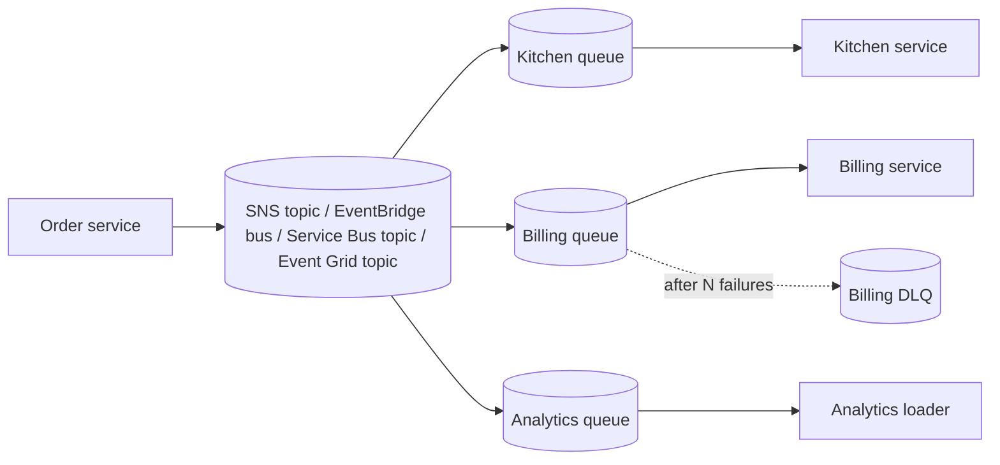
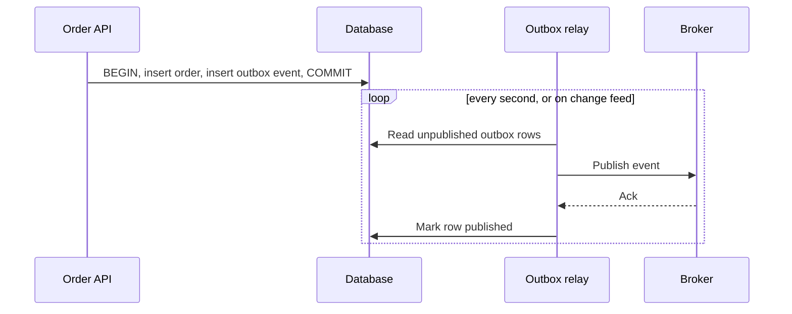
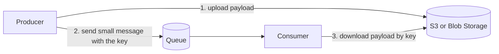
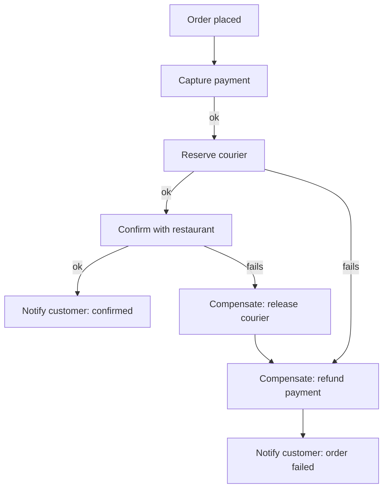
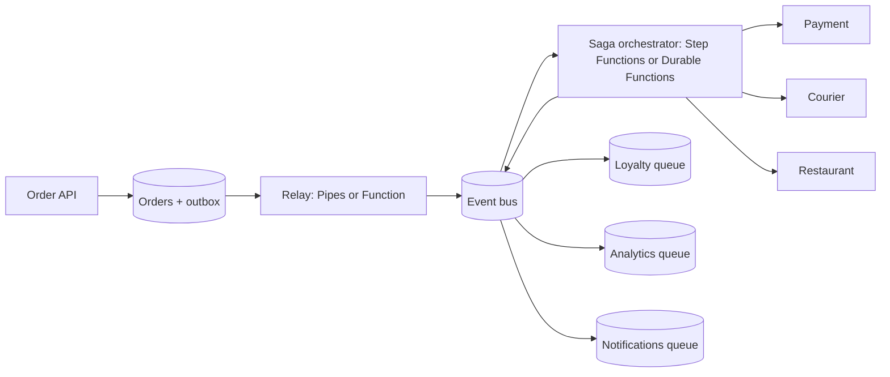

# Event-Driven Patterns in the Cloud

## Introduction

The previous pages introduced the building blocks: [queues](./1-cloud-sqs-and-service-bus.mdx), [pub/sub](./2-cloud-sns-and-event-grid.mdx) and [streams](./3-cloud-kinesis-and-event-hubs.mdx). Knowing the services is like knowing what bricks, beams and pipes are. You still need building techniques to put them together into something that does not leak.

Event-driven systems fail in a small number of predictable ways:

- An event is **lost** because the database write succeeded but the publish failed.
- An event is **processed twice** because a consumer timed out after doing the work.
- A **multi-step business process** half-finishes: the payment was taken, but the restaurant never got the order.
- A **payload is too big** for the broker.
- A producer **changes the event shape** and silently breaks three consumers.
- Nobody can **trace** what happened to a request once it crosses a queue.

Each of those failure modes has a well-known pattern that fixes it. This page walks through them with AWS and Azure implementations and runnable Python you can try locally.

| Problem | Pattern |
| --- | --- |
| One event, many independent consumers | Fan-out to queues |
| Database write and publish must both happen | Transactional outbox |
| Duplicates from at-least-once delivery | Idempotent consumer |
| Messages too large for the broker | Claim check |
| Multi-step process across services | Saga (choreography or orchestration) |
| Consumers break when events change | Event contracts and versioning |
| Hard to debug async flows | Correlation IDs and distributed tracing |

## Event Notification vs Event-Carried State Transfer

Before the patterns, decide **what goes in an event**. There are two common styles:

```json
{
  "type": "com.shop.order.placed",
  "id": "evt-9f1c",
  "time": "2026-10-11T09:30:00Z",
  "data": { "orderId": "o-42" }
}
```

```json
{
  "type": "com.shop.order.placed",
  "id": "evt-9f1c",
  "time": "2026-10-11T09:30:00Z",
  "data": {
    "orderId": "o-42",
    "customerId": "c-7",
    "items": [{ "sku": "PIZZA-MARG", "qty": 2 }],
    "total": 24.0,
    "restaurantId": "r-12"
  }
}
```

| Style | What it carries | Pros | Cons |
| --- | --- | --- | --- |
| **Event notification** (thin) | Just an ID and what happened | Small, stable contract, no stale data | Every consumer calls back to the producer's API, adding load and coupling |
| **Event-carried state transfer** (fat) | Everything consumers need | Consumers work independently, even if the producer is down | Bigger messages, more fields that can change, risk of leaking data to consumers that should not see it |

Most teams land in the middle: include the fields that most consumers need and that are stable, and let rare consumers call back for the rest.

## Pattern 1: Fan-Out to Queues

Give each consumer its own queue, fed by a topic or event bus. The publisher stays unaware of consumers, and each consumer gets buffering, retries and its own dead-letter queue.



| | AWS | Azure |
| --- | --- | --- |
| Topic | SNS topic or EventBridge bus | Service Bus topic or Event Grid topic |
| Per-consumer buffer | SQS queue per consumer | Service Bus subscription (already queue-like) or a queue per consumer behind Event Grid |
| Dead letters | SQS DLQ per queue | Built-in DLQ per subscription |

On Azure, Service Bus topics give you this pattern in one resource: each subscription *is* the per-consumer queue. On AWS you compose SNS (or EventBridge) with SQS. The setup commands are on the [pub/sub page](./2-cloud-sns-and-event-grid.mdx).

## Pattern 2: Transactional Outbox

This is the most important pattern on this page, because it fixes a bug most teams ship without noticing: the **dual write**.

```python
def place_order(order):
    db.insert(order)          # 1. succeeds
    broker.publish(order)     # 2. network blip: fails, or the process crashes here
```

If step 2 fails, the order exists but nobody ever hears about it. Swap the order of the steps and you get the opposite bug: an event for an order that was never saved. You cannot wrap a database and a message broker in one transaction.

The **outbox** fixes it: write the business row *and* the event into the **same database, in the same transaction**. A separate relay reads the outbox table and publishes. If the relay crashes, it simply retries; the event is never lost (it may be published twice, which idempotent consumers handle).



Here is a complete, runnable outbox using SQLite and a fake broker that fails randomly:

```python
import json
import random
import sqlite3
import uuid

random.seed(3)
db = sqlite3.connect(":memory:")
db.executescript("""
CREATE TABLE orders (id TEXT PRIMARY KEY, total REAL);
CREATE TABLE outbox (id TEXT PRIMARY KEY, type TEXT, payload TEXT, published INTEGER DEFAULT 0);
""")


def place_order(order_id: str, total: float) -> None:
    with db:  # one transaction for both writes
        db.execute("INSERT INTO orders VALUES (?, ?)", (order_id, total))
        db.execute("INSERT INTO outbox (id, type, payload) VALUES (?, ?, ?)",
                   (str(uuid.uuid4()), "OrderPlaced", json.dumps({"orderId": order_id, "total": total})))


def flaky_publish(event_type: str, payload: str) -> None:
    if random.random() < 0.4:
        raise ConnectionError("broker unavailable")
    print(f"  published {event_type} {payload}")


def relay_once() -> None:
    rows = db.execute("SELECT id, type, payload FROM outbox WHERE published = 0 ORDER BY rowid").fetchall()
    for row_id, event_type, payload in rows:
        try:
            flaky_publish(event_type, payload)
            with db:
                db.execute("UPDATE outbox SET published = 1 WHERE id = ?", (row_id,))
        except ConnectionError as exc:
            print(f"  will retry: {exc}")


for i, total in enumerate([20.0, 35.5, 12.0], start=1):
    place_order(f"o-{i}", total)

for attempt in range(1, 4):
    print(f"relay pass {attempt}")
    relay_once()

pending = db.execute("SELECT COUNT(*) FROM outbox WHERE published = 0").fetchone()[0]
print("unpublished events left:", pending)
```

Output:

```text
relay pass 1
  will retry: broker unavailable
  published OrderPlaced {"orderId": "o-2", "total": 35.5}
  will retry: broker unavailable
relay pass 2
  published OrderPlaced {"orderId": "o-1", "total": 20.0}
  published OrderPlaced {"orderId": "o-3", "total": 12.0}
relay pass 3
unpublished events left: 0
```

Note that the relay published `o-2` before `o-1` because `o-1` failed on the first pass. If consumers need per-order ordering, publish per key in order (stop at the first failure for that key), or use an ordered channel such as SQS FIFO or Service Bus sessions.

### Outbox in the cloud without a polling relay

Both clouds can replace the polling relay with a **change feed** from the database:

| | AWS | Azure |
| --- | --- | --- |
| Change feed | DynamoDB Streams | Azure Cosmos DB change feed |
| Relay | **EventBridge Pipes** (DynamoDB stream source, EventBridge bus or SQS target, with filtering) or a Lambda function | Azure Functions Cosmos DB trigger |
| Relational databases | Poll the outbox table from Lambda on a schedule, or use change data capture with AWS DMS or Debezium on MSK | Poll from a timer-triggered Function, or use Azure SQL change tracking / change data capture |

With DynamoDB or Cosmos DB you often do not even need a separate outbox table: you write the item, and the change feed *is* the outbox.

## Pattern 3: Idempotent Consumer, Retries and Dead Letters

Every service in this section delivers **at least once**. Retries happen on timeouts, crashes, throttling and network errors. Your consumers must be **idempotent**: processing the same event twice has the same effect as processing it once.

Three techniques, from simplest to most general:

1. **Natural idempotency**: "set status to SHIPPED" is safe to repeat; "add 1 to the counter" is not. Prefer absolute writes.
2. **Conditional writes**: DynamoDB `ConditionExpression` (for example `attribute_not_exists(pk)`), Cosmos DB optimistic concurrency with ETags, or a unique constraint in SQL.
3. **Deduplication table**: record the event ID with the side effect in one transaction, and skip IDs you have seen. The [queues page](./1-cloud-sqs-and-service-bus.mdx#writing-an-idempotent-consumer) has a runnable example.

Pair idempotency with **bounded retries and a dead-letter queue**:

```python
import random
import time


class PermanentError(Exception):
    """Retrying will never help: bad data, missing customer, validation failure."""


def process_with_retries(handler, message, max_attempts=4, base_delay=0.05):
    for attempt in range(1, max_attempts + 1):
        try:
            return handler(message)
        except PermanentError as exc:
            return f"dead-lettered immediately: {exc}"
        except Exception as exc:
            if attempt == max_attempts:
                return f"dead-lettered after {attempt} attempts: {exc}"
            delay = base_delay * 2 ** (attempt - 1) * random.uniform(0.5, 1.5)  # backoff + jitter
            print(f"  attempt {attempt} failed ({exc}), retrying in {delay:.2f}s")
            time.sleep(delay)


calls = {"n": 0}


def flaky_handler(msg):
    calls["n"] += 1
    if calls["n"] < 3:
        raise TimeoutError("payment API timeout")
    return f"charged {msg['orderId']}"


def bad_data_handler(msg):
    raise PermanentError("customer c-404 does not exist")


print(process_with_retries(flaky_handler, {"orderId": "o-42"}))
print(process_with_retries(bad_data_handler, {"orderId": "o-43"}))
```

Example output (delays vary because of jitter):

```text
  attempt 1 failed (payment API timeout), retrying in 0.04s
  attempt 2 failed (payment API timeout), retrying in 0.12s
charged o-42
dead-lettered immediately: customer c-404 does not exist
```

In the cloud you rarely write this loop yourself. The platform provides it: SQS `maxReceiveCount` and redrive, Lambda retry settings and on-failure destinations, Service Bus max delivery count and `dead_letter_message`, Event Grid retry policy and dead-letter containers. Your job is to **classify errors**: let transient errors throw so the platform retries, and dead-letter permanent errors immediately.

## Pattern 4: Claim Check

Brokers limit message size (for example 1 MiB in SQS, 256 KB in Service Bus Standard, 1 MB in Event Grid). Large payloads also make every hop slower and more expensive. The **claim check** pattern stores the payload in object storage and sends only a reference, like checking your coat and carrying the ticket.



### On AWS

```python
import json
import uuid
import boto3

s3 = boto3.client("s3")
sqs = boto3.client("sqs")
BUCKET = "helpdesk-claim-checks-111122223333"
QUEUE_URL = "https://sqs.us-east-1.amazonaws.com/111122223333/transcripts"

transcript = {"ticketId": "T-1001", "messages": ["..."] * 50_000}   # several MB
key = f"transcripts/{uuid.uuid4()}.json"
s3.put_object(Bucket=BUCKET, Key=key, Body=json.dumps(transcript).encode())
sqs.send_message(QueueUrl=QUEUE_URL, MessageBody=json.dumps(
    {"ticketId": "T-1001", "payload": {"bucket": BUCKET, "key": key}}))
print("sent claim check for", key)
```

AWS also publishes the [Amazon SQS Extended Client Library for Python](https://github.com/awslabs/amazon-sqs-python-extended-client-lib), which does this automatically for large messages.

### On Azure

```python
import json
import uuid
from azure.identity import DefaultAzureCredential
from azure.servicebus import ServiceBusClient, ServiceBusMessage
from azure.storage.blob import BlobServiceClient

cred = DefaultAzureCredential()
blobs = BlobServiceClient("https://helpdeskfiles123.blob.core.windows.net", credential=cred)
name = f"transcripts/{uuid.uuid4()}.json"
blobs.get_blob_client("claim-checks", name).upload_blob(json.dumps({"ticketId": "T-1001"}))

with ServiceBusClient("helpdesk-sb-12345.servicebus.windows.net", cred) as sb:
    with sb.get_queue_sender("transcripts") as sender:
        sender.send_messages(ServiceBusMessage(json.dumps(
            {"ticketId": "T-1001", "payload": {"container": "claim-checks", "blob": name}})))
print("sent claim check for", name)
```

Add a lifecycle rule to delete claim-check objects after a few days, so storage does not grow forever (see [Storage Classes, Tiers and Lifecycle Policies](../6-cloud-storage/3-cloud-storage-classes.mdx)).

## Pattern 5: Sagas for Multi-Step Processes

A food order needs four services to agree: take payment, reserve a courier, confirm with the restaurant, notify the customer. There is no distributed transaction across them. A **saga** is a sequence of local steps, each with a **compensating action** that undoes it if a later step fails.

There are two ways to coordinate a saga:

- **Choreography**: each service listens for events and emits the next one (`PaymentCaptured` triggers the courier service, which emits `CourierReserved`, and so on). No central coordinator.
- **Orchestration**: a workflow engine calls each step in turn and runs compensations on failure. On AWS this is **AWS Step Functions**; on Azure, **Durable Functions** or **Logic Apps**. See [Workflows: Step Functions and Durable Functions](../4-cloud-serverless/5-cloud-step-functions-durable.mdx).



This runnable orchestrator shows the core logic every saga engine implements: run steps in order, remember what succeeded, and on failure run the compensations in reverse.

```python
log = []


def capture_payment(o):  log.append("payment captured")
def refund_payment(o):   log.append("payment refunded")
def reserve_courier(o):  log.append("courier reserved")
def release_courier(o):  log.append("courier released")


def confirm_restaurant(o):
    if o["restaurant_open"] is False:
        raise RuntimeError("restaurant closed")
    log.append("restaurant confirmed")


STEPS = [
    (capture_payment, refund_payment),
    (reserve_courier, release_courier),
    (confirm_restaurant, None),
]


def run_saga(order):
    done = []
    for action, compensate in STEPS:
        try:
            action(order)
            done.append(compensate)
        except Exception as exc:
            log.append(f"FAILED: {exc}")
            for undo in reversed(done):
                if undo:
                    undo(order)
            return "rolled back"
    return "completed"


print(run_saga({"id": "o-1", "restaurant_open": True}), log)
log.clear()
print(run_saga({"id": "o-2", "restaurant_open": False}), log)
```

Output:

```text
completed ['payment captured', 'courier reserved', 'restaurant confirmed']
rolled back ['payment captured', 'courier reserved', 'FAILED: restaurant closed', 'courier released', 'payment refunded']
```

A real orchestrator adds what this toy lacks: durable state that survives crashes, retries per step, timeouts, and a visual history of each execution. That is exactly what Step Functions and Durable Functions provide. Compensations must themselves be idempotent, because they can be retried too.

## Pattern 6: Event Contracts and Versioning

Events are an API. Treat them like one.

- **Use a standard envelope.** [CloudEvents 1.0](https://cloudevents.io/) defines `id`, `source`, `type`, `time`, `specversion` and `data`. Event Grid supports it natively; on AWS you can carry CloudEvents inside the EventBridge `detail` or an SQS body.
- **Name types clearly and version them**: `com.shop.order.placed.v1`, or a `dataschema`/`schemaVersion` field.
- **Make only additive changes** within a version. Adding an optional field is safe; renaming or removing a field is a new version, published alongside the old one until consumers migrate.
- **Use a schema registry** where it helps: the EventBridge Schema Registry can discover schemas from events and generate code bindings; Event Hubs has a built-in schema registry for Avro and JSON schemas.
- **Consumers should be tolerant readers**: ignore unknown fields, and fail clearly (to a DLQ) on missing required ones.

## Pattern 7: Correlation IDs and Tracing

When a request crosses three queues and four functions, logs from each piece are useless unless you can join them. Put a **correlation ID** in every message (as a message attribute or application property, not only in the body) and log it everywhere. Distributed tracing tools propagate trace context across many messaging services automatically: **AWS X-Ray** (and OpenTelemetry via the AWS Distro for OpenTelemetry) and **Azure Monitor Application Insights** (with OpenTelemetry). See [Distributed Tracing: X-Ray and Application Insights](../12-cloud-observability-and-security/2-cloud-tracing.mdx).

Also monitor the signals that tell you an async system is unhealthy: queue depth, age of the oldest message, DLQ count, consumer lag (iterator age in Kinesis, consumer lag in Event Hubs), and failed deliveries on EventBridge rules and Event Grid subscriptions.

## Real-World Scenario

Your team builds the ordering backend for a food-delivery app, deployed on AWS for one region and Azure for another (a requirement from a regional partner). An order must take payment, reserve a courier, and be confirmed by the restaurant within 3 minutes, or be refunded. Many other services (loyalty points, analytics, customer notifications) also react to orders.

**Solution:**

1. The order API writes the order and an `OrderPlaced` outbox record in one transaction (DynamoDB on AWS, Cosmos DB on Azure). EventBridge Pipes (AWS) or a Cosmos DB-triggered Function (Azure) relays the change feed to the event bus.
2. The **critical path** (payment, courier, restaurant, with a 3-minute timeout and compensations) is an **orchestrated saga** in Step Functions or Durable Functions, started by the `OrderPlaced` event.
3. **Non-critical consumers** (loyalty, analytics, notifications) use **choreography**: they subscribe to `OrderPlaced`, `OrderConfirmed` and `OrderFailed` through per-consumer queues.
4. All consumers are idempotent on `orderId` plus event type, with DLQs and alarms.
5. Receipts and order photos travel as **claim checks** in S3 or Blob Storage.



**Why this approach:** the outbox guarantees no order is silently lost. The money-and-timeout path needs a clear owner, visible state and reliable compensation, which orchestration gives you. Everything else is loosely coupled through events, so new consumers can be added without touching the order flow.

**When to use it / when not to:** this combination fits business processes with several services and real consequences of partial failure. For a single service writing to its own database, a plain transaction is simpler and stronger. For two steps with no compensation needed, a queue between them is enough.

**Alternatives and trade-offs:**

| Approach | Pros | Cons | Best for |
| --- | --- | --- | --- |
| Choreography only | Very loose coupling, no central component, easy to add consumers | Hard to see or change the end-to-end flow; timeouts and compensations scattered | Simple flows, notifications, analytics |
| Orchestration only | Clear flow, central timeouts, retries and compensation, execution history | Orchestrator knows every participant; can become a bottleneck for change | Critical multi-step transactions |
| Hybrid (shown above) | Best of both: control where it matters, decoupling elsewhere | Two styles to learn | Most production systems |
| Synchronous calls in one request | Simple to write and read | Fragile: one slow service blocks the user; no durable retry | Short, low-risk flows |
| Distributed transactions (two-phase commit) | Strong consistency | Not supported across cloud messaging services; poor availability | Rarely appropriate in the cloud |

## Common Mistakes

- **Dual writes without an outbox.** "It almost never fails" means it fails at 3 a.m. on your busiest day.
- **Retrying permanent errors.** A malformed message retried ten times is ten wasted invocations and a delay for everything behind it. Classify errors and dead-letter permanent ones immediately.
- **Non-idempotent compensations.** A refund that runs twice is a new incident. Key compensations by order ID.
- **Choreography for everything.** When nobody can explain the full order flow without reading six services' code, introduce an orchestrator for the critical path.
- **Events as remote procedure calls.** If a producer waits for a specific consumer's reply, you have built a slow, fragile RPC. Use a synchronous API or an orchestrator instead.
- **Breaking changes in events.** Renaming a field breaks consumers you do not know about. Version events and keep old versions until consumers migrate.
- **No correlation IDs.** Debugging async systems without them is guesswork.

## Summary

- **Fan-out to queues** gives each consumer isolation, buffering and its own DLQ.
- The **transactional outbox** (or a database change feed) prevents lost events from dual writes; DynamoDB Streams with EventBridge Pipes and the Cosmos DB change feed with Functions are cloud-native relays.
- **Idempotent consumers**, bounded retries with backoff, and **dead-letter queues** handle at-least-once delivery.
- The **claim check** pattern moves large payloads through S3 or Blob Storage.
- **Sagas** coordinate multi-step processes with compensations; use orchestration (Step Functions, Durable Functions) for critical paths and choreography for loosely coupled reactions.
- Treat events as versioned contracts with a standard envelope such as CloudEvents, and trace them with correlation IDs.

## Exercises

1. Modify the outbox relay so it preserves per-order ordering: for each `orderId`, stop publishing that order's events at the first failure. Add a second event per order to test it.
2. Add a `timeout` step to the saga simulation: if confirming the restaurant takes longer than a limit, compensate. How do Step Functions and Durable Functions express timeouts? Look them up in the official docs.
3. Design a version 2 of the `OrderPlaced` event that splits `total` into `subtotal`, `tax` and `deliveryFee`. Describe how you would roll it out without breaking existing consumers.
4. For the food-delivery scenario, list the metrics and alarms you would set up on each cloud, naming the specific metric for queue age, DLQ size and stream consumer lag.

Related pages:

- [Choosing a Messaging Service](./0-cloud-messaging-options.mdx)
- [Queues: SQS and Azure Service Bus](./1-cloud-sqs-and-service-bus.mdx)
- [Pub/Sub: SNS, EventBridge and Event Grid](./2-cloud-sns-and-event-grid.mdx)
- [Streaming: Kinesis and Event Hubs](./3-cloud-kinesis-and-event-hubs.mdx)
- [NoSQL: DynamoDB and Cosmos DB](../7-cloud-databases/2-cloud-dynamodb-cosmosdb.mdx)
- [Project: Event-Driven Image Processing Pipeline](../14-cloud-projects/4-cloud-project-event-pipeline.mdx)
