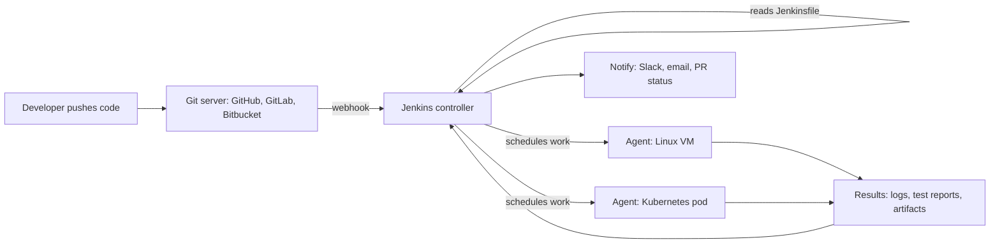
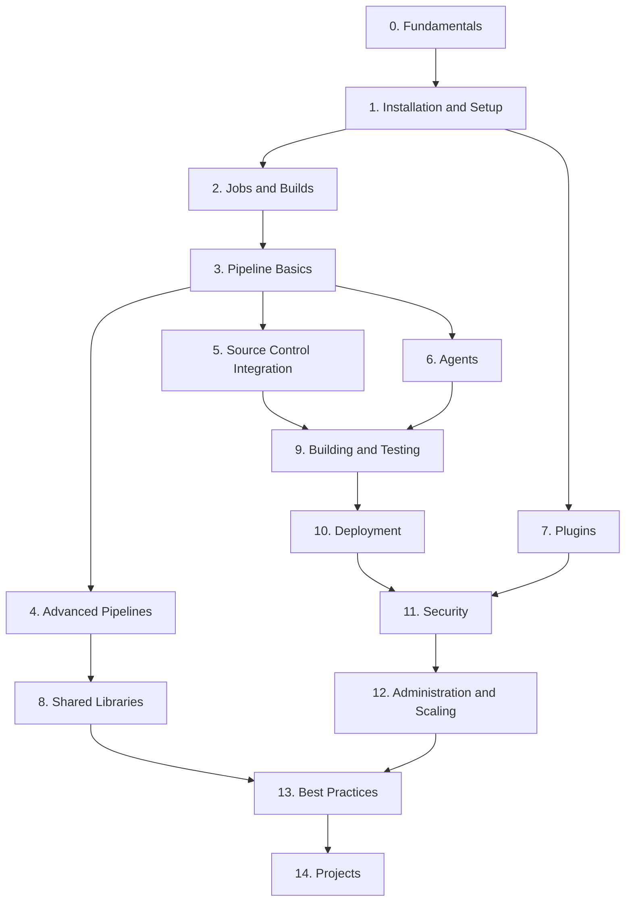
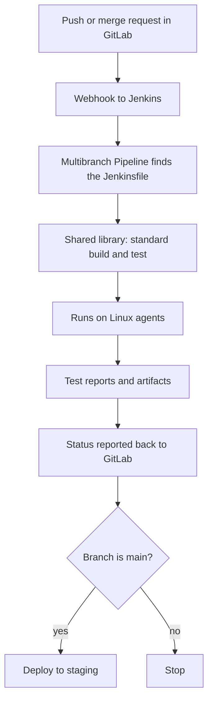

# Jenkins Introduction

<div style={{
    "width": "30%",
    "margin": "0 auto",
    "text-align": "center"
}}>
    
</div>

## Introduction

**Jenkins** is an open-source automation server. You give it instructions such as "when someone pushes to `main`, compile the code, run the tests, build a Docker image and deploy it to staging", and it carries them out every time, on every change, without anyone having to remember the steps.

Jenkins is one of the oldest and most widely used tools for **continuous integration and continuous delivery (CI/CD)**. It is written in Java, it runs on your own servers (or your own cloud account), and it can be extended with a very large catalog of community plugins. The plugin index at [plugins.jenkins.io](https://plugins.jenkins.io) lists well over a thousand of them.

A useful way to picture Jenkins:

- A **build script** on your laptop is a recipe you follow by hand.
- A **CI service** is a kitchen that follows the recipe for you every time an order comes in.
- **Jenkins** is a kitchen you own. You choose the ovens (agents), hire the staff (plugins), and write the house rules (pipelines). That gives you a lot of control, and it also means you are responsible for keeping the kitchen clean.

This page explains what Jenkins is, why teams still choose it, how this tutorial is organized, and what you need before you start.

:::info
This tutorial goes deep on **Jenkins specifically**. If you want tool-neutral background on CI/CD first, read the [CI/CD tutorial](/docs/devops/cicd) on this site. The next page, [CI/CD Concepts for Jenkins Users](./1-jenkins-ci-cd-concepts.mdx), gives a short recap focused on Jenkins.
:::

## A Short History

Knowing where Jenkins came from explains several of its quirks.

- **2004 to 2005:** Kohsuke Kawaguchi, then at Sun Microsystems, started a CI server called **Hudson**. Its first release came out in early 2005.
- **2010 to 2011:** Oracle acquired Sun and with it the Hudson trademark. After a dispute over the name, the community voted in January 2011 to rename the project **Jenkins** and continue development under the new name. Oracle kept Hudson going for a while and later handed it to the Eclipse Foundation. Hudson is no longer maintained.
- **2016:** Jenkins 2 made **Pipeline as code** (the `Jenkinsfile`) the recommended way to define builds.
- **2019:** Jenkins became a founding project of the **Continuous Delivery Foundation (CDF)**, part of the Linux Foundation.
- **Today:** Jenkins ships a **weekly** release line and a **Long-Term Support (LTS)** line. A new LTS baseline appears roughly every 12 weeks.

Because Jenkins grew up before containers, Kubernetes and YAML-based CI, it carries some history: old terms (you may still see "master" and "slave" in older blog posts; the current terms are **controller** and **agent**), old job types (Freestyle jobs), and a plugin system that is both its biggest strength and its biggest maintenance cost.

:::caution Versions change
At the time of writing (autumn 2026), the current LTS line is **2.580.x**, and Jenkins requires **Java 21 or Java 25**. Java 17 is no longer supported from LTS 2.555.1 onward. Always check the [LTS changelog](https://www.jenkins.io/changelog-stable/) and the [Java support policy](https://www.jenkins.io/doc/book/platform-information/support-policy-java/) before you install or upgrade.
:::

## A First Look at a Jenkins Pipeline

Here is the kind of file you will write throughout this tutorial. It is a **Declarative Pipeline**, stored as a file named `Jenkinsfile` in the root of your Git repository.

```groovy
// Jenkinsfile
pipeline {
    agent any                      // run on any available agent

    options {
        timeout(time: 15, unit: 'MINUTES')
        buildDiscarder(logRotator(numToKeepStr: '20'))
    }

    stages {
        stage('Build') {
            steps {
                echo "Building commit ${env.GIT_COMMIT ?: 'local'}"
                sh 'echo "compiling..." && sleep 1'
            }
        }
        stage('Test') {
            steps {
                sh 'echo "running tests..." && echo "12 passed, 0 failed"'
            }
        }
        stage('Deploy to staging') {
            when { branch 'main' }  // only deploy from main
            steps {
                sh 'echo "deploying to staging"'
            }
        }
    }

    post {
        success { echo 'Pipeline succeeded.' }
        failure { echo 'Pipeline failed. Check the logs above.' }
    }
}
```

When Jenkins runs this pipeline for a feature branch, the console log looks roughly like this (trimmed):

Example output:

```text
[Pipeline] Start of Pipeline
[Pipeline] node
Running on agent-linux-1 in /home/jenkins/workspace/my-app_feature-login
[Pipeline] stage
[Pipeline] { (Build)
[Pipeline] echo
Building commit 3f9c2a1d...
[Pipeline] sh
+ echo compiling...
compiling...
[Pipeline] stage
[Pipeline] { (Test)
+ echo running tests...
running tests...
12 passed, 0 failed
[Pipeline] stage
[Pipeline] { (Deploy to staging)
Stage "Deploy to staging" skipped due to when conditional
[Pipeline] echo
Pipeline succeeded.
[Pipeline] End of Pipeline
Finished: SUCCESS
```

Every part of that file is covered later:

| Piece | What it does | Where you learn it |
|-------|--------------|--------------------|
| `pipeline` and `stages` | The overall structure | [Declarative Pipeline Syntax](../3-jenkins-pipeline-basics/2-jenkins-declarative-pipeline.mdx) |
| `agent any` | Where the work runs | [Controller and Agents](../6-jenkins-agents/0-jenkins-controller-and-agents.mdx) |
| `options` | Timeouts, build retention and more | [Pipeline Options and Tuning](../4-jenkins-pipeline-advanced/6-jenkins-pipeline-options.mdx) |
| `when` | Run a stage only in some cases | [Conditional Stages with when](../3-jenkins-pipeline-basics/8-jenkins-when-conditions.mdx) |
| `post` | Actions after the run, such as notifications | [Post Conditions](../3-jenkins-pipeline-basics/7-jenkins-post-conditions.mdx) |
| `env.GIT_COMMIT` | Built-in environment variables | [Environment Variables](../3-jenkins-pipeline-basics/6-jenkins-environment-variables.mdx) |

## How Jenkins Works at a Glance



The **controller** is the brain: it serves the web UI, stores configuration, decides what to run and where. **Agents** are the hands: they check out code and run the build commands. You will study this split in detail in [Jenkins Architecture](./2-jenkins-architecture.mdx).

## Why Teams Still Choose Jenkins

Hosted CI services such as GitHub Actions and GitLab CI are popular, and for many teams they are the simpler choice. Jenkins remains common for reasons that matter in real organizations:

1. **You run it where you want.** On-premises, in an air-gapped network, in your own cloud account, or on Kubernetes. Your source code and secrets never have to leave your network.
2. **It works with any source control and any tool.** Git hosted anywhere, plus older systems. If a tool has a command line, Jenkins can run it.
3. **Extensibility.** Plugins and shared libraries let a platform team build a standard pipeline that hundreds of repositories reuse.
4. **No per-minute billing from a vendor.** You pay for the machines and the people who run them instead. That is not automatically cheaper, as [Total Cost of Running Jenkins](../13-jenkins-best-practices/4-jenkins-cost-and-maintenance.mdx) explains.
5. **Existing investment.** Many companies have years of jobs, plugins and knowledge in Jenkins. Migrating has a real cost.

It has real downsides too, and this tutorial is honest about them:

- **Plugin maintenance.** Plugins have their own release cycles and dependencies. Upgrades can break things.
- **Groovy quirks.** Pipelines run through a special interpreter (CPS) so they can survive restarts. That causes surprising errors such as `NotSerializableException`.
- **The controller is a single point of failure.** Open-source Jenkins has no built-in active-active high availability.
- **You own security.** Jenkins publishes security advisories regularly, and you must patch it.

[Jenkins vs GitHub Actions, GitLab CI and Others](./3-jenkins-vs-alternatives.mdx) and [When Should You Choose Jenkins?](./4-jenkins-when-to-use.mdx) help you decide whether Jenkins is right for your team.

## What You'll Learn

The tutorial has 15 sections. Each builds on the previous ones, but you can jump to any section once you know the fundamentals.

| # | Section | What it covers | Start here |
|---|---------|----------------|------------|
| 0 | Jenkins Fundamentals | What Jenkins is, its architecture, how it compares to other CI tools, and key terms | [Jenkins Introduction](./0-jenkins-introduction.mdx) |
| 1 | Installation and Setup | Docker, Linux and Kubernetes installs, the setup wizard, the UI, system configuration and upgrades | [Installing Jenkins with Docker](../1-jenkins-installation/0-jenkins-install-docker.mdx) |
| 2 | Jobs and Builds | Freestyle jobs, triggers, parameters, workspaces, artifacts and why Pipelines replaced Freestyle | [Freestyle Jobs](../2-jenkins-jobs/0-jenkins-freestyle-jobs.mdx) |
| 3 | Pipeline Basics | The Jenkinsfile, Declarative and Scripted syntax, stages, environment variables, `post` and `when` | [Pipeline Introduction](../3-jenkins-pipeline-basics/0-jenkins-pipeline-introduction.mdx) |
| 4 | Advanced Pipelines | Parallel stages, matrix builds, approvals, retries, stash, Groovy essentials and replay | [Parallel Stages](../4-jenkins-pipeline-advanced/0-jenkins-parallel-stages.mdx) |
| 5 | Source Control Integration | Git, Multibranch Pipelines, GitHub, GitLab, Bitbucket, pull requests and monorepos | [Git Integration](../5-jenkins-scm-integration/0-jenkins-git-integration.mdx) |
| 6 | Agents and Distributed Builds | SSH, inbound, Docker, Kubernetes and cloud agents, labels and agent strategy | [Controller and Agents](../6-jenkins-agents/0-jenkins-controller-and-agents.mdx) |
| 7 | Plugins | Managing plugins, the essential set, avoiding plugin sprawl, plugins as code and writing a plugin | [Plugin Management](../7-jenkins-plugins/0-jenkins-plugin-management.mdx) |
| 8 | Shared Libraries | Reusing pipeline code across many repositories, testing and versioning it | [Shared Libraries Introduction](../8-jenkins-shared-libraries/0-jenkins-shared-libraries-introduction.mdx) |
| 9 | Building and Testing | Java, Node.js, Python, Go and .NET builds, test reports, coverage, SonarQube, Docker images and caching | [Building Java Projects with Maven and Gradle](../9-jenkins-build-and-test/0-jenkins-java-builds.mdx) |
| 10 | Deployment | Deployment pipelines, promotion, Kubernetes, cloud, Terraform, blue-green, rollbacks and GitOps | [Deployment Pipelines](../10-jenkins-deployment/0-jenkins-deployment-pipelines.mdx) |
| 11 | Security | Authentication, authorization, credentials, external secrets, script security and hardening | [Jenkins Security Overview](../11-jenkins-security/0-jenkins-security-overview.mdx) |
| 12 | Administration and Scaling | Configuration as Code, Job DSL, backups, monitoring, tuning, HA, notifications and the REST API | [Configuration as Code (JCasC)](../12-jenkins-administration/0-jenkins-configuration-as-code.mdx) |
| 13 | Best Practices | Pipeline best practices, anti-patterns, migrations and the total cost of Jenkins | [Pipeline Best Practices](../13-jenkins-best-practices/0-jenkins-pipeline-best-practices.mdx) |
| 14 | Jenkins Projects | Seven end-to-end projects, ending with a production CI/CD platform capstone | [Project: CI/CD for a Java Microservice](../14-jenkins-projects/0-jenkins-project-java-microservice.mdx) |

### Section highlights

- **Fundamentals (section 0)** gives you vocabulary and judgment: how Jenkins is built and when it is (and is not) the right tool.
- **Installation (section 1)** gets a real Jenkins running on your machine in minutes with Docker.
- **Jobs and Pipelines (sections 2 to 4)** are the core skills. You will write Declarative Pipelines and learn when Scripted Pipeline is the better tool.
- **SCM integration and agents (sections 5 and 6)** turn a single server into a system that builds every branch and pull request on scalable, disposable agents.
- **Plugins and shared libraries (sections 7 and 8)** are how organizations keep hundreds of pipelines consistent without copy-paste.
- **Build, test and deploy (sections 9 and 10)** cover the real work pipelines do, for many languages and targets.
- **Security and administration (sections 11 and 12)** are what separate a hobby server from a production platform.
- **Best practices and projects (sections 13 and 14)** put everything together.

## Learning Path



### Suggested routes

| Your goal | Suggested route |
|-----------|-----------------|
| Decide whether to adopt or keep Jenkins (tech lead, manager) | Section 0, then skim 7, 11, 12 and [Total Cost of Running Jenkins](../13-jenkins-best-practices/4-jenkins-cost-and-maintenance.mdx) |
| Get your first pipeline running this week | Sections 0, 1 and 3, then [Project: Node.js Web App Pipeline](../14-jenkins-projects/1-jenkins-project-node-webapp.mdx) |
| You inherited an old Jenkins full of Freestyle jobs | Sections 2, 3, 12 and [Migrating Freestyle Jobs to Pipelines](../13-jenkins-best-practices/2-jenkins-migrating-freestyle.mdx) |
| Build a platform for many teams | Sections 6, 8, 11 and 12, then [Project: Company-Wide Shared Library](../14-jenkins-projects/4-jenkins-project-shared-library.mdx) |
| Run Jenkins on Kubernetes | [Installing Jenkins on Kubernetes](../1-jenkins-installation/2-jenkins-install-kubernetes.mdx), [Kubernetes Pod Agents](../6-jenkins-agents/4-jenkins-kubernetes-agents.mdx) and [Project: Kubernetes Deployment Pipeline](../14-jenkins-projects/3-jenkins-project-kubernetes.mdx) |

## Prerequisites

:::info Prerequisites
You will get the most from this tutorial if you have:

- **Git basics**: commits, branches, pull requests. See the [Git tutorial](/docs/devops/git) if you need a refresher.
- **Command-line comfort**: running commands in a Linux shell, reading output, setting environment variables.
- **Docker basics**: running a container and mapping a port. The [Docker tutorial](/docs/devops/docker) covers this.
- **One programming language** you can build and test (Java, JavaScript, Python, Go or C#).

You do **not** need to know Groovy. Declarative Pipeline looks like structured configuration, and the Groovy you need is taught in [Groovy Essentials for Pipelines](../4-jenkins-pipeline-advanced/5-jenkins-groovy-for-pipelines.mdx).
:::

Later sections also use Kubernetes ([Kubernetes tutorial](/docs/devops/kubernetes)), Terraform ([Terraform tutorial](/docs/devops/terraform)) and Ansible ([Ansible tutorial](/docs/devops/ansible)). Each page says what it assumes.

## Getting Your Machine Ready

You will install Jenkins properly in [Installing Jenkins with Docker](../1-jenkins-installation/0-jenkins-install-docker.mdx). If you want to try it right now and have Docker installed, this starts the current LTS release with a named volume for its data:

```bash
docker volume create jenkins_home

docker run -d --name jenkins \
  -p 8080:8080 -p 50000:50000 \
  -v jenkins_home:/var/jenkins_home \
  --restart=on-failure \
  jenkins/jenkins:lts-jdk21

# Wait about 30 seconds, then print the one-time setup password
docker exec jenkins cat /var/jenkins_home/secrets/initialAdminPassword
```

Example output (your password will differ):

```text
jenkins_home
8b1e6f0c2d7a4c55e0e3b1a9d8f2c6a1
3e5c1f9a8b7d4e2f9c0a1b2c3d4e5f60
```

Open `http://localhost:8080`, paste the password, and follow the wizard. [Initial Setup Wizard](../1-jenkins-installation/3-jenkins-initial-setup.mdx) explains each choice.

:::tip
Port `8080` is the web UI. Port `50000` is only needed for inbound TCP agents. If all your agents connect over SSH or WebSocket, you can leave it unpublished.
:::

## How Each Page Is Organized

| Part | What you get |
|------|--------------|
| Introduction | What the topic is, in plain language |
| Concept sections | The idea built up step by step, with diagrams |
| Examples | Jenkinsfiles, configuration and commands, with sample output |
| Real-World Scenario | A concrete situation, the solution, **why** it fits, **when** to use it or not, and **alternatives and trade-offs** |
| Common Mistakes or Best Practices | Pitfalls that catch real teams |
| Summary | A short recap |
| Further Learning | Exercises and links to related pages |

## Frequently Asked Questions

**Is Jenkins free?**
Jenkins itself is free and open source (MIT license). Running it is not free: you pay for servers, storage, and the time people spend upgrading, patching and debugging it. Commercial distributions with support also exist.

**Is Jenkins outdated?**
It is old, not abandoned. Jenkins has a weekly release line and a regular LTS line, and the project publishes security fixes regularly. Some parts are legacy: Freestyle jobs, and the **Blue Ocean** UI, which is deprecated and no longer receives feature updates. This tutorial teaches the current approach: Pipelines as code, the Pipeline Graph View plugin for visualization, and Configuration as Code for setup.

**Do I need Kubernetes to run Jenkins?**
No. A single Docker container or Linux VM is fine for learning and for many small teams. Kubernetes helps when you need many short-lived build agents.

**Should I learn GitHub Actions instead?**
If your code lives on GitHub and your needs are simple, GitHub Actions may be the faster path. Many engineers end up using both. The comparison page helps you choose.

## Real-World Scenario

You join a 40-person company that builds a B2B invoicing product. There are 25 Git repositories on a self-hosted GitLab server inside the company network. Builds are done by hand on a developer's laptop before every release, and twice last quarter a release shipped with a failing test. Your manager asks you to "set up CI/CD".

Here is how this tutorial helps you plan instead of just installing something.

**Step 1: Pick the tool (section 0).** The source code and customer test data must stay inside the network, and the company already runs servers on-premises. A hosted SaaS CI with cloud runners is ruled out. GitLab CI with self-hosted runners and Jenkins are both reasonable. The team already has two engineers who know Jenkins, so you prototype with Jenkins and keep GitLab CI as the alternative.

**Step 2: Start small (sections 1 and 3).** You run Jenkins in Docker on one VM and write a Declarative `Jenkinsfile` for the most important repository: build, test, publish test reports.

**Step 3: Build every branch (section 5).** A Multibranch Pipeline with GitLab webhooks builds every merge request and reports status back to GitLab, so broken tests block the merge.

**Step 4: Move builds off the controller (section 6).** You add two Linux agents and set the controller's own executors to zero.

**Step 5: Avoid copy-paste (section 8).** By the tenth repository the Jenkinsfiles all look alike, so you move the common steps into a shared library.

**Step 6: Make it safe and repeatable (sections 11 and 12).** Credentials go in the credentials store, logins go through the company directory, and the whole Jenkins configuration is stored as code so you can rebuild the server.



### Why this approach

The constraints (on-premises code, a self-hosted Git server, existing Jenkins skills) point to a self-hosted CI server. Starting with one repository proves value quickly. Adding agents, shared libraries and configuration as code only as the need appears keeps the system no more complex than it has to be.

### When to use it and when not to

This plan fits a team that must keep builds inside its own network, or that has build needs a hosted service handles poorly. If all your code were on GitHub.com and you had no data restrictions, GitHub Actions would likely get you to the same result with less operational work.

### Alternatives and trade-offs

| Approach | Pros | Cons | Best for |
|----------|------|------|----------|
| Manual builds on laptops | Zero setup | Unrepeatable, error-prone, no audit trail | Nothing beyond a prototype |
| Jenkins, self-hosted | Full control, any SCM, huge plugin ecosystem, runs anywhere | You patch, upgrade, back up and scale it | Regulated or on-premises environments, complex builds, existing Jenkins investment |
| GitLab CI with self-hosted runners | Built into GitLab, YAML config, merge request integration out of the box | Tied to GitLab; advanced features depend on GitLab tier | Teams already on GitLab |
| GitHub Actions | Hosted runners, large marketplace, minimal admin | Tied to GitHub; usage-based billing on hosted runners | Teams on GitHub.com with standard builds |
| Other hosted CI (CircleCI, Buildkite and others) | Little admin, strong features | Another vendor and bill | Teams wanting a dedicated CI product |

## Best Practices for Learning Jenkins

- **Run Jenkins locally in Docker** and break it freely. A throwaway instance is the best learning tool.
- **Write pipelines as code from day one.** Avoid configuring builds by clicking through Freestyle job forms, except to understand them.
- **Keep the controller clean.** Do not run builds on the controller. Install only plugins you need.
- **Read the console log.** Almost every Jenkins problem is explained, sometimes cryptically, in the build log or the system log.
- **Use the Snippet Generator.** It writes correct step syntax for installed plugins. See [Snippet Generator and Pipeline Syntax Tools](../3-jenkins-pipeline-basics/9-jenkins-pipeline-syntax-generator.mdx).

## Common Mistakes

- **Learning from old tutorials.** Many online guides still teach Blue Ocean, `master`/`slave` terminology, Java 8 or 11, or Freestyle-only setups. Check the date and the Jenkins version.
- **Installing dozens of plugins "just in case".** Every plugin is code you must keep updated and secure. Start with the suggested set.
- **Putting business logic in Groovy.** Pipeline Groovy runs on the controller. Keep heavy work in `sh` steps on agents.
- **Never upgrading.** An unpatched Jenkins exposed to a network is a real security risk. Plan upgrades from the start.

## Summary

- Jenkins is an open-source, self-hosted automation server for CI/CD, written in Java and extended by plugins.
- It began as Hudson in 2005, became Jenkins in 2011, and is now a Continuous Delivery Foundation project.
- Modern Jenkins means **Pipelines as code** in a `Jenkinsfile`, builds on **agents** rather than the controller, and configuration stored as code.
- Its strengths are control, flexibility and ecosystem. Its costs are maintenance, plugin management, Groovy quirks and a single controller.
- At the time of writing the LTS line is 2.580.x and requires Java 21 or 25. Check the official changelog for current versions.
- The tutorial has 15 sections, from fundamentals to a production capstone project.

## Further Learning

Exercises:

1. Start Jenkins with the `docker run` command above, finish the setup wizard, and create a Pipeline job that pastes in the sample `Jenkinsfile`. Find the line in the console log that shows which node ran the build.
2. Change the sample pipeline so the `Test` stage fails (`sh 'exit 1'`). Which stages run, which are skipped, and which `post` block fires?
3. List the CI/CD needs of a project you know: where the code lives, which languages it uses, and any data or network restrictions. Keep the list for [When Should You Choose Jenkins?](./4-jenkins-when-to-use.mdx).

Next pages in this section:

- [CI/CD Concepts for Jenkins Users](./1-jenkins-ci-cd-concepts.mdx)
- [Jenkins Architecture](./2-jenkins-architecture.mdx)
- [Jenkins vs GitHub Actions, GitLab CI and Others](./3-jenkins-vs-alternatives.mdx)
- [When Should You Choose Jenkins?](./4-jenkins-when-to-use.mdx)
- [Jenkins Terminology Cheat Sheet](./5-jenkins-terminology.mdx)

External reading:

- [Jenkins User Handbook](https://www.jenkins.io/doc/book/)
- [Jenkins LTS changelog](https://www.jenkins.io/changelog-stable/)
- [Jenkins plugin index](https://plugins.jenkins.io)
