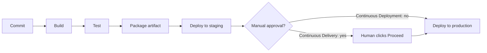
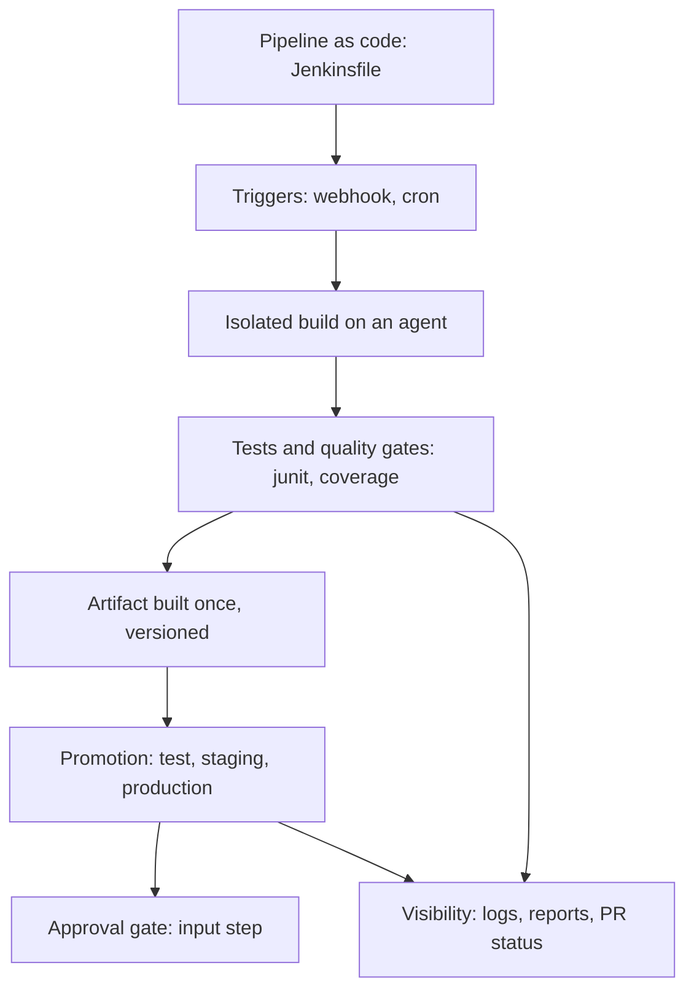

# CI/CD Concepts for Jenkins Users

## Introduction

Jenkins is a tool. CI/CD is the practice the tool supports. If you learn Jenkins without the practice, you end up with a very busy server that runs scripts but does not make your team ship faster or safer.

This page is a short, Jenkins-focused recap of the CI/CD ideas you need for the rest of the tutorial. For each idea you will see:

- what it means in plain language,
- how Jenkins implements it (which feature, which pipeline keyword),
- a small `Jenkinsfile` snippet that shows it.

If you want the full, tool-neutral treatment, read the [CI/CD tutorial](/docs/devops/cicd) on this site. This page focuses on the translation from concept to Jenkins.

An analogy: CI/CD is like a car factory's assembly line. Every car (code change) goes down the same line, gets the same checks at the same stations, and either rolls out the door or gets pulled aside with a clear note about what failed. Jenkins is the conveyor belt and the robots. It does not decide what a good car is. You do, by writing the checks.

## The Three Terms

People use "CI/CD" loosely. The three practices are different:

| Practice | Definition | What Jenkins does |
|----------|------------|-------------------|
| **Continuous Integration (CI)** | Developers merge small changes often, and every change is built and tested automatically | Runs a pipeline on every push and pull request, reports pass or fail |
| **Continuous Delivery** | Every change that passes the pipeline is *ready* to release; a person decides when | Builds a release artifact and deploys it to staging; production waits for an approval step |
| **Continuous Deployment** | Every change that passes the pipeline goes to production automatically | Same pipeline, with no manual gate before production |



The left half (commit, build, test) is **CI**. The right half is **CD**. The only difference between delivery and deployment is that one gate.

In Jenkins, that gate is usually the `input` step:

```groovy
pipeline {
    agent any
    stages {
        stage('Deploy to staging') {
            steps { sh './deploy.sh staging' }
        }
        stage('Deploy to production') {
            steps {
                // Continuous Delivery: a person approves. Remove this for Continuous Deployment.
                input message: 'Deploy to production?', ok: 'Deploy'
                sh './deploy.sh production'
            }
        }
    }
}
```

Example output while waiting:

```text
[Pipeline] { (Deploy to production)
[Pipeline] input
Deploy to production?
Deploy or Abort
```

:::caution
An `input` step inside a stage that has an agent keeps that agent's executor busy while it waits. [Manual Input and Approvals](../4-jenkins-pipeline-advanced/2-jenkins-input-and-approvals.mdx) shows how to wait without holding an agent, and how to add a timeout so builds do not wait forever.
:::

## Concept 1: Pipeline as Code

**Idea:** the steps that build, test and deploy your software are written in a file stored next to the code, reviewed in pull requests, and versioned with the code.

**In Jenkins:** a `Jenkinsfile` in the repository root. Jenkins reads it each time it builds that branch. The old alternative, configuring "Freestyle" jobs through web forms, stores the build definition only in Jenkins, where nobody reviews it and it is easy to lose.

| Without pipeline as code | With a Jenkinsfile |
|--------------------------|--------------------|
| Build steps live in Jenkins web forms | Build steps live in Git |
| Changes are invisible to reviewers | Changes go through pull requests |
| A feature branch cannot change its own build | Each branch carries its own pipeline |
| Rebuilding the server loses the jobs | The repository is the source of truth |

You will learn more in [The Jenkinsfile](../3-jenkins-pipeline-basics/1-jenkins-jenkinsfile.mdx) and [Freestyle vs Pipeline Jobs](../2-jenkins-jobs/5-jenkins-freestyle-vs-pipeline.mdx).

## Concept 2: Triggers and Fast Feedback

**Idea:** a build starts automatically when something changes, and developers hear about failures within minutes, not hours.

**In Jenkins:**

- **Webhooks** from GitHub, GitLab or Bitbucket notify Jenkins on push. This is the preferred trigger.
- **Polling** (`pollSCM`) asks the Git server for changes on a schedule. It works when webhooks cannot reach Jenkins, but it adds load and delay.
- **Cron** (`cron`) runs builds on a schedule, for example a nightly full test suite.
- **Upstream** triggers start a job when another job finishes.

```groovy
pipeline {
    agent any
    triggers {
        // Nightly at around 2 a.m.; H spreads load across jobs
        cron('H 2 * * *')
    }
    stages {
        stage('Nightly integration tests') {
            steps { sh './run-integration-tests.sh' }
        }
    }
}
```

Fast feedback also means **ordering stages so cheap checks fail first**: linting and unit tests before slow integration tests and image builds. If the code does not compile, there is no point spending 20 minutes building a container.

See [Build Triggers](../2-jenkins-jobs/1-jenkins-build-triggers.mdx) and [GitHub Integration and Webhooks](../5-jenkins-scm-integration/2-jenkins-github-integration.mdx).

## Concept 3: Build Once, Deploy Many

**Idea:** build the deployable artifact (a JAR, a wheel, a Docker image) exactly once, give it a unique version, and promote that same artifact through test, staging and production. Rebuilding for each environment risks shipping something different from what you tested.

**In Jenkins:**

- `archiveArtifacts` stores files with the build record on the controller (fine for small files).
- Real projects push artifacts to a registry or repository (Docker registry, Nexus, Artifactory, a package index) and record the version.
- `stash` and `unstash` move files between stages within one run.

```groovy
pipeline {
    agent any
    environment {
        // One version per build, reused by every later stage
        APP_VERSION = "1.4.${env.BUILD_NUMBER}"
    }
    stages {
        stage('Package') {
            steps {
                sh 'mkdir -p dist && echo "app ${APP_VERSION}" > dist/app.txt'
                archiveArtifacts artifacts: 'dist/*.txt', fingerprint: true
            }
        }
        stage('Deploy to test') {
            steps { sh 'echo "deploying version ${APP_VERSION} to test"' }
        }
        stage('Deploy to staging') {
            steps { sh 'echo "deploying version ${APP_VERSION} to staging"' }
        }
    }
}
```

Example output (build number 37):

```text
+ mkdir -p dist
+ echo 'app 1.4.37'
Archiving artifacts
Recording fingerprints
+ echo 'deploying version 1.4.37 to test'
deploying version 1.4.37 to test
+ echo 'deploying version 1.4.37 to staging'
deploying version 1.4.37 to staging
```

:::note
In `sh 'echo "... ${APP_VERSION}"'` the single quotes mean Groovy does **not** substitute the variable. The shell does, because Jenkins exports `APP_VERSION` as an environment variable. This matters for secrets: letting the shell expand a variable is safer than letting Groovy paste it into the command string. [Environment Variables](../3-jenkins-pipeline-basics/6-jenkins-environment-variables.mdx) explains the difference.
:::

Fingerprints let Jenkins track which builds produced and used a given file. See [Build History and Artifacts](../2-jenkins-jobs/4-jenkins-build-history-and-artifacts.mdx) and [Environments and Promotion](../10-jenkins-deployment/1-jenkins-environments-and-promotion.mdx).

## Concept 4: Automated Tests and Quality Gates

**Idea:** the pipeline decides whether a change is good enough, using tests and other checks, rather than a person eyeballing it.

**In Jenkins**, build results have more nuance than pass or fail:

| Result | Meaning | Typical cause |
|--------|---------|---------------|
| `SUCCESS` | Everything passed | All steps returned exit code 0 and no tests failed |
| `UNSTABLE` | It built, but quality checks complained | The `junit` step recorded failing tests |
| `FAILURE` | A step failed | A command returned a non-zero exit code |
| `ABORTED` | Stopped before finishing | A user clicked stop, or a timeout fired |
| `NOT_BUILT` | Stage or build did not run | Skipped stages, or an earlier failure |

```groovy
pipeline {
    agent any
    stages {
        stage('Test') {
            steps {
                // Your test runner writes JUnit XML; || true lets junit decide the result
                sh 'pytest --junitxml=reports/junit.xml || true'
            }
            post {
                always { junit 'reports/*.xml' }
            }
        }
    }
}
```

Example output when one test fails:

```text
+ pytest --junitxml=reports/junit.xml
...
1 failed, 41 passed in 3.20s
+ true
[Pipeline] junit
Recording test results
Finished: UNSTABLE
```

The `|| true` trick deserves a warning: it also hides crashes where the test runner never produced a report. Section 9 shows safer patterns in [Test Reports with JUnit](../9-jenkins-build-and-test/4-jenkins-test-reports.mdx). Coverage and static analysis gates are covered in [Code Coverage](../9-jenkins-build-and-test/5-jenkins-code-coverage.mdx) and [Code Quality with SonarQube](../9-jenkins-build-and-test/6-jenkins-code-quality.mdx).

## Concept 5: Reproducible, Isolated Builds

**Idea:** a build should give the same result no matter which machine runs it, and one build should not affect another.

**In Jenkins:**

- **Agents with labels** pick a machine with the right tools: `agent { label 'linux && docker' }`.
- **Container agents** run each build inside a fresh image with pinned tool versions: `agent { docker { image 'node:22' } }` (needs the Docker Pipeline plugin, ID `docker-workflow`).
- **Kubernetes pod agents** create a fresh pod per build and delete it afterwards (the `kubernetes` plugin).
- **Clean workspaces**, for example with `cleanWs()` from the Workspace Cleanup plugin, so leftovers from a previous build cannot hide problems.

```groovy
pipeline {
    agent {
        docker { image 'python:3.12-slim' }  // fresh container, pinned tools
    }
    stages {
        stage('Versions') {
            steps { sh 'python --version' }
        }
    }
}
```

Example output:

```text
+ python --version
Python 3.12.7
```

The patch version printed depends on the image you pull. Pinning a more specific tag, or an image digest, makes builds more reproducible. [Choosing an Agent Strategy](../6-jenkins-agents/7-jenkins-agent-strategies.mdx) compares the options.

## Concept 6: Visibility and Traceability

**Idea:** anyone can see what was built, from which commit, by whom, whether it passed, and where it was deployed.

**In Jenkins:** each build has a number, a console log, a list of changes (commits), test results, artifacts and fingerprints. Pipeline runs can be visualized stage by stage with the **Pipeline Graph View** plugin (`pipeline-graph-view`) or the older Stage View. The once-popular **Blue Ocean** UI is deprecated and no longer gets feature updates, so do not build new workflows around it.

Jenkins also reports status back to the Git server, so a pull request shows a green check or red cross. Notifications go to chat or email from `post` blocks. See [Notifications: Email, Slack and Teams](../12-jenkins-administration/6-jenkins-notifications.mdx).

## Putting It Together: A Concept Map



| CI/CD concept | Jenkins feature | Where it is taught |
|---------------|-----------------|-------------------|
| Pipeline as code | `Jenkinsfile`, Multibranch Pipeline | Sections 3 and 5 |
| Triggers | Webhooks, `pollSCM`, `cron`, upstream | [Build Triggers](../2-jenkins-jobs/1-jenkins-build-triggers.mdx) |
| Isolated builds | Agents, labels, Docker and Kubernetes agents | Section 6 |
| Quality gates | `junit`, coverage, Warnings NG, SonarQube | Section 9 |
| Build once, deploy many | Artifacts, fingerprints, registries | Sections 2, 9 and 10 |
| Approval gates | `input` step, `milestone` | [Manual Input and Approvals](../4-jenkins-pipeline-advanced/2-jenkins-input-and-approvals.mdx) |
| Reuse across repositories | Shared libraries | Section 8 |
| Secrets | Credentials store, `withCredentials` | Section 11 |

## Real-World Scenario

Your team maintains a Python web API for a food-delivery startup. Today, a developer merges to `main`, someone runs tests "when they remember", and on Fridays a senior engineer SSHes into the server and runs `git pull`. Twice this month a broken commit sat on `main` for days. You are asked to introduce CI/CD with the company's existing Jenkins server.

**The plan, concept by concept:**

1. **Pipeline as code:** add a `Jenkinsfile` to the repository so the pipeline is reviewed like any other change.
2. **Fast feedback:** a webhook triggers a build on every push and pull request. Lint and unit tests run first, in under three minutes.
3. **Isolation:** builds run in a `python:3.12-slim` container agent, so "works on my machine" problems surface early.
4. **Build once:** the pipeline builds one Docker image tagged with the commit SHA and pushes it to the registry.
5. **Delivery, not deployment yet:** `main` deploys automatically to staging. Production requires an `input` approval from the on-call engineer.

```groovy
pipeline {
    agent none
    options { timeout(time: 30, unit: 'MINUTES') }
    stages {
        stage('Lint and unit tests') {
            agent { docker { image 'python:3.12-slim' } }
            steps {
                sh '''
                    pip install -q -r requirements-dev.txt
                    ruff check .
                    pytest -q --junitxml=reports/unit.xml
                '''
            }
            post { always { junit 'reports/*.xml' } }
        }
        stage('Build image') {
            when { branch 'main' }
            agent { label 'docker' }
            steps {
                sh 'docker build -t registry.example.com/food-api:${GIT_COMMIT} .'
                sh 'docker push registry.example.com/food-api:${GIT_COMMIT}'
            }
        }
        stage('Deploy to staging') {
            when { branch 'main' }
            agent { label 'deploy' }
            steps { sh './deploy.sh staging ${GIT_COMMIT}' }
        }
        stage('Approve production') {
            when { branch 'main' }
            agent none   // wait without holding an executor
            steps {
                timeout(time: 1, unit: 'DAYS') {
                    input message: 'Promote this build to production?', ok: 'Promote'
                }
            }
        }
        stage('Deploy to production') {
            when { branch 'main' }
            agent { label 'deploy' }
            steps { sh './deploy.sh production ${GIT_COMMIT}' }
        }
    }
}
```

### Why this approach

The team's problem is not a missing tool. It is missing *habits*: tests not always run, deploys done by hand. Continuous integration with fast feedback fixes the first. Continuous delivery with an approval gate fixes the second, while letting a cautious team keep a human in control of production until they trust the pipeline.

### When to use it and when not to

Continuous delivery with a manual gate suits teams that are new to automation, or that have release rules (change windows, compliance sign-off). Once the test suite is trusted and rollbacks are fast, many teams remove the gate and move to continuous deployment. If the product ships a mobile app or on-premises installer, there may be no "production deploy" at all; the pipeline ends at a signed, published artifact.

### Alternatives and trade-offs

| Approach | Pros | Cons | Best for |
|----------|------|------|----------|
| CI only (build and test, deploy by hand) | Simple, low risk to start | Deploys stay slow and error-prone | First week of adoption |
| Continuous Delivery (manual production gate) | Human control, audit trail, still automated | Changes can queue up waiting for approval | Most teams, regulated environments |
| Continuous Deployment (no gate) | Fastest feedback from real users, small batches | Requires strong tests, monitoring and fast rollback | Mature web services |
| Nightly or scheduled releases | Predictable timing | Large batches, slower feedback | Products with fixed release trains |

## Common Mistakes

- **Treating Jenkins as a remote shell.** A job that runs `ssh prod 'git pull && restart'` is automation, but it is not CI/CD: nothing is tested, versioned or reproducible.
- **Rebuilding per environment.** Building a fresh image for production means production runs something you never tested. Build once, promote the same artifact.
- **Slow pipelines.** If CI takes 45 minutes, developers stop waiting for it. Put fast checks first and parallelize. See [Parallel Stages](../4-jenkins-pipeline-advanced/0-jenkins-parallel-stages.mdx).
- **Ignoring red builds.** A pipeline that is "always a bit broken" teaches people to ignore it. Fix or quarantine flaky tests quickly.
- **Waiting for input while holding an agent.** Use `agent none` at the top level and on the approval stage, and always wrap `input` in a `timeout`.

## Summary

- **CI** builds and tests every change. **Continuous delivery** keeps every passing change releasable. **Continuous deployment** releases it automatically.
- In Jenkins, the difference between delivery and deployment is usually one `input` step.
- Pipeline as code means a reviewed, versioned `Jenkinsfile`.
- Webhooks, fast checks first, isolated agents and test reports give fast, trustworthy feedback.
- Build an artifact once, version it, and promote that same artifact through environments.
- Jenkins build results include `UNSTABLE`, which usually means tests failed but the build itself completed.

## Further Learning

Exercises:

1. Take the "build once" example and add a third environment, `qa`, between test and staging. Confirm every stage prints the same version.
2. Write a pipeline whose `Test` stage records a JUnit report with one failing test. Confirm the build ends `UNSTABLE`, not `FAILURE`. Then remove `|| true` and observe the difference.
3. For a project you know, write down which parts are CI, which are delivery, and whether you would add a manual gate before production. Justify the choice in two sentences.

Related pages:

- [Jenkins Architecture](./2-jenkins-architecture.mdx)
- [Pipeline Introduction](../3-jenkins-pipeline-basics/0-jenkins-pipeline-introduction.mdx)
- [Deployment Pipelines](../10-jenkins-deployment/0-jenkins-deployment-pipelines.mdx)
- The site's general [CI/CD tutorial](/docs/devops/cicd)
