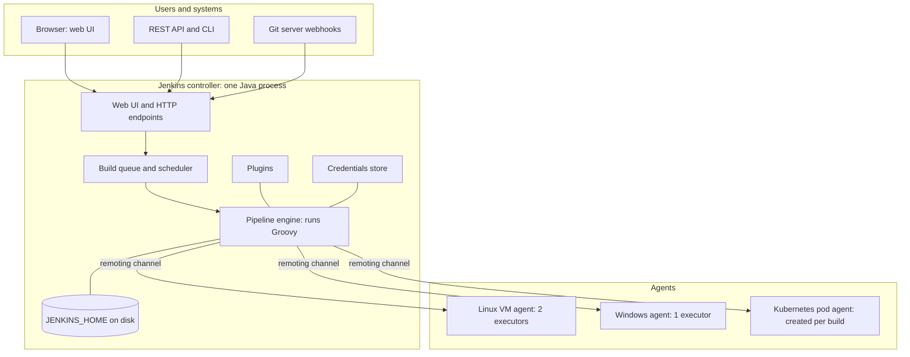
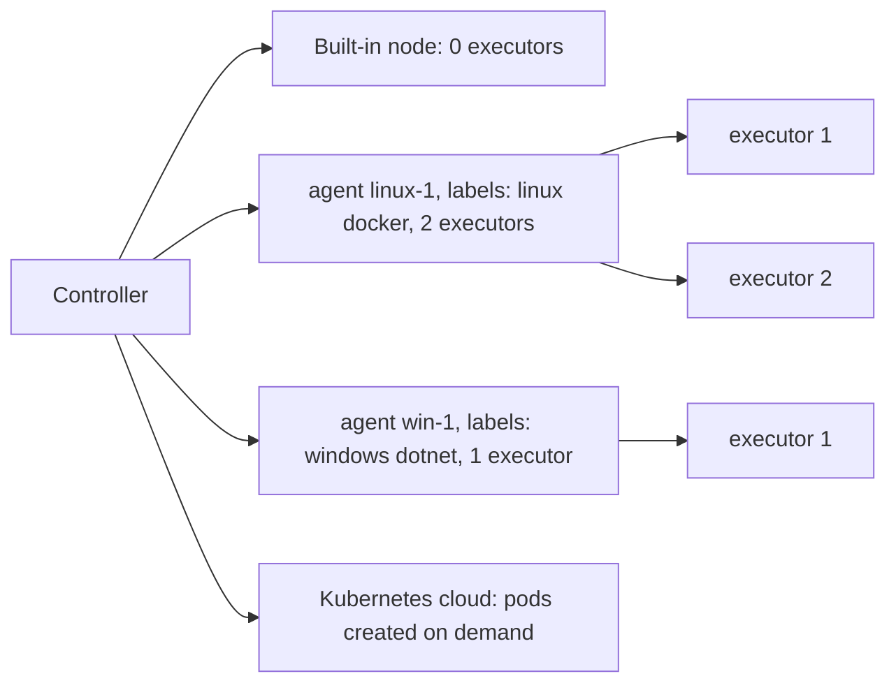
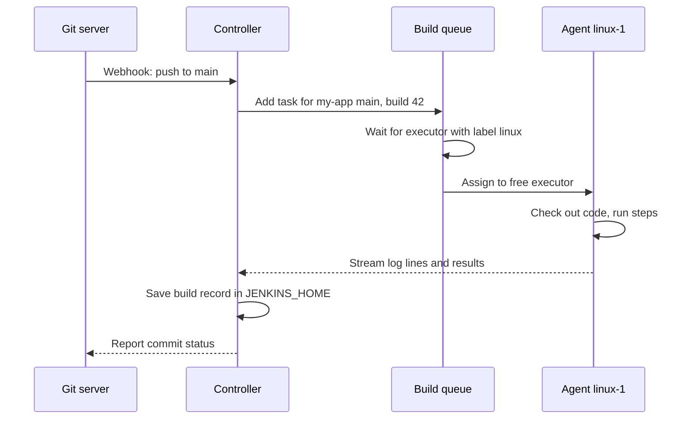
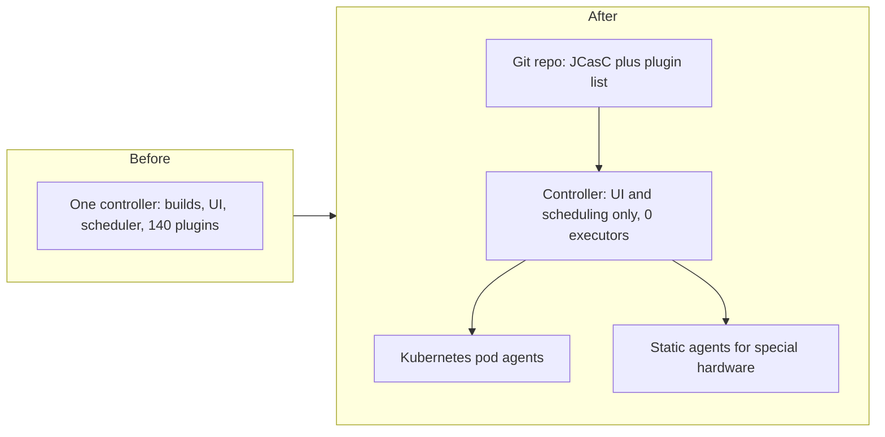

# Jenkins Architecture

## Introduction

Most Jenkins problems that confuse beginners make sense once you know how Jenkins is built. Why does a pipeline slow down the whole server? Why does a Groovy loop throw `NotSerializableException`? Why did the build run on the wrong machine? Why does a backup need the `secrets` folder? All of these come from the architecture.

This page explains the main parts of Jenkins and how they work together:

- the **controller** and its home directory, `JENKINS_HOME`,
- **nodes**, **agents** and **executors**,
- the **build queue** and how Jenkins picks where to run,
- **plugins** and the **Update Center**,
- **remoting**, the channel between controller and agents,
- how a **Pipeline** really executes, part on the controller and part on agents.

An analogy: think of a restaurant. The **controller** is the head chef at the pass: they take orders, decide which cook makes what, keep the recipe book and check every plate. The **agents** are the line cooks at their stations. **Executors** are the burners at each station. If the head chef starts cooking too, orders pile up and the whole kitchen slows down. That is exactly why Jenkins advises against running builds on the controller.

## The Big Picture



Everything on the left talks to the controller over HTTP. The controller is a single Java process. It talks to agents over a channel called **remoting**. All state (configuration, job definitions, build records) lives on the controller's disk in `JENKINS_HOME`.

## The Controller

The **controller** (formerly called "master") is the central Jenkins process. According to the Jenkins glossary, it stores configuration, loads plugins and serves the user interfaces. In practice it:

- serves the web UI, the REST API and webhook endpoints,
- holds the **build queue** and decides which agent runs each task,
- runs the **Pipeline engine**, which interprets your `Jenkinsfile`,
- stores credentials (encrypted) and all configuration,
- keeps build logs, test results and archived artifacts.

The controller is distributed as a single Java web application, `jenkins.war`. You can run it with `java -jar jenkins.war`, through an OS package that wraps it in a system service, in the official Docker image, or with a Helm chart on Kubernetes.

:::caution Java version
The controller needs a supported Java runtime. At the time of writing, LTS releases from 2.555.1 onward require **Java 21 or Java 25**. An unsupported Java version prevents the controller from starting. Check the [Java support policy](https://www.jenkins.io/doc/book/platform-information/support-policy-java/) before upgrading either Java or Jenkins.
:::

### JENKINS_HOME: where everything lives

Jenkins does not use a database. It stores its state as XML files and directories under `JENKINS_HOME`. In the official Docker image that is `/var/jenkins_home`. With the Linux packages it is usually `/var/lib/jenkins`.

```bash
# Inside the official Docker container
docker exec jenkins ls -1 /var/jenkins_home
```

Example output (trimmed):

```text
config.xml
credentials.xml
fingerprints
hudson.model.UpdateCenter.xml
jobs
logs
nodes
plugins
secret.key
secret.key.not-so-secret
secrets
updates
userContent
users
war
workspace
```

| Path | What it holds | Back it up? |
|------|---------------|-------------|
| `config.xml` and other top-level `*.xml` | Global and plugin configuration | Yes |
| `jobs/` | One folder per job: its `config.xml` and `builds/` history | Job configs yes; build history if you need it |
| `plugins/` | Installed plugin files | Yes, or reinstall from a pinned list |
| `secrets/`, `secret.key`, `identity.key.enc` | Keys that encrypt stored credentials | **Yes, always**. Without them, credentials cannot be decrypted |
| `nodes/` | Agent definitions | Yes |
| `users/` | Local user accounts and settings | Yes |
| `workspace/` | Workspaces for builds that ran on the controller | Usually no |
| `war/`, `cache/`, `tools/` | Recreated automatically | No |

The `jenkins.io` guide on [architecting for scale](https://www.jenkins.io/doc/book/scaling/architecting-for-scale/) gives the same advice: losing the secrets and keys can make stored credentials unrecoverable. [Backup and Restore](../12-jenkins-administration/2-jenkins-backup-and-restore.mdx) builds a full backup plan.

A job's configuration really is just a file:

```bash
docker exec jenkins cat /var/jenkins_home/jobs/hello-pipeline/config.xml
```

Example output (trimmed):

```text
<?xml version='1.1' encoding='UTF-8'?>
<flow-definition plugin="workflow-job">
  <description>My first pipeline</description>
  <definition class="org.jenkinsci.plugins.workflow.cps.CpsFlowDefinition" plugin="workflow-cps">
    <script>pipeline { agent any; stages { stage('Hi') { steps { echo 'hi' } } } }</script>
    <sandbox>true</sandbox>
  </definition>
</flow-definition>
```

This file-based design makes Jenkins simple to install, but it also means disk speed matters, and a single controller cannot easily share its state with a second one. That is the root of the "single point of failure" problem discussed below.

## Nodes, Agents and Executors

These three words are often mixed up:

| Term | Meaning |
|------|---------|
| **Node** | Any machine that can run builds. The controller's own **built-in node** and every agent are nodes |
| **Agent** | A machine or container that connects to the controller and runs tasks for it. It runs a small Java process (the agent JAR) |
| **Executor** | A slot for running one task on a node. Two executors means two builds can run there at once |
| **Label** | A tag on an agent, such as `linux`, `docker` or `gpu`, used to choose where a build runs |



The Jenkins documentation discourages running builds on the built-in node, for **security** (build scripts would run inside the controller with access to `JENKINS_HOME` and its secrets), **performance** (builds compete with the UI and scheduler) and **scalability** reasons. Set the built-in node's executors to `0` and give the work to agents.

```yaml
# Jenkins Configuration as Code (JCasC) snippet: no builds on the controller
jenkins:
  numExecutors: 0
```

[Configuration as Code (JCasC)](../12-jenkins-administration/0-jenkins-configuration-as-code.mdx) explains how files like this configure a whole Jenkins instance.

### Static agents vs cloud agents

- **Static (permanent) agents** are machines you register once. They stay connected and keep their tools and caches.
- **Cloud agents** are created on demand by a plugin, for example a pod per build with the `kubernetes` plugin, or a VM with the Amazon EC2 or Azure VM Agents plugins, and removed when idle.

Section 6 covers both in depth, starting with [Controller and Agents](../6-jenkins-agents/0-jenkins-controller-and-agents.mdx).

## How Agents Connect: Remoting

The controller and agents talk over **remoting**, a Java library that lets the controller send commands, stream logs and transfer files over one connection. There are two directions to set it up:

| Connection type | Who opens the connection | Network needs | Typical use |
|-----------------|--------------------------|---------------|-------------|
| **SSH (outbound)** | The controller connects to the agent over SSH | Controller must reach the agent on port 22 | Linux VMs you manage; often the preferred option |
| **Inbound over TCP** | The agent connects to the controller's agent port (default `50000`) | Agent must reach the controller | Agents behind NAT or firewalls; Kubernetes pods |
| **Inbound over WebSocket** | The agent connects over the normal HTTP(S) port | Agent must reach the Jenkins URL | When you cannot open an extra TCP port, for example through a reverse proxy |

Inbound agents used to be called **JNLP** agents, after the old Java Web Start protocol. You will still see that name in the `jenkins/inbound-agent` image and the Kubernetes container named `jnlp`. See [Inbound (JNLP) Agents](../6-jenkins-agents/2-jenkins-inbound-agents.mdx) and [SSH Agents](../6-jenkins-agents/1-jenkins-ssh-agents.mdx).

## The Build Queue and Scheduling

When something triggers a build, Jenkins does not start it immediately. It puts a task in the **queue**. The scheduler then looks for an executor on a node whose labels match what the task asks for.



If no matching agent is free, the task waits. The queue shows a reason such as "Waiting for next available executor on 'linux'". A cloud plugin may react by starting a new agent. Labels, executors and scheduling are covered in [Labels, Executors and Scheduling](../6-jenkins-agents/6-jenkins-labels-and-executors.mdx).

## Plugins and the Update Center

Jenkins **core** is fairly small. Almost everything you use day to day is a **plugin**: Git support, Pipeline itself, credentials, Docker and Kubernetes agents, test reports, notifications, authentication with LDAP or SAML.

- Plugins plug into **extension points** in core and in other plugins. That is why plugins depend on each other and why one upgrade can pull in several others.
- The **Update Center** is the hosted catalog Jenkins downloads plugins from.
- "Pipeline" is not one plugin. It is a family of plugins, with IDs such as `workflow-aggregator` (the umbrella), `workflow-cps` (the Groovy engine), `workflow-job`, `pipeline-model-definition` (Declarative syntax) and `workflow-durable-task-step` (the `sh`, `bat` and `node` steps).

```text
Pipeline (workflow-aggregator)
├── workflow-job                 Pipeline job type
├── workflow-cps                 Runs the Groovy pipeline script
├── pipeline-model-definition    Declarative Pipeline syntax
├── workflow-durable-task-step   sh, bat, node, ws steps
├── workflow-basic-steps         echo, timeout, retry, archiveArtifacts and more
└── ...
```

This plugin model is Jenkins' biggest strength and biggest operational cost. Section 7 shows how to keep it under control, starting with [Plugin Management](../7-jenkins-plugins/0-jenkins-plugin-management.mdx).

## How a Pipeline Really Runs

This is the most important part of the architecture for pipeline authors.

Your `Jenkinsfile` is Groovy code. The **Groovy itself runs on the controller**, inside the Pipeline engine. Only the **steps** that do real work, such as `sh`, `bat`, `checkout` or `junit` parsing files in the workspace, run on the agent.

```groovy
pipeline {
    agent { label 'linux' }
    stages {
        stage('Example') {
            steps {
                script {
                    // This loop and string handling run ON THE CONTROLLER
                    def services = ['api', 'web', 'worker']
                    for (s in services) {
                        // This shell command runs ON THE AGENT
                        sh "echo building ${s} on \$(hostname)"
                    }
                }
            }
        }
    }
}
```

Example output:

```text
+ hostname
+ echo building api on linux-1
building api on linux-1
+ hostname
+ echo building web on linux-1
building web on linux-1
+ hostname
+ echo building worker on linux-1
building worker on linux-1
```

The official [Pipeline best practices](https://www.jenkins.io/doc/book/pipeline/pipeline-best-practices/) put it directly: Groovy code in a Pipeline always executes on the controller and uses the controller's memory and CPU. So:

- **Do:** use Groovy as glue between steps. Put heavy work in `sh` steps, scripts in your repository, or build tools.
- **Do not:** parse large JSON files with `JsonSlurper`, call HTTP APIs from Groovy, or run big loops in Groovy. Use `jq` or `curl` inside `sh` on the agent instead.

### CPS: why pipelines survive restarts

The Pipeline engine transforms your Groovy into **continuation-passing style (CPS)** so it can save the program's state to disk after each step. If the controller restarts, the pipeline can resume where it left off. That is a powerful feature. It also explains several quirks:

- Variables must be **serializable** (savable to disk). Holding a non-serializable object, such as a `java.util.regex.Matcher`, across a step causes `NotSerializableException`.
- Some Groovy features, such as certain closures over collections, behave differently or are not supported under CPS.
- Methods annotated `@NonCPS` run as plain Groovy, but they **cannot call pipeline steps**.
- Saving state costs disk I/O. Jenkins offers **durability settings**: `MAX_SURVIVABILITY` (the default), `SURVIVABLE_NONATOMIC` and `PERFORMANCE_OPTIMIZED`. Lower durability is faster but a crash may lose the running build's state. See the [scaling Pipeline](https://www.jenkins.io/doc/book/pipeline/scaling-pipeline/) docs.

[Groovy Essentials for Pipelines](../4-jenkins-pipeline-advanced/5-jenkins-groovy-for-pipelines.mdx) shows how to work with these rules.

### The sandbox

Pipeline scripts that users can edit run in a **Groovy sandbox** by default. The Script Security plugin only lets them call approved methods. An administrator can approve more. This protects the controller, because pipeline Groovy runs inside the controller process. See [Script Security and Sandboxing](../11-jenkins-security/5-jenkins-script-security.mdx).

## The Controller as a Single Point of Failure

Open-source Jenkins runs **one active controller** per instance. Its state is on local disk, so you cannot run two copies of the same controller side by side. Consequences:

- If the controller is down, nobody can start builds or see results.
- Upgrades and plugin changes require a restart and a short outage.
- One overloaded controller (too many jobs, heavy Groovy, huge logs) slows down every team on it.

Common ways teams reduce the risk:

| Technique | What it gives you | Limits |
|-----------|-------------------|--------|
| Fast restore: backups plus configuration as code | Rebuild a controller in minutes | Running builds are lost; some downtime |
| Run the controller on Kubernetes with a persistent volume | Automatic restart if the pod or node dies | Still one controller; restart takes time |
| Multiple controllers split by team or product | Smaller blast radius, independent upgrades | More instances to patch and manage |
| Commercial distributions with HA features | Vendor-supported failover options | Licensing cost; vendor lock-in |

[High Availability and Scaling](../12-jenkins-administration/5-jenkins-high-availability.mdx) goes deeper.

## Real-World Scenario

A 200-engineer fintech company runs one Jenkins controller for everyone. It has 1,800 jobs, builds also run on the controller's own 8 executors, and 140 plugins are installed. Every afternoon the UI becomes slow, some builds hang, and last month a controller crash lost a week of configuration changes because only `jobs/` was backed up. You are asked to fix it.

**Diagnosis using the architecture:**

1. **Builds on the built-in node** compete with the scheduler and UI for CPU, memory and disk, and run with access to `JENKINS_HOME`. Fix: set controller executors to 0, add agents.
2. **Heavy Groovy** in a popular pipeline parses a 40 MB JSON file with `JsonSlurper` on every build. Fix: move parsing into `sh 'jq ...'` on the agent.
3. **Static agents with long-lived workspaces** fill disks and cause flaky builds. Fix: move most builds to Kubernetes pod agents that start clean each time.
4. **Incomplete backups.** Fix: back up `JENKINS_HOME` including `secrets/` and keys, and move configuration into JCasC files in Git.
5. **One controller for all teams.** Fix, in a later phase: split into controllers per business unit, managed from the same configuration-as-code repository.



### Why this approach

Each fix targets an architectural cause, not a symptom. Moving builds off the controller and moving heavy work out of Groovy reduces controller load, which is the scarce resource. Configuration as code turns a fragile, hand-built server into something you can recreate.

### When to use it and when not to

A small team with ten jobs and one agent does not need multiple controllers or Kubernetes. Start with "no builds on the controller" and good backups; add the rest when load or team count grows. Splitting controllers too early multiplies maintenance work.

### Alternatives and trade-offs

| Approach | Pros | Cons | Best for |
|----------|------|------|----------|
| Bigger controller (scale up) | Quick, no redesign | Hits limits; still one blast radius | Short-term relief |
| Controller plus static agents | Simple, predictable, caches survive | Agents drift and need maintenance | Small to medium teams |
| Controller plus Kubernetes pod agents | Clean builds, elastic capacity | Requires Kubernetes skills; cold-start time | Many teams, bursty load |
| Multiple controllers | Isolation, independent upgrades | More instances to manage | Large organizations |
| Move to a hosted CI service | No controller to run | Migration cost, different trade-offs | Teams whose constraints allow it |

## Common Mistakes

- **Running builds on the controller.** A fresh install gives the built-in node executors, so builds run there until you change it. It is a common cause of slow, insecure Jenkins servers.
- **Doing real work in Groovy.** Loops over thousands of items, JSON parsing and HTTP calls in pipeline Groovy all load the controller.
- **Backing up only `jobs/`.** Without `secrets/` and the key files, restored credentials cannot be decrypted.
- **Opening port 50000 to the internet.** Only inbound TCP agents need it, and they should reach it over a private network. Consider WebSocket or SSH instead.
- **Treating plugins as free.** Each plugin adds code that loads into the controller and needs updates.

## Summary

- The **controller** is one Java process that serves the UI, schedules builds, runs the Pipeline engine and stores all state in `JENKINS_HOME` as files.
- **Agents** run the build work. **Executors** are slots for concurrent tasks. **Labels** route work to suitable agents.
- Agents connect over **remoting**, by SSH from the controller or inbound over TCP or WebSocket.
- Almost all features come from **plugins**, which depend on each other.
- Pipeline **Groovy runs on the controller** under CPS so it can survive restarts. Steps like `sh` run on agents.
- The controller is a **single point of failure**. Mitigate with no builds on the controller, good backups, configuration as code, and, at scale, multiple controllers.

## Further Learning

Exercises:

1. Start Jenkins in Docker and list `JENKINS_HOME`. Create a pipeline job and find its `config.xml`. Run it twice and look inside `jobs/<name>/builds/`.
2. Write a pipeline with a `script` block that prints `hostname` in Groovy (`InetAddress.localHost.hostName`) and in `sh 'hostname'`. Explain why the two can differ. (The Groovy call may need script approval, which is itself a lesson.)
3. Draw the architecture of a Jenkins setup you know, or the one from the scenario. Mark which parts are single points of failure.

Related pages:

- [Jenkins Terminology Cheat Sheet](./5-jenkins-terminology.mdx)
- [Controller and Agents](../6-jenkins-agents/0-jenkins-controller-and-agents.mdx)
- [Securing Agents and the Controller](../11-jenkins-security/6-jenkins-securing-agents.mdx)
- [Performance Tuning](../12-jenkins-administration/4-jenkins-performance-tuning.mdx)

External reading:

- [Managing Nodes](https://www.jenkins.io/doc/book/managing/nodes/) (Jenkins handbook)
- [Architecting for Scale](https://www.jenkins.io/doc/book/scaling/architecting-for-scale/)
- [Pipeline Best Practices](https://www.jenkins.io/doc/book/pipeline/pipeline-best-practices/)
