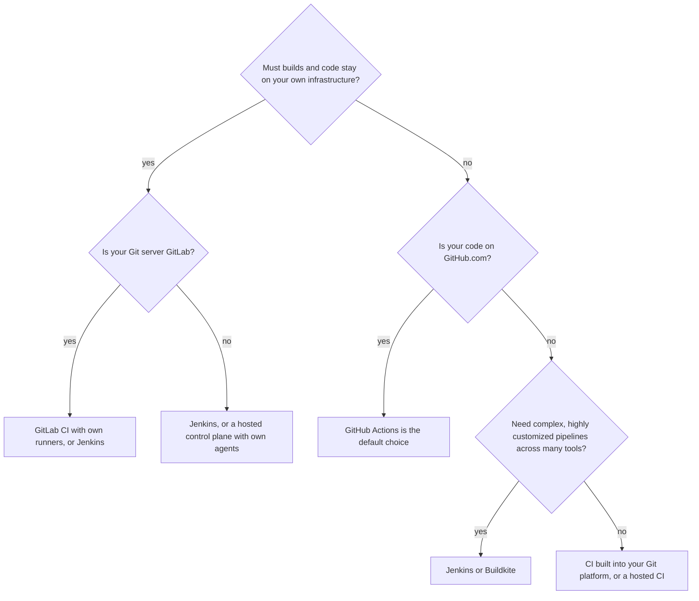
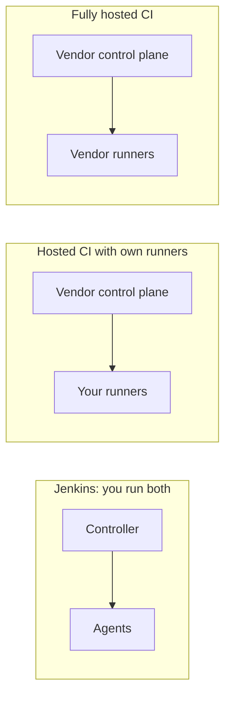

# Jenkins vs GitHub Actions, GitLab CI and Others

## Introduction

"Should we use Jenkins or GitHub Actions?" is one of the most common questions in CI/CD. There is no universal answer, but there is a good way to think about it.

The tools differ much less in *what* they can run (every one of them can run a shell command in a container) than in **who operates them**, **where they run**, **how you configure them**, and **how they fit your source control**. This page compares Jenkins with the main alternatives on those points, shows the same small pipeline written for three tools, and ends with a decision guide and a realistic scenario.

An analogy: choosing a CI tool is like choosing between owning a car, leasing one, and using a ride service. Owning (Jenkins) gives you full control and no per-trip fee, but you handle the insurance, repairs and parking. A ride service (a hosted CI) is effortless until the bill grows or you need to go somewhere it does not serve. Leasing (hosted control plane with your own runners) sits in between.

:::note Facts change
Pricing, free-tier limits and features of hosted CI services change often, sometimes several times a year. This page compares design and trade-offs, not prices. Always check each vendor's official pricing and documentation before deciding.
:::

## The Contenders

| Tool | Type | Configuration | Where builds run |
|------|------|---------------|------------------|
| **Jenkins** | Self-hosted, open source (MIT) | `Jenkinsfile` (Groovy DSL), plus UI and JCasC for the server | Your agents: VMs, containers, Kubernetes pods |
| **GitHub Actions** | Hosted by GitHub (also in GitHub Enterprise Server) | YAML in `.github/workflows/` | GitHub-hosted runners or your self-hosted runners |
| **GitLab CI/CD** | Built into GitLab (SaaS or self-managed) | `.gitlab-ci.yml` | GitLab-hosted runners or your own GitLab Runner |
| **CircleCI** | Hosted SaaS (server edition exists) | `.circleci/config.yml` | CircleCI cloud or self-hosted runners |
| **Azure Pipelines** | Part of Azure DevOps | `azure-pipelines.yml` | Microsoft-hosted or self-hosted agents |
| **Buildkite** | Hosted control plane | YAML pipeline, often generated dynamically | Always your own agents |
| **Tekton** | Kubernetes-native framework | Kubernetes custom resources (YAML) | Pods in your cluster |
| **TeamCity** | JetBrains, self-hosted or cloud | UI or Kotlin DSL | Build agents |

## The Same Pipeline in Three Tools

The task: on every push, run lint and unit tests for a Python project in a `python:3.12-slim` container, and publish test results.

### Jenkins

```groovy
// Jenkinsfile
pipeline {
    agent { docker { image 'python:3.12-slim' } }
    options { timeout(time: 10, unit: 'MINUTES') }
    stages {
        stage('Install') {
            steps { sh 'pip install -q -r requirements-dev.txt' }
        }
        stage('Lint') {
            steps { sh 'ruff check .' }
        }
        stage('Test') {
            steps { sh 'pytest -q --junitxml=reports/junit.xml' }
        }
    }
    post {
        always { junit allowEmptyResults: true, testResults: 'reports/*.xml' }
    }
}
```

To make this work, you need a running Jenkins controller, an agent with Docker, the Docker Pipeline (`docker-workflow`) and JUnit (`junit`) plugins, a Multibranch Pipeline job pointing at the repository, and a webhook from your Git server.

### GitHub Actions

```yaml
# .github/workflows/ci.yml
name: ci
on:
  push:
  pull_request:
jobs:
  test:
    runs-on: ubuntu-latest
    container: python:3.12-slim
    timeout-minutes: 10
    steps:
      - uses: actions/checkout@v6
      - run: pip install -q -r requirements-dev.txt
      - run: ruff check .
      - run: pytest -q --junitxml=reports/junit.xml
```

To make this work, you commit the file. GitHub provides the runner. Publishing test results as a nice report needs a marketplace action or uploading the XML as an artifact.

### GitLab CI/CD

```yaml
# .gitlab-ci.yml
stages: [lint, test]

default:
  image: python:3.12-slim
  before_script:
    - pip install -q -r requirements-dev.txt

lint:
  stage: lint
  script:
    - ruff check .

unit-tests:
  stage: test
  timeout: 10m
  script:
    - pytest -q --junitxml=reports/junit.xml
  artifacts:
    when: always
    reports:
      junit: reports/junit.xml
```

To make this work, you commit the file in a GitLab project with a runner available. JUnit results appear in merge requests.

You can validate both YAML files locally before committing:

```bash
python3 -c "import yaml,sys; [yaml.safe_load(open(f)) for f in sys.argv[1:]]; print('valid YAML')" \
  .github/workflows/ci.yml .gitlab-ci.yml
```

Output:

```text
valid YAML
```

### When the pipeline grows: a matrix example

Differences show up more as pipelines grow. Here is the same "test on two Python versions" matrix in Jenkins and GitHub Actions.

```groovy
// Jenkinsfile: Declarative matrix
pipeline {
    agent none
    stages {
        stage('Test matrix') {
            matrix {
                axes {
                    axis {
                        name 'PY'
                        values '3.11', '3.12'
                    }
                }
                agent { docker { image "python:${PY}-slim" } }
                stages {
                    stage('Test') {
                        steps { sh 'python --version && pytest -q' }
                    }
                }
            }
        }
    }
}
```

```yaml
# .github/workflows/matrix.yml
name: matrix
on: [push]
jobs:
  test:
    runs-on: ubuntu-latest
    strategy:
      matrix:
        py: ["3.11", "3.12"]
    container: python:${{ matrix.py }}-slim
    steps:
      - uses: actions/checkout@v6
      - run: python --version && pytest -q
```

Both are readable. Jenkins is more verbose, but it is real code: when you need logic that YAML cannot express cleanly, such as computing which services changed in a monorepo, you can drop into a `script` block or a shared library. That power is also the risk. Logic in YAML-based tools tends to stay small because it is awkward to write, while Jenkins pipelines can grow into hard-to-test programs. [Matrix Builds](../4-jenkins-pipeline-advanced/1-jenkins-matrix-builds.mdx) covers the Jenkins version in depth.

### What the comparison shows

- The **pipeline logic** is nearly identical. All three run the same commands in the same image.
- The **setup effort** differs a lot. With GitHub Actions or GitLab CI, committing a file is enough. With Jenkins, someone has to run the server.
- **Language:** Jenkins uses a Groovy-based DSL, which allows real programming when needed (and tempts people to do too much). The others use YAML with expressions and templating.

## Comparison by Dimension



| Dimension | Jenkins | GitHub Actions | GitLab CI/CD |
|-----------|---------|----------------|--------------|
| Who operates the control plane | You | GitHub (unless you run GitHub Enterprise Server) | GitLab (unless self-managed) |
| Setup time for a first pipeline | Hours: install, plugins, agents, webhook | Minutes | Minutes |
| Source control support | Any Git host, plus other SCMs via plugins | GitHub | GitLab (can mirror external repos) |
| Configuration language | Groovy DSL (Declarative or Scripted) | YAML | YAML |
| Reuse mechanism | Shared libraries | Reusable workflows, composite actions | `include`, templates, CI/CD components |
| Ecosystem | Plugins (installed on the server) | Marketplace actions (referenced per workflow) | Built-in features plus templates |
| Runner/agent options | Anything that runs Java: VMs, Docker, Kubernetes, bare metal, mainframes | Hosted runners, self-hosted runners | Hosted runners, GitLab Runner anywhere |
| Pull request integration | Via plugins (`github-branch-source` and others) | Native | Native |
| Upgrades and security patching | Your job, regularly | Vendor's job for the service; yours for self-hosted runners | Vendor's job on SaaS; yours if self-managed |
| High availability | One active controller; you design recovery | Vendor-managed | Vendor-managed on SaaS |
| Cost model | Infrastructure plus staff time | Usage-based for hosted runners; check current pricing | Tier plus usage; check current pricing |

### Where Jenkins wins

- **Any environment.** Air-gapped networks, on-premises data centers, unusual hardware (embedded boards, macOS build farms, GPUs, mainframes). If it can run Java, it can be an agent.
- **Any combination of tools.** Multiple Git hosts, artifact repositories, ticketing systems and deployment targets in one pipeline.
- **Deep customization.** Shared libraries can implement a full internal platform. Scripted Pipeline allows logic that YAML-based systems make awkward.
- **No vendor lock-in for the engine.** Jenkins is open source and runs anywhere.

### Where Jenkins loses

- **Operational burden.** Someone must upgrade core and plugins, apply security fixes, back up, monitor and scale the controller.
- **Plugin fragility.** Plugins are maintained by many different people, at different quality levels. Some are abandoned. Upgrades can conflict.
- **Groovy CPS quirks.** Errors like `NotSerializableException` and script approvals confuse newcomers.
- **Single controller.** No built-in active-active high availability in the open-source edition.
- **Developer experience.** Hosted tools put CI results right in the pull request UI with less setup. Jenkins can do this, but you have to configure it.

### Where hosted CI loses

- **Data and network constraints.** Hosted runners run outside your network. Self-hosted runners help, but the control plane and logs still live with the vendor.
- **Usage-based costs** can grow with build minutes, especially for large teams, long test suites, or macOS and GPU runners.
- **Platform coupling.** GitHub Actions is designed around GitHub, and GitLab CI around GitLab. Moving Git hosts usually means rewriting pipelines.
- **Vendor changes.** Pricing, limits and features change on the vendor's schedule. For example, in late 2025 GitHub announced and then postponed a per-minute platform charge for self-hosted runners in private repositories. Check GitHub's [Actions pricing changes page](https://resources.github.com/actions/2026-pricing-changes-for-github-actions/) and billing docs for the latest status.

## Agents vs Runners: Where the Real Work Happens

Every tool on this page separates a **control plane** (decides what to run) from **workers** (run the commands). The names differ, but the design questions are the same.

| Question | Jenkins agents | GitHub Actions self-hosted runners | GitLab Runner |
|----------|----------------|-----------------------------------|---------------|
| Who starts the connection | Controller over SSH, or the agent inbound over TCP or WebSocket | The runner connects out to GitHub | The runner polls GitLab |
| Can the worker sit behind a firewall with no inbound ports | Yes, with inbound agents | Yes | Yes |
| Ephemeral, clean worker per job | Docker or Kubernetes agents, cloud plugins | Ephemeral runner mode, Actions Runner Controller on Kubernetes | Docker, Kubernetes and autoscaling executors |
| Choosing a worker | Labels and label expressions | `runs-on` labels and runner groups | Tags |
| Who patches the worker | You | You | You |

The practical lesson: **self-hosted runners make hosted CI feel more like Jenkins**. You regain control over where builds run, and you also take on the work of patching, scaling and securing those machines. What you do *not* take on with hosted CI is the control plane itself, which is the part of Jenkins that causes most operational work: the controller, its plugins and its upgrades.



## Security and Compliance Differences

Security is often the deciding factor, so it deserves its own comparison.

| Concern | Jenkins | Hosted CI (GitHub Actions, GitLab.com and similar) |
|---------|---------|----------------------------------------------------|
| Where secrets are stored | Jenkins credentials store on your controller, or an external vault | Vendor's secret store, or an external vault |
| Patch responsibility | You patch core and every plugin | Vendor patches the platform; you patch self-hosted runners |
| Third-party code risk | Plugins run inside the controller with broad access | Marketplace actions or templates run inside your jobs |
| Network exposure | Your choice: can be fully private | Control plane is on the internet; runners may be private |
| Audit and change control | Pipelines in Git; server config in JCasC; audit plugins | Built-in audit logs depending on plan |
| Untrusted pull requests from forks | Configurable trust rules in branch source plugins | Built-in restrictions for fork workflows |

Neither model is automatically more secure. A well-run Jenkins inside a private network can be very secure. A neglected Jenkins exposed to the internet, with old plugins, is one of the classic ways CI systems get compromised. Hosted CI shifts some risk to the vendor but adds supply-chain risk from third-party actions. Section 11, starting with [Jenkins Security Overview](../11-jenkins-security/0-jenkins-security-overview.mdx), covers the Jenkins side in depth.

## The Other Alternatives in Brief

| Tool | What makes it different | Consider it when |
|------|------------------------|------------------|
| **CircleCI** | Mature hosted CI with strong caching, test splitting and orbs (reusable config) | You want a dedicated hosted CI that is not tied to one Git host |
| **Azure Pipelines** | Deep integration with Azure DevOps boards, repos and Azure services | Your organization is standardized on Azure DevOps |
| **Buildkite** | Hosted control plane, but builds always run on your agents; dynamic pipelines | You want Jenkins-like control of compute without running the server |
| **Tekton** | CI/CD building blocks as Kubernetes resources | You run Kubernetes and want a cloud-native framework to build a platform on |
| **Argo Workflows** | General Kubernetes workflow engine, often paired with Argo CD for delivery | Your team is all-in on Kubernetes and GitOps |
| **TeamCity** | JetBrains product with a polished UI and Kotlin DSL | You value a commercial product with strong .NET and JVM support |
| **Jenkins X** | Separate project focused on Kubernetes and GitOps; despite the name it is not the Jenkins you install with `jenkins.war` | Rarely chosen for new projects today; evaluate carefully |

Many organizations run **more than one** tool. A common pattern is GitHub Actions for open-source and simple repositories, and Jenkins for internal systems with special hardware or network needs. For delivery to Kubernetes, CI tools often hand off to a GitOps tool like Argo CD; see [Jenkins with GitOps and Argo CD](../10-jenkins-deployment/7-jenkins-gitops.mdx).

## Translating Concepts Between Tools

If you already know another tool, this table speeds up learning Jenkins:

| Concept | Jenkins | GitHub Actions | GitLab CI/CD |
|---------|---------|----------------|--------------|
| Pipeline file | `Jenkinsfile` | `.github/workflows/*.yml` | `.gitlab-ci.yml` |
| Top-level unit | `pipeline` | workflow | pipeline |
| Group of steps | `stage` | job | job (in a stage) |
| Single command | `sh 'cmd'` step | `run: cmd` | `script:` line |
| Machine that runs work | agent (node) | runner | runner |
| Choose machine | `agent { label 'x' }` | `runs-on: x` | `tags: [x]` |
| Container per build | `agent { docker { image 'x' } }` | `container: x` | `image: x` |
| Parallel work | `parallel`, `matrix` | multiple jobs, `strategy.matrix` | multiple jobs, `parallel:matrix` |
| Secrets | Credentials plus `withCredentials` | `secrets.NAME` | CI/CD variables |
| Manual approval | `input` step | environment protection rules | `when: manual` jobs |
| Reuse | Shared libraries | reusable workflows, actions | `include`, components |
| After-run actions | `post` block | `if: always()` and similar | `after_script`, `when: always` |

## Real-World Scenario

A healthcare-software company has 60 repositories. Product code is on a self-managed GitLab instance inside the company network because of patient-data rules. A few open-source SDKs live on GitHub.com. They currently run an old Jenkins with 300 Freestyle jobs that nobody fully understands. The CTO asks: "Should we move everything to GitLab CI, move to GitHub Actions, or modernize Jenkins?"

**Evaluating the options:**

1. **GitHub Actions for everything:** ruled out for product code. The code lives on GitLab and must stay inside the network.
2. **GitLab CI for product code:** a strong option. CI is built into the Git platform they already run, merge request integration is native, and runners can live inside the network. Cost: rewriting 300 jobs, and the GitLab tier needed for some features.
3. **Modernized Jenkins:** convert Freestyle jobs to Jenkinsfiles, move configuration to JCasC, use Kubernetes agents. Cost: they still operate the controller and plugins.

**Decision:** they choose a **phased move to GitLab CI** for product code, because it removes a server they struggle to maintain and the Git platform is already in place. They keep a **small, modernized Jenkins** for two workloads GitLab runners handle poorly in their environment: a lab of physical medical devices used for hardware-in-the-loop tests, and a legacy build that integrates with several internal systems through plugins. The open-source SDKs use **GitHub Actions**.

### Why this approach

Each workload goes to the tool that fits its constraints. Hosted or built-in CI wins where it reduces work, and Jenkins stays where its flexibility is actually used. The company avoids both a risky big-bang migration and a "Jenkins for everything because we always did it" decision.

### When to use it and when not to

A multi-tool setup makes sense when constraints genuinely differ between workloads. A small team with one Git host and ordinary builds should pick **one** tool. Running two or three CI systems means duplicated knowledge, secrets and maintenance.

### Alternatives and trade-offs

| Approach | Pros | Cons | Best for |
|----------|------|------|----------|
| Modernize Jenkins for everything | One tool, reuse existing knowledge, maximum flexibility | Ongoing operational and plugin burden | Heavy customization, many integrations, mixed SCMs |
| Move fully to CI built into the Git platform | Least operational work, native PR integration | Migration effort; tied to that platform | Single Git platform, standard builds |
| Hybrid: Git-platform CI plus small Jenkins | Right tool per workload | Two systems to know and secure | Special hardware or integration needs |
| Hosted control plane with own agents (for example Buildkite) | No server to run, compute stays with you | Another vendor; migration effort | Large-scale builds needing own compute |

Migration mechanics are covered in [Migrating to or from Jenkins](../13-jenkins-best-practices/3-jenkins-migrating-to-other-ci.mdx).

## Common Mistakes

- **Comparing feature lists instead of constraints.** All modern CI tools can build, test and deploy. Start from where your code lives, where builds must run, and who will operate the system.
- **Ignoring operating cost.** "Jenkins is free" ignores the engineer-hours spent on upgrades and plugins. "Hosted CI is cheap" ignores minute-based bills at scale. Estimate both; see [Total Cost of Running Jenkins](../13-jenkins-best-practices/4-jenkins-cost-and-maintenance.mdx).
- **Judging Jenkins by an old installation.** A Freestyle-heavy Jenkins with 200 plugins is not what a modern, codified Jenkins looks like.
- **Assuming migration is a file conversion.** Pipelines depend on credentials, agents, plugins and integrations. Those are most of the migration work.
- **Using outdated comparisons.** Vendor features and pricing change frequently. Check the date of any comparison you read, including this one.

## Summary

- Jenkins, GitHub Actions and GitLab CI can all run the same build. They differ in **who operates them**, **where builds run**, **configuration language** and **coupling to a Git platform**.
- Jenkins wins on control, flexibility, any-environment agents and SCM independence. It loses on operational burden, plugin fragility, Groovy quirks and its single controller.
- GitHub Actions and GitLab CI win on setup speed and native pull request integration. They lose where data must stay in your network, where usage costs grow, or where you change Git platforms.
- Buildkite, Tekton, CircleCI, Azure Pipelines and TeamCity each fit specific situations.
- Many organizations run more than one tool deliberately. Small teams should usually pick one.

## Further Learning

Exercises:

1. Take a small project of yours and write its CI pipeline in both a `Jenkinsfile` and a GitHub Actions or GitLab CI file. List every piece of setup outside the file that each one needed.
2. Using the "Translating Concepts" table, convert this GitHub Actions snippet to a Declarative `Jenkinsfile`: a job that runs on `ubuntu-latest`, in the `node:22` container, runs `npm ci` and `npm test`.
3. For your team or a team you know, score Jenkins, GitHub Actions and GitLab CI from 1 to 5 on: data constraints, operational capacity, Git platform, special hardware, and budget predictability. Which wins, and by how much?

Related pages:

- [When Should You Choose Jenkins?](./4-jenkins-when-to-use.mdx)
- [Jenkins Architecture](./2-jenkins-architecture.mdx)
- [Migrating to or from Jenkins](../13-jenkins-best-practices/3-jenkins-migrating-to-other-ci.mdx)
- The general [CI/CD tutorial](/docs/devops/cicd), which covers other tools in its tools section

External reading:

- [Jenkins User Handbook](https://www.jenkins.io/doc/book/)
- [GitHub Actions documentation](https://docs.github.com/en/actions)
- [GitLab CI/CD documentation](https://docs.gitlab.com/ci/)
