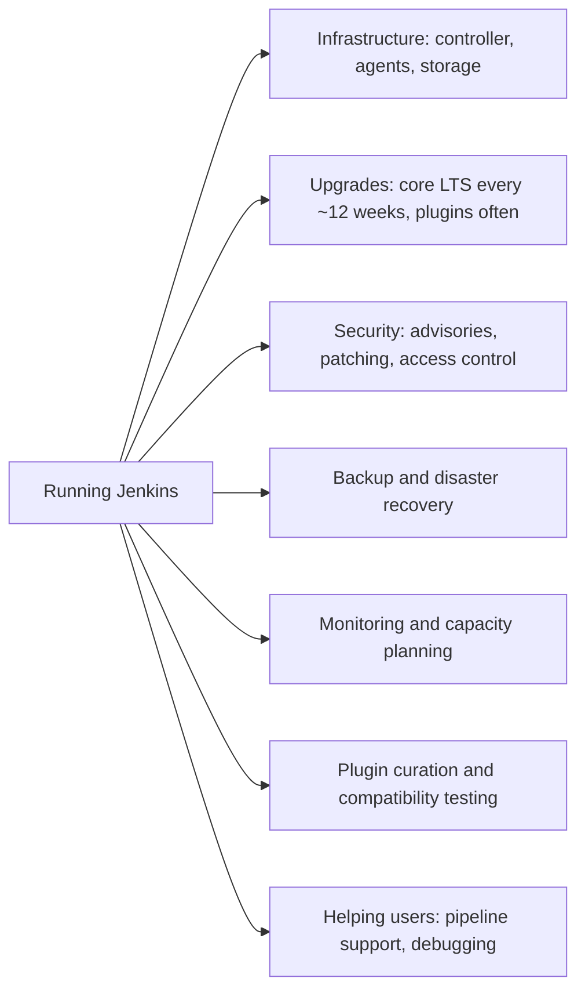
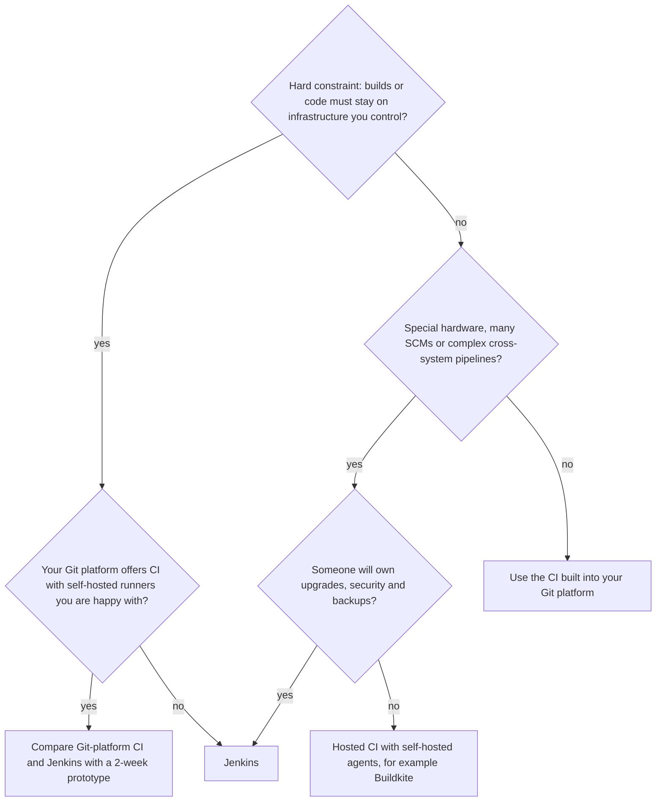
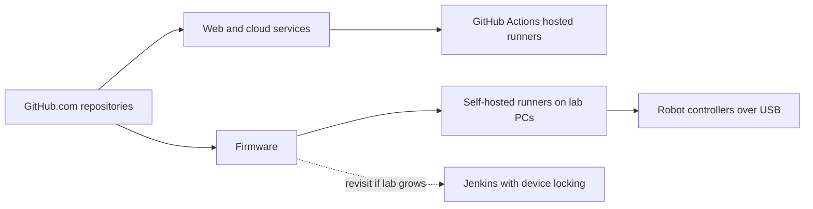

# When Should You Choose Jenkins?

## Introduction

The previous page compared Jenkins with other CI/CD tools feature by feature. This page turns that comparison into a **decision**. It answers the question a tech lead actually faces: "For *our* team, *our* code and *our* constraints, is Jenkins the right choice, and if so, how do we adopt it without creating a maintenance burden we regret?"

Choosing a CI/CD platform is a multi-year decision. Pipelines, credentials, integrations and habits accumulate around it, and switching later is expensive. So it is worth thirty minutes of structured thinking up front.

An analogy: choosing Jenkins is like deciding to run your own email server. It is entirely possible, it gives you full control, and some organizations genuinely need it. But if you do not need that control, you are signing up for patching, backups and on-call duty that a managed service would handle for you.

This page gives you:

- strong signals **for** Jenkins and strong signals **against** it,
- the hidden costs people forget,
- a simple scoring helper to structure the discussion,
- a checklist for adopting Jenkins the modern way, if you choose it.

## Strong Signals for Jenkins

| Signal | Why it points to Jenkins |
|--------|--------------------------|
| Code, builds or artifacts must stay inside your network (regulated industries, government, air-gapped sites) | Jenkins runs entirely on infrastructure you control, including fully offline |
| You use several source control systems, or one a hosted CI does not support well | Jenkins integrates with any Git host and, through plugins, other SCMs |
| Builds need special hardware or operating systems: embedded boards, consoles, GPUs, macOS farms, mainframes, physical test labs | Any machine that runs Java can be a Jenkins agent |
| Pipelines orchestrate many internal systems: ticketing, artifact stores, change management, legacy deploy tools | Plugins and Scripted Pipeline handle complex integrations |
| You need a central platform team to provide standard pipelines to many teams | Shared libraries and Configuration as Code support a governed internal platform |
| You already have Jenkins skills and a large, working investment | Modernizing is often cheaper than migrating |
| Hosted per-minute costs would be very high at your build volume | Self-hosted compute can be cheaper at scale, if you account for staff time honestly |

## Strong Signals Against Jenkins

| Signal | Why it points away from Jenkins |
|--------|---------------------------------|
| Your code lives on one hosted Git platform (GitHub.com, GitLab.com) and there are no data restrictions | The built-in CI does the same job with almost no setup |
| Small team, nobody wants to own a server | Jenkins needs regular upgrades, plugin updates, security patches and backups |
| Builds are standard: install dependencies, test, build a container, deploy | You will not use Jenkins' flexibility, but you will pay for it |
| You need managed high availability without designing it yourself | Open-source Jenkins has one active controller; HA is your responsibility |
| Your organization has a strict policy of minimizing self-hosted software | Jenkins is self-hosted by definition |
| Developers want CI results and configuration only inside the pull request UI | Possible with Jenkins, but native in Git-platform CI |

:::tip
If you find signals in **both** tables, that is normal. Weigh them. One hard constraint (for example, "builds must run in an air-gapped network") usually outweighs several soft preferences.
:::

## The Hidden Costs

"Jenkins is free" is true for the license and misleading for everything else. Before choosing it, make sure someone owns each of these:



| Cost area | What it involves | How to reduce it |
|-----------|------------------|------------------|
| Upgrades | New LTS baselines arrive roughly every 12 weeks, with patch releases between; plugins update constantly | Stay on LTS, upgrade on a schedule, test on a staging controller |
| Security | The Jenkins project publishes security advisories for core and plugins regularly | Subscribe to advisories; keep plugins minimal; restrict access |
| Plugins | Each plugin is third-party code with its own maintainers and dependencies | Keep a short, reviewed plugin list in Git |
| Recovery | The controller holds state on disk | Back up `JENKINS_HOME` including secrets; use Configuration as Code |
| User support | Teams need help with Groovy, agents and credentials | Shared libraries, templates and good docs |

[Total Cost of Running Jenkins](../13-jenkins-best-practices/4-jenkins-cost-and-maintenance.mdx) helps you estimate these in hours and money. [Security Advisories and Hardening](../11-jenkins-security/7-jenkins-security-advisories.mdx) covers the security routine.

## Is Your Team Ready to Run Jenkins?

Even when Jenkins fits the technical constraints, it needs an owner. Ask these questions honestly:

1. **Who upgrades it?** Name a person or team, and a schedule.
2. **Who is paged when it is down?** If the answer is "nobody", builds will stop at the worst possible moment.
3. **Can you rebuild it from scratch?** If not today, plan to reach that point with Configuration as Code.
4. **Who approves new plugins?** Without a gate, plugin count only grows.
5. **Does anyone know Groovy and Pipeline well?** At least one person should understand CPS, the sandbox and shared libraries.

If you cannot answer at least the first three, either budget for that work or prefer a hosted tool.

## A Scoring Helper

Discussions about tools often turn into opinions. A simple weighted checklist keeps them focused on facts. The script below is deliberately small and opinionated. Adjust the weights to your organization; the value is in making the trade-offs explicit, not in the exact number.

```python
# ci_fit.py: a tiny, opinionated helper to structure the "Jenkins or not?" discussion.
# Each answer is 0 (no) to 2 (strongly yes). Weights reflect how much each factor matters.

FACTORS = {
    # factor: (weight, points toward Jenkins if "yes")
    "code_or_builds_must_stay_on_prem": (3, +1),
    "multiple_or_unusual_scm": (2, +1),
    "special_hardware_or_os": (2, +1),
    "complex_cross_system_pipelines": (2, +1),
    "existing_jenkins_skills_and_jobs": (2, +1),
    "team_can_run_and_patch_a_server": (3, +1),
    "code_on_single_hosted_git_platform": (2, -1),
    "standard_builds_only": (2, -1),
    "small_team_no_platform_engineers": (3, -1),
}


def score(answers):
    total = 0
    for name, (weight, direction) in FACTORS.items():
        total += answers.get(name, 0) * weight * direction
    return total


def verdict(total):
    if total >= 8:
        return "Jenkins is a strong fit"
    if total >= 0:
        return "Close call: prototype Jenkins and one alternative"
    return "Prefer the CI built into your Git platform or a hosted CI"


teams = {
    "Startup on GitHub.com": {
        "code_on_single_hosted_git_platform": 2,
        "standard_builds_only": 2,
        "small_team_no_platform_engineers": 2,
    },
    "Bank with on-prem Git": {
        "code_or_builds_must_stay_on_prem": 2,
        "complex_cross_system_pipelines": 2,
        "existing_jenkins_skills_and_jobs": 2,
        "team_can_run_and_patch_a_server": 2,
    },
    "Game studio, consoles and GPUs": {
        "special_hardware_or_os": 2,
        "multiple_or_unusual_scm": 1,
        "team_can_run_and_patch_a_server": 1,
        "code_on_single_hosted_git_platform": 1,
    },
}

for team, answers in teams.items():
    t = score(answers)
    print(f"{team:32} score={t:+3d}  -> {verdict(t)}")
```

Run it with `python3 ci_fit.py`.

Output:

```text
Startup on GitHub.com            score=-14  -> Prefer the CI built into your Git platform or a hosted CI
Bank with on-prem Git            score=+20  -> Jenkins is a strong fit
Game studio, consoles and GPUs   score= +7  -> Close call: prototype Jenkins and one alternative
```

How to use it well:

- **Fill it in as a group.** Ask the platform team, a developer and a security person. Disagreements reveal hidden constraints.
- **Treat hard constraints as vetoes.** If code legally cannot leave your network, no score for convenience should override that.
- **Revisit the answers yearly.** Teams grow, Git platforms change, and the right answer changes with them.

## A Decision Flow



## Quick Verdicts for Common Situations

Most teams match one of a handful of patterns. Use this table as a starting point, then check it against your own constraints.

| Situation | Usual verdict | Main reason |
|-----------|---------------|-------------|
| Startup, all code on GitHub.com, web and mobile apps | GitHub Actions | Nothing to operate, native pull request checks |
| Company standardized on self-managed GitLab | GitLab CI, unless special needs | CI is already part of the platform you run |
| Bank, insurer or government agency with on-premises Git and strict change control | Jenkins or Git-platform CI with own runners | Data must stay inside; Jenkins excels at complex, audited pipelines |
| Game studio building for consoles, PC and mobile | Often Jenkins | Special build machines, huge repositories, mixed SCMs |
| Embedded or hardware company with test labs | Jenkins or self-hosted runners, depending on lab size | Physical devices, scheduling and locking |
| Large enterprise with an existing, working Jenkins | Modernize Jenkins first, then reassess | Migration cost is real; a codified Jenkins may be enough |
| Kubernetes-first platform team building an internal developer platform | Compare Jenkins, Tekton and Git-platform CI | All can work; depends on team skills and existing tools |
| Open-source project | The CI offered by its Git host | Contributors expect it; free tiers for public repositories are common |

## Running a Two-Week Prototype

When the decision is close, a short, structured prototype beats any amount of debate. Pick one real, representative repository, not a toy, and try the candidate tools side by side.

| Day | Activity | What you learn |
|-----|----------|----------------|
| 1 to 2 | Install or enable each tool; connect it to your Git server | Real setup effort, network and firewall surprises |
| 3 to 5 | Port the repository's build and tests | Configuration language fit, agent or runner needs |
| 6 to 7 | Add secrets, test reports and pull request status | Credential handling, developer experience |
| 8 to 9 | Add a deployment to a test environment with an approval | Promotion and approval models |
| 10 | Break things on purpose: kill an agent, restart the controller, roll back a plugin or version | Failure behavior and recovery effort |

Write down measurable results: time to first green build, minutes per build, how many plugins or marketplace actions you needed, and how long recovery took. Those numbers make the final decision much easier to explain.

## If You Choose Jenkins: Do It the Modern Way

Many bad Jenkins experiences come from installations set up years ago by clicking through forms. If you adopt Jenkins today, start with the practices that keep it maintainable:

| Practice | What it means | Where to learn it |
|----------|---------------|-------------------|
| Stay on LTS | Use the LTS release line and a supported Java version (Java 21 or 25 at the time of writing) | [Upgrading Jenkins and LTS Releases](../1-jenkins-installation/6-jenkins-upgrading.mdx) |
| Pipelines as code | Every job is a `Jenkinsfile` in Git; avoid new Freestyle jobs | [The Jenkinsfile](../3-jenkins-pipeline-basics/1-jenkins-jenkinsfile.mdx) |
| Multibranch and organization folders | Jenkins discovers repositories and branches automatically | [Multibranch Pipelines](../5-jenkins-scm-integration/1-jenkins-multibranch-pipelines.mdx) |
| No builds on the controller | Built-in node executors set to 0; work runs on agents | [Controller and Agents](../6-jenkins-agents/0-jenkins-controller-and-agents.mdx) |
| Ephemeral agents | Docker or Kubernetes agents that start clean for each build | [Kubernetes Pod Agents](../6-jenkins-agents/4-jenkins-kubernetes-agents.mdx) |
| Configuration as Code | Server configuration in JCasC YAML, plugins in a pinned list | [Configuration as Code (JCasC)](../12-jenkins-administration/0-jenkins-configuration-as-code.mdx) |
| Minimal plugins | Every plugin justified and owned | [Avoiding Plugin Sprawl and Dependency Problems](../7-jenkins-plugins/2-jenkins-plugin-dependency-hell.mdx) |
| Shared libraries | Common steps written once, versioned and tested | [Shared Libraries Introduction](../8-jenkins-shared-libraries/0-jenkins-shared-libraries-introduction.mdx) |
| Real authentication | SSO or LDAP, role-based access, credentials in the store | [Authentication and SSO](../11-jenkins-security/1-jenkins-authentication.mdx) |
| Current UI tools | Pipeline Graph View for visualization; Blue Ocean is deprecated | [Essential Plugins](../7-jenkins-plugins/1-jenkins-essential-plugins.mdx) |

A minimal, modern starting point looks like this. The plugin list is kept in Git and installed at image build time, so the controller is reproducible:

```text
# plugins.txt (plugin-id:version or plugin-id:latest while prototyping)
configuration-as-code
workflow-aggregator
pipeline-graph-view
git
github-branch-source
credentials-binding
docker-workflow
kubernetes
junit
```

```dockerfile
# Dockerfile for a reproducible controller image
FROM jenkins/jenkins:lts-jdk21
COPY --chown=jenkins:jenkins plugins.txt /usr/share/jenkins/ref/plugins.txt
RUN jenkins-plugin-cli --plugin-file /usr/share/jenkins/ref/plugins.txt
# Keep the config outside JENKINS_HOME so a new image always brings the new file
ENV CASC_JENKINS_CONFIG=/usr/share/jenkins/casc/casc.yaml
COPY --chown=jenkins:jenkins casc.yaml /usr/share/jenkins/casc/casc.yaml
```

```yaml
# casc.yaml: smallest useful Configuration as Code file
jenkins:
  systemMessage: "Managed by Configuration as Code. Do not edit settings in the UI."
  numExecutors: 0
```

```bash
docker build -t my-jenkins:1.0 .
docker run -d --name jenkins -p 8080:8080 -v jenkins_home:/var/jenkins_home my-jenkins:1.0
docker logs jenkins 2>&1 | grep -i "fully up and running"
```

Example output:

```text
... INFO hudson.lifecycle.Lifecycle#onReady: Jenkins is fully up and running
```

:::note
Pin exact plugin versions (in the form `plugin-id:version`) once you move past prototyping, so every rebuild of the image gives the same result. [Managing Plugins as Code](../7-jenkins-plugins/3-jenkins-plugin-installation-manager.mdx) covers `jenkins-plugin-cli` and version pinning. The setup wizard still appears on first start unless you also configure security in code and disable the wizard; [Project: Fully Codified Jenkins Instance](../14-jenkins-projects/5-jenkins-project-jenkins-as-code.mdx) builds a complete version.
:::

## Signals It Is Time to Reconsider an Existing Jenkins

The same thinking applies if you already run Jenkins. Revisit the decision when you see several of these:

- The original reason for Jenkins is gone, for example the company moved all code to a hosted Git platform and dropped its on-premises requirement.
- Nobody on the team wants to own the controller, and upgrades are years behind.
- Most pipelines are simple build-test-deploy flows that the Git platform's CI could run unchanged.
- Plugin problems, not build problems, cause most CI outages.

Reconsidering does not automatically mean migrating. Often the cheaper fix is to modernize: codify the configuration, cut plugins, and move builds to ephemeral agents. [Migrating to or from Jenkins](../13-jenkins-best-practices/3-jenkins-migrating-to-other-ci.mdx) helps you compare both paths.

## Real-World Scenario

You are the first DevOps hire at a 30-person robotics company. Firmware is built with a vendor toolchain that only runs on Windows, and tests must run on physical robot controllers connected to lab machines by USB. The web dashboard and cloud services are ordinary TypeScript and Python. All code is on GitHub.com. The CTO asks you to pick a CI/CD platform.

**Applying the guide:**

1. **Signals for Jenkins:** special hardware (lab machines with USB-attached controllers), a Windows-only toolchain, and complex pipelines that flash firmware and then run hardware tests.
2. **Signals against Jenkins:** small team, code on one hosted Git platform, and the web services have completely standard builds.
3. **Team readiness:** you can own the server, but you are one person. Anything you choose must be low maintenance.

**Decision:**

- **GitHub Actions** for the web dashboard and cloud services. Standard builds, native pull request checks, nothing to operate.
- For firmware, you compare **GitHub Actions self-hosted runners** on the lab machines with a **small Jenkins** controlling the lab. You prototype both for a week. Self-hosted runners turn out to be enough for the current two lab machines, so you choose them and note in a decision record that Jenkins becomes worth revisiting if the lab grows into a shared pool needing scheduling, locking of devices (the Lockable Resources plugin) and cross-system test orchestration.



### Why this approach

The decision follows the constraints, not habit. Jenkins would work well here, but for two lab machines its extra capability does not yet outweigh the cost of running another server for a one-person DevOps team. Writing down *when* to revisit keeps the door open without paying for it now.

### When to use it and when not to

Use the "prototype both, write down the trigger to revisit" approach whenever the scores are close. If the company had fifty lab machines shared by ten teams, Jenkins' scheduling, labels and lockable resources would likely tip the decision the other way.

### Alternatives and trade-offs

| Approach | Pros | Cons | Best for |
|----------|------|------|----------|
| Jenkins for everything | One system; strong hardware-lab support | Operates a server for simple web builds too | Larger teams with heavy lab or on-prem needs |
| Git-platform CI for everything, self-hosted runners for hardware | One system, minimal operations | Limited scheduling and device management as the lab grows | Small teams, small labs |
| Git-platform CI for web, Jenkins for the lab | Best tool per workload | Two systems to learn and secure | Growing hardware labs with many teams |
| Hosted control plane with own agents | No server to run, full control of compute | Another vendor and bill | Teams that outgrow runners but do not want Jenkins |

## Common Mistakes

- **Choosing Jenkins by default** because "everyone uses it" or because it was used at a previous job. Use the constraints.
- **Rejecting Jenkins by reputation** after seeing one badly maintained instance. A codified, minimal Jenkins is a different experience.
- **No owner.** A Jenkins without a named owner degrades: plugins go stale, disks fill, security patches lag.
- **Skipping the prototype.** A one- or two-week prototype with a real repository reveals more than any comparison article.
- **Not writing the decision down.** Record the constraints, the scores and the conditions under which you would revisit. Future you will thank you.

## Summary

- Choose Jenkins for **hard constraints** it handles well: on-premises or air-gapped builds, special hardware, many SCMs, complex cross-system pipelines, or a central platform for many teams.
- Prefer the CI built into your Git platform when code is on one hosted platform, builds are standard and nobody wants to run a server.
- Jenkins' real cost is **operations**: upgrades, plugins, security, backups and user support. Name an owner before you start.
- A weighted checklist and a short prototype turn opinions into an explicit, reviewable decision.
- If you choose Jenkins, start modern: LTS, pipelines as code, no builds on the controller, ephemeral agents, Configuration as Code and a minimal plugin list.

## Further Learning

Exercises:

1. Run `ci_fit.py`, then add your own team with honest answers. Change one weight you disagree with and see whether the verdict changes. Write one sentence on why you changed it.
2. Answer the five "Is your team ready?" questions for a real or imagined team. For each "no", write what it would take to change it.
3. Build the minimal controller image from the "Do It the Modern Way" section. Confirm in the UI that the system message appears and that the built-in node has 0 executors.

Related pages:

- [Jenkins vs GitHub Actions, GitLab CI and Others](./3-jenkins-vs-alternatives.mdx)
- [Jenkins Terminology Cheat Sheet](./5-jenkins-terminology.mdx)
- [Installing Jenkins with Docker](../1-jenkins-installation/0-jenkins-install-docker.mdx)
- [Total Cost of Running Jenkins](../13-jenkins-best-practices/4-jenkins-cost-and-maintenance.mdx)
- [Migrating to or from Jenkins](../13-jenkins-best-practices/3-jenkins-migrating-to-other-ci.mdx)
