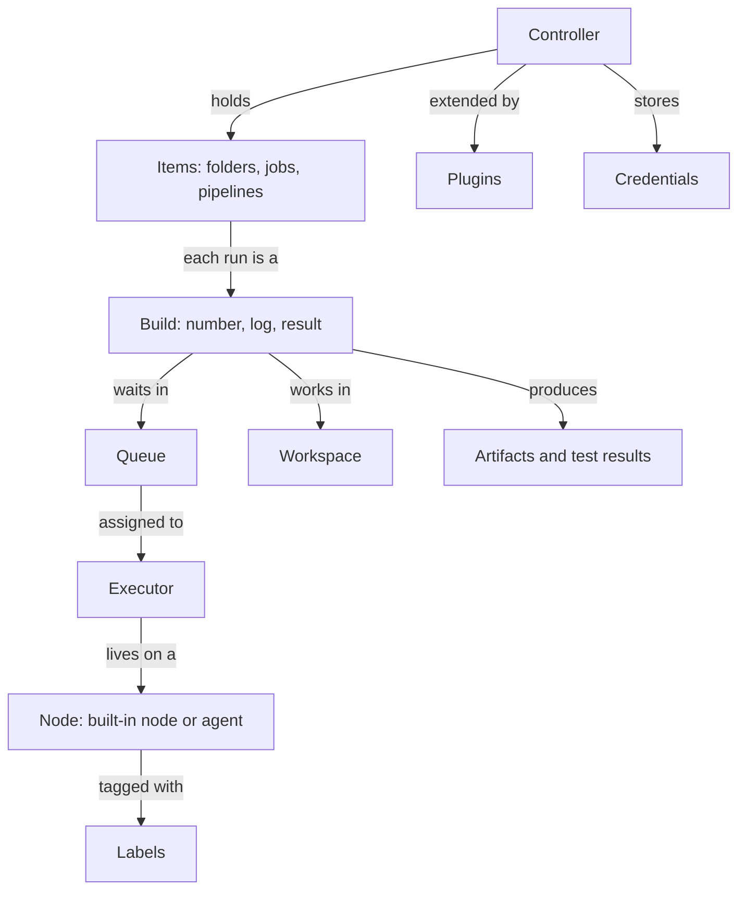

# Jenkins Terminology Cheat Sheet

## Introduction

Jenkins has a vocabulary of its own, and some of it has changed over the years. A colleague might say "the job runs on the slave", the docs say "the Pipeline runs on an agent", and the UI might say "node". These all describe related, but not identical, things.

This page is a reference you can come back to. Terms are grouped by topic, each with a short definition, an example, and a link to the page where it is taught. It is based on the official [Jenkins glossary](https://www.jenkins.io/doc/book/glossary/), extended with the Pipeline and administration terms you will meet in this tutorial.

:::tip How to use this page
Skim it once now so the words feel familiar. When a later page uses a term you do not recognize, search this page (Ctrl+F or Cmd+F).
:::

## The Terms in One Picture



## Core Concepts

| Term | Definition | Example |
|------|------------|---------|
| **Jenkins** | Open-source automation server used mostly for CI/CD | The whole system you install |
| **Controller** | The central Jenkins process: stores configuration, loads plugins, serves the UI, schedules work | `https://jenkins.example.com` |
| **Core** | The main Jenkins application, `jenkins.war`, without plugins | Upgraded on its own schedule |
| **`JENKINS_HOME`** | Directory where the controller keeps all its state as files | `/var/jenkins_home` in Docker |
| **Jenkins URL** | The address users and webhooks use to reach Jenkins; set in system configuration | Needed for correct links in notifications |
| **LTS** | Long-Term Support release line; new baseline roughly every 12 weeks, with patch releases | Version `2.580.1` |
| **Weekly** | Release line with a new version every week; newest features, less stabilization | Version `2.5xx` without a third number |

See [Jenkins Architecture](./2-jenkins-architecture.mdx) and [Upgrading Jenkins and LTS Releases](../1-jenkins-installation/6-jenkins-upgrading.mdx).

## Nodes, Agents and Scheduling

| Term | Definition | Example |
|------|------------|---------|
| **Node** | Any machine that can run builds: the built-in node or an agent | Listed under Manage Jenkins, Nodes |
| **Built-in node** | The node inside the controller process. Formerly called the "master node". Should have 0 executors | `numExecutors: 0` |
| **Agent** | A machine or container that connects to the controller and runs work for it | A Linux VM named `linux-1` |
| **Permanent (static) agent** | An agent you register once and keep | A Windows build server |
| **Cloud** | Configuration that creates agents on demand and removes them later | Kubernetes, Amazon EC2, Azure VM Agents |
| **Executor** | A slot that runs one task on a node; the count limits concurrency | 2 executors means 2 builds at once |
| **Label** | A tag on agents used to choose where work runs | `linux`, `docker`, `gpu` |
| **Label expression** | A boolean combination of labels | `linux && docker && !arm64` |
| **Queue** | Where builds wait for a matching free executor | "Waiting for next available executor" |
| **Remoting** | The library and protocol used between controller and agents | Agent JAR, `remoting.jar` |
| **SSH agent** | Agent the controller starts by connecting over SSH | Port 22 on the agent |
| **Inbound agent (JNLP)** | Agent that connects to the controller itself, over TCP (port `50000` by default) or WebSocket | `jenkins/inbound-agent` image |
| **Pod template** | Kubernetes plugin definition of the pod used as an agent | YAML with `jnlp` and tool containers |
| **Flyweight executor** | A lightweight, temporary slot on the controller that runs the Pipeline's own Groovy; does not use a regular executor | Why a pipeline can "run" with 0 controller executors |

Section 6 explains these in practice, starting with [Controller and Agents](../6-jenkins-agents/0-jenkins-controller-and-agents.mdx) and [Labels, Executors and Scheduling](../6-jenkins-agents/6-jenkins-labels-and-executors.mdx).

## Items: Jobs, Pipelines and Folders

| Term | Definition | Example |
|------|------------|---------|
| **Item** | Anything in the Jenkins UI tree: a folder, job or pipeline | Everything on the dashboard |
| **Job** | A configured unit of work Jenkins can run. Older docs call it a **project** | `build-api` |
| **Freestyle job** | Job type configured through web forms; steps are build steps and post-build actions | Legacy, simple automation |
| **Pipeline job** | Job whose behavior is defined by Pipeline code, inline or from a `Jenkinsfile` | Most modern jobs |
| **Multibranch Pipeline** | Item that scans a repository and creates one Pipeline job per branch (and pull request) that has a `Jenkinsfile` | `my-app` with `main`, `feature-x`, `PR-12` |
| **Organization Folder** | Item that scans a whole GitHub organization, GitLab group or Bitbucket project and creates Multibranch Pipelines | All repositories of `acme-corp` |
| **Folder** | A container for items, with its own permissions and credentials | `team-payments/` |
| **View** | A filtered display of items on the dashboard | "All failing jobs" |
| **Build** | One run of a job, numbered from 1 | `my-app/main #42` |
| **Upstream / downstream** | A job that triggers another is upstream; the triggered job is downstream | Build triggers deploy |
| **Trigger** | What starts a build | Webhook, `cron`, `pollSCM`, upstream |
| **Parameter** | User-supplied input to a build | `ENVIRONMENT=staging` |
| **Quiet period** | Delay before a triggered build starts, to batch changes | 5 seconds by default |

See [Freestyle Jobs](../2-jenkins-jobs/0-jenkins-freestyle-jobs.mdx), [Freestyle vs Pipeline Jobs](../2-jenkins-jobs/5-jenkins-freestyle-vs-pipeline.mdx), [Multibranch Pipelines](../5-jenkins-scm-integration/1-jenkins-multibranch-pipelines.mdx) and [Organization Folders](../5-jenkins-scm-integration/5-jenkins-organization-folders.mdx).

## Pipeline Terms

Here is an annotated `Jenkinsfile` that shows most Pipeline terms in context:

```groovy
@Library('acme-pipeline-lib@v2') _          // shared library, pinned to a version

pipeline {                                  // Declarative Pipeline: top-level block
    agent none                              // agent directive: where to run
    options {                               // options directive
        timeout(time: 20, unit: 'MINUTES')
    }
    parameters {                            // build parameters
        choice(name: 'TARGET', choices: ['staging', 'production'])
    }
    environment {                           // environment variables
        APP = 'invoices'
    }
    stages {
        stage('Test') {                     // a stage
            agent { label 'linux' }         // stage-level agent
            steps {                         // the steps block
                sh './gradlew test'         // a step
            }
            post {                          // post section: runs after the stage
                always { junit 'build/test-results/**/*.xml' }
            }
        }
        stage('Deploy') {
            when { branch 'main' }          // when condition
            agent { label 'deploy' }
            steps {
                withCredentials([string(credentialsId: 'deploy-token', variable: 'TOKEN')]) {
                    sh './deploy.sh "$TARGET"'   // TOKEN is available to the script
                }
            }
        }
    }
}
```

| Term | Definition |
|------|------------|
| **Pipeline** | A suite of plugins and a model for defining a delivery process as code; also one pipeline definition |
| **`Jenkinsfile`** | The file in your repository that contains the Pipeline code |
| **Declarative Pipeline** | Structured syntax starting with a `pipeline` block; validated before it runs; recommended for most use |
| **Scripted Pipeline** | Free-form Groovy syntax starting with `node`; more flexible, more error-prone |
| **Stage** | A named group of steps, such as Build, Test or Deploy; shown in visualizations |
| **Step** | A single action, such as `sh`, `echo`, `checkout` or `junit` |
| **Directive** | A Declarative configuration section, such as `agent`, `options`, `environment`, `when` or `parameters` |
| **`post`** | Section with conditions such as `always`, `success`, `failure`, `unstable` and `cleanup` |
| **`when`** | Directive that decides whether a stage runs |
| **`script` block** | Lets you write Scripted (Groovy) code inside a Declarative stage |
| **`parallel`** | Runs stages or branches at the same time |
| **`matrix`** | Runs the same stages for every combination of axis values |
| **`input`** | Pauses a pipeline until a person approves or supplies values |
| **`stash` / `unstash`** | Saves files in one stage and restores them in another, possibly on a different agent |
| **Shared library** | Reusable Pipeline code in a separate repository, loaded with `@Library` |
| **`vars/`** | Folder in a shared library where each file defines a custom step, such as `buildJavaApp()` |
| **CPS** | Continuation-passing style: how Jenkins runs Pipeline Groovy so it can resume after restarts |
| **`@NonCPS`** | Annotation for helper methods that run as normal Groovy; they cannot call steps |
| **Sandbox** | Restricted Groovy environment for untrusted Pipeline code |
| **Script approval** | Admin approval of a method signature or script blocked by the sandbox |
| **Durability** | How often a running Pipeline saves its state; trades speed for crash recovery |
| **Replay** | Rerun a build with edited Pipeline code, without committing it |
| **Restart from stage** | Rerun a completed Declarative Pipeline from a chosen top-level stage |
| **Snippet Generator** | UI tool that writes step syntax for you, under "Pipeline Syntax" |

Sections 3, 4 and 8 cover these: start with [Pipeline Introduction](../3-jenkins-pipeline-basics/0-jenkins-pipeline-introduction.mdx), [Declarative vs Scripted Pipelines](../3-jenkins-pipeline-basics/4-jenkins-declarative-vs-scripted.mdx) and [Shared Libraries Introduction](../8-jenkins-shared-libraries/0-jenkins-shared-libraries-introduction.mdx).

## Build Results and Outputs

| Term | Definition |
|------|------------|
| **SUCCESS** | Build completed and no step or publisher marked it otherwise. Shown green |
| **UNSTABLE** | Build completed, but a publisher reported problems, usually failing tests. Shown yellow |
| **FAILURE** | A step failed fatally, for example a non-zero exit code. Shown red |
| **ABORTED** | Build was stopped by a user or a timeout. Shown grey |
| **NOT_BUILT** | Build or stage did not run, for example because an earlier stage failed |
| **Console output** | The full build log |
| **Workspace** | Directory on a node where the build checks out and builds code. It usually remains after the build unless cleaned |
| **Artifact** | A file saved with the build record for later download, via `archiveArtifacts` |
| **Fingerprint** | A checksum Jenkins records to track which builds produced and used a file |
| **Publisher** | A post-build action that processes results, such as JUnit reports or coverage |
| **Test report** | Parsed test results, usually from JUnit XML, with trends over builds |
| **Build discarder** | Policy that deletes old builds to save disk space, for example keep the last 20 |

Example: checking results from a terminal with the REST API, which every Jenkins page offers by appending `/api/json`:

```bash
curl -s -u "alice:$JENKINS_API_TOKEN" \
  "https://jenkins.example.com/job/my-app/job/main/lastBuild/api/json?tree=number,result,duration"
```

Example output:

```text
{"_class":"org.jenkinsci.plugins.workflow.job.WorkflowRun","duration":84213,"number":42,"result":"UNSTABLE"}
```

See [Build History and Artifacts](../2-jenkins-jobs/4-jenkins-build-history-and-artifacts.mdx), [Test Reports with JUnit](../9-jenkins-build-and-test/4-jenkins-test-reports.mdx) and [REST API and CLI](../12-jenkins-administration/8-jenkins-rest-api-and-cli.mdx).

## Source Control Terms

| Term | Definition |
|------|------------|
| **SCM** | Source control management: Git, or older systems such as Subversion |
| **Branch source** | Plugin that teaches Multibranch Pipelines how to discover branches and pull requests on a platform, such as `github-branch-source` |
| **Branch indexing / scanning** | Jenkins checking the repository for branches, pull requests and `Jenkinsfile`s |
| **Webhook** | HTTP call from the Git server to Jenkins when something changes |
| **Polling (`pollSCM`)** | Jenkins periodically asking the Git server for changes |
| **Commit status / checks** | Pass or fail result reported back to the pull request |
| **`checkout scm`** | Step that checks out the same revision that triggered the build |

See [Git Integration](../5-jenkins-scm-integration/0-jenkins-git-integration.mdx) and [Pull Request Builds](../5-jenkins-scm-integration/4-jenkins-pull-request-builds.mdx).

## Plugins and Administration

| Term | Definition |
|------|------------|
| **Plugin** | Extension distributed separately from core; identified by an ID such as `kubernetes` or `configuration-as-code` |
| **Update Center** | Hosted catalog from which Jenkins downloads plugins and their metadata |
| **Plugin Installation Manager** | Tool (`jenkins-plugin-cli`) that installs plugins from a list, for reproducible images |
| **Suggested plugins** | The default set offered by the setup wizard |
| **Manage Jenkins** | The administration area of the UI |
| **Tools** | Configured installations of JDKs, Maven, Gradle, Node.js and so on, used by builds |
| **JCasC** | Jenkins Configuration as Code: configuring the controller from YAML, plugin ID `configuration-as-code` |
| **Job DSL** | Plugin (`job-dsl`) that creates jobs from Groovy scripts |
| **Script Console** | Admin page that runs arbitrary Groovy on the controller. Very powerful, very dangerous |
| **System log** | The controller's own log, separate from build logs |
| **Safe restart** | Restart that waits for running builds to finish |

See [Plugin Management](../7-jenkins-plugins/0-jenkins-plugin-management.mdx), [Configuration as Code (JCasC)](../12-jenkins-administration/0-jenkins-configuration-as-code.mdx) and [Job DSL](../12-jenkins-administration/1-jenkins-job-dsl.mdx).

## Security Terms

| Term | Definition |
|------|------------|
| **Security realm** | How Jenkins authenticates users: its own user database, LDAP, SAML, OpenID Connect and others |
| **Authorization strategy** | What authenticated users may do, for example matrix-based or role-based |
| **Credentials** | Stored secrets: username and password, secret text, SSH keys, certificates, files |
| **Credentials ID** | The name a pipeline uses to refer to a credential, for example `deploy-token` |
| **Credentials scope** | `System` credentials are for Jenkins itself; `Global` credentials can be used by jobs |
| **`withCredentials`** | Step from the `credentials-binding` plugin that exposes a credential to a block of steps and masks it in logs |
| **API token** | Per-user token for scripts and the REST API, used instead of a password |
| **CSRF protection (crumb)** | Protection against cross-site request forgery for form and API requests |
| **Security advisory** | Official announcement of vulnerabilities and fixed versions in core or plugins |

See [Jenkins Security Overview](../11-jenkins-security/0-jenkins-security-overview.mdx) and [Credentials Management](../11-jenkins-security/3-jenkins-credentials.mdx).

## Legacy and Renamed Terms

You will meet these in older blog posts, plugins and Stack Overflow answers.

| Old or legacy term | Current term or status |
|--------------------|------------------------|
| Hudson | Jenkins' original name; the project was renamed in 2011 |
| Master | **Controller** |
| Slave | **Agent** |
| Master node | **Built-in node** |
| Project | **Job** (the UI still says "project" in some places) |
| JNLP agent | **Inbound agent** (the name survives in images and container names) |
| Global Tool Configuration | **Tools** page under Manage Jenkins |
| Blue Ocean | **Deprecated** UI. Use Pipeline Graph View or Stage View for visualization, and the Snippet Generator for writing Pipelines |
| Cobertura and JaCoCo coverage plugins | Largely superseded by the **Coverage** plugin (`coverage`) |
| Workflow | Early name of **Pipeline**; survives in plugin IDs like `workflow-aggregator` |

## Acronyms

| Acronym | Stands for | Where you meet it |
|---------|------------|-------------------|
| CI | Continuous Integration | Building and testing every change |
| CD | Continuous Delivery or Continuous Deployment | Releasing changes; see [CI/CD Concepts for Jenkins Users](./1-jenkins-ci-cd-concepts.mdx) |
| LTS | Long-Term Support | The recommended Jenkins release line |
| JCasC | Jenkins Configuration as Code | YAML configuration of the controller |
| CPS | Continuation-Passing Style | How Pipeline Groovy is executed |
| DSL | Domain-Specific Language | Pipeline syntax and Job DSL are both DSLs |
| SCM | Source Control Management | Git integration and branch sources |
| JNLP | Java Network Launch Protocol | Old name for inbound agents |
| WAR | Web Application Archive | `jenkins.war`, the controller package |
| JDK / JRE | Java Development Kit / Runtime Environment | The controller and agents need a supported Java |
| CDF | Continuous Delivery Foundation | The Linux Foundation project that hosts Jenkins |
| SSO | Single Sign-On | Logging in with SAML or OpenID Connect |
| RBAC | Role-Based Access Control | Authorization by roles, for example with the Role-based Authorization Strategy plugin |
| CSRF | Cross-Site Request Forgery | Protection that requires a crumb on requests |

## Real-World Scenario

You lead a platform team that supports 15 product teams on a shared Jenkins. Support requests keep going in circles because people use words differently: "my slave is stuck" might mean an agent is offline, an executor is busy, or a build is waiting in the queue. A new hire spent a day trying to "add executors to the master" to fix a slow build, which would have put builds on the controller.

**What you do:**

1. **Publish a short internal glossary** based on this page, with your own agent names and labels, and link it from the Jenkins system message.
2. **Rename things in the system:** agents are named by role (`linux-docker-01`), labels describe capabilities (`docker`, `gpu`), and the built-in node has 0 executors.
3. **Update the support request template** to ask for precise facts: job and build number, stage, the queue message if waiting, and the node it ran on.

```text
Support request template
------------------------
Job and build:   team-payments/api/main #318
Stage:           Integration tests
Symptom:         Waiting in queue for 25 minutes
Queue message:   "Waiting for next available executor on 'linux && docker'"
Node (if ran):   n/a
```

That queue message alone tells the platform team the issue is **capacity for the `linux && docker` label**, not a broken build.

### Why this approach

Shared vocabulary makes support faster and prevents harmful "fixes", such as adding controller executors. Current terms (controller, agent, built-in node) match the documentation and the UI, so people can search for answers themselves.

### When to use it and when not to

Any Jenkins shared by more than one team benefits from a glossary and a support template. A single developer with a personal Jenkins does not need the process, but still benefits from the right words when searching docs.

### Alternatives and trade-offs

| Approach | Pros | Cons | Best for |
|----------|------|------|----------|
| No shared vocabulary | Zero effort | Slow support, confused newcomers, risky fixes | Solo use only |
| Link the official glossary | Authoritative, maintained by the project | Generic; does not mention your agents or labels | Small teams |
| Internal glossary plus support template | Specific to your setup, speeds up triage | Must be kept up to date | Shared, multi-team Jenkins |
| Self-service dashboards for queue and agents | Users diagnose capacity issues themselves | Requires monitoring setup | Large installations |

## Common Mistakes

- **Confusing node, agent and executor.** A node is a machine, an agent is a node that is not the controller, and an executor is a slot on a node.
- **Thinking a stage is a separate job.** Stages are parts of one build, sharing one build number and log.
- **Assuming the workspace is clean.** Workspaces usually persist between builds on static agents unless you clean them.
- **Using "Pipeline" for every job.** Freestyle jobs are not Pipelines, and their configuration is not code.
- **Learning from old terminology.** If a guide talks about masters, slaves and Blue Ocean, check its age before following it.

## Summary

- The **controller** manages; **agents** do the work; **executors** are slots; **labels** route work.
- **Items** include folders, jobs and Multibranch Pipelines. A **build** is one run of a job.
- **Pipeline** terms: `Jenkinsfile`, Declarative and Scripted syntax, stages, steps, directives, `post`, `when`, shared libraries and CPS.
- Build results include **SUCCESS**, **UNSTABLE**, **FAILURE**, **ABORTED** and **NOT_BUILT**.
- Old terms such as master, slave, JNLP and Blue Ocean still appear online. Use the current terms.

## Further Learning

Exercises:

1. Without looking, explain the difference between a node, an agent, an executor and a label to a colleague. Then check your answer against the tables.
2. Take the annotated `Jenkinsfile` above and label each line with the term from the Pipeline table. Which directives are optional?
3. Open your Jenkins (or the Docker one from [Jenkins Introduction](./0-jenkins-introduction.mdx)) and find, in the UI: the built-in node's executor count, the Update Center, and the Snippet Generator.

Related pages:

- [Jenkins Architecture](./2-jenkins-architecture.mdx)
- [CI/CD Concepts for Jenkins Users](./1-jenkins-ci-cd-concepts.mdx)
- [Tour of the Jenkins UI](../1-jenkins-installation/4-jenkins-ui-tour.mdx)
- [Snippet Generator and Pipeline Syntax Tools](../3-jenkins-pipeline-basics/9-jenkins-pipeline-syntax-generator.mdx)

External reading:

- [Jenkins glossary](https://www.jenkins.io/doc/book/glossary/)
- [Jenkins terminology update](https://www.jenkins.io/blog/2020/06/18/terminology-update/) (Jenkins blog)
