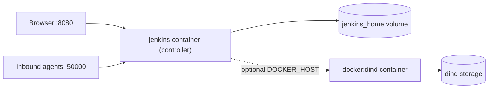
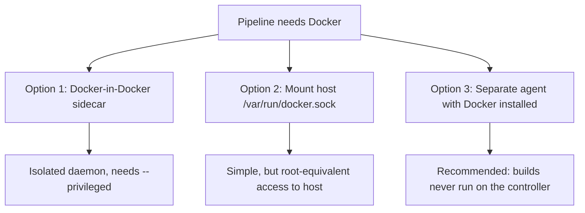

# Installing Jenkins with Docker

## Introduction

The fastest way to get a real Jenkins controller running on your laptop or a small server is the official Docker image. You do not install Java, you do not touch system packages, and you can throw the whole thing away with one command when you are done experimenting.

Running Jenkins in a container is like renting a furnished apartment instead of building a house. The image comes with the right Java version, the Jenkins WAR file, and a sensible user account already set up. You only bring your own belongings, which in Jenkins terms is the **`JENKINS_HOME` directory**: jobs, build history, plugins, credentials and configuration. If you keep that directory on a Docker volume, you can swap the "apartment" (upgrade the image) without losing anything.

In this page you will:

1. Pick the right image tag.
2. Start Jenkins with a persistent volume.
3. Build a custom image that has your plugins baked in.
4. Run everything with Docker Compose.
5. Decide how your pipelines should run Docker commands (Docker-in-Docker, socket mounting, or separate agents).

If Docker itself is new to you, start with the [Docker tutorial](/docs/devops/docker) first. For where the controller fits in the bigger picture, see [Jenkins Architecture](../0-jenkins-fundamentals/2-jenkins-architecture.mdx).

## How the Pieces Fit Together



- **Port 8080** serves the web UI and the REST API.
- **Port 50000** is the TCP port that inbound (JNLP) agents can use to connect. You only need it if you run inbound agents that do not use WebSocket. See [Inbound (JNLP) Agents](../6-jenkins-agents/2-jenkins-inbound-agents.mdx).
- **`/var/jenkins_home`** inside the container is where all state lives. Mount a volume there or you will lose everything when the container is removed.

## Choosing an Image Tag

The official image is `jenkins/jenkins` on Docker Hub. It is published for both the weekly line and the Long-Term Support (LTS) line, with several base operating systems and Java versions.

| Tag pattern | Example | What you get | When to use it |
| --- | --- | --- | --- |
| `lts-jdk21` | `jenkins/jenkins:lts-jdk21` | Latest LTS, Debian base, Java 21 | Tutorials, quick local testing |
| `lts-jdk25` | `jenkins/jenkins:lts-jdk25` | Latest LTS on Java 25 | You want the newest supported Java |
| `<version>-lts-jdk21` | `jenkins/jenkins:2.580.1-lts-jdk21` | One exact LTS release | Production, so upgrades are deliberate |
| `lts-slim`, `lts-alpine` | `jenkins/jenkins:lts-alpine-jdk21` | Smaller base images | Size matters and you test them well |
| `lts-rhel-ubi9-jdk21` | `jenkins/jenkins:lts-rhel-ubi9-jdk21` | Red Hat UBI 9 base | Organizations standardized on RHEL |
| `latest`, `jdk21` | `jenkins/jenkins:jdk21` | Weekly releases | You need a fix that is not in LTS yet |

:::info Versions change
At the time of writing (autumn 2026) the current LTS line is **2.580.x**, and Jenkins requires **Java 21 or Java 25**. Java 17 support ended with the 2.541.x LTS line, and Java 17 images were retired. Check the [LTS changelog](https://www.jenkins.io/changelog-stable/) and the [Java support policy](https://www.jenkins.io/doc/book/platform-information/support-policy-java/) for the current numbers. The official images already contain the right Java, so you do not install it yourself.
:::

A floating tag like `lts-jdk21` silently moves to a new release every time you pull. That is convenient on a laptop and dangerous in production, where you want to read the [upgrade guide](./6-jenkins-upgrading.mdx) before every jump. Pin an exact version for anything that matters.

## Quick Start: One Command

Create a named volume and start the controller:

```bash
docker volume create jenkins_home

docker run -d \
  --name jenkins \
  --restart=on-failure \
  -p 8080:8080 -p 50000:50000 \
  -v jenkins_home:/var/jenkins_home \
  jenkins/jenkins:lts-jdk21
```

Check that it is running:

```bash
docker ps --filter name=jenkins
```

Example output:

```text
CONTAINER ID   IMAGE                       COMMAND                  STATUS         PORTS                                              NAMES
3f1c2a9b7d10   jenkins/jenkins:lts-jdk21   "/usr/bin/tini -- /u…"   Up 20 seconds  0.0.0.0:8080->8080/tcp, 0.0.0.0:50000->50000/tcp   jenkins
```

### Getting the Initial Admin Password

On first start Jenkins generates a one-time password and prints it to the log. You need it to unlock the [setup wizard](./3-jenkins-initial-setup.mdx).

```bash
docker logs jenkins 2>&1 | grep -A 6 "initial setup"
```

Example output:

```text
Jenkins initial setup is required. An admin user has been created and a password generated.
Please use the following password to proceed to installation:

a3f9c1d2e4b84f6c9d0e7a1b2c3d4e5f

This may also be found at: /var/jenkins_home/secrets/initialAdminPassword

```

The password sits between two rows of asterisks in the full log. It is often easier to read it straight from the file:

```bash
docker exec jenkins cat /var/jenkins_home/secrets/initialAdminPassword
```

Example output:

```text
a3f9c1d2e4b84f6c9d0e7a1b2c3d4e5f
```

Open `http://localhost:8080`, paste the password, and continue with the [Initial Setup Wizard](./3-jenkins-initial-setup.mdx).

### Why a Named Volume and Not a Bind Mount?

You could mount a host folder with `-v /srv/jenkins:/var/jenkins_home`. The official image documentation advises against it for beginners because of permissions: Jenkins runs as the `jenkins` user with **UID 1000** inside the container, and that user must be able to write to the host folder. Named volumes are managed by Docker and avoid that problem.

If you do need a bind mount, for example so your backup tool can see the files, fix ownership first:

```bash
sudo mkdir -p /srv/jenkins_home
sudo chown -R 1000:1000 /srv/jenkins_home
```

## Passing JVM and Jenkins Options

The image reads a few environment variables at startup:

| Variable | Purpose | Example |
| --- | --- | --- |
| `JAVA_OPTS` | JVM options for the Java process | `-Xmx2g` |
| `JENKINS_JAVA_OPTS` | JVM options for the controller only (preferred over `JAVA_OPTS` for controller-specific settings) | `-Duser.timezone=Europe/Berlin` |
| `JENKINS_OPTS` | Arguments for the Jenkins launcher | `--prefix=/jenkins` |

```bash
docker run -d --name jenkins \
  -p 8080:8080 \
  -v jenkins_home:/var/jenkins_home \
  -e JENKINS_JAVA_OPTS="-Xmx2g -Duser.timezone=Europe/Berlin" \
  -e JENKINS_OPTS="--prefix=/jenkins" \
  jenkins/jenkins:2.580.1-lts-jdk21
```

With `--prefix=/jenkins` the UI is served at `http://localhost:8080/jenkins/`. That is useful when a reverse proxy serves Jenkins under a sub-path.

:::tip
Do not tune the heap blindly. Start with the defaults, watch memory in [Monitoring Jenkins](../12-jenkins-administration/3-jenkins-monitoring.mdx), and adjust. [Performance Tuning](../12-jenkins-administration/4-jenkins-performance-tuning.mdx) covers JVM settings in depth.
:::

## Building a Custom Image with Plugins

Clicking through the plugin manager on every new instance does not scale and is not reproducible. The image ships with `jenkins-plugin-cli` (the [Plugin Installation Manager Tool](https://github.com/jenkinsci/plugin-installation-manager-tool)), which installs plugins and their dependencies at image build time.

Create a working folder with two files. First, `plugins.txt`:

```text
configuration-as-code
git
workflow-aggregator
pipeline-graph-view
credentials-binding
timestamper
docker-workflow
```

Each line is a plugin ID. You can pin a version with `plugin-id:version`, for example `git:5.10.1`. Pinning makes builds reproducible; leaving versions off gives you the latest compatible release at build time. [Managing Plugins as Code](../7-jenkins-plugins/3-jenkins-plugin-installation-manager.mdx) discusses which to choose.

Then a `Dockerfile`:

```dockerfile
FROM jenkins/jenkins:2.580.1-lts-jdk21

# Install plugins listed in plugins.txt (resolves dependencies too)
COPY --chown=jenkins:jenkins plugins.txt /usr/share/jenkins/ref/plugins.txt
RUN jenkins-plugin-cli --plugin-file /usr/share/jenkins/ref/plugins.txt

# Skip the interactive wizard because we configure Jenkins as code
ENV JAVA_OPTS="-Djenkins.install.runSetupWizard=false"
```

Build and run it:

```bash
docker build -t my-jenkins:2.580.1-1 .
docker run -d --name jenkins -p 8080:8080 \
  -v jenkins_home:/var/jenkins_home my-jenkins:2.580.1-1
```

Example output from the build:

```text
[+] Building 74.2s (8/8) FINISHED
 => [1/3] FROM docker.io/jenkins/jenkins:2.580.1-lts-jdk21
 => [2/3] COPY --chown=jenkins:jenkins plugins.txt /usr/share/jenkins/ref/plugins.txt
 => [3/3] RUN jenkins-plugin-cli --plugin-file /usr/share/jenkins/ref/plugins.txt
 => exporting to image
 => => naming to docker.io/library/my-jenkins:2.580.1-1
```

:::caution Disabling the wizard also disables the first admin user
With `runSetupWizard=false`, Jenkins does not create the unlock password or ask you for an admin account. You must configure security yourself, normally with [Configuration as Code (JCasC)](../12-jenkins-administration/0-jenkins-configuration-as-code.mdx). Never expose a wizard-less instance without a security realm. The [Initial Setup Wizard](./3-jenkins-initial-setup.mdx) page shows a minimal JCasC file that creates an admin user.
:::

### How `/usr/share/jenkins/ref` Works

Files placed under `/usr/share/jenkins/ref/` in the image are copied into `/var/jenkins_home` on startup. Plugins installed by `jenkins-plugin-cli` land in `/usr/share/jenkins/ref/plugins/`. When you upgrade the image, new plugin versions in the image are copied over older versions in the volume. That is the whole point: the image, not the volume, becomes the source of truth for plugins.

## Docker Compose Setup

For anything you keep around for more than an afternoon, put the configuration in a `compose.yaml` file so it is versioned and repeatable:

```yaml
services:
  jenkins:
    build: .
    image: my-jenkins:2.580.1-1
    container_name: jenkins
    restart: on-failure
    ports:
      - "8080:8080"
      - "50000:50000"
    environment:
      JENKINS_JAVA_OPTS: "-Xmx2g"
    volumes:
      - jenkins_home:/var/jenkins_home

volumes:
  jenkins_home:
```

```bash
docker compose up -d --build
docker compose logs -f jenkins
```

Example output:

```text
jenkins  | INFO	jenkins.InitReactorRunner$1#onAttained: Completed initialization
jenkins  | INFO	hudson.lifecycle.Lifecycle#onReady: Jenkins is fully up and running
```

When you see `Jenkins is fully up and running`, the controller is ready.

## Running Docker Builds from a Dockerized Jenkins

Sooner or later a pipeline needs to run `docker build` or use the `agent { docker { ... } }` syntax. The controller container does not have a Docker daemon. You have three options.



### Option 1: Docker-in-Docker (the Official Tutorial Setup)

The [official Docker installation guide](https://www.jenkins.io/doc/book/installing/docker/) runs a `docker:dind` container next to Jenkins and points Jenkins at it over TLS. In Compose form:

```yaml
services:
  docker:
    image: docker:dind
    privileged: true
    environment:
      DOCKER_TLS_CERTDIR: /certs
    volumes:
      - docker-certs:/certs/client
      - jenkins_home:/var/jenkins_home
    networks:
      jenkins:
        aliases: [docker]

  jenkins:
    image: my-jenkins-docker:2.580.1-1
    restart: on-failure
    environment:
      DOCKER_HOST: tcp://docker:2376
      DOCKER_CERT_PATH: /certs/client
      DOCKER_TLS_VERIFY: "1"
    ports:
      - "8080:8080"
      - "50000:50000"
    volumes:
      - jenkins_home:/var/jenkins_home
      - docker-certs:/certs/client:ro
    networks: [jenkins]

volumes:
  jenkins_home:
  docker-certs:

networks:
  jenkins:
```

The `my-jenkins-docker` image adds the Docker CLI (not the daemon) and the Docker Pipeline plugin:

```dockerfile
FROM jenkins/jenkins:2.580.1-lts-jdk21
USER root
RUN apt-get update && apt-get install -y lsb-release ca-certificates curl && \
    install -m 0755 -d /etc/apt/keyrings && \
    curl -fsSL https://download.docker.com/linux/debian/gpg -o /etc/apt/keyrings/docker.asc && \
    chmod a+r /etc/apt/keyrings/docker.asc && \
    echo "deb [arch=$(dpkg --print-architecture) signed-by=/etc/apt/keyrings/docker.asc] \
      https://download.docker.com/linux/debian $(. /etc/os-release && echo "$VERSION_CODENAME") stable" \
      > /etc/apt/sources.list.d/docker.list && \
    apt-get update && apt-get install -y docker-ce-cli && \
    rm -rf /var/lib/apt/lists/*
USER jenkins
RUN jenkins-plugin-cli --plugins "docker-workflow json-path-api"
```

The `jenkins_home` volume is shared with the dind container because the Docker Pipeline plugin mounts the workspace path into build containers, and that path must exist where the daemon runs.

### Option 2: Mounting the Host Docker Socket

```bash
docker run -d --name jenkins -p 8080:8080 \
  -v jenkins_home:/var/jenkins_home \
  -v /var/run/docker.sock:/var/run/docker.sock \
  my-jenkins-docker:2.580.1-1
```

It is simple and fast because image layers are cached on the host. But anyone who can run a pipeline can now run `docker run -v /:/host ...` and own the host. Only use it on a single-user lab machine.

### Option 3: Separate Docker-Capable Agents

The production answer is to keep the controller free of builds entirely and run builds on agents that have Docker installed, or on ephemeral Kubernetes pods. See [Docker Agents](../6-jenkins-agents/3-jenkins-docker-agents.mdx) and [Choosing an Agent Strategy](../6-jenkins-agents/7-jenkins-agent-strategies.mdx).

## Real-World Scenario

Your team of eight developers maintains three Java services. Today a single shared VM runs an old Jenkins installed by hand three years ago. Nobody knows exactly which plugins it has, and the last upgrade broke the build for a day. You have been asked to make Jenkins "rebuildable".

**The solution:**

1. Write `plugins.txt` with pinned versions taken from the current instance (the [Plugin Installation Manager](../7-jenkins-plugins/3-jenkins-plugin-installation-manager.mdx) can list them).
2. Build `my-jenkins:2.580.1-1` from a Dockerfile in a Git repository, together with a JCasC file.
3. Run it with Docker Compose on the same VM, with `jenkins_home` on a named volume that is backed up nightly ([Backup and Restore](../12-jenkins-administration/2-jenkins-backup-and-restore.mdx)).
4. Set the built-in node's executors to 0 and add one Docker-capable VM agent for builds.
5. For upgrades, bump the base tag in a branch, build, run it against a copy of the volume, then roll out.

**Why this approach:** The image plus Git repository *is* the documentation. Upgrading becomes a reviewed pull request instead of a nervous click on "Update". Rolling back means starting the previous image tag against the restored volume.

**When to use it:** single-node installations, small and medium teams, labs, and anywhere Docker is already the standard runtime.

**When not to use it:** if your organization already runs Kubernetes, the [Helm chart](./2-jenkins-install-kubernetes.mdx) gives you ephemeral pod agents and better scheduling. If your operations team forbids containers on build hosts, use the [Linux packages](./1-jenkins-install-linux.mdx).

### Alternatives and Trade-offs

| Approach | Pros | Cons | Best for |
| --- | --- | --- | --- |
| Docker image (this page) | Fast setup, Java bundled, reproducible, easy rollback | Docker builds need extra wiring; one host is still a single point of failure | Small teams, labs, single-VM installs |
| Linux package (apt/dnf) | Native systemd service, familiar to ops teams | You manage Java and OS packages; harder to reproduce | Organizations with VM-centric operations |
| Helm on Kubernetes | Pod agents, declarative config, cluster scheduling | Needs a cluster and Kubernetes skills | Teams already on Kubernetes |
| Managed CI (GitHub Actions, GitLab CI) | No server to run | Less control, different cost model | Teams without Jenkins-specific needs (see [Jenkins vs Alternatives](../0-jenkins-fundamentals/3-jenkins-vs-alternatives.mdx)) |

## Common Mistakes

1. **No volume.** `docker run jenkins/jenkins:lts-jdk21` without `-v` stores everything in the container layer. `docker rm` deletes all jobs and history.
2. **Using `latest` thinking it is stable.** `latest` follows the *weekly* line. Use an `lts-*` tag or a pinned LTS version.
3. **Bind-mount permission errors.** Errors such as `touch: cannot touch '/var/jenkins_home/copy_reference_file.log': Permission denied` mean the host folder is not writable by UID 1000.
4. **Mounting the Docker socket on a shared instance.** It gives every pipeline author root on the host.
5. **Running builds on the controller.** It works on day one, but builds then compete with the UI for memory and can read controller files. Move builds to agents early.
6. **Installing plugins through the UI on an image-based setup.** The next image upgrade may overwrite them, or you forget to add them to `plugins.txt`. Change the file, rebuild the image.
7. **Forgetting port 50000 is optional.** If all agents use WebSocket or SSH, do not publish it.

## Summary

- The official image `jenkins/jenkins` bundles the correct Java version. Use an `lts-jdk21` (or `lts-jdk25`) tag for learning and a pinned `2.580.1-lts-jdk21` style tag for production.
- Always mount `/var/jenkins_home` on a named volume; it holds all Jenkins state.
- Get the unlock password with `docker exec jenkins cat /var/jenkins_home/secrets/initialAdminPassword`.
- Bake plugins into a custom image with `jenkins-plugin-cli` and a `plugins.txt` file.
- Docker Compose makes the setup versionable and repeatable.
- For Docker builds, prefer dedicated agents. Docker-in-Docker works but is privileged; socket mounting is root-equivalent.

## Exercises

1. Start Jenkins with `jenkins/jenkins:lts-jdk21` and a named volume. Create a dummy job, remove the container with `docker rm -f jenkins`, start a new one on the same volume, and confirm the job survived.
2. Build a custom image with five plugins from `plugins.txt`. Then open **Manage Jenkins > Plugins > Installed plugins** and confirm their versions.
3. Convert your `docker run` command into a `compose.yaml` file, add a `JENKINS_JAVA_OPTS` setting, and restart with `docker compose up -d`.
4. Set up the Docker-in-Docker Compose file and run a pipeline with `sh 'docker version'`. Explain in one sentence why the client and server versions can differ.

**Next steps:** continue with [Installing Jenkins on Linux](./1-jenkins-install-linux.mdx) or [Installing Jenkins on Kubernetes](./2-jenkins-install-kubernetes.mdx), then walk through the [Initial Setup Wizard](./3-jenkins-initial-setup.mdx).
