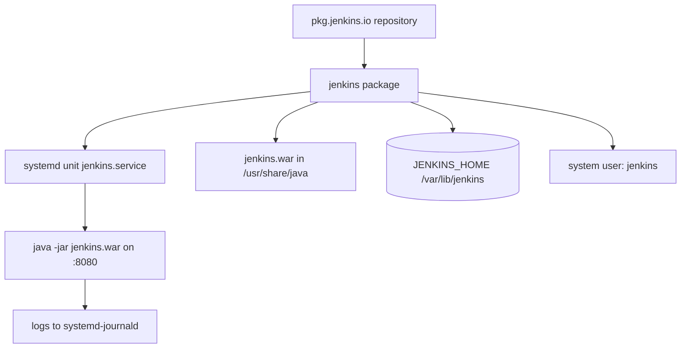
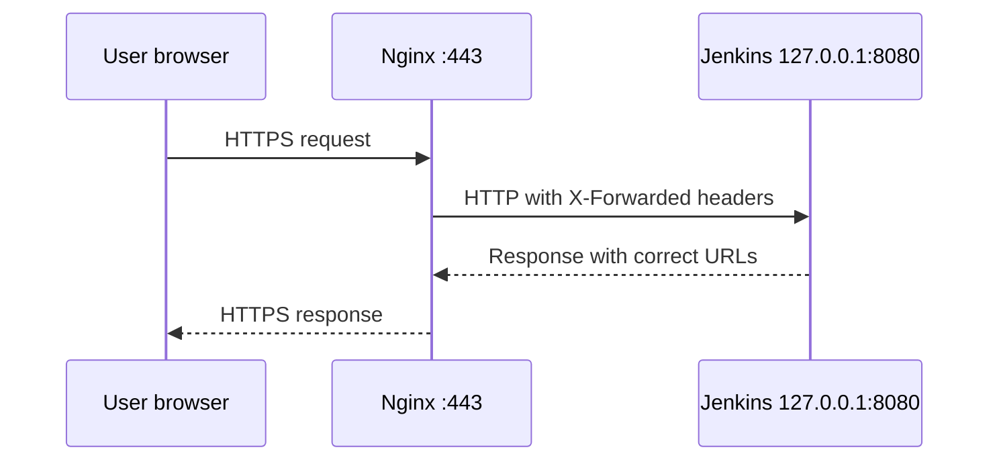

# Installing Jenkins on Linux

## Introduction

Many companies run Jenkins the traditional way: a Linux virtual machine, a package from the official Jenkins repository, and a `systemd` service that starts at boot. It is boring in the best sense. Operations teams already know how to patch, monitor and back up a Linux service, and nothing about it requires containers or Kubernetes.

Think of it like installing a database server with the distribution's package manager. You add the vendor's repository, install the package, adjust a few settings in the service unit, and let `systemd` keep it alive.

In this page you will:

1. Install a supported Java runtime.
2. Add the Jenkins LTS repository and install the package on Debian/Ubuntu and on RHEL/Fedora.
3. Manage the service with `systemctl` and read its logs with `journalctl`.
4. Change the port, heap size and home directory with a `systemd` override.
5. Put Jenkins behind Nginx with HTTPS.

If you prefer containers, see [Installing Jenkins with Docker](./0-jenkins-install-docker.mdx) instead.

## What the Package Sets Up



| Item | Default location or value |
| --- | --- |
| Service unit | `/lib/systemd/system/jenkins.service` (or `/usr/lib/systemd/system/` on RHEL) |
| Home directory (`JENKINS_HOME`) | `/var/lib/jenkins` |
| System user | `jenkins` |
| HTTP port | `8080` |
| Logs | `journalctl -u jenkins` |
| Initial admin password | `/var/lib/jenkins/secrets/initialAdminPassword` |

## Prerequisites

- A 64-bit Linux VM. For a small team, 2 CPUs, 4 GB of RAM and 50 GB of disk is a comfortable starting point, but real needs depend on how many jobs you keep and whether builds run on the controller (they should not). The official [hardware recommendations](https://www.jenkins.io/doc/book/scaling/hardware-recommendations/) are worth reading.
- `sudo` access.
- **Java 21 or Java 25.** Jenkins 2.555.1 and later LTS releases no longer start on Java 17. Install Java **before** the Jenkins package.

:::info Check the current requirements
Supported Java versions change roughly every two years. Before installing, check the [Java support policy](https://www.jenkins.io/doc/book/platform-information/support-policy-java/) and the [Linux installation guide](https://www.jenkins.io/doc/book/installing/linux/).
:::

## Installing on Debian and Ubuntu

### Step 1: Install Java

```bash
sudo apt update
sudo apt install -y fontconfig openjdk-21-jre
java -version
```

Example output:

```text
openjdk version "21.0.8" 2025-07-15
OpenJDK Runtime Environment (build 21.0.8+9-Ubuntu-0ubuntu124.04.1)
OpenJDK 64-Bit Server VM (build 21.0.8+9-Ubuntu-0ubuntu124.04.1, mixed mode, sharing)
```

`fontconfig` is needed because Jenkins renders some graphs and fonts on the server.

### Step 2: Add the Jenkins LTS Repository

Jenkins publishes two Debian repositories: `debian-stable` for LTS releases and `debian` for weekly releases. Use LTS for anything other than experiments.

```bash
sudo wget -O /etc/apt/keyrings/jenkins-keyring.asc \
  https://pkg.jenkins.io/debian-stable/jenkins.io-2026.key

echo "deb [signed-by=/etc/apt/keyrings/jenkins-keyring.asc] \
https://pkg.jenkins.io/debian-stable binary/" | \
  sudo tee /etc/apt/sources.list.d/jenkins.list > /dev/null
```

:::caution The signing key rotates
The Jenkins project rotates its repository signing key from time to time; the file name contains the year (`jenkins.io-2026.key` at the time of writing). If `apt update` reports `NO_PUBKEY` or an expired key, download the current key from the [official instructions](https://www.jenkins.io/doc/book/installing/linux/) instead of disabling signature checks.
:::

### Step 3: Install and Start

```bash
sudo apt update
sudo apt install -y jenkins
sudo systemctl enable --now jenkins
sudo systemctl status jenkins --no-pager
```

Example output:

```text
● jenkins.service - Jenkins Continuous Integration Server
     Loaded: loaded (/lib/systemd/system/jenkins.service; enabled; preset: enabled)
     Active: active (running) since Sat 2026-10-10 09:14:02 UTC; 12s ago
   Main PID: 4211 (java)
     Memory: 612.4M
```

## Installing on RHEL, Rocky, AlmaLinux and Fedora

```bash
sudo wget -O /etc/yum.repos.d/jenkins.repo \
  https://pkg.jenkins.io/rpm-stable/jenkins.repo

sudo dnf upgrade -y
sudo dnf install -y fontconfig java-21-openjdk
sudo dnf install -y jenkins
sudo systemctl daemon-reload
sudo systemctl enable --now jenkins
```

The `.repo` file references the repository's GPG key, so `dnf` verifies packages automatically. On older systems, replace `dnf` with `yum`.

If the host has more than one Java installed, choose the default with `alternatives`:

```bash
sudo alternatives --config java
```

On Debian and Ubuntu the equivalent is `sudo update-alternatives --config java`.

## Opening the Firewall

Jenkins listens on port 8080 by default. If you will put a reverse proxy in front (recommended), open only 80 and 443 and keep 8080 local.

```bash
# Ubuntu with ufw, direct access for a lab
sudo ufw allow 8080/tcp

# RHEL family with firewalld
sudo firewall-cmd --permanent --add-port=8080/tcp
sudo firewall-cmd --reload
```

Then read the initial password and open `http://<server-ip>:8080`:

```bash
sudo cat /var/lib/jenkins/secrets/initialAdminPassword
```

Example output:

```text
5c2d9e8f1a7b4c3d8e6f0a9b1c2d3e4f
```

Continue with the [Initial Setup Wizard](./3-jenkins-initial-setup.mdx).

## Managing the Service

| Task | Command |
| --- | --- |
| Start / stop / restart | `sudo systemctl start jenkins` (or `stop`, `restart`) |
| Start at boot | `sudo systemctl enable jenkins` |
| Status | `systemctl status jenkins` |
| Follow logs | `sudo journalctl -u jenkins -f` |
| Logs since boot | `sudo journalctl -u jenkins -b` |

A hard `systemctl restart` kills running builds. When builds may be running, use the **safe restart** instead: open `http://<server>:8080/safeRestart` (as an administrator), which waits for running builds to finish first.

If Jenkins does not start, the journal almost always says why:

```bash
sudo journalctl -u jenkins -n 50 --no-pager
```

Example output for a common failure (exact wording varies between versions):

```text
jenkins[5120]: Running with Java 17 from /usr/lib/jvm/java-17-openjdk-amd64, which is older than the minimum required version (Java 21).
jenkins[5120]: Supported Java versions are: [21, 25]
systemd[1]: jenkins.service: Main process exited, code=exited, status=1/FAILURE
```

The fix is to install Java 21 or 25 and make it the default (or point `JENKINS_JAVA_CMD` at it, as shown next).

## Customizing with a systemd Override

Since 2022 (LTS 2.332.1) the Linux packages are configured through the `systemd` unit, not through `/etc/default/jenkins` or `/etc/sysconfig/jenkins`. Never edit the packaged unit file directly, because upgrades overwrite it. Create an override instead:

```bash
sudo systemctl edit jenkins
```

That opens an editor for `/etc/systemd/system/jenkins.service.d/override.conf`. Add the settings you need:

```text
[Service]
Environment="JENKINS_PORT=8081"
Environment="JENKINS_LISTEN_ADDRESS=127.0.0.1"
Environment="JAVA_OPTS=-Djava.awt.headless=true -Xmx2g"
Environment="JENKINS_JAVA_CMD=/usr/lib/jvm/java-21-openjdk-amd64/bin/java"
```

Apply it:

```bash
sudo systemctl daemon-reload
sudo systemctl restart jenkins
sudo ss -tlnp | grep java
```

Example output:

```text
LISTEN 0      50     [::ffff:127.0.0.1]:8081      *:*    users:(("java",pid=6022,fd=8))
```

Common variables in the unit:

| Variable | Purpose |
| --- | --- |
| `JENKINS_HOME` | Where all state lives (default `/var/lib/jenkins`) |
| `JENKINS_PORT` | HTTP port (default 8080) |
| `JENKINS_LISTEN_ADDRESS` | Bind address; `127.0.0.1` when behind a local proxy |
| `JENKINS_PREFIX` | Serve under a path like `/jenkins` |
| `JAVA_OPTS` | JVM flags such as heap size and system properties |
| `JENKINS_JAVA_CMD` | Which `java` binary to use |

### Moving `JENKINS_HOME` to a Bigger Disk

Build history and artifacts grow quickly. Putting `JENKINS_HOME` on its own volume makes resizing and backups easier:

```bash
sudo systemctl stop jenkins
sudo rsync -a /var/lib/jenkins/ /data/jenkins/
sudo chown -R jenkins:jenkins /data/jenkins
sudo systemctl edit jenkins   # add: Environment="JENKINS_HOME=/data/jenkins"
sudo systemctl daemon-reload
sudo systemctl start jenkins
```

If SELinux is enforcing (RHEL family), the new directory also needs the right context, for example with `semanage fcontext` and `restorecon`. Check the journal if Jenkins cannot write to the new path.

## Putting Jenkins Behind Nginx with HTTPS

Jenkins can terminate TLS itself, but most teams put a reverse proxy in front. The proxy handles certificates (for example from Let's Encrypt), and Jenkins listens only on localhost.



A minimal server block, based on the [official reverse proxy guide](https://www.jenkins.io/doc/book/system-administration/reverse-proxy-configuration-with-jenkins/reverse-proxy-configuration-nginx/):

```text
upstream jenkins {
  keepalive 32;
  server 127.0.0.1:8080;
}

server {
  listen 443 ssl;
  server_name jenkins.example.com;

  ssl_certificate     /etc/letsencrypt/live/jenkins.example.com/fullchain.pem;
  ssl_certificate_key /etc/letsencrypt/live/jenkins.example.com/privkey.pem;

  location / {
    proxy_pass         http://jenkins;
    proxy_http_version 1.1;
    proxy_set_header   Connection        "";
    proxy_set_header   Host              $host;
    proxy_set_header   X-Real-IP         $remote_addr;
    proxy_set_header   X-Forwarded-For   $proxy_add_x_forwarded_for;
    proxy_set_header   X-Forwarded-Proto $scheme;
    proxy_set_header   X-Forwarded-Port  $server_port;
    proxy_request_buffering off;
    proxy_buffering    off;
    proxy_read_timeout 90s;
    client_max_body_size 100m;
  }
}
```

Two more steps are easy to forget:

1. Set **Manage Jenkins > System > Jenkins URL** to `https://jenkins.example.com/` (see [System Configuration](./5-jenkins-system-configuration.mdx)).
2. Check **Manage Jenkins > System Information** or the administrative monitor. Jenkins warns "It appears that your reverse proxy set up is broken" when headers are wrong.

:::tip WebSocket agents
If you use inbound agents over WebSocket through the proxy, you also need `Upgrade` and `Connection` header handling. See the official Nginx guide and [Inbound (JNLP) Agents](../6-jenkins-agents/2-jenkins-inbound-agents.mdx).
:::

## Running the WAR File Directly

The package is a wrapper around a single file, `jenkins.war`. For a quick test on any machine with Java 21+, you can run it directly:

```bash
wget https://get.jenkins.io/war-stable/latest/jenkins.war
java -jar jenkins.war --httpPort=9090
```

Example output:

```text
Running from: /home/dev/jenkins.war
webroot: /home/dev/.jenkins/war
...
Jenkins is fully up and running
```

Without `JENKINS_HOME` set, it uses `~/.jenkins`. This is handy for trying something out, but use the package or a container for real installations so the process is supervised and restarted.

## Real-World Scenario

Your company runs everything on RHEL VMs managed by an operations team with Ansible. Containers are not approved for production yet. A product team needs Jenkins for nightly builds of a C++ and Java codebase, and security requires TLS, central logging and quarterly patching.

**The solution:**

1. An Ansible role installs `java-21-openjdk`, adds the `rpm-stable` repository, installs a **pinned** `jenkins` package version, and writes the `systemd` override (port 8080 on `127.0.0.1`, heap size, `JENKINS_HOME=/data/jenkins`). The [Ansible tutorial](/docs/devops/ansible) covers writing such roles.
2. Nginx terminates TLS with the company certificate.
3. `journald` forwards logs to the central logging system like any other service.
4. Builds run on two separate RHEL agents over SSH ([SSH Agents](../6-jenkins-agents/1-jenkins-ssh-agents.mdx)); the controller has zero executors.
5. Quarterly, the team bumps the pinned version after reading the [upgrade guide](./6-jenkins-upgrading.mdx).

**Why this approach:** it fits existing operational habits. Patching, monitoring, backup and access control use tools the operations team already trusts.

**When to use it:** VM-centric organizations, air-gapped networks with internal package mirrors, or when Jenkins must sit next to tools that only exist on the host.

**When not to use it:** if you need many short-lived build environments, or your teams already deploy to Kubernetes, containers or the Helm chart will save effort.

| Approach | Pros | Cons | Best for |
| --- | --- | --- | --- |
| Linux package + systemd | Native service, standard patching, no container runtime | You manage Java; configuration drift unless automated | VM-based operations teams |
| Linux package + Ansible + JCasC | Reproducible, reviewed changes | More upfront work | Production on VMs |
| Docker image | Java bundled, quick rollback | Needs Docker on the host | Small teams, labs |
| Helm on Kubernetes | Ephemeral pod agents, declarative | Needs cluster skills | Kubernetes shops |

## Common Mistakes

1. **Installing Jenkins before Java.** The service fails to start; install Java 21 or 25 first, then restart Jenkins.
2. **Editing `/lib/systemd/system/jenkins.service` directly.** The next package upgrade overwrites it. Use `systemctl edit jenkins`.
3. **Still editing `/etc/default/jenkins`.** Modern packages ignore it; settings belong in the `systemd` override.
4. **Using the weekly repository by accident.** `pkg.jenkins.io/debian` is weekly; `debian-stable` is LTS. Check with `apt policy jenkins`.
5. **Unpinned automatic upgrades.** `unattended-upgrades` or `dnf-automatic` can jump you to a new LTS line without reading the upgrade notes. Hold the package (`sudo apt-mark hold jenkins`) or exclude it, and upgrade deliberately.
6. **Exposing port 8080 to the internet.** Bind to `127.0.0.1` and use a TLS proxy.
7. **Forgetting the Jenkins URL after adding a proxy.** Links in emails and webhooks point to the wrong address.

## Summary

- Install **Java 21 or 25** first, then add the `debian-stable` or `rpm-stable` repository and install the `jenkins` package.
- The package creates a `jenkins` user, a `systemd` service, and `JENKINS_HOME` at `/var/lib/jenkins`.
- Use `systemctl` to manage it and `journalctl -u jenkins` to read logs.
- Customize port, Java binary, heap and home directory with `sudo systemctl edit jenkins`, never by editing the packaged unit.
- Put Nginx (or another proxy) in front for TLS, and set the Jenkins URL to match.
- Pin and hold the package version so upgrades happen on your schedule.

## Exercises

1. Install Jenkins on an Ubuntu VM, then move it to port 8081 with a `systemd` override. Confirm with `ss -tlnp`.
2. Deliberately point `JENKINS_JAVA_CMD` at a non-existent path, restart, and find the error in `journalctl`. Then fix it.
3. Put Nginx in front with a self-signed certificate. Set the Jenkins URL and confirm the reverse proxy warning disappears.
4. Write a short shell script that stops Jenkins, archives `JENKINS_HOME` with `tar`, and starts Jenkins again. Compare it with the approaches in [Backup and Restore](../12-jenkins-administration/2-jenkins-backup-and-restore.mdx).

**Next steps:** run through the [Initial Setup Wizard](./3-jenkins-initial-setup.mdx), or compare with [Installing Jenkins on Kubernetes](./2-jenkins-install-kubernetes.mdx).
