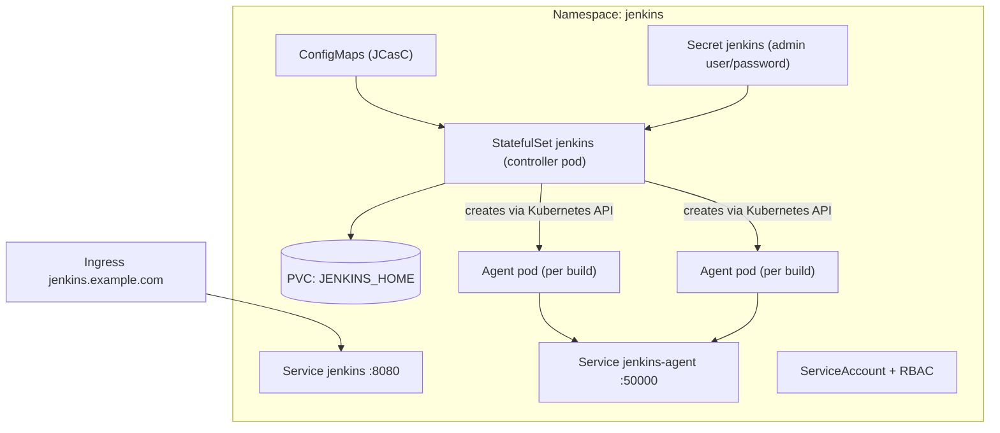

# Installing Jenkins on Kubernetes

## Introduction

If your applications already run on Kubernetes, running Jenkins there too is a natural step. The controller becomes one more workload with a persistent volume, and, more importantly, **every build can get a fresh pod** that is created when the build starts and deleted when it ends. No more snowflake build servers with leftover files from last week.

A good analogy is a restaurant kitchen. The controller is the head chef who reads orders and assigns work. On a VM installation the chef has a fixed number of cooks standing around all day. On Kubernetes the chef calls in a cook with exactly the right tools for each order, and the cook leaves as soon as the dish is done.

The official way to install Jenkins on Kubernetes is the **`jenkinsci/jenkins` Helm chart**. In this page you will:

1. Install the chart into a `jenkins` namespace.
2. Write a `values.yaml` that pins the image, sizes the controller, and configures persistence.
3. Configure Jenkins itself with JCasC from the same values file.
4. Expose Jenkins through an Ingress.
5. Understand how the chart wires up Kubernetes pod agents.

You should be comfortable with `kubectl` and basic Kubernetes objects. If not, read the [Kubernetes tutorial](/docs/devops/kubernetes) first.

## What the Chart Deploys



Key points:

- The controller runs as a **StatefulSet with one replica**. Jenkins does not support multiple active controllers sharing one home directory, so the controller is still a single pod. Kubernetes restarts it if it dies, but builds running at that moment are interrupted. [High Availability and Scaling](../12-jenkins-administration/5-jenkins-high-availability.mdx) discusses this limitation honestly.
- A **sidecar container** watches ConfigMaps and reloads JCasC configuration when you change it.
- The chart installs the **`kubernetes` plugin** and configures a Kubernetes "cloud" so pipelines can run in pods. [Kubernetes Pod Agents](../6-jenkins-agents/4-jenkins-kubernetes-agents.mdx) covers pod templates in depth.

## Step 1: Add the Repository and Look Around

```bash
helm repo add jenkinsci https://charts.jenkins.io
helm repo update
helm search repo jenkinsci/jenkins
```

Example output:

```text
NAME                CHART VERSION   APP VERSION   DESCRIPTION
jenkinsci/jenkins   5.9.68          2.580.1       Jenkins - Build great things at any scale! ...
```

The chart version and app version (the Jenkins version) change frequently. Check the [chart source](https://github.com/jenkinsci/helm-charts/tree/main/charts/jenkins) and its `CHANGELOG.md` before upgrading.

See all configurable values with:

```bash
helm show values jenkinsci/jenkins > default-values.yaml
wc -l default-values.yaml
```

Example output (the number varies by chart version):

```text
1400 default-values.yaml
```

The file is long because the chart is very configurable. You only override what you need.

## Step 2: The Quickest Possible Install

For a throwaway lab cluster (kind, minikube or k3d):

```bash
kubectl create namespace jenkins
helm install jenkins jenkinsci/jenkins -n jenkins
kubectl -n jenkins rollout status statefulset/jenkins
```

Example output:

```text
Waiting for 1 pods to be ready...
partitioned roll out complete: 1 new pods have been updated...
```

Get the generated admin password. The chart stores it in a Secret named after the release:

```bash
kubectl get secret -n jenkins jenkins \
  -o jsonpath="{.data.jenkins-admin-password}" | base64 --decode; echo
```

Example output:

```text
Xk3pQ9vB7mL2rT8nW4cZ1d
```

Port-forward the service and log in as `admin`:

```bash
kubectl -n jenkins port-forward svc/jenkins 8080:8080
```

Open `http://127.0.0.1:8080`. Notice there is **no setup wizard**: the chart configures security and the admin user through JCasC, so the instance is ready to use.

## Step 3: A Production-Style values.yaml

The defaults are fine for a lab, but in production you want to pin versions and be explicit. Create `jenkins-values.yaml`:

```yaml
controller:
  image:
    repository: jenkins/jenkins
    tag: "2.580.1-lts-jdk21"     # pin the exact LTS release
  admin:
    existingSecret: jenkins-admin # created separately, not stored in Git
    userKey: username
    passwordKey: password
  resources:
    requests:
      cpu: "1"
      memory: "2Gi"
    limits:
      memory: "4Gi"
  javaOpts: "-XX:InitialRAMPercentage=50.0 -XX:MaxRAMPercentage=75.0"
  numExecutors: 0                 # never build on the controller
  installLatestPlugins: false     # only what we list below
  installPlugins:
    - kubernetes
    - workflow-aggregator
    - git
    - configuration-as-code
    - pipeline-graph-view
    - credentials-binding
    - timestamper
  JCasC:
    defaultConfig: true
    configScripts:
      welcome: |
        jenkins:
          systemMessage: "Managed by Helm and JCasC. Changes in the UI will be overwritten."
      location: |
        unclassified:
          location:
            url: "https://jenkins.example.com/"
            adminAddress: "ci-team@example.com"
  ingress:
    enabled: true
    ingressClassName: nginx
    hostName: jenkins.example.com
    annotations:
      cert-manager.io/cluster-issuer: letsencrypt
    tls:
      - secretName: jenkins-tls
        hosts:
          - jenkins.example.com

persistence:
  enabled: true
  size: 50Gi
  storageClass: ""               # empty uses the cluster default

agent:
  enabled: true
  resources:
    requests:
      cpu: "500m"
      memory: "512Mi"
    limits:
      memory: "1Gi"
```

A few notes on these values:

| Value | Why it matters |
| --- | --- |
| `controller.image.tag` | Pins Jenkins so `helm upgrade` does not jump LTS lines unexpectedly |
| `controller.admin.existingSecret` | Keeps the admin password out of the values file and Git |
| `controller.installLatestPlugins: false` | Prevents dependency resolution from pulling newer plugin versions than you tested |
| `controller.installPlugins` | Plugins installed at startup. You can pin with `id:version`, for example `git:5.10.1`, as the chart's own defaults do |
| `controller.numExecutors: 0` | Keeps builds off the controller pod |
| `controller.JCasC.configScripts` | Each key becomes a JCasC YAML file; the sidecar reloads changes |
| `persistence.size` | Default is 8Gi, which fills up fast with build history |

:::caution Check value names against your chart version
The chart evolves, and occasionally keys are renamed or restructured. Always diff your file against `helm show values jenkinsci/jenkins` for the chart version you install. The [chart README](https://github.com/jenkinsci/helm-charts/blob/main/charts/jenkins/README.md) lists breaking changes per major version.
:::

Create the admin secret first, then install:

```bash
kubectl create namespace jenkins
kubectl -n jenkins create secret generic jenkins-admin \
  --from-literal=username=admin \
  --from-literal=password="$(openssl rand -base64 24)"

helm upgrade --install jenkins jenkinsci/jenkins \
  -n jenkins -f jenkins-values.yaml --version 5.9.68
```

Example output:

```text
Release "jenkins" does not exist. Installing it now.
NAME: jenkins
LAST DEPLOYED: Sat Oct 10 10:42:17 2026
NAMESPACE: jenkins
STATUS: deployed
REVISION: 1
NOTES:
1. Get your 'admin' user password by running: ...
```

Using `helm upgrade --install` with `--version` makes the command idempotent and pinned, so you can run it from a pipeline or a GitOps tool such as Argo CD.

### Plugins: Startup Install vs a Custom Image

Installing plugins at pod startup means every restart downloads them from the update center. That is slow and fails if the update center is unreachable. Many teams instead build a custom image with plugins baked in (as in [Installing Jenkins with Docker](./0-jenkins-install-docker.mdx)) and set:

```yaml
controller:
  image:
    registry: registry.example.com
    repository: platform/jenkins
    tag: "2.580.1-1"
  installPlugins: false
```

| Approach | Pros | Cons |
| --- | --- | --- |
| `installPlugins` in values | Simple, everything in one file | Slower startup, depends on the update center at runtime |
| Custom image with plugins | Fast, offline-capable, tested as one artifact | You need an image build pipeline and registry |

## Step 4: Verify Agents Work

The chart configures a Kubernetes cloud named `kubernetes` with a default pod template. Create a Pipeline job with this Jenkinsfile:

```groovy
pipeline {
    agent {
        kubernetes {
            yaml '''
apiVersion: v1
kind: Pod
spec:
  containers:
  - name: maven
    image: maven:3.9-eclipse-temurin-21
    command: ["sleep"]
    args: ["infinity"]
'''
            defaultContainer 'maven'
        }
    }
    stages {
        stage('Check') {
            steps {
                sh 'mvn -version'
                sh 'hostname'
            }
        }
    }
}
```

While it runs, watch pods appear and disappear:

```bash
kubectl -n jenkins get pods -w
```

Example output:

```text
NAME                         READY   STATUS              RESTARTS   AGE
jenkins-0                    2/2     Running             0          12m
k8s-demo-1-8xq7r-0k2fd-1lzm  0/2     ContainerCreating   0          1s
k8s-demo-1-8xq7r-0k2fd-1lzm  2/2     Running             0          6s
k8s-demo-1-8xq7r-0k2fd-1lzm  2/2     Terminating         0          21s
```

Each agent pod has two containers: your `maven` container and the `jnlp` container that connects back to the controller. The pod is deleted when the build finishes.

## Step 5: Upgrading and Day-2 Operations

```bash
# Change the image tag in jenkins-values.yaml, then:
helm diff upgrade jenkins jenkinsci/jenkins -n jenkins -f jenkins-values.yaml  # needs the helm-diff plugin
helm upgrade jenkins jenkinsci/jenkins -n jenkins -f jenkins-values.yaml --version 5.9.68
helm history jenkins -n jenkins
helm rollback jenkins 1 -n jenkins
```

`helm rollback` restores the Kubernetes objects, but **not** the contents of `JENKINS_HOME`. If a new Jenkins version migrated data on disk, rolling back the image may not be enough. Snapshot the persistent volume before upgrades; see [Upgrading Jenkins and LTS Releases](./6-jenkins-upgrading.mdx) and [Backup and Restore](../12-jenkins-administration/2-jenkins-backup-and-restore.mdx).

### Other Installation Options

- **Plain manifests.** The official docs also show a hand-written Deployment, Service, ServiceAccount and PersistentVolume. It is good for learning but you take over all maintenance.
- **Jenkins Operator.** A Kubernetes operator project exists for managing Jenkins as a custom resource. Check its activity and compatibility with current Jenkins releases before adopting it; the Helm chart is the more widely used path.

## Real-World Scenario

Your platform team runs a shared EKS cluster for 15 product teams. Teams complain that the old Jenkins VM has "works on my agent" problems: one team's Node 18 upgrade broke another team's build. Builds also queue for an hour on Monday mornings because there are only six static executors.

**The solution:**

1. Install the `jenkinsci/jenkins` chart through Argo CD, with the values file in Git and the chart version pinned.
2. Bake plugins into a custom image built by a separate pipeline.
3. Configure all global settings with JCasC under `controller.JCasC.configScripts`.
4. Each team declares its build containers in a pod template inside its Jenkinsfile (or the platform team offers shared templates in a [shared library](../8-jenkins-shared-libraries/0-jenkins-shared-libraries-introduction.mdx)).
5. Agent pods run in a separate namespace with resource quotas so one team cannot starve the others.

**Why this approach:** each build gets a clean, versioned environment, capacity scales with the cluster autoscaler, and the whole controller can be recreated from Git plus a volume backup.

**When to use it:** you already operate Kubernetes well, you have many teams with different toolchains, and build load is spiky.

**When not to use it:** you do not have Kubernetes expertise (operating a cluster just for Jenkins is a big tax), builds need special hardware or GUI sessions, or builds need privileged Docker access that your cluster policies forbid.

| Approach | Pros | Cons | Best for |
| --- | --- | --- | --- |
| Helm chart on Kubernetes | Ephemeral pod agents, autoscaling, GitOps-friendly | Controller is still one pod; Kubernetes skills required; Docker builds need extra tools (Kaniko, BuildKit) | Kubernetes-native organizations |
| VM with static agents | Simple mental model, full OS access | Agents drift; capacity is fixed | Small teams, special hardware |
| VM controller + Kubernetes agents | Controller on stable VM, builds in pods | Two systems to operate, network between them | Teams moving to Kubernetes gradually |
| Managed CI service | No controller to run | Less customization; usage-based cost | Teams without Jenkins-specific needs |

## Common Mistakes

1. **Using the default 8Gi volume in production.** Build logs and artifacts fill it, and a full disk makes Jenkins unstable. Size it generously, and configure build discarders.
2. **Unpinned chart and image.** `helm upgrade` without `--version` can jump to a new major chart version with breaking value changes.
3. **Editing configuration in the UI.** JCasC from the chart overwrites it on reload. Change the values file instead.
4. **Admin password in the values file in Git.** Use `controller.admin.existingSecret` or an external secrets operator.
5. **No resource requests on agent pods.** The scheduler packs too many builds on one node, and builds get OOM-killed.
6. **Assuming Kubernetes makes Jenkins highly available.** It restarts the pod, but there is still one controller and running builds are lost.
7. **Mounting the node's Docker socket into agent pods to build images.** Modern clusters often use containerd without a Docker socket, and it is a security risk anyway. Use daemonless builders; see [Building and Pushing Docker Images](../9-jenkins-build-and-test/7-jenkins-docker-image-builds.mdx).

## Summary

- Install with `helm repo add jenkinsci https://charts.jenkins.io` and `helm upgrade --install jenkins jenkinsci/jenkins`.
- The controller is a single-replica StatefulSet with a PVC for `JENKINS_HOME`; agents are pods created per build by the `kubernetes` plugin.
- The chart configures security through JCasC, so there is no setup wizard; read the admin password from the release Secret.
- Pin the chart version and `controller.image.tag`, keep the admin password in an existing Secret, and size persistence realistically.
- Configure Jenkins through `controller.JCasC.configScripts` and consider baking plugins into a custom image.
- `helm rollback` does not roll back `JENKINS_HOME`; snapshot the volume before upgrades.

## Exercises

1. Install the chart on a local kind or minikube cluster with default values. Read the admin password from the Secret and log in through `kubectl port-forward`.
2. Add a `configScripts` entry that sets a system message, run `helm upgrade`, and watch the message appear without restarting the controller pod.
3. Run the Maven pod example and watch the agent pod with `kubectl get pods -w`. Then add a second container (for example `node:22`) and use the `container('node')` step to run `node --version`.
4. Pin all plugins to explicit versions, set `installLatestPlugins: false`, and explain what could go wrong if you left versions unpinned.

**Next steps:** read [Kubernetes Pod Agents](../6-jenkins-agents/4-jenkins-kubernetes-agents.mdx) for pod templates, and [Configuration as Code (JCasC)](../12-jenkins-administration/0-jenkins-configuration-as-code.mdx) to manage the rest of the configuration.
