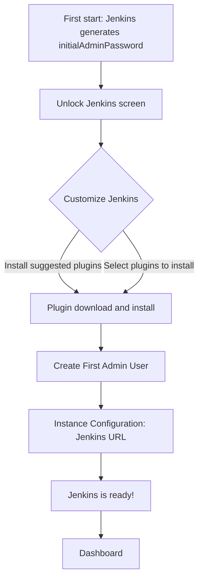

# Initial Setup Wizard

## Introduction

The first time a fresh Jenkins controller starts, it does not let anyone in. Instead it shows the **setup wizard**, a short one-time process that:

1. Proves you are the person who installed Jenkins (unlocking).
2. Installs an initial set of plugins.
3. Creates the first administrator account.
4. Records the URL that Jenkins should use for links.

It is like the first-boot screen of a new phone: language, Wi-Fi, account, done. You only see it once, but the choices you make here shape the instance for a long time, especially the plugin selection.

This page walks through each screen, explains what each choice really means, and then shows how to **skip the wizard entirely** with Configuration as Code, which is what you will want for any instance you might need to rebuild.

You should already have Jenkins running with [Docker](./0-jenkins-install-docker.mdx) or on [Linux](./1-jenkins-install-linux.mdx). The [Helm chart](./2-jenkins-install-kubernetes.mdx) skips the wizard for you.

## The Wizard at a Glance



## Step 1: Unlock Jenkins

Open `http://localhost:8080` (or your server's address). You will see **Unlock Jenkins** with a field for the administrator password.

Jenkins wrote a random password to a file inside `JENKINS_HOME` and to its log. Read it with the command that matches your installation:

```bash
# Docker
docker exec jenkins cat /var/jenkins_home/secrets/initialAdminPassword

# Linux package
sudo cat /var/lib/jenkins/secrets/initialAdminPassword

# Plain WAR file
cat ~/.jenkins/secrets/initialAdminPassword
```

Example output:

```text
8e1f2c3a4b5d6e7f8091a2b3c4d5e6f7
```

Paste it and click **Continue**.

**Why this step exists:** a freshly started Jenkins is reachable by anyone on the network. Before the unlock step was added (Jenkins 2.0, 2016), new instances started with security disabled by default, and exposed, unprotected instances were a recurring problem. Requiring a secret that only someone with file or log access can read closes that window.

:::caution Treat the unlock password as a credential
Anyone who reads it before you can take over the instance. Do not paste it into chat, and do not leave a new instance unlocked on a public network. Once you create an admin user, the file is no longer used.
:::

## Step 2: Customize Jenkins (Plugins)

You get two choices:

- **Install suggested plugins.** A curated set chosen by the Jenkins project.
- **Select plugins to install.** The same list with checkboxes, plus categories you can browse. You can also click **None** to start with nothing.

### What "Suggested" Installs

The suggested list is defined in Jenkins core and changes over time. At the time of writing it includes:

| Category | Suggested plugins (IDs) |
| --- | --- |
| Organization and administration | `cloudbees-folder`, `antisamy-markup-formatter` |
| Build features | `build-timeout`, `credentials-binding`, `timestamper`, `ws-cleanup` |
| Build tools | `ant`, `gradle` |
| Pipelines and continuous delivery | `workflow-aggregator`, `github-branch-source`, `pipeline-github-lib`, `pipeline-graph-view` |
| Source code management | `git` |
| Distributed builds | `ssh-slaves` (the SSH Build Agents plugin) |
| User management and security | `matrix-auth`, `ldap` |
| Notifications and publishing | `email-ext`, `mailer` |
| Appearance | `dark-theme` |

Each of these pulls in dependencies, so the final count of installed plugins is several times larger than this table.

Notice what is **not** there: Blue Ocean. Blue Ocean is no longer actively developed, and the suggested list now includes **Pipeline Graph View** (`pipeline-graph-view`) for visualizing pipelines. You will see it in the [UI tour](./4-jenkins-ui-tour.mdx).

### Suggested or Custom?

| Choice | Pros | Cons | Best for |
| --- | --- | --- | --- |
| Install suggested plugins | Fast, sensible defaults, works for tutorials | Installs things you may never use (Ant, LDAP) | Learning, first instance |
| Select plugins, minimal set | Smaller attack surface, fewer updates to track | You must know what you need | Teams that already know their stack |
| Select **None**, then plugins as code | Fully reproducible | Most upfront work | Production, rebuildable instances |

Every plugin is code running inside your controller with full access to it. More plugins mean more security advisories to follow and more chances of dependency conflicts during upgrades. [Avoiding Plugin Sprawl and Dependency Problems](../7-jenkins-plugins/2-jenkins-plugin-dependency-hell.mdx) explains this in depth. For learning, choose suggested; for production, start minimal.

### When Plugin Downloads Fail

The wizard downloads plugins from the Jenkins update center (`updates.jenkins.io`). Behind a corporate proxy or firewall, downloads fail with errors such as:

```text
java.net.UnknownHostException: updates.jenkins.io
```

Fixes, in order of preference:

1. Configure the HTTP proxy in **Manage Jenkins > Plugins > Advanced settings** (you may need to skip plugin installation first, create the admin user, and then come back).
2. Allow outbound HTTPS to `updates.jenkins.io` and `get.jenkins.io` (plus their mirrors).
3. For air-gapped networks, build a custom image with plugins baked in using `jenkins-plugin-cli` on a machine that does have access, as shown in [Installing Jenkins with Docker](./0-jenkins-install-docker.mdx).

## Step 3: Create the First Admin User

Enter a username, password, full name and email. This account is stored in Jenkins' **own user database** and gets full administrator rights.

Practical advice:

- Use a strong, unique password and store it in your password manager. Recent Jenkins releases also enforce password rules for the built-in user database; if a password is rejected, the form explains why.
- Use a real email address; notifications and password-related messages use it.
- Plan to replace this local account with your company's identity provider later (LDAP, SAML, OIDC). See [Authentication and SSO](../11-jenkins-security/1-jenkins-authentication.mdx). Keep one local break-glass admin account only if your security policy allows it.

You can click **Skip and continue as admin**, which keeps the generated password as the `admin` user's password. That is fine for a disposable lab and a bad idea everywhere else, because the "password" is a random string in a file you will eventually lose track of.

## Step 4: Instance Configuration

The last screen asks for the **Jenkins URL**, prefilled with the address you used in the browser (for example `http://localhost:8080/`).

This value matters more than it looks. Jenkins uses it to build absolute links in:

- email and chat notifications ("Build failed, see ...")
- commit status links on GitHub and GitLab
- agent connection instructions
- the `BUILD_URL` and `JENKINS_URL` environment variables in builds

If you will put Jenkins behind a reverse proxy with a real domain name, enter that, for example `https://jenkins.example.com/`. You can change it later in **Manage Jenkins > System**; see [System Configuration](./5-jenkins-system-configuration.mdx).

Click **Save and Finish**, then **Start using Jenkins**. If the final page says "Jenkins is almost ready!", click **Restart** so newly installed plugins load.

## What the Wizard Actually Changed

After the wizard, `JENKINS_HOME` contains a few new files worth knowing about:

```bash
docker exec jenkins ls /var/jenkins_home
```

Example output:

```text
config.xml
hudson.plugins.git.GitTool.xml
jenkins.install.InstallUtil.lastExecVersion
jenkins.install.UpgradeWizard.state
jenkins.model.JenkinsLocationConfiguration.xml
jobs
nodes
plugins
secrets
updates
userContent
users
```

| File or folder | Meaning |
| --- | --- |
| `config.xml` | Main configuration, including the security realm and authorization strategy |
| `jenkins.model.JenkinsLocationConfiguration.xml` | The Jenkins URL and admin email |
| `jenkins.install.InstallUtil.lastExecVersion` | The version that completed setup; its presence stops the wizard from running again |
| `users/` | The admin user you created, with a hashed password |
| `plugins/` | Installed plugins (`.jpi` files and exploded folders) |
| `secrets/` | Encryption keys for stored credentials. Back them up and protect them |

The wizard sets two important security defaults in `config.xml`: the security realm is **Jenkins' own user database**, and authorization is **"Logged-in users can do anything"**, with anonymous read access disabled. That is acceptable for a single-team instance and too broad for a shared one; see [Authorization and Role-Based Access](../11-jenkins-security/2-jenkins-authorization.mdx).

## Skipping the Wizard with Configuration as Code

Clicking through a wizard is not reproducible. If the controller dies, nobody remembers which boxes were ticked. The professional setup is:

1. Bake plugins into the image ([Managing Plugins as Code](../7-jenkins-plugins/3-jenkins-plugin-installation-manager.mdx)).
2. Describe configuration in a JCasC YAML file ([Configuration as Code](../12-jenkins-administration/0-jenkins-configuration-as-code.mdx)).
3. Disable the wizard with the system property `jenkins.install.runSetupWizard=false`.

A minimal `casc.yaml` that recreates what the wizard did:

```yaml
jenkins:
  systemMessage: "Configured by JCasC"
  numExecutors: 0
  securityRealm:
    local:
      allowsSignup: false
      users:
        - id: "admin"
          name: "Jenkins Admin"
          password: "${JENKINS_ADMIN_PASSWORD}"
  authorizationStrategy:
    loggedInUsersCanDoAnything:
      allowAnonymousRead: false

unclassified:
  location:
    url: "http://localhost:8080/"
    adminAddress: "ci-admin@example.com"
```

The `${JENKINS_ADMIN_PASSWORD}` value is resolved by JCasC from an environment variable (or a secrets file), so the password never appears in Git.

A `Dockerfile` that puts it together:

```dockerfile
FROM jenkins/jenkins:2.580.1-lts-jdk21

RUN jenkins-plugin-cli --plugins configuration-as-code git workflow-aggregator pipeline-graph-view

COPY casc.yaml /var/jenkins_home/casc_configs/casc.yaml
ENV CASC_JENKINS_CONFIG=/var/jenkins_home/casc_configs/casc.yaml
ENV JAVA_OPTS="-Djenkins.install.runSetupWizard=false"
```

Build and run:

```bash
docker build -t jenkins-casc:dev .
docker run -d --name jenkins-casc -p 8080:8080 \
  -e JENKINS_ADMIN_PASSWORD='change-me-please-123!' \
  jenkins-casc:dev
docker logs jenkins-casc 2>&1 | grep -i "fully up"
```

Example output:

```text
INFO	hudson.lifecycle.Lifecycle#onReady: Jenkins is fully up and running
```

Open `http://localhost:8080` and log in as `admin` directly. No unlock screen, no plugin screen, and the same result every time.

:::warning Never disable the wizard without configuring security
If you set `runSetupWizard=false` and provide no security realm, you can end up with an instance that has security wide open. Always ship a JCasC file with `securityRealm` and `authorizationStrategy` together with the property.
:::

## Verifying the Setup from the Command Line

After the wizard (or JCasC) finishes, check that the instance answers authenticated API calls. Create an **API token** for your admin user (click your name in the top right, then **Security**, then **Add new Token**) and call the JSON API:

```bash
curl -s -u admin:YOUR_API_TOKEN \
  "http://localhost:8080/api/json?tree=mode,numExecutors,useSecurity"
```

Example output:

```text
{"_class":"hudson.model.Hudson","mode":"NORMAL","numExecutors":2,"useSecurity":true}
```

An anonymous call should be rejected:

```bash
curl -s -o /dev/null -w "%{http_code}\n" http://localhost:8080/api/json
```

Example output:

```text
403
```

A `403` here is good news: anonymous users cannot read the instance. If you get `200`, anonymous read access is enabled, and you should review [Authorization and Role-Based Access](../11-jenkins-security/2-jenkins-authorization.mdx). The [REST API and CLI](../12-jenkins-administration/8-jenkins-rest-api-and-cli.mdx) page covers the API in detail.

## Troubleshooting the Wizard

| Symptom | Likely cause | Fix |
| --- | --- | --- |
| `initialAdminPassword` file does not exist | Setup already completed, or the wizard is disabled | Log in with the admin account you created; check `JAVA_OPTS` for `runSetupWizard=false` |
| Stuck on "Getting Started" with failed plugins | No access to the update center | Configure the proxy, then retry from **Manage Jenkins > Plugins** |
| Some plugins show "Failed" with dependency errors | Mirror or update center glitch, or a Jenkins version too old for the latest plugins | Click **Retry**; if it persists, upgrade Jenkins to the current LTS first |
| Wizard appears again after a restart | `JENKINS_HOME` is not persisted (no volume), so Jenkins starts fresh every time | Mount a volume (Docker) or check the `JENKINS_HOME` path (Linux) |
| Forgot the admin password | Local user database account | Stop Jenkins and reset it following the official [lost password guidance](https://www.jenkins.io/doc/book/security/access-control/disable/), or reapply a JCasC file with a new password |

The most common one by far is the fourth. If the wizard keeps coming back, your data is not being saved, which means your jobs would be lost too.

## Real-World Scenario

You are the first DevOps hire at a 30-person startup. You need Jenkins this week for a demo, but you also know it will become critical infrastructure.

**The solution:**

- **Day 1:** run the Docker image, use the wizard with **Install suggested plugins**, and create a real admin account with a strong password. Set the Jenkins URL to the DNS name you will use later, not `localhost`.
- **Week 2:** export the current plugin list and configuration (**Manage Jenkins > Configuration as Code > View Configuration** shows the YAML once the plugin is installed). Trim plugins you do not use.
- **Week 3:** move to an image with `plugins.txt` and `casc.yaml` in Git, with `runSetupWizard=false`. Rebuild the instance from scratch on a test host to prove it works.

**Why this approach:** the wizard is the fastest way to a working instance, and nothing you click is lost because JCasC can export it. You get speed now and reproducibility soon.

**When to use the wizard:** learning, demos, short-lived instances, and as a discovery tool to see what settings exist.

**When not to:** any instance you would need to rebuild after a disk failure, or any time you create more than one instance (per-team controllers, staging copies).

| Approach | Pros | Cons | Best for |
| --- | --- | --- | --- |
| Wizard with suggested plugins | Fastest, no knowledge needed | Many plugins, not reproducible | Learning, demos |
| Wizard with minimal plugins | Smaller footprint | Still manual, not reproducible | Single long-lived instance with a careful admin |
| JCasC + plugins in image, wizard disabled | Reproducible, reviewable, rebuildable | Upfront effort, must handle secrets | Production and multiple instances |
| Helm chart (wizard skipped automatically) | JCasC built in | Requires Kubernetes | Kubernetes shops |

## Common Mistakes

1. **"Skip and continue as admin" on a real instance.** You later cannot remember the password. Create a proper account.
2. **Leaving `localhost` as the Jenkins URL.** Links in notifications and commit statuses break for everyone else.
3. **Installing every plugin that looks interesting.** Each one is a maintenance and security commitment.
4. **Losing the `secrets/` folder.** Credentials stored in Jenkins are encrypted with keys there; a backup without it cannot decrypt them.
5. **Re-running the wizard by deleting files.** If you need a fresh start, start a fresh `JENKINS_HOME`, rather than deleting state files by hand.
6. **Disabling the wizard without a security realm.** Always configure `securityRealm` and `authorizationStrategy` in JCasC.

## Summary

- The wizard unlocks Jenkins with the one-time `initialAdminPassword`, installs plugins, creates the first admin, and sets the Jenkins URL.
- The suggested plugins are a good learning default; production instances should start minimal.
- Pipeline Graph View, not Blue Ocean, is the current suggested pipeline visualization.
- Set the Jenkins URL to the real public address from day one.
- For reproducible instances, disable the wizard with `-Djenkins.install.runSetupWizard=false` and configure security and plugins as code.

## Exercises

1. Run the wizard twice in fresh containers: once with suggested plugins and once with **None**. Compare the number of plugins in **Manage Jenkins > Plugins > Installed plugins**.
2. After completing the wizard, open `config.xml` in `JENKINS_HOME` and find the `securityRealm` and `authorizationStrategy` elements.
3. Build the JCasC image above, start it with a different `JENKINS_ADMIN_PASSWORD`, and log in. Then remove the `securityRealm` block and observe what happens (on a local machine only).
4. Write down which three suggested plugins you would remove for a team that only builds Node.js projects from GitHub, and why.

**Next steps:** take the [Tour of the Jenkins UI](./4-jenkins-ui-tour.mdx), then review [System Configuration](./5-jenkins-system-configuration.mdx).
