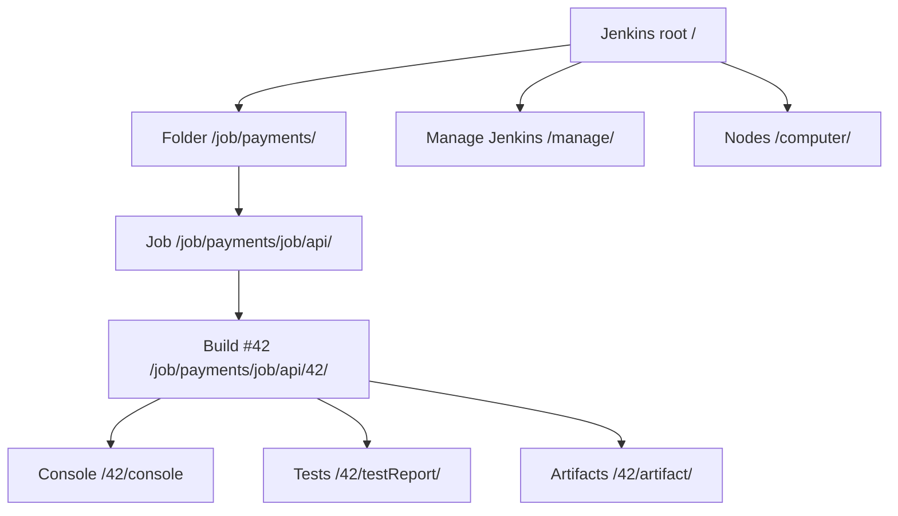
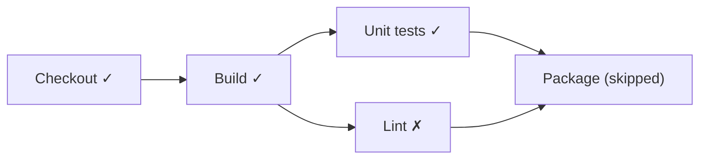

# Tour of the Jenkins UI

## Introduction

The first time you log in to Jenkins, the UI can feel like a large office building without signs. There are menus on the left, links on every page, and a **Manage Jenkins** area with dozens of entries. The good news is that the UI follows a small number of consistent patterns. Once you see them, every page becomes predictable.

The key idea is that **Jenkins is organized as a tree of objects, and the URL mirrors that tree**. A folder contains jobs, a job contains builds, a build contains console output, test results and artifacts. Each object has its own page with a side panel of actions for that object.



This page tours the main areas you will use daily. The screens shown are those of a recent LTS release (2.580.x); the Jenkins UI has been modernized steadily over the last few years, so older instances may look different, but the structure is the same.

## The Dashboard

The dashboard (the root URL `/`) is your home page. It has four parts:

| Area | What it shows |
| --- | --- |
| Top bar | Jenkins logo (link home), search box, notifications/administrative monitors, your user menu |
| Breadcrumbs | Where you are in the tree, for example `Dashboard > payments > api > #42`. Each crumb has a dropdown with shortcuts |
| Side panel | Actions for the current object: **New Item**, **Build History**, **Manage Jenkins**, **My Views** |
| Main area | A **view**: a table of jobs with status, weather, last success, last failure and duration |

### Status Icons and Weather

Each job row shows two icons:

- **Status** of the last build: green check (success), red cross (failure), yellow/orange warning (unstable, usually failing tests), grey (not built or aborted). An animated icon means a build is running.
- **Weather**: a summary of recent build health. Sunny means the recent builds mostly passed; stormy means most recent builds failed. It is a quick way to spot chronically flaky jobs.

### Views

A view is a filtered list of jobs. The default view is **All**. Click **+** next to the tabs to create a **List View** that filters jobs by name or regular expression, for example all jobs matching `payments-.*`.

Views are handy, but in larger instances **folders** organize jobs better: they also scope credentials and permissions. Folders come from the `cloudbees-folder` plugin, which the setup wizard suggests.

## Creating Your First Item

Click **New Item**. You will see a name field and a list of item types. The exact list depends on plugins, but typically includes:

| Item type | What it is | Covered in |
| --- | --- | --- |
| Freestyle project | A job configured entirely through UI forms | [Freestyle Jobs](../2-jenkins-jobs/0-jenkins-freestyle-jobs.mdx) |
| Pipeline | A job defined by a Jenkinsfile (inline or from SCM) | [Pipeline Introduction](../3-jenkins-pipeline-basics/0-jenkins-pipeline-introduction.mdx) |
| Multibranch Pipeline | One job per branch and pull request, discovered automatically | [Multibranch Pipelines](../5-jenkins-scm-integration/1-jenkins-multibranch-pipelines.mdx) |
| Folder | A container for other items | This page |
| Organization Folder | Scans a whole GitHub organization or similar | [Organization Folders](../5-jenkins-scm-integration/5-jenkins-organization-folders.mdx) |

Try it now: create a Pipeline item called `hello-ui`, scroll to **Pipeline**, choose **Pipeline script**, and paste:

```groovy
pipeline {
    agent any
    stages {
        stage('Checkout') {
            steps {
                echo 'Pretending to check out code'
            }
        }
        stage('Build') {
            steps {
                sh 'echo "Building on $(hostname)"; sleep 3'
            }
        }
        stage('Test') {
            steps {
                echo 'All tests passed'
            }
        }
    }
}
```

Click **Save**, then **Build Now** in the side panel. You will use this job for the rest of the tour.

:::note
`agent any` runs on whatever executor is free. On a new instance that is the built-in node, which is fine for a tour. In real setups, set the built-in node's executors to 0 and run builds on agents; see [Controller and Agents](../6-jenkins-agents/0-jenkins-controller-and-agents.mdx).
:::

## The Job Page

Open `hello-ui`. The side panel now shows job-level actions:

| Action | What it does |
| --- | --- |
| **Status** | The job's overview page |
| **Changes** | Commits included in recent builds |
| **Build Now** / **Build with Parameters** | Start a build (the second appears when the job has parameters) |
| **Configure** | Edit the job |
| **Delete Pipeline** / **Rename** | Manage the job itself |
| **Pipeline Syntax** | The Snippet Generator and reference docs ([Snippet Generator](../3-jenkins-pipeline-basics/9-jenkins-pipeline-syntax-generator.mdx)) |
| **Stages** or **Pipeline Overview** | Graph of recent runs, from the Pipeline Graph View plugin |

Below that, the **Build History** widget lists recent builds with their numbers and timestamps. Builds are numbered sequentially per job: `#1`, `#2`, and so on.

## The Build Page

Click a build number, for example `#1`. This is the page you will open most often, usually because something failed.

| Section | Purpose |
| --- | --- |
| **Console Output** | The full log, live while the build runs. The first place to look when a build fails |
| **Pipeline Overview** | A stage graph with per-stage logs and timing |
| **Changes** | Commits that triggered or are included in this build |
| **Test Result** | Parsed test reports, when a pipeline publishes them with `junit` |
| **Build Artifacts** | Files archived with `archiveArtifacts` |
| **Replay** / **Restart from Stage** | Re-run a pipeline with modified script, or from a specific stage ([Restart from Stage and Replay](../4-jenkins-pipeline-advanced/7-jenkins-restart-and-replay.mdx)) |
| **Parameters** | Values used, if the build was parameterized |

Console Output for the `hello-ui` build looks like this:

```text
Started by user Jenkins Admin
[Pipeline] Start of Pipeline
[Pipeline] node
Running on Jenkins in /var/jenkins_home/workspace/hello-ui
[Pipeline] {
[Pipeline] stage
[Pipeline] { (Checkout)
[Pipeline] echo
Pretending to check out code
[Pipeline] }
[Pipeline] // stage
[Pipeline] stage
[Pipeline] { (Build)
[Pipeline] sh
+ hostname
+ echo Building on 3f1c2a9b7d10
Building on 3f1c2a9b7d10
+ sleep 3
[Pipeline] }
[Pipeline] // stage
...
[Pipeline] End of Pipeline
Finished: SUCCESS
```

The `[Pipeline]` lines are Jenkins narrating each step. The lines starting with `+` are shell commands echoed by `sh` (because Jenkins runs shell with `-x`). The last line is always the build result.

:::tip Reading long logs
For long logs, use **View as plain text** (`/consoleText`) and your browser's search, or download it with `curl`. The `timestamper` plugin adds timestamps to each line, which helps find slow steps.
:::

## Visualizing Pipelines: Pipeline Graph View

For years, Jenkins pipelines were visualized with the **Stage View** plugin and later **Blue Ocean**. Blue Ocean is no longer actively developed and receives only limited maintenance, so do not build new workflows around it.

The current recommendation is the **Pipeline Graph View** plugin (`pipeline-graph-view`), which the setup wizard installs as a suggested plugin. It adds:

- A graph of stages, including parallel branches, on each build page.
- Per-stage logs, so you can click a failed stage and see only its output.
- A **Stages** view on the job page showing recent runs side by side.



That is roughly what a pipeline with a failed parallel branch looks like in the graph view: you see immediately which stage failed without scrolling through the console.

## Manage Jenkins

**Manage Jenkins** (`/manage`) is the administration area, visible only to users with administer permission. Entries are grouped into categories. A typical recent instance shows:

| Category | Entries | What you do there |
| --- | --- | --- |
| System Configuration | System, Tools, Plugins, Nodes, Clouds, Appearance, Configuration as Code (if installed) | Global settings, tool installations, plugin management, agents |
| Security | Security, Credentials, Credential Providers, Users | Authentication, authorization, secrets |
| Status Information | System Information, System Log, Load Statistics, About Jenkins | Diagnostics and versions |
| Troubleshooting | Manage Old Data | Clean up data left by removed plugins |
| Tools and Actions | Reload Configuration from Disk, Jenkins CLI, Script Console, Prepare for Shutdown | Maintenance actions |

Plugins add their own entries, and plugins that have not declared a category appear under **Uncategorized**. Exact names vary slightly between versions.

At the top of Manage Jenkins you may see **administrative monitors**: yellow or red banners for things like available security updates, a misconfigured reverse proxy, or a deprecated plugin. Do not ignore them. Many security problems are announced there first.

:::caution The Script Console is root access
**Script Console** (`/script`) runs arbitrary Groovy inside the controller with full privileges. It is powerful for troubleshooting and dangerous in the wrong hands. Only administrators can use it, which is one of many reasons to limit who is an administrator. See [Script Security and Sandboxing](../11-jenkins-security/5-jenkins-script-security.mdx).
:::

## Nodes and Executors

**Manage Jenkins > Nodes** (`/computer`) lists the built-in node and all agents, with their status, free disk space, and clock difference. The **Build Executor Status** widget on the dashboard's side panel shows each executor and what it is running.

Two things to notice on a fresh instance:

1. The **Built-In Node** has 2 executors by default. That is why `agent any` builds run on the controller.
2. Jenkins shows a warning recommending you not to build on the built-in node. Taking that advice early saves pain later.

## The Build Queue

When you click **Build Now** and nothing seems to happen, look at the **Build Queue** widget in the dashboard's side panel. A queued item shows a clock icon; hover over it (or open the item) to see **why** it is waiting. Typical reasons:

| Message (approximately) | Meaning | What to do |
| --- | --- | --- |
| "Waiting for next available executor" | All matching executors are busy | Wait, add executors or agents |
| "There are no nodes with the label 'docker'" | No agent has the requested label | Fix the label in the Jenkinsfile or label an agent ([Labels, Executors and Scheduling](../6-jenkins-agents/6-jenkins-labels-and-executors.mdx)) |
| "All nodes of label 'linux' are offline" | Agents exist but are disconnected | Check **Nodes** and the agent logs |
| "In the quiet period. Expires in 4 sec" | Jenkins is waiting to batch more triggers | Nothing; it starts shortly |
| "Waiting for next available executor on 'kubernetes'" while a pod starts | A dynamic agent is being provisioned | Check pod events if it takes long |

The queue is also available as JSON, which is useful for alerts when builds wait too long:

```bash
curl -s -u admin:YOUR_API_TOKEN \
  "http://localhost:8080/queue/api/json?tree=items[task[name],why,inQueueSince]"
```

Example output:

```text
{"_class":"hudson.model.Queue","items":[{"inQueueSince":1791627003000,"task":{"_class":"org.jenkinsci.plugins.workflow.job.WorkflowJob","name":"hello-ui"},"why":"Waiting for next available executor"}]}
```

## Configuring a Job: the Configure Page

Every job's **Configure** page uses the same layout: a left-hand list of sections (**General**, **Triggers**, **Pipeline**, and more depending on the job type and plugins) and a long form on the right. A few habits make it less overwhelming:

- Click the **?** icon next to any field for inline help. It is often better than searching the web.
- Use **Apply** to save without leaving the page, and **Save** to save and return.
- For Pipeline jobs, most of the interesting configuration is in the Jenkinsfile, not this form. The form mostly decides **where** the Jenkinsfile comes from (inline script or **Pipeline script from SCM**) and which triggers apply.
- If the job was created by [Job DSL](../12-jenkins-administration/1-jenkins-job-dsl.mdx) or an organization folder, edits here will be overwritten on the next seed or scan.

## Your User Menu

Click your name in the top right:

| Page | Use |
| --- | --- |
| **Account** | Full name, email, description |
| **Appearance** | Theme: light, dark, or follow the system (from the `dark-theme` plugin) |
| **Security** | API tokens for scripts and the CLI, and active sessions |
| **Credentials** | Credentials scoped to your user (rarely needed) |
| **My Views** | Personal views of jobs |
| **Builds** | Builds you started |

Generate an **API token** here instead of using your password in scripts. Tokens can be revoked individually.

## Useful URLs

Because the URL mirrors the object tree, you can navigate faster by typing URLs:

| URL | Goes to |
| --- | --- |
| `/manage` | Manage Jenkins |
| `/manage/pluginManager/` | Plugin manager |
| `/computer/` | Nodes and executors |
| `/job/NAME/lastBuild/console` | Console of the latest build |
| `/job/NAME/lastFailedBuild/` | Latest failed build |
| `/job/NAME/lastBuild/consoleText` | Plain-text log (good for `curl` and `grep`) |
| `/job/NAME/api/json?pretty=true` | The job as JSON (append `/api/json` to almost any page) |
| `/safeRestart` | Restart after running builds finish |
| `/whoAmI/` | Your identity and authorities, useful for debugging permissions |

Example: fetch the result of the last `hello-ui` build from a terminal.

```bash
curl -s -u admin:YOUR_API_TOKEN \
  "http://localhost:8080/job/hello-ui/lastBuild/api/json?tree=number,result,duration"
```

Example output:

```text
{"_class":"org.jenkinsci.plugins.workflow.job.WorkflowRun","duration":4123,"number":1,"result":"SUCCESS"}
```

The search box in the top bar also helps: type a job name and press Enter to jump straight to it.

## Real-World Scenario

You joined a team that uses Jenkins, and on your first day a teammate says "the release pipeline on main is red, can you look?" There are 140 jobs in nested folders.

**How to work it, using only the UI:**

1. Type the job name in the search box, or follow breadcrumbs: `Dashboard > platform > release > main`.
2. On the job page, look at the **Stages** view: is it always the same stage that fails, or random ones? A consistent stage points to a real bug; random ones suggest flaky infrastructure.
3. Open the failed build, then **Pipeline Overview**, and click the red stage to read only its log.
4. Check **Changes** to see which commits were included since the last green build.
5. If it looks like an environment problem, open **Nodes** to see whether the agent that ran it is low on disk or offline.
6. If you need to test a fix to the Jenkinsfile quickly, use **Replay** (if you have permission) instead of pushing several "fix CI" commits.

**Why this approach:** each step narrows the cause using information Jenkins already collected, and none requires admin rights except possibly Replay.

**When not to rely on the UI:** for recurring questions like "which jobs failed last night?", script it with the REST API or build a dashboard. Clicking through 140 jobs every morning does not scale.

| Approach | Pros | Cons | Best for |
| --- | --- | --- | --- |
| Web UI | Visual, no setup, discoverable | Slow for bulk questions | Investigating one build |
| REST API with `curl` | Scriptable, precise | Needs tokens and knowledge of URLs | Automation, reports |
| Jenkins CLI | Scriptable admin tasks | Another tool to install | Admin operations |
| Notifications (Slack, email) | Problems come to you | Noise if not tuned | Teams with many jobs |

## Common Mistakes

1. **Reading only the last lines of the console.** The real error is often higher up; search for `ERROR`, `FAILED` or the first non-zero exit code.
2. **Configuring things in the UI on a JCasC-managed instance.** Your change is overwritten on the next configuration reload. Look for a system message saying the instance is managed as code.
3. **Using passwords in scripts.** Use API tokens from your user's **Security** page.
4. **Ignoring administrative monitors.** Security warnings appear there.
5. **Installing Blue Ocean for visualization on new instances.** Use Pipeline Graph View instead.
6. **Creating hundreds of jobs at the top level.** Use folders from the start; they scope permissions and credentials too.

## Summary

- Jenkins is a tree: folders contain jobs, jobs contain builds, builds contain logs, tests and artifacts. URLs mirror that tree.
- The side panel always shows actions for the current object; breadcrumbs show where you are.
- The build page's **Console Output** and **Pipeline Overview** are where you debug failures.
- **Pipeline Graph View** is the current pipeline visualization; Blue Ocean is no longer actively developed.
- **Manage Jenkins** groups admin pages into categories; the Script Console is effectively root access.
- Append `/api/json` to most pages to get the same data programmatically.

## Exercises

1. Create a folder `sandbox`, move `hello-ui` into it, and note how the URL changes.
2. Make the `Test` stage fail with `sh 'exit 1'`. Find the failure using only Pipeline Overview, then using `consoleText` and `grep`.
3. Generate an API token and write a one-line `curl` command that prints the result of the last build of any job you pass as an argument.
4. Visit `/whoAmI/` as your admin user and as a second, non-admin user. Compare the authorities listed.

**Next steps:** configure global settings in [System Configuration](./5-jenkins-system-configuration.mdx), then learn jobs in [Freestyle Jobs](../2-jenkins-jobs/0-jenkins-freestyle-jobs.mdx) and pipelines in [Pipeline Introduction](../3-jenkins-pipeline-basics/0-jenkins-pipeline-introduction.mdx).
