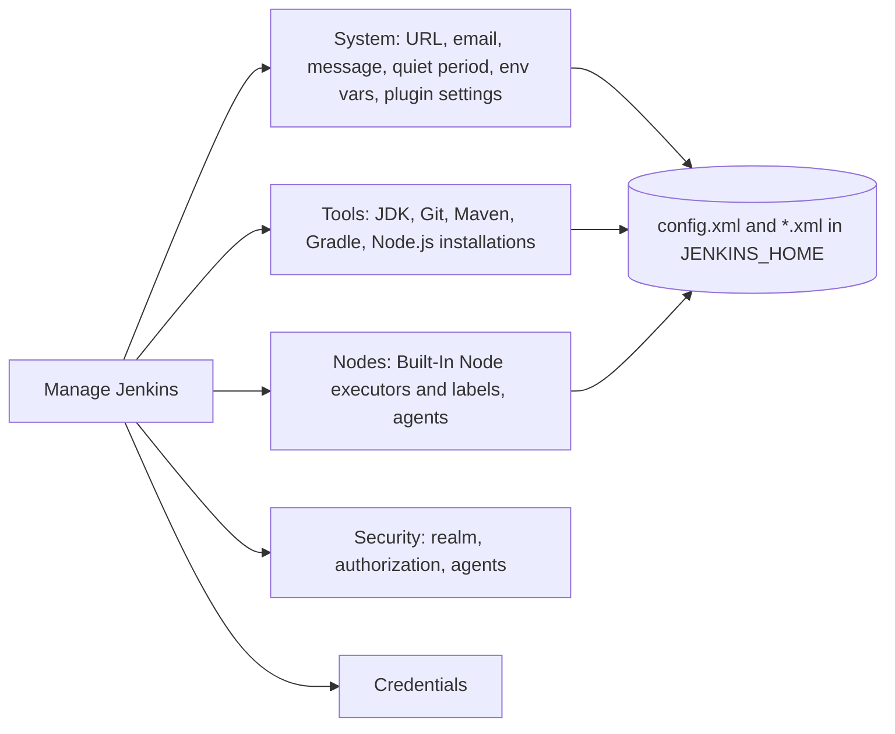

# System Configuration

## Introduction

Once Jenkins is installed and unlocked, a handful of global settings decide how every job behaves: what URL appears in notifications, whether builds run on the controller, which JDK and Maven versions are available, and which environment variables every build sees.

These settings live under **Manage Jenkins**, mainly on the **System** and **Tools** pages, and on the **Built-In Node** configuration. Think of them as the building's shared utilities: water, electricity and the address on the door. Individual apartments (jobs) can customize a lot, but they all depend on these.

In this page you will:

1. Learn the most important fields on **Manage Jenkins > System** and why each matters.
2. Stop builds from running on the controller.
3. Define global environment variables.
4. Register tool installations (JDK, Git, Maven) and use them from a pipeline.
5. Express all of that as Configuration as Code (JCasC) so it is versioned and repeatable.

Security settings (authentication, authorization, CSRF, agent protocols) also live under Manage Jenkins but get their own section: start with the [Jenkins Security Overview](../11-jenkins-security/0-jenkins-security-overview.mdx).

## Where Global Settings Live



Everything you save in these forms ends up as XML files in `JENKINS_HOME`. That is why a backup of `JENKINS_HOME` captures configuration, and why JCasC can generate the same state from YAML.

## The System Page, Field by Field

Open **Manage Jenkins > System** (`/manage/configure`). The page is long, and plugins add their own sections to it. These are the core fields you should know.

### Home Directory

Read-only here. It shows `JENKINS_HOME`, such as `/var/jenkins_home` in Docker or `/var/lib/jenkins` on Linux packages. To change it, set the `JENKINS_HOME` environment variable in the container or the `systemd` unit ([Installing Jenkins on Linux](./1-jenkins-install-linux.mdx)).

### System Message

A banner shown on the dashboard. It accepts formatted text depending on the markup formatter (by default, safe HTML via `antisamy-markup-formatter`). Teams use it for maintenance notices or "This instance is managed by JCasC, do not edit in the UI."

### Quiet Period

How many seconds Jenkins waits after a trigger before starting a build (default 5). If three commits arrive within the quiet period, they are built together in one build. Raise it if developers commonly push several commits in quick succession and builds are expensive; individual jobs can override it.

### SCM Checkout Retry Count

How many times Jenkins retries a failed checkout (default 0). A value of 2 or 3 smooths over transient network errors to your Git server. It does not fix real authentication problems, so do not set it high.

### Jenkins Location

Two fields that are easy to overlook and important to get right:

- **Jenkins URL**: the public base URL, for example `https://jenkins.example.com/`. Used for links in notifications, commit statuses, the `JENKINS_URL` and `BUILD_URL` variables, and agent instructions. Behind a reverse proxy it must match the address users and webhooks use.
- **System Admin e-mail address**: the "from" address for notification emails, for example `Jenkins CI <jenkins@example.com>`.

### Global Properties: Environment Variables

Tick **Environment variables** to define key/value pairs available to every build on every node. Good uses:

- `ARTIFACT_REPO_URL=https://nexus.example.com/repository/maven-releases/`
- `DEFAULT_AWS_REGION=eu-west-1`

Bad uses: secrets. Global variables are visible to anyone who can configure or read builds, and they are printed in plain text by `env` or `printenv`. Use [Credentials](../11-jenkins-security/3-jenkins-credentials.mdx) and `withCredentials` for secrets.

### Usage Statistics

An opt-in checkbox for sending anonymous usage data to the Jenkins project. It is your choice; some organizations disable it by policy.

### Plugin Sections

Below the core fields, plugins add their sections: **Git plugin** (global user name and email for tags), **Global Pipeline Libraries** ([Shared Libraries Introduction](../8-jenkins-shared-libraries/0-jenkins-shared-libraries-introduction.mdx)), **Extended E-mail Notification**, **GitHub** servers, and so on. You configure them as you add the corresponding features.

## Stop Building on the Controller

By default, the **Built-In Node** (the controller itself) has 2 executors. That is convenient for a first build but a bad idea afterwards:

- Builds run as the same OS user as Jenkins and can read `JENKINS_HOME`, including encrypted credentials and their keys.
- A heavy build competes with the web UI and the scheduler for CPU and memory.

Set it to 0 under **Manage Jenkins > Nodes > Built-In Node > Configure** (in older versions this field was on the System page):

| Field | Recommended | Why |
| --- | --- | --- |
| Number of executors | `0` | No builds on the controller |
| Labels | (empty) or `built-in` | Only if you need to target it deliberately |
| Usage | "Only build jobs with label expressions matching this node" | Prevents accidental use if you keep executors |

After this, you need at least one agent before any build can run. See [Controller and Agents](../6-jenkins-agents/0-jenkins-controller-and-agents.mdx). For a quick local lab you can keep the executors; just know that you are cutting a corner.

## Tool Installations

**Manage Jenkins > Tools** registers named installations of build tools. A pipeline can then ask for "maven-3.9" by name, and Jenkins either uses an existing path on the agent or downloads and caches the tool automatically.

Typical entries:

| Tool | Name example | Source |
| --- | --- | --- |
| JDK | `temurin-21` | Path on agents, or an installer such as the Adoptium plugin |
| Git | `Default` | Usually `git` on the agent's `PATH` |
| Maven | `maven-3.9` | "Install automatically" from Apache |
| Gradle | `gradle-8` | "Install automatically" |
| NodeJS | `node-22` | Requires the `nodejs` plugin |

Use them in a pipeline with the `tools` directive:

```groovy
pipeline {
    agent { label 'linux' }
    tools {
        maven 'maven-3.9'
        jdk 'temurin-21'
    }
    stages {
        stage('Versions') {
            steps {
                sh 'java -version'
                sh 'mvn -version'
            }
        }
    }
}
```

Example output:

```text
[Pipeline] sh
+ java -version
openjdk version "21.0.8" 2025-07-15 LTS
[Pipeline] sh
+ mvn -version
Apache Maven 3.9.11
Maven home: /home/jenkins/agent/tools/hudson.tasks.Maven_MavenInstallation/maven-3.9
Java version: 21.0.8, vendor: Eclipse Adoptium
```

The `tools` directive adds each tool's `bin` directory to `PATH` and sets variables like `JAVA_HOME` for the build.

### Tools Directive vs Container Images

There are two ways to get build tools onto an agent, and the choice shapes your whole setup:

| Approach | Pros | Cons | Best for |
| --- | --- | --- | --- |
| Global Tools + `tools` directive | Works on static VM agents; versions named centrally | Tools downloaded per agent; OS packages still needed; drift across agents | VM and SSH agents |
| Container image per build (`agent { docker ... }` or Kubernetes pod) | Exact environment per project, versioned with the code | Needs Docker or Kubernetes agents | Modern containerized setups |
| Pre-baked agent images (VM or AMI) | Fast start, no downloads | Image build pipeline to maintain | Large fleets of cloud agents |

Many teams move from the first to the second over time. See [Docker Agents](../6-jenkins-agents/3-jenkins-docker-agents.mdx).

## Configuration as Code: The Same Settings in YAML

Every setting above can be captured in a JCasC YAML file. If the `configuration-as-code` plugin is installed, **Manage Jenkins > Configuration as Code > View Configuration** shows the YAML for your current instance, which is a great way to learn the keys.

A file covering this page's settings:

```yaml
jenkins:
  systemMessage: "Managed by JCasC. Edit the jenkins-config repository, not the UI."
  numExecutors: 0
  mode: EXCLUSIVE
  quietPeriod: 5
  scmCheckoutRetryCount: 2
  globalNodeProperties:
    - envVars:
        env:
          - key: "ARTIFACT_REPO_URL"
            value: "https://nexus.example.com/repository/maven-releases/"
          - key: "DEFAULT_AWS_REGION"
            value: "eu-west-1"

unclassified:
  location:
    url: "https://jenkins.example.com/"
    adminAddress: "Jenkins CI <jenkins@example.com>"

tool:
  git:
    installations:
      - name: "Default"
        home: "git"
  maven:
    installations:
      - name: "maven-3.9"
        properties:
          - installSource:
              installers:
                - maven:
                    id: "3.9.11"
```

Apply it by pointing `CASC_JENKINS_CONFIG` at the file (or a directory of files) and restarting, or with **Reload existing configuration** on the Configuration as Code page.

Validate the YAML syntax locally before you ship it:

```bash
python3 -c "import yaml,sys; yaml.safe_load(open(sys.argv[1])); print('valid YAML')" jenkins.yaml
```

Example output:

```text
valid YAML
```

That only checks YAML syntax. JCasC itself validates keys when it applies the file and fails loudly on unknown attributes, which is what you want. Always test changes on a non-production instance first.

:::info Key names come from plugins
JCasC keys are derived from the Java classes of Jenkins and its plugins, so they can change when plugins change. Use **View Configuration** and the **Documentation** link on the Configuration as Code page of your own instance as the source of truth. [Configuration as Code (JCasC)](../12-jenkins-administration/0-jenkins-configuration-as-code.mdx) covers this in depth.
:::

## Inspecting Configuration with the Script Console

For a quick read-only check, administrators can query settings in **Manage Jenkins > Script Console**:

```groovy
import jenkins.model.Jenkins
import jenkins.model.JenkinsLocationConfiguration

def j = Jenkins.get()
println "Executors on built-in node: ${j.numExecutors}"
println "Quiet period: ${j.quietPeriod}"
println "Jenkins URL: ${JenkinsLocationConfiguration.get().url}"
```

Example output:

```text
Executors on built-in node: 0
Quiet period: 5
Jenkins URL: https://jenkins.example.com/
```

Prefer reading over writing here. Changes made through the Script Console are invisible to code review and are lost if JCasC reapplies the file.

## Other Global Settings Worth Knowing

The System and Tools pages are where you start, but a few more global settings come up quickly on a new instance:

| Setting | Where | Why you care |
| --- | --- | --- |
| Markup formatter | **Manage Jenkins > Security** | Controls whether descriptions and the system message allow HTML. Safe HTML (OWASP Markup Formatter) is the sensible default; raw HTML allows cross-site scripting by anyone who can edit a description |
| Global Pipeline Libraries | **Manage Jenkins > System** | Registers [shared libraries](../8-jenkins-shared-libraries/0-jenkins-shared-libraries-introduction.mdx) that every pipeline can load |
| Clouds | **Manage Jenkins > Clouds** | Dynamic agents on Kubernetes, Docker hosts or cloud VMs ([Kubernetes Pod Agents](../6-jenkins-agents/4-jenkins-kubernetes-agents.mdx)) |
| Credentials | **Manage Jenkins > Credentials** | Secrets for Git, registries and cloud accounts ([Credentials Management](../11-jenkins-security/3-jenkins-credentials.mdx)) |
| Appearance | **Manage Jenkins > Appearance** | Default theme for users (from the `dark-theme` plugin) |
| HTTP proxy | **Manage Jenkins > Plugins > Advanced settings** | Needed when the controller reaches the internet through a corporate proxy |
| Build discarders | Per job (`buildDiscarder` option), or globally with plugins | Keeps `JENKINS_HOME` from filling up with old builds |

### Build Retention: a Global Problem with a Per-Job Fix

Disk usage is the most common reason a "stable" Jenkins instance falls over. Every build keeps its log, test results and archived artifacts in `JENKINS_HOME` until something deletes them. Jenkins has no global default that keeps only the last N builds; each job decides. The usual fix is to set a discarder in every pipeline:

```groovy
pipeline {
    agent any
    options {
        buildDiscarder(logRotator(numToKeepStr: '30', artifactNumToKeepStr: '5'))
    }
    stages {
        stage('Build') {
            steps {
                echo 'Building...'
            }
        }
    }
}
```

This keeps the last 30 builds and the artifacts of only the last 5. Organizations with many teams usually enforce it through a shared library or pipeline template rather than trusting every Jenkinsfile; see [Pipeline Options and Tuning](../4-jenkins-pipeline-advanced/6-jenkins-pipeline-options.mdx).

Check how much space jobs use on the controller with a quick command:

```bash
docker exec jenkins sh -c 'du -sh /var/jenkins_home/jobs/* | sort -h | tail -5'
```

Example output:

```text
212M	/var/jenkins_home/jobs/payments-api
480M	/var/jenkins_home/jobs/web-frontend
1.3G	/var/jenkins_home/jobs/nightly-integration
2.9G	/var/jenkins_home/jobs/release-pipeline
7.4G	/var/jenkins_home/jobs/mobile-app
```

The biggest jobs are usually the ones archiving large artifacts on every build. Store those in an artifact repository instead, and keep only small reports in Jenkins.

## Real-World Scenario

Your company has three Jenkins controllers (one per business unit) that were configured by hand over the years. A security review finds that two of them still run builds on the controller, the Jenkins URL on one is `http://10.0.4.17:8080/`, and Maven versions differ between them, so the same project builds differently depending on where it runs.

**The solution:**

1. On each controller, open **View Configuration** and save the generated YAML.
2. Merge the common parts into a shared `base.yaml` (URL pattern, `numExecutors: 0`, tool installations, global variables) and keep per-controller differences in small overlay files.
3. Store them in a `jenkins-config` Git repository with pull request review.
4. Deliver the files to each controller (baked into the image, a mounted volume, or a ConfigMap on Kubernetes) and set `CASC_JENKINS_CONFIG` to the directory.
5. Set a system message warning that UI changes will be overwritten.

**Why this approach:** global settings now have one source of truth, every change is reviewed and has an author, and a new controller gets the same configuration in minutes.

**When to use it:** more than one controller, compliance requirements, or any instance you would need to rebuild.

**When not to:** a personal lab where you are still exploring options. Use the UI there, then export once you know what you want.

| Approach | Pros | Cons | Best for |
| --- | --- | --- | --- |
| UI forms | Discoverable, inline help, instant | No history or review, drifts between instances | Learning, one-off changes |
| JCasC YAML in Git | Versioned, reviewable, reproducible | Must learn keys; secrets need handling | Production instances |
| Groovy init scripts (`init.groovy.d`) | Can do anything | Imperative, hard to review, fragile across versions | Rare cases JCasC cannot express |
| Script Console | Fast for inspection | No audit trail, easy to break things | Read-only diagnostics |

## Common Mistakes

1. **Wrong or missing Jenkins URL.** Links in emails, Slack and commit statuses point to `localhost` or an internal IP.
2. **Builds on the built-in node.** Set its executors to 0 and use agents.
3. **Secrets in global environment variables.** They show up in logs and configuration pages; use credentials.
4. **Mixing UI edits with JCasC.** The next reload silently reverts UI changes. Pick one source of truth, and say which in the system message.
5. **Auto-installing tools on every agent without caching.** Each new ephemeral agent downloads Maven or the JDK again. Use container images or pre-baked agents for ephemeral fleets.
6. **High checkout retry counts.** They hide real Git problems and slow down failures. Keep it at 2 or 3.

## Summary

- **Manage Jenkins > System** holds global settings: system message, quiet period, checkout retries, Jenkins URL, admin email, global environment variables, and plugin sections.
- Set the **Jenkins URL** correctly; many integrations depend on it.
- Set the **Built-In Node** executors to 0 so builds run on agents.
- **Manage Jenkins > Tools** registers named JDK, Git, Maven and other installations, used through the `tools` directive.
- Never put secrets in global environment variables.
- Capture all of it as **JCasC YAML** in Git; use **View Configuration** to discover the keys.

## Exercises

1. Set a system message and a global environment variable `TEAM=platform`. Write a pipeline that prints `TEAM` with `sh 'echo $TEAM'`.
2. Register Maven through **Tools** with automatic installation, then build a sample project using the `tools` directive. Find where Jenkins cached the Maven download on the agent.
3. Install `configuration-as-code`, open **View Configuration**, and identify the YAML keys for the settings you changed in exercises 1 and 2.
4. Write a JCasC file that sets `numExecutors: 0`, the Jenkins URL, and one global variable. Start a fresh container with it and verify the settings in the UI.

**Next steps:** learn how to keep the instance current in [Upgrading Jenkins and LTS Releases](./6-jenkins-upgrading.mdx), then move on to [Jobs and Builds](../2-jenkins-jobs/0-jenkins-freestyle-jobs.mdx).
