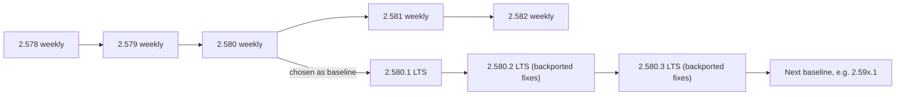
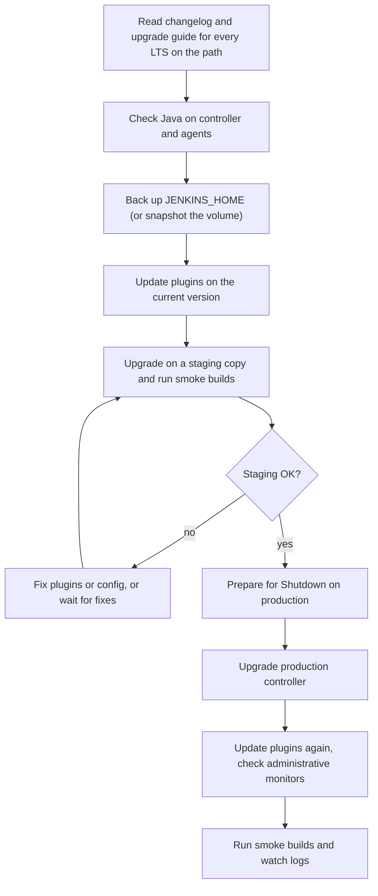

# Upgrading Jenkins and LTS Releases

## Introduction

Jenkins ships a new release every week and a new Long-Term Support (LTS) release every four weeks. Plugins update on their own schedules, and security advisories are published several times a year. If you never upgrade, your instance gradually becomes insecure and incompatible with new plugins. If you upgrade carelessly, you can break every build in the company on a Monday morning.

Upgrading Jenkins is like servicing a car. Skip it and the car eventually fails at the worst moment. Do it on a schedule, with a checklist, and it becomes routine.

In this page you will:

1. Understand the weekly and LTS release lines and their version numbers.
2. Learn how to read the changelog and the upgrade guide.
3. Follow a safe upgrade procedure: backup, staging, plugins, Java, controller.
4. Apply it to Docker, Linux package and Helm installations.
5. Know how to roll back when something goes wrong.

## Weekly vs LTS



| | Weekly | LTS |
| --- | --- | --- |
| Version format | `2.NNN` (for example `2.585`) | `2.NNN.P` (for example `2.580.1`) |
| Cadence | Every week | Every four weeks |
| Content | All new features and fixes | A baseline weekly plus selected, proven backports |
| Risk | Higher; regressions possible | Lower; changes soaked in weekly first |
| Docker tags | `latest`, `jdk21`, `2.585-jdk21` | `lts`, `lts-jdk21`, `2.580.1-lts-jdk21` |
| Linux repo | `pkg.jenkins.io/debian`, `rpm` | `pkg.jenkins.io/debian-stable`, `rpm-stable` |

How LTS works, according to the [LTS release line documentation](https://www.jenkins.io/download/lts/):

- Every **12 weeks** the community picks a recent weekly release as the new **baseline**.
- Each baseline gets **three** LTS releases, `.1`, `.2` and `.3`, published about **four weeks** apart.
- Fixes are backported only after they shipped in a weekly release and proved stable.

So a given LTS line is supported for about three months, and then you move to the next line. "Long-term" means "stable and predictable", not "supported for years".

:::info Current numbers (they change)
At the time of writing the newest LTS line is **2.580.x** (2.580.1 released at the end of September 2026). Check the [stable changelog](https://www.jenkins.io/changelog-stable/) for today's version.
:::

### Which Line Should You Run?

Almost everyone should run **LTS**. Run weekly only if you need a specific fix or feature now, you can tolerate the occasional regression, and you upgrade every week or two. Switching from weekly to LTS is only possible once an LTS release is numerically newer than the weekly you run.

## The Java Requirement

Jenkins periodically raises its minimum Java version. Recent history, from the [Java support policy](https://www.jenkins.io/doc/book/platform-information/support-policy-java/):

| Java | First LTS supporting it | Status |
| --- | --- | --- |
| Java 17 | 2.346.1 (June 2022) | No longer supported; last LTS was 2.541.3 (March 2026) |
| Java 21 | 2.479.1 (October 2024) | Supported; planned end of support September 2027 |
| Java 25 | 2.541.1 (January 2026) | Supported; planned end of support September 2029 |

Since **2.555.1** (April 2026), Jenkins requires Java 21 or 25 on the controller **and on every agent**. If you upgrade the controller but an agent still runs Java 17, that agent will fail to connect. The order is:

1. Upgrade Java on agents (the agent JVM, not necessarily the JDK your builds use).
2. Upgrade Java on the controller (or use an image with the new Java).
3. Upgrade Jenkins.

If a project must build with Java 8, 11 or 17, that is still possible: the agent process runs on Java 21 or 25, and the build uses an older JDK through the `tools` directive or a container image.

Check what Java your controller and agents run from the Script Console:

```groovy
import jenkins.model.Jenkins

println "Controller: ${System.getProperty('java.version')}"
Jenkins.get().computers.each { c ->
    def version
    try {
        version = c.isOnline() ? c.getSystemProperties().get('java.version') : 'offline'
    } catch (Exception e) {
        version = "unknown (${e.class.simpleName})"
    }
    println "${c.displayName}: ${version}"
}
```

Example output:

```text
Controller: 21.0.8
Built-In Node: 21.0.8
linux-agent-1: 21.0.8
win-agent-1: 17.0.12
```

Here `win-agent-1` must be upgraded before you move to an LTS line that requires Java 21. The **Versions Node Monitors** plugin can show this permanently on the Nodes page.

## Reading the Upgrade Guide

The [LTS upgrade guide](https://www.jenkins.io/doc/upgrade-guide/) has one section per LTS line, newest first. Each section lists only the things that need your attention: removed features, changed defaults, plugins that must be updated first, and configuration changes.

Rules for using it:

- Read the section for **every** LTS release between your current version and the target, not just the target.
- Pay special attention to `.1` releases, which start a new line and contain the most change.

Examples of what recent guides contain:

| Release | Notable upgrade notes |
| --- | --- |
| 2.555.1 | Java 21 or 25 required on controller and agents; Java 17 images retired; JCasC users had to remove an obsolete `crumbIssuer` setting before upgrading or Jenkins would not start |
| 2.568.1 | Windows Server 2019 controller images dropped |
| 2.580.1 | Several library plugins (such as bouncycastle API, JAXB, Trilead API, SSH server, Instance Identity) are no longer bundled in the WAR; instances that cannot reach the update center must provide them manually |

These are summaries; always read the full text in the official guide for your own path.

## A Safe Upgrade Procedure



1. **Read** the changelog and upgrade guide for every release on your path.
2. **Check Java** on the controller and all agents.
3. **Back up** `JENKINS_HOME`. Include `secrets/`; without it, stored credentials cannot be decrypted. See [Backup and Restore](../12-jenkins-administration/2-jenkins-backup-and-restore.mdx).
4. **Update plugins first** on the current version, so you are not changing both core and plugins at once. Upgrade guides often require minimum plugin versions.
5. **Test on staging**: restore the backup on a separate instance (with outbound notifications and deployments disabled), upgrade it, and run representative builds.
6. **Drain production** with **Manage Jenkins > Prepare for Shutdown**, which stops new builds from starting and lets running builds finish.
7. **Upgrade** the controller.
8. **Update plugins again**: some plugin releases require the newer core.
9. **Verify**: check administrative monitors, the system log, and a few real builds.

### Upgrading a Docker Installation

With plugins baked into a custom image, the upgrade is a code change:

```dockerfile
# Before: FROM jenkins/jenkins:2.568.3-lts-jdk21
FROM jenkins/jenkins:2.580.1-lts-jdk21
COPY --chown=jenkins:jenkins plugins.txt /usr/share/jenkins/ref/plugins.txt
RUN jenkins-plugin-cli --plugin-file /usr/share/jenkins/ref/plugins.txt
```

To find out which pinned plugins have newer versions, `jenkins-plugin-cli` can report available updates:

```bash
docker run --rm -v "$PWD/plugins.txt:/plugins.txt" jenkins/jenkins:2.580.1-lts-jdk21 \
  jenkins-plugin-cli --plugin-file /plugins.txt --available-updates --output txt
```

Example output:

```text
configuration-as-code:2133.ve570217cdb_cd
git:5.10.1
workflow-aggregator:608.v67378e9d3db_1
```

Then rebuild and restart:

```bash
docker compose build
docker compose up -d
docker compose logs -f jenkins | grep -m1 "fully up and running"
```

Rollback means restoring the previous image tag **and** the backup of the volume, because the new version may have migrated data in `JENKINS_HOME`.

### Upgrading a Linux Package Installation

If you hold the package to avoid accidental upgrades, release the hold, upgrade to a specific version, and hold again:

```bash
apt list -a jenkins 2>/dev/null | head -5
sudo apt-mark unhold jenkins
sudo apt install jenkins=2.580.1
sudo apt-mark hold jenkins
sudo systemctl status jenkins --no-pager
```

Example output:

```text
jenkins/binary 2.580.1 all
jenkins/binary 2.568.3 all
jenkins/binary 2.568.2 all
jenkins set to manual installation.
jenkins set on hold.
```

On the RHEL family, use `sudo dnf install jenkins-2.580.1` and the `versionlock` plugin for `dnf` to pin. Rolling back means installing the previous version and restoring the backup.

### Upgrading on Kubernetes with Helm

Change `controller.image.tag` in your values file, review the chart changelog if you also bump the chart version, then:

```bash
helm upgrade jenkins jenkinsci/jenkins -n jenkins \
  -f jenkins-values.yaml --version 5.9.68
kubectl -n jenkins rollout status statefulset/jenkins
```

Example output:

```text
Release "jenkins" has been upgraded. Happy Helming!
partitioned roll out complete: 1 new pods have been updated...
```

Take a volume snapshot before upgrading; `helm rollback` only restores Kubernetes objects, not data inside the PVC. See [Installing Jenkins on Kubernetes](./2-jenkins-install-kubernetes.mdx).

## Updating Plugins

The **Manage Jenkins > Plugins > Updates** tab lists available plugin updates, marks security fixes, and warns when an update is incompatible or requires a newer Jenkins core. Updates take effect after a restart.

Rules of thumb:

- Apply **security** updates promptly. The [security advisories](https://www.jenkins.io/security/advisories/) page lists them, and Jenkins shows a banner when an installed plugin or core version is affected.
- Update plugins in batches on a schedule, not one at a time whenever you notice.
- Read the changelog of plugins central to your builds (Pipeline, Git, Kubernetes, Credentials) before updating.
- Uninstall plugins you do not use; every installed plugin needs updates. See [Avoiding Plugin Sprawl and Dependency Problems](../7-jenkins-plugins/2-jenkins-plugin-dependency-hell.mdx).

## Knowing When an Upgrade Is Due

You should not have to remember to check for new releases. The update center publishes the latest LTS version as a plain-text file, which makes a tiny scheduled check easy:

```bash
curl -s https://updates.jenkins.io/stable/latestCore.txt
```

Example output:

```text
2.580.1
```

A small Pipeline job, run weekly, can compare that with the running version and tell the team when a new LTS is out:

```groovy
pipeline {
    agent { label 'linux' }
    triggers { cron('H 7 * * 1') }   // Monday mornings
    stages {
        stage('Compare versions') {
            steps {
                script {
                    def latest = sh(
                        script: 'curl -fsS https://updates.jenkins.io/stable/latestCore.txt',
                        returnStdout: true
                    ).trim()
                    // Every Jenkins response carries an X-Jenkins header with the version
                    def running = sh(
                        script: 'curl -fsSI "${JENKINS_URL}login" | tr -d "\\r" | awk -F": " \'tolower($1)=="x-jenkins" {print $2}\'',
                        returnStdout: true
                    ).trim()
                    echo "Running: ${running}, latest LTS: ${latest}"
                    if (running != latest) {
                        currentBuild.description = "Upgrade available: ${latest}"
                        unstable("Jenkins ${latest} is available (running ${running})")
                    }
                }
            }
        }
    }
}
```

Example output:

```text
Running: 2.568.3, latest LTS: 2.580.1
WARNING: Jenkins 2.580.1 is available (running 2.568.3)
Finished: UNSTABLE
```

Jenkins sends its version in the `X-Jenkins` HTTP response header, and `JENKINS_URL` is set for every build from the configured Jenkins URL, so the job asks its own controller. Marking the build unstable makes it stand out on the dashboard, and you can add a Slack or email notification in a `post` block ([Notifications](../12-jenkins-administration/6-jenkins-notifications.mdx)). Combine this with the security advisory banner and you will rarely be surprised.

## Verifying After an Upgrade

A short, repeatable checklist after every upgrade catches most problems in the first hour instead of the first incident:

| Check | Where | What good looks like |
| --- | --- | --- |
| Version | **Manage Jenkins > About Jenkins** or the page footer | The target version |
| Startup errors | `docker logs`, `journalctl -u jenkins`, or `kubectl logs` | No `SEVERE` lines about failed plugins |
| Plugin health | **Manage Jenkins > Plugins > Installed plugins** | No plugins marked as failed to load or with missing dependencies |
| Administrative monitors | Top of **Manage Jenkins** | No new red warnings |
| Agents | **Manage Jenkins > Nodes** | All expected agents online |
| JCasC | **Manage Jenkins > Configuration as Code** | Configuration applied without errors |
| Smoke builds | A handful of representative pipelines | Same results as before the upgrade |

Scan the startup log for plugin problems quickly:

```bash
docker logs jenkins 2>&1 | grep -E "SEVERE|Failed Loading plugin" | head -20
```

Example output when a plugin dependency is missing:

```text
SEVERE	jenkins.InitReactorRunner$1#onTaskFailed: Failed Loading plugin Example Plugin v1.2 (example)
java.io.IOException: Failed to load: Example Plugin (example 1.2)
 - Update required: Credentials Plugin (credentials 1309.v8835d63eb_d8a_) to be updated to 1415.v831096eb_5534 or higher
```

The message tells you exactly what to do: update the named dependency, then restart. If the output is empty, plugins loaded cleanly.

## Real-World Scenario

Your company runs Jenkins 2.541.3 on Java 17 with 120 plugins. A critical security advisory affects a plugin you use, and the fixed plugin version requires a newer core. You need to reach the current LTS (2.580.1) within two weeks.

**The plan:**

1. **Path:** 2.541.3 to 2.580.1 crosses the 2.555.x, 2.568.x and 2.580.x lines. Read all three upgrade guide sections. Key items: Java 21 required (2.555.1), JCasC `crumbIssuer` removal (2.555.1), unbundled library plugins (2.580.1).
2. **Java first:** roll Java 21 to all agents and the controller while still on 2.541.3, which supports Java 21. That separates the Java change from the Jenkins change.
3. **Plugins:** update all plugins on 2.541.3 as far as possible; remove 15 plugins nobody uses.
4. **Staging:** restore last night's backup to a staging VM, with email and deployment credentials removed, upgrade directly to 2.580.1, and run builds for the ten most important pipelines.
5. **Production:** announce a maintenance window, use Prepare for Shutdown, upgrade, update plugins again, and run the same smoke builds.

**Why this approach:** each risky change (Java, plugins, core) is isolated and tested, and there is a known-good backup to return to.

**When to jump several LTS lines at once:** when staging proves it works, as here. Jenkins supports upgrading across several LTS lines as long as you read every guide in between. **When to step through each line:** very old instances (years behind) or ones with many unmaintained plugins, where the upgrade guides call out multi-step migrations.

| Strategy | Pros | Cons | Best for |
| --- | --- | --- | --- |
| Every LTS release (every 4 weeks) | Small changes, security fixes fast | Frequent maintenance windows | Teams with automation and staging |
| Each new LTS line (every 12 weeks) | Fewer upgrades, still current | Larger batch of changes | Most teams |
| Only when forced (security) | Least effort in the short term | Big risky jumps, long exposure to vulnerabilities | Nobody; avoid |
| Weekly | Newest features | Higher regression risk | Plugin developers, early adopters |

## Common Mistakes

1. **Upgrading without a backup of `JENKINS_HOME`.** Some upgrades migrate on-disk data; without a backup there is no real rollback.
2. **Upgrading core and every plugin at the same moment.** When something breaks, you cannot tell which change caused it.
3. **Forgetting agents' Java version.** Agents on an unsupported Java fail to connect after the controller upgrade.
4. **Floating tags in production.** `jenkins/jenkins:lts` moves when you least expect it. Pin exact versions.
5. **Reading only the target version's notes.** Breaking changes from intermediate releases still apply.
6. **Restarting with builds running.** Use Prepare for Shutdown or `/safeRestart`.
7. **Ignoring the update center banners.** Security warnings there are often the first notice that you are vulnerable.

## Summary

- **Weekly** releases ship every week; **LTS** releases ship every four weeks from a baseline chosen every 12 weeks, with three point releases per line.
- Run LTS and pin exact versions; the current line at the time of writing is 2.580.x.
- Since 2.555.1, Jenkins requires **Java 21 or 25** on the controller and all agents.
- Read the upgrade guide section for **every** LTS release on your path.
- Procedure: back up, check Java, update plugins, test on staging, drain, upgrade, update plugins again, verify.
- Rollback needs both the old binary or image and the old `JENKINS_HOME` backup.

## Exercises

1. Find your instance's version in **Manage Jenkins > About Jenkins**. List the LTS upgrade guide sections you would need to read to reach the current LTS.
2. Run the Java version Script Console snippet on your instance and record the result for each node.
3. On a Docker lab instance, upgrade from an older LTS tag to a newer one using a named volume. Before upgrading, copy the volume with `docker run --rm -v jenkins_home:/from -v jenkins_backup:/to alpine cp -a /from/. /to/`. Then practice the rollback.
4. Write an upgrade runbook for your team (one page): owners, schedule, staging steps, smoke builds, rollback criteria. Compare it with the checklist in [Total Cost of Running Jenkins](../13-jenkins-best-practices/4-jenkins-cost-and-maintenance.mdx).

**Next steps:** with Jenkins installed and maintained, start building with [Freestyle Jobs](../2-jenkins-jobs/0-jenkins-freestyle-jobs.mdx) and [Pipeline Introduction](../3-jenkins-pipeline-basics/0-jenkins-pipeline-introduction.mdx). For security patching, see [Security Advisories and Hardening](../11-jenkins-security/7-jenkins-security-advisories.mdx).
