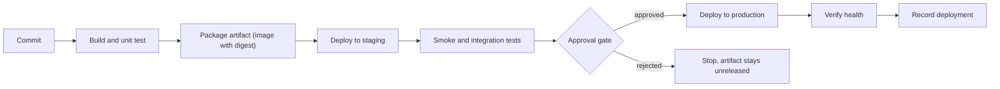
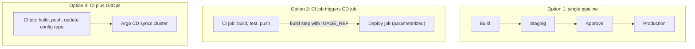

# Deployment Pipelines

## Introduction

A **CI pipeline** answers the question "is this commit good?" A **deployment pipeline** answers a harder one: "how does this good commit get safely in front of users, and how do we know it worked?"

In Jenkins, both are usually written as a Jenkinsfile. The difference is in what the later stages do. They take an artifact that has already been built and tested, push it through one or more environments, check that each deployment is healthy, and leave a record of who deployed what and when.

Think of a deployment pipeline as an airport baggage system. Your suitcase gets one tag at check-in (the build). After that, the system moves the *same* suitcase through scanners and conveyor belts (environments and checks) to the right plane (production). Nobody repacks your suitcase at every belt. If they did, you could not trust that what arrived is what you checked in.

This page covers the Jenkins-specific design of deployment pipelines:

- The "build once, deploy many" rule and how to give artifacts a stable identity
- A reference stage layout for a deployment pipeline
- One pipeline vs separate CI and CD jobs
- Preventing two deployments from colliding with `lock`, `milestone` and `disableConcurrentBuilds`
- Verifying a deployment and recording it

For general continuous delivery theory, see the [CI/CD tutorial](/docs/devops/cicd). The rest of this section builds on this page: [Environments and Promotion](./1-jenkins-environments-and-promotion.mdx), [Deploying to Kubernetes](./2-jenkins-deploy-to-kubernetes.mdx), [Rollbacks](./6-jenkins-rollbacks.mdx) and more.

## The Shape of a Deployment Pipeline



Every arrow after **Package** moves the *same* artifact. Only configuration (URLs, replica counts, secrets) changes between environments.

## Rule One: Build Once, Deploy Many

The most common deployment bug in Jenkins setups is rebuilding the application in each deploy stage:

```groovy
// Anti-pattern: each environment gets a different build
stage('Deploy Staging') {
    steps {
        sh 'mvn package'
        sh './deploy.sh staging target/app.jar'
    }
}
stage('Deploy Production') {
    steps {
        sh 'mvn package'   // a dependency may have changed since staging
        sh './deploy.sh production target/app.jar'
    }
}
```

The second `mvn package` can pull a newer snapshot dependency, run on an agent with a different JDK, or pick up a commit that landed in between. What you tested in staging is not what you ship.

The fix is to build once and refer to that output by an **immutable identity**:

| Artifact type | Good identity | Avoid |
| --- | --- | --- |
| Container image | Registry digest (`sha256:...`) or a tag containing the Git SHA | `latest`, `main`, `staging` |
| JAR, ZIP, wheel | Version plus Git SHA, stored in an artifact repository | Rebuilding from source per stage |
| Helm chart | Chart version in a chart repository | Packaging the chart in each stage |
| Terraform | Saved plan file archived with the build | Running `plan` and `apply` separately without the file |

### Capturing an identity in Jenkins

Here is a minimal pipeline that builds a container image once, records its digest, and makes it available to later stages. It assumes the agent has Docker and that a Jenkins credential named `registry-creds` (username and password) exists. See [Building and Pushing Docker Images](../9-jenkins-build-and-test/7-jenkins-docker-image-builds.mdx) for the build details.

```groovy
pipeline {
    agent { label 'docker' }

    environment {
        REGISTRY = 'registry.example.com'
        IMAGE    = "${REGISTRY}/shop/orders-api"
    }

    stages {
        stage('Build and Push') {
            steps {
                script {
                    env.GIT_SHORT = sh(script: 'git rev-parse --short=12 HEAD', returnStdout: true).trim()
                    env.IMAGE_TAG = "${env.BUILD_NUMBER}-${env.GIT_SHORT}"
                }
                withCredentials([usernamePassword(credentialsId: 'registry-creds',
                                                  usernameVariable: 'REG_USER',
                                                  passwordVariable: 'REG_PASS')]) {
                    sh '''
                        echo "$REG_PASS" | docker login "$REGISTRY" -u "$REG_USER" --password-stdin
                        docker build -t "$IMAGE:$IMAGE_TAG" .
                        docker push "$IMAGE:$IMAGE_TAG"
                    '''
                }
                script {
                    // RepoDigests holds "registry/repo@sha256:..." after a push
                    env.IMAGE_REF = sh(
                        script: 'docker inspect --format="{{index .RepoDigests 0}}" "$IMAGE:$IMAGE_TAG"',
                        returnStdout: true
                    ).trim()
                }
                echo "Built ${env.IMAGE_REF}"
                writeFile file: 'release.env', text: "IMAGE_REF=${env.IMAGE_REF}\nGIT_SHA=${env.GIT_COMMIT}\n"
                archiveArtifacts artifacts: 'release.env', fingerprint: true
            }
        }
    }
}
```

Example output (console log, trimmed):

```text
[Pipeline] sh
+ docker push registry.example.com/shop/orders-api:57-3f9c2a1b7d40
57-3f9c2a1b7d40: digest: sha256:9b1e...c4 size: 1786
[Pipeline] echo
Built registry.example.com/shop/orders-api@sha256:9b1e...c4
[Pipeline] archiveArtifacts
Archiving artifacts
Recording fingerprints
```

Three details matter here:

- The `sh` for `docker push` uses **single quotes**, so the shell expands `$REG_PASS`, not Groovy. This keeps the secret out of the Groovy string and avoids the "insecure interpolation" warning. See [Credentials Management](../11-jenkins-security/3-jenkins-credentials.mdx).
- `IMAGE_REF` uses the digest. A tag can be moved to another image later. A digest cannot.
- The small `release.env` file is archived and fingerprinted. Later jobs, or people doing a rollback, can find exactly which image this build produced.

## A Reference Layout

A full deployment pipeline for a service usually has these stages. Each later page in this section zooms into one of them.

```groovy
pipeline {
    agent none

    options {
        buildDiscarder(logRotator(numToKeepStr: '50', artifactNumToKeepStr: '20'))
        timestamps()
        disableConcurrentBuilds()
    }

    stages {
        stage('Build and Test') {
            agent { label 'docker' }
            steps {
                sh './gradlew test'
                // build and push image, set env.IMAGE_REF (see previous example)
            }
        }

        stage('Deploy to Staging') {
            agent { label 'deploy' }
            when { branch 'main' }
            steps {
                sh './scripts/deploy.sh staging "$IMAGE_REF"'
            }
        }

        stage('Verify Staging') {
            agent { label 'deploy' }
            when { branch 'main' }
            steps {
                sh './scripts/smoke-test.sh https://staging.shop.example.com'
            }
        }

        stage('Approve Production') {
            agent none
            when { branch 'main' }
            options { timeout(time: 4, unit: 'HOURS') }
            input {
                message 'Deploy to production?'
                ok 'Deploy'
                submitter 'release-managers'
                submitterParameter 'APPROVER'
            }
            steps {
                echo "Approved by ${APPROVER}"
            }
        }

        stage('Deploy to Production') {
            agent { label 'deploy' }
            when { branch 'main' }
            steps {
                lock(resource: 'orders-api-production') {
                    sh './scripts/deploy.sh production "$IMAGE_REF"'
                    sh './scripts/smoke-test.sh https://shop.example.com'
                }
            }
        }
    }

    post {
        success { echo "Released ${env.IMAGE_REF}" }
        failure { echo 'Deployment failed, see the stage logs' }
    }
}
```

Points worth noticing:

- **`agent none` at the top** with per-stage agents. The approval stage runs with no agent, so a waiting build does not hold an executor for hours. See [Manual Input and Approvals](../4-jenkins-pipeline-advanced/2-jenkins-input-and-approvals.mdx).
- **`when { branch 'main' }`** restricts deployments to the main branch in a [multibranch pipeline](../5-jenkins-scm-integration/1-jenkins-multibranch-pipelines.mdx). Pull request builds still get the build and test stages.
- **Deploy logic lives in scripts** in the repository (`deploy.sh`). The Jenkinsfile orchestrates; scripts do the work. You can run the same script on a laptop when debugging, and Groovy CPS quirks never touch it.
- **A smoke test follows every deploy.** A deploy that "succeeded" but serves errors is a failed deploy.

## One Pipeline or Separate CI and CD Jobs?

Teams usually pick one of three structures.



Option 2 uses the `build` step to trigger a separate, parameterized deploy job:

```groovy
// At the end of the CI pipeline
stage('Trigger Staging Deploy') {
    when { branch 'main' }
    steps {
        build job: 'deploy/orders-api',
              wait: false,
              parameters: [
                  string(name: 'IMAGE_REF', value: env.IMAGE_REF),
                  string(name: 'TARGET_ENV', value: 'staging')
              ]
    }
}
```

The deploy job is its own Jenkinsfile with `parameters { string(name: 'IMAGE_REF') ... }`. Because the deploy job takes any image reference, the same job can also do rollbacks: you run it with an older `IMAGE_REF`. [Rollbacks](./6-jenkins-rollbacks.mdx) builds on this.

| Approach | Pros | Cons | Best for |
| --- | --- | --- | --- |
| Single pipeline | One view of the whole release; simple to start | Long-running builds with approvals; redeploying an old version means re-running old builds | Small teams, one service, few environments |
| CI job plus parameterized deploy job | Deploy any version any time; separate permissions for deploy | Two jobs to maintain; need to pass identity between them | Several environments, on-demand rollbacks, stricter access control |
| CI plus GitOps (Argo CD or Flux) | Cluster state lives in Git; drift is corrected; no cluster credentials in Jenkins | Extra system to run; Kubernetes only | Kubernetes platforms with many services |

Option 3 is covered in [Jenkins with GitOps and Argo CD](./7-jenkins-gitops.mdx).

## Preventing Colliding Deployments

Two builds deploying to the same environment at the same time can leave it in a mixed state. Jenkins has three tools for this, and they solve different problems.

### disableConcurrentBuilds

```groovy
options {
    disableConcurrentBuilds(abortPrevious: true)
}
```

Only one build of *this job* (or this branch, in multibranch) runs at a time. With `abortPrevious: true`, a new build aborts the running one, which is useful for pull request builds but **dangerous during a deployment**: an aborted `kubectl apply` or `terraform apply` can leave things half done. For deploy jobs, use plain `disableConcurrentBuilds()` so new builds queue instead.

### lock (Lockable Resources plugin)

```groovy
lock(resource: 'orders-api-production') {
    sh './scripts/deploy.sh production "$IMAGE_REF"'
}
```

The `lock` step from the **Lockable Resources** plugin (`lockable-resources`) works **across jobs**. If a hotfix job and the main pipeline both deploy to production, they wait for each other. You can also lock a whole stage with `options { lock('orders-api-production') }`.

### milestone

```groovy
stage('Deploy to Production') {
    steps {
        milestone(ordinal: 100, label: 'prod-deploy')
        lock(resource: 'orders-api-production') {
            sh './scripts/deploy.sh production "$IMAGE_REF"'
        }
    }
}
```

The `milestone` step (plugin `pipeline-milestone-step`) makes builds pass milestones in build-number order. When build 58 passes a milestone, an older build 57 that has not reached it yet is aborted. This stops an old, slow build from overwriting a newer release after a long approval wait.

| Tool | Scope | Solves |
| --- | --- | --- |
| `disableConcurrentBuilds()` | One job or branch | Two builds of the same job running at once |
| `lock(resource: ...)` | Any jobs naming the resource | Different jobs touching the same environment |
| `milestone(...)` | Builds of one job | Older builds deploying after newer ones |

## Verifying and Recording a Deployment

A deploy step that returns exit code 0 only tells you the command ran. Add explicit checks:

```bash
#!/usr/bin/env bash
# scripts/smoke-test.sh - fail if the service is not healthy within 60 seconds
set -euo pipefail
BASE_URL="$1"
for i in $(seq 1 12); do
  if curl -fsS --max-time 5 "$BASE_URL/healthz" > /dev/null; then
    echo "healthy after $((i * 5))s"
    exit 0
  fi
  echo "not healthy yet (attempt $i)"
  sleep 5
done
echo "service did not become healthy" >&2
exit 1
```

Example output:

```text
not healthy yet (attempt 1)
not healthy yet (attempt 2)
healthy after 15s
```

Then leave a trail. Jenkins keeps build history, but it is easier to read if each deploy build says what it did. This `post` block belongs in the parameterized deploy job described above, which has `TARGET_ENV` and `IMAGE_REF` parameters:

```groovy
post {
    success {
        script {
            currentBuild.description = "${params.TARGET_ENV}: ${params.IMAGE_REF.take(60)}"
        }
        writeFile file: 'deploy-record.json',
                  text: """{"env": "${params.TARGET_ENV}", "image": "${params.IMAGE_REF}", "build": "${env.BUILD_URL}"}"""
        archiveArtifacts artifacts: 'deploy-record.json'
    }
}
```

The build description shows up in the build history list, so "what is in production right now?" can be answered at a glance. Many teams also post the same record to Slack (see [Notifications](../12-jenkins-administration/6-jenkins-notifications.mdx)) or to an observability tool as a deployment marker.

## Real-World Scenario

**Your team** runs an online shop with an `orders-api` service. Today a developer SSHes into two servers, pulls the latest code, and restarts the service. Twice last quarter, production got a build that was never in staging because someone deployed from their laptop. The team already uses Jenkins for CI and wants deployments to go through it too.

### The solution

1. The existing multibranch CI pipeline is extended to **push an image tagged with the build number and Git SHA**, and to archive `release.env` with the digest.
2. On `main`, the CI pipeline **triggers a parameterized `deploy/orders-api` job** with `IMAGE_REF` and `TARGET_ENV=staging`.
3. The deploy job runs `deploy.sh`, then `smoke-test.sh`, and sets the build description.
4. A release manager runs the same deploy job with `TARGET_ENV=production` and the same `IMAGE_REF`. The job has an `input` gate restricted to the `release-managers` group and a `lock` on the production resource.
5. SSH access to the production servers is removed for developers. Only the Jenkins deploy agent has the key.

### Why this approach

- **The same digest** goes to staging and production, which closes the "never tested" gap.
- **A separate deploy job** means a rollback is just "run the deploy job with the previous `IMAGE_REF`."
- **Locks and approval** give the team control without slowing down CI for every pull request.

### When to use it, and when not to

This design suits teams that deploy a few times a day or less, need an approval trail, and run on servers or a mix of platforms. If you deploy many Kubernetes services, a GitOps tool may fit better because it also detects drift. If your code already lives on GitHub and you have no special agent needs, the deployment features of GitHub Actions (environments with required reviewers) may be simpler than running Jenkins. See [Jenkins vs GitHub Actions, GitLab CI and Others](../0-jenkins-fundamentals/3-jenkins-vs-alternatives.mdx).

### Alternatives and trade-offs

| Approach | Pros | Cons | Best for |
| --- | --- | --- | --- |
| Manual SSH deploys | No tooling | No audit trail, untested builds reach production | Nothing beyond a hobby project |
| Jenkins single pipeline | Easy to read end to end | Hard to redeploy an old version | One service, low release frequency |
| Jenkins CI plus deploy job | Any version, any time; clear permissions | Two jobs; artifact identity must be passed carefully | Most teams on servers or mixed platforms |
| Jenkins CI plus GitOps | Drift detection, Git audit trail | Kubernetes only, extra system | Kubernetes platforms |
| Dedicated CD tool (Spinnaker, Harness, Octopus) | Rich release features | Extra cost or operations | Large release organizations |

## Common Mistakes

1. **Rebuilding per environment.** Build once, store the artifact, pass its identity.
2. **Deploying `latest`.** Tags move. Use a digest or a SHA-based tag.
3. **Holding an executor during approval.** Use `agent none` on the approval stage.
4. **Deploying from every branch.** Guard deploy stages with `when { branch 'main' }` or tag conditions.
5. **No verification.** Exit code 0 from a deploy command is not proof of health. Add smoke tests.
6. **Using `abortPrevious` on deploy jobs.** It can interrupt a deployment halfway.
7. **All the logic in Groovy.** Keep deploy steps in shell scripts or tools that run outside Jenkins, so they can be tested and reused.

## Summary

- A deployment pipeline moves **one immutable artifact** through environments and verifies each step.
- Identify artifacts by **digest or SHA**, archive a small release record, and fingerprint it.
- Choose between a **single pipeline**, a **CI job plus deploy job**, or **CI plus GitOps** based on team size, rollback needs, and platform.
- Use `disableConcurrentBuilds`, `lock` and `milestone` for different kinds of collisions.
- Verify each deployment with health checks and record what was deployed where.

## Exercises

1. Take an existing CI pipeline and add a stage that writes `release.env` with the image digest and archives it with a fingerprint. Find the fingerprint page in the Jenkins UI.
2. Split the pipeline into a CI job and a parameterized deploy job. Trigger the deploy job with the `build` step and pass `IMAGE_REF`.
3. Start two deploy builds at once against the same environment, first without and then with `lock`. Compare the console logs.
4. Add a `milestone` before the production stage, start two builds, approve the newer one first, and observe what happens to the older build.

### Related pages

- [Environments and Promotion](./1-jenkins-environments-and-promotion.mdx)
- [Rollbacks](./6-jenkins-rollbacks.mdx)
- [Pipeline Best Practices](../13-jenkins-best-practices/0-jenkins-pipeline-best-practices.mdx)
- [Project: Kubernetes Deployment Pipeline](../14-jenkins-projects/3-jenkins-project-kubernetes.mdx)
