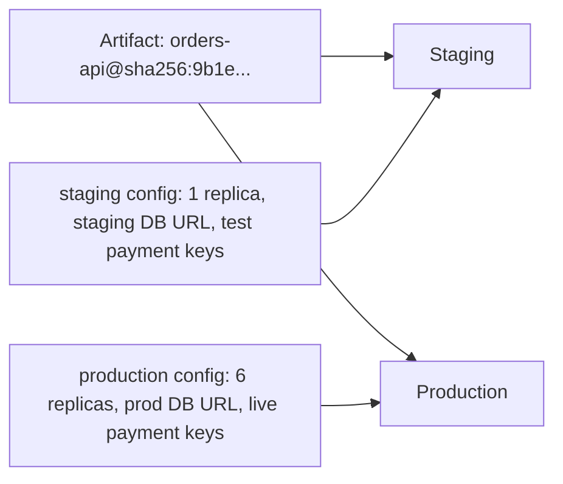
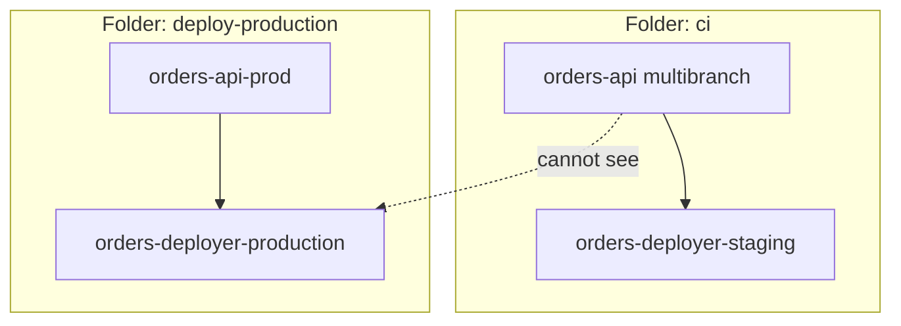

# Environments and Promotion

## Introduction

Most teams run their software in more than one place. A typical setup has **dev** (anything goes), **staging** (close to production, used for final checks) and **production** (real users). Some add QA, performance, or per-region production environments.

**Promotion** is the act of moving a release from one environment to the next once it has proven itself. The key word is *moving*: the artifact that reaches production should be the exact one that passed staging. Only its configuration changes.

A useful picture is a school year. A student (the release) is promoted from grade to grade after passing that grade's exams. Nobody swaps in a different student at the start of the next grade. Each grade has its own classroom and teacher (configuration and credentials), but the student is the same person.

This page shows how to model environments and promotion in Jenkins:

- Keeping per-environment configuration out of the Jenkinsfile logic
- Scoping credentials so a staging job cannot touch production
- Three promotion patterns: approval gates, a parameterized promote job, and tag-driven promotion
- Recording which version is in which environment

It assumes you have read [Deployment Pipelines](./0-jenkins-deployment-pipelines.mdx), which covers the "build once, deploy many" rule.

## What Changes Between Environments



Things that **should** differ per environment:

- Hostnames, database URLs, queue names
- Replica counts, instance sizes, autoscaling limits
- Secrets and credentials
- Feature flag defaults
- Who is allowed to deploy

Things that **should not** differ: the application binary or image, its dependencies, and the deploy procedure itself. If the production deploy runs a different script from staging, staging is not testing your deploy.

## Storing Environment Configuration

Keep environment settings in files under version control, next to the code or in a separate config repository:

```text
deploy/
  environments/
    staging.env
    production.env
  deploy.sh
```

```bash
# deploy/environments/staging.env
APP_URL=https://staging.shop.example.com
REPLICAS=1
DB_HOST=orders-db.staging.internal
CREDENTIALS_ID=orders-deployer-staging
```

```bash
# deploy/environments/production.env
APP_URL=https://shop.example.com
REPLICAS=6
DB_HOST=orders-db.prod.internal
CREDENTIALS_ID=orders-deployer-production
```

The pipeline loads the right file with the `readProperties` step from the **Pipeline Utility Steps** plugin (`pipeline-utility-steps`):

```groovy
def loadEnvConfig(String name) {
    def props = readProperties file: "deploy/environments/${name}.env"
    echo "Loaded ${props.size()} settings for ${name}"
    return props
}

pipeline {
    agent { label 'deploy' }
    parameters {
        choice(name: 'TARGET_ENV', choices: ['staging', 'production'], description: 'Where to deploy')
        string(name: 'IMAGE_REF', description: 'Image digest reference to deploy')
    }
    stages {
        stage('Deploy') {
            steps {
                script {
                    def cfg = loadEnvConfig(params.TARGET_ENV)
                    withCredentials([file(credentialsId: cfg.CREDENTIALS_ID, variable: 'KUBECONFIG')]) {
                        withEnv(["APP_URL=${cfg.APP_URL}", "REPLICAS=${cfg.REPLICAS}"]) {
                            sh './deploy/deploy.sh "$IMAGE_REF"'
                        }
                    }
                }
            }
        }
    }
}
```

Example output:

```text
[Pipeline] readProperties
[Pipeline] echo
Loaded 4 settings for staging
[Pipeline] withCredentials
Masking supported pattern matches of $KUBECONFIG
[Pipeline] sh
+ ./deploy/deploy.sh registry.example.com/shop/orders-api@sha256:9b1e...c4
deploying 1 replica(s) to https://staging.shop.example.com
```

:::note
Settings files contain **names** of credentials, not secrets. The secrets themselves live in the Jenkins credentials store or an external secret manager. See [External Secrets with Vault and Cloud Secret Managers](../11-jenkins-security/4-jenkins-external-secrets.mdx).
:::

## Scoping Credentials per Environment

If every job can read the production deploy credential, then any Jenkinsfile on any branch can deploy to production, approval gate or not. A pull request that edits the Jenkinsfile could simply skip the `input` step.

Jenkins gives you two tools to prevent this:

1. **Folder-scoped credentials.** Credentials defined on a folder are only visible to jobs inside that folder.
2. **Folder permissions.** With an authorization strategy such as Role-Based Strategy or Matrix Authorization, only some people can configure or run jobs in a folder. See [Authorization and Role-Based Access](../11-jenkins-security/2-jenkins-authorization.mdx).

A common layout:

```text
Jenkins
├── ci/                       (everyone can run; staging credentials only)
│   └── orders-api            multibranch pipeline
└── deploy-production/        (release managers only; production credentials)
    └── orders-api-prod       parameterized deploy job, main branch only
```



You can create the folder credentials by hand or with [Configuration as Code (JCasC)](../12-jenkins-administration/0-jenkins-configuration-as-code.mdx) plus [Job DSL](../12-jenkins-administration/1-jenkins-job-dsl.mdx). With cloud providers, an even stronger option is to give the production deploy agent its own cloud identity, so the secret never exists in Jenkins at all. See [Deploying to AWS and Azure](./3-jenkins-deploy-to-cloud.mdx).

## Promotion Pattern 1: Approval Gate in One Pipeline

The simplest promotion is a pipeline that deploys to staging, waits for approval, then deploys the same artifact to production.

```groovy
pipeline {
    agent none
    options { disableConcurrentBuilds() }

    stages {
        stage('Build') {
            agent { label 'docker' }
            steps {
                script { env.IMAGE_REF = sh(script: './ci/build-and-push.sh', returnStdout: true).trim() }
            }
        }

        stage('Staging') {
            agent { label 'deploy' }
            when { branch 'main' }
            steps {
                sh './deploy/deploy.sh staging "$IMAGE_REF"'
                sh './deploy/smoke-test.sh https://staging.shop.example.com'
            }
        }

        stage('Promote to Production') {
            when {
                beforeInput true
                branch 'main'
            }
            options { timeout(time: 1, unit: 'DAYS') }
            input {
                message "Promote ${env.IMAGE_REF} to production?"
                ok 'Promote'
                submitter 'release-managers'
                submitterParameter 'APPROVER'
                parameters {
                    string(name: 'CHANGE_TICKET', description: 'Change ticket ID, for example CHG-1234')
                }
            }
            agent { label 'deploy-prod' }
            steps {
                milestone(ordinal: 50, label: 'production')
                lock(resource: 'orders-api-production') {
                    sh './deploy/deploy.sh production "$IMAGE_REF"'
                    sh './deploy/smoke-test.sh https://shop.example.com'
                }
                echo "Promoted by ${APPROVER} under ${CHANGE_TICKET}"
            }
        }
    }
}
```

In Declarative, the `input` directive is evaluated **before** the stage's `agent` is allocated, so no executor is held while waiting. `beforeInput true` makes Jenkins check the `when` condition before showing the prompt, so feature branches never see it.

**Limitations:** the build stays open until someone answers or the timeout fires. If you want to promote an artifact from last week, you must find that old build. And a branch that edits the Jenkinsfile could remove the gate, which is why the production credential should only be reachable from the `deploy-prod` agent or folder.

## Promotion Pattern 2: A Parameterized Promote Job

The second pattern separates the "build and stage" pipeline from a **promote job** that anyone authorized can run at any time with a chosen version.

```groovy
// Jenkinsfile.promote, used by deploy-production/orders-api-prod
pipeline {
    agent { label 'deploy-prod' }
    options {
        disableConcurrentBuilds()
        buildDiscarder(logRotator(numToKeepStr: '200'))
    }
    parameters {
        string(name: 'SOURCE_BUILD', description: 'Build number of ci/orders-api/main to promote')
    }
    stages {
        stage('Fetch release record') {
            steps {
                copyArtifacts(projectName: 'ci/orders-api/main',
                              selector: specific(params.SOURCE_BUILD),
                              filter: 'release.env',
                              fingerprintArtifacts: true)
                script {
                    def rel = readProperties file: 'release.env'
                    env.IMAGE_REF = rel.IMAGE_REF
                    currentBuild.description = "from #${params.SOURCE_BUILD}: ${rel.IMAGE_REF.take(60)}"
                }
            }
        }
        stage('Check it passed staging') {
            steps {
                sh './deploy/check-environment.sh staging "$IMAGE_REF"'
            }
        }
        stage('Deploy to Production') {
            steps {
                lock(resource: 'orders-api-production') {
                    sh './deploy/deploy.sh production "$IMAGE_REF"'
                    sh './deploy/smoke-test.sh https://shop.example.com'
                }
            }
        }
    }
}
```

Notes:

- `copyArtifacts` comes from the **Copy Artifact** plugin (`copyartifact`). The source job must allow it, for example with `options { copyArtifactPermission('/deploy-production/*') }` in the CI Jenkinsfile.
- The promote job reads the **release record** produced by the CI build. It never rebuilds anything.
- `check-environment.sh` asks staging what it is currently running (or queries your deployment records) and refuses to continue if the image never went through staging. This turns "please only promote tested builds" from a rule into a check.
- Access control is handled by folder permissions, not by an `input` step.

:::tip
The older **Promoted Builds** plugin was designed for freestyle jobs and does not support Pipeline jobs well. For pipelines, use one of the patterns on this page instead.
:::

## Promotion Pattern 3: Promote by Git Tag

A third pattern uses Git as the promotion signal. Pushing a tag such as `v1.8.0` triggers a production release in a multibranch pipeline with tag discovery enabled.

```groovy
stage('Release to Production') {
    when { buildingTag() }
    steps {
        script {
            // Resolve the image built from the same commit on main
            env.IMAGE_REF = sh(script: "./ci/find-image-for-commit.sh ${env.GIT_COMMIT}",
                               returnStdout: true).trim()
        }
        lock(resource: 'orders-api-production') {
            sh './deploy/deploy.sh production "$IMAGE_REF"'
        }
    }
}
```

Tags give you a readable release history in Git, and Git hosting tools can restrict who may push release tags. The pipeline must look up the existing image for the tagged commit rather than rebuild it. Note that Jenkins does not build tags automatically by default when they are discovered. You must configure that in the branch source (see [Multibranch Pipelines](../5-jenkins-scm-integration/1-jenkins-multibranch-pipelines.mdx)).

## Comparing the Patterns

| Pattern | Pros | Cons | Best for |
| --- | --- | --- | --- |
| Approval gate in one pipeline | Easy to see the whole flow; little setup | Long-running builds; hard to promote an old version | Small teams with one service |
| Parameterized promote job | Promote any version at any time; strong permission boundary | Two jobs; needs a release record | Regulated teams, several environments |
| Git tag triggers release | Release history in Git; familiar to developers | Tag permissions live in the Git host; image lookup needed | Libraries and services with versioned releases |
| GitOps pull request to config repo | Reviewed promotion, Git audit trail | Requires Argo CD or Flux | Kubernetes platforms ([Jenkins with GitOps](./7-jenkins-gitops.mdx)) |

## Knowing What Runs Where

Once promotion works, someone will ask "which version is in staging right now?" A few options:

- **Build descriptions** in the deploy jobs (see the previous page).
- **Fingerprints.** Because the release record is fingerprinted, its fingerprint page lists every job and build that used it, which shows the path from CI build to production deploy.
- **Ask the environment.** A `/version` endpoint that returns the Git SHA, or for Kubernetes, `kubectl get deploy orders-api -o jsonpath='{.spec.template.spec.containers[0].image}'`. This is the most trustworthy answer because it reflects reality, not what Jenkins thinks happened.

## Real-World Scenario

**Your company** sells payroll software and must pass an annual audit. The auditors want to see that every production change was tested in staging and approved by someone other than the author. Today developers deploy to production from their feature branches because the production kubeconfig is a global Jenkins credential.

### The solution

1. Move the production kubeconfig from a global credential to a credential in a new `deploy-production` folder. Only the `release-managers` group has the Build permission there.
2. The `ci/payroll-api` multibranch pipeline builds, pushes, deploys to staging on `main`, and archives `release.env`.
3. A promote job in `deploy-production` takes `SOURCE_BUILD`, copies the release record, verifies that staging runs that image, deploys with a `lock`, and records the approver (Jenkins records the user who started the build).
4. A policy check in `check-environment.sh` also compares the commit author with the current user and refuses self-promotion.

### Why this approach

- The **permission boundary is enforced by Jenkins folders**, not by Jenkinsfile code that a branch could change.
- Each production build has a **clear record**: who ran it, which CI build it came from, and the fingerprint chain.
- Old versions can be promoted again for a rollback without rebuilding.

### When to use it, and when not to

Use separate promote jobs when you need strong separation of duties, or when promotions happen at a different pace from builds. For a small internal tool deployed by one team, a single pipeline with an `input` gate is simpler and good enough.

### Alternatives and trade-offs

| Approach | Pros | Cons | Best for |
| --- | --- | --- | --- |
| Global credentials plus `input` gate | Fast to set up | Gate can be bypassed by editing the Jenkinsfile | Prototypes |
| Folder-scoped credentials plus promote job | Strong boundary, auditable | More jobs to manage | Audited or regulated teams |
| Separate Jenkins controller for production | Strongest isolation | Two instances to run and patch | Very large or high-security setups |
| GitHub or GitLab environments with required reviewers | Built into the Git host | Ties you to that platform's CI | Teams already on those platforms |

## Common Mistakes

1. **Per-environment builds.** Promotion must move the same artifact, never rebuild it.
2. **Global production credentials.** Any job, on any branch, could use them. Scope them to a folder or to a dedicated agent.
3. **Environment-specific deploy scripts.** Use one script with per-environment config files.
4. **Approval without context.** Show the image reference, the change summary and a link to staging in the `input` message.
5. **Promoting without checking.** Verify the artifact actually passed the previous environment.
6. **Snowflake environments.** If staging and production are built differently, staging tests little. Create both from the same Terraform modules ([Running Terraform and Ansible](./4-jenkins-terraform-and-ansible.mdx)).

## Summary

- Environments differ in **configuration and credentials**, never in the artifact or the deploy procedure.
- Keep environment settings in version-controlled files and load them with `readProperties`.
- Use **folder-scoped credentials** and folder permissions so only the right jobs can reach production.
- Promote with an **approval gate**, a **parameterized promote job**, or **Git tags**, depending on your audit and flexibility needs.
- Record and verify what runs where, and trust the environment itself over Jenkins' memory.

## Exercises

1. Create `staging.env` and `production.env` files and a pipeline that loads one with `readProperties` based on a `choice` parameter.
2. Create two folders with different credentials and confirm that a job in one folder cannot use the other folder's credential.
3. Build a promote job that uses `copyArtifacts` to fetch `release.env` from a specific CI build and prints the image reference.
4. Write `check-environment.sh` for your platform so it fails when the image is not running in staging.

### Related pages

- [Deployment Pipelines](./0-jenkins-deployment-pipelines.mdx)
- [Manual Input and Approvals](../4-jenkins-pipeline-advanced/2-jenkins-input-and-approvals.mdx)
- [Credentials Management](../11-jenkins-security/3-jenkins-credentials.mdx)
- [Rollbacks](./6-jenkins-rollbacks.mdx)
