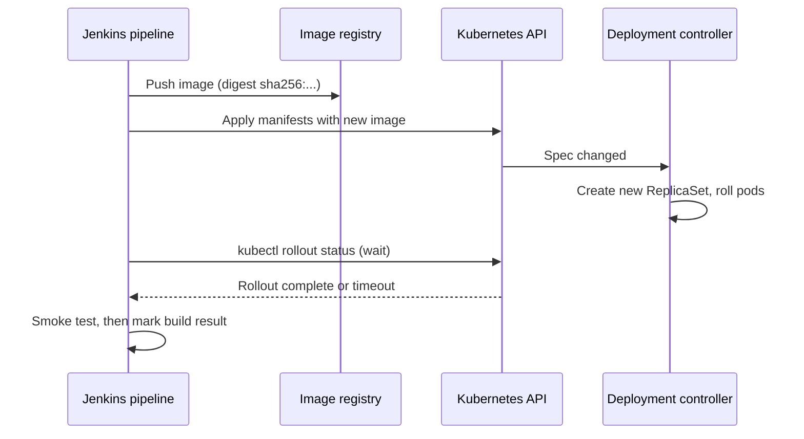

# Deploying to Kubernetes

## Introduction

Kubernetes has become the default place to run containers, and many Jenkins pipelines end by putting a new image into a cluster. Mechanically this is a short step: run `kubectl apply` or `helm upgrade`. The hard parts are around it:

- **How does Jenkins authenticate** to the cluster without spreading admin credentials?
- **Which tool** turns your manifests into the right YAML for each environment?
- **How do you know** the rollout actually worked, and stop if it did not?

Think of the cluster as a warehouse with a smart robot (the Kubernetes control plane). Jenkins does not move boxes itself. It hands the robot a new packing list ("run version 1.8 with 3 replicas") and then watches until the robot reports the shelves are stocked. Your job is to make sure Jenkins has a badge that opens only the right doors, and that it waits for the robot's report before saying "done."

This page assumes you know basic Kubernetes objects (Deployments, Services, namespaces). If not, start with the [Kubernetes tutorial](/docs/devops/kubernetes). For running Jenkins *agents* in Kubernetes, see [Kubernetes Pod Agents](../6-jenkins-agents/4-jenkins-kubernetes-agents.mdx). This page is about deploying *applications* to Kubernetes.

## The Deployment Flow



## Step 1: Giving Jenkins Access to the Cluster

You have three common options.

| Option | How it works | Pros | Cons |
| --- | --- | --- | --- |
| Kubeconfig file credential | Store a kubeconfig in Jenkins credentials, bind it with `withKubeConfig` or `withCredentials` | Works for any cluster, any agent | Long-lived secret in Jenkins; must be rotated |
| Service account of an in-cluster pod agent | Agent pod runs with a Kubernetes ServiceAccount bound to a Role | No secret stored in Jenkins | Agent must run inside the target cluster |
| Cloud identity (EKS, AKS, GKE) | Agent gets a cloud role, then `aws eks update-kubeconfig` or `az aks get-credentials` | Short-lived tokens, central IAM | Cloud-specific setup ([Deploying to AWS and Azure](./3-jenkins-deploy-to-cloud.mdx)) |

### A least-privilege deployer identity

Whatever option you choose, the identity Jenkins uses should only be able to update the resources it deploys, in the namespaces it deploys to. Never give Jenkins `cluster-admin`.

```yaml
# rbac-jenkins-deployer.yaml
apiVersion: v1
kind: ServiceAccount
metadata:
  name: jenkins-deployer
  namespace: shop-staging
---
apiVersion: rbac.authorization.k8s.io/v1
kind: Role
metadata:
  name: deployer
  namespace: shop-staging
rules:
  - apiGroups: ["apps"]
    resources: ["deployments", "replicasets"]
    verbs: ["get", "list", "watch", "create", "update", "patch"]
  - apiGroups: [""]
    resources: ["services", "configmaps", "pods"]
    verbs: ["get", "list", "watch", "create", "update", "patch"]
  - apiGroups: [""]
    resources: ["secrets"]
    verbs: ["get", "list", "watch", "create", "update", "patch"]
---
apiVersion: rbac.authorization.k8s.io/v1
kind: RoleBinding
metadata:
  name: jenkins-deployer
  namespace: shop-staging
subjects:
  - kind: ServiceAccount
    name: jenkins-deployer
    namespace: shop-staging
roleRef:
  kind: Role
  name: deployer
  apiGroup: rbac.authorization.k8s.io
```

```bash
kubectl apply -f rbac-jenkins-deployer.yaml
kubectl auth can-i delete namespaces --as=system:serviceaccount:shop-staging:jenkins-deployer
kubectl auth can-i patch deployments -n shop-staging --as=system:serviceaccount:shop-staging:jenkins-deployer
```

Output:

```text
serviceaccount/jenkins-deployer created
role.rbac.authorization.k8s.io/deployer created
rolebinding.rbac.authorization.k8s.io/jenkins-deployer created
no
yes
```

Helm stores release state in Secrets, which is why the Role includes `secrets`. If you only use `kubectl apply` and no Secrets, drop that rule. The `watch` verb matters too: `kubectl rollout status` and Helm 4's `--wait` both rely on watching resources.

### Binding a kubeconfig with withKubeConfig

The **Kubernetes CLI** plugin (`kubernetes-cli`) provides `withKubeConfig`. It writes a temporary kubeconfig, sets `KUBECONFIG` for the block, and deletes the file afterwards.

```groovy
withKubeConfig(credentialsId: 'k8s-staging-deployer',
               serverUrl: 'https://k8s-staging.example.com:6443',
               namespace: 'shop-staging') {
    sh 'kubectl get deployments'
}
```

The credential can be a token (Secret text), a certificate, or a whole kubeconfig file. If the agent runs **inside** the cluster as a pod, you can omit `credentialsId` and the plugin uses the pod's ServiceAccount token.

Without the plugin, a "Secret file" credential works just as well:

```groovy
withCredentials([file(credentialsId: 'k8s-staging-kubeconfig', variable: 'KUBECONFIG')]) {
    sh 'kubectl get deployments -n shop-staging'
}
```

## Step 2: Running kubectl in the Pipeline

Your agents need `kubectl` (and `helm` or `kustomize` if you use them). With the Kubernetes plugin, the cleanest approach is a pod template with a tools container. The `alpine/k8s` community image bundles kubectl, Helm, Kustomize and other tools. Pin a version that matches your cluster, or build your own image.

```groovy
pipeline {
    agent {
        kubernetes {
            defaultContainer 'k8s'
            yaml '''
apiVersion: v1
kind: Pod
spec:
  serviceAccountName: jenkins-deployer
  containers:
    - name: k8s
      image: alpine/k8s:1.37.1
      command: ["sleep"]
      args: ["infinity"]
'''
        }
    }
    parameters {
        string(name: 'IMAGE_REF', description: 'Image with digest, e.g. registry.example.com/shop/orders-api@sha256:...')
    }
    stages {
        stage('Tool versions') {
            steps {
                sh 'kubectl version --client && helm version --short && kustomize version'
            }
        }
    }
}
```

Example output:

```text
Client Version: v1.37.1
Kustomize Version: v5.x
v4.x
v5.x
```

Exact versions depend on the image tag you pin. Check the image's tag list before choosing one.

:::note
The pod above uses `serviceAccountName: jenkins-deployer`, so it can deploy only to the namespace that ServiceAccount is bound to, and only if the agent pod runs in the same cluster. For deploying to *other* clusters, use a kubeconfig credential instead.
:::

## Step 3: Choosing a Manifest Tool

### Plain kubectl with an image substitution

For one or two simple services, plain manifests plus `kubectl set image` can be enough:

```bash
kubectl -n shop-staging apply -f k8s/
kubectl -n shop-staging set image deployment/orders-api orders-api="$IMAGE_REF"
kubectl -n shop-staging rollout status deployment/orders-api --timeout=180s
```

Example output:

```text
deployment.apps/orders-api configured
service/orders-api unchanged
deployment.apps/orders-api image updated
Waiting for deployment "orders-api" rollout to finish: 1 of 3 updated replicas are available...
Waiting for deployment "orders-api" rollout to finish: 2 of 3 updated replicas are available...
deployment "orders-api" successfully rolled out
```

The downside: `apply` first sets whatever image the YAML file says, then `set image` changes it, causing two rollouts. It also means the YAML in Git is not what runs in the cluster.

### Kustomize overlays

Kustomize (built into `kubectl apply -k`) keeps a shared base and small per-environment overlays:

```text
k8s/
  base/
    deployment.yaml
    service.yaml
    kustomization.yaml
  overlays/
    staging/kustomization.yaml
    production/kustomization.yaml
```

```yaml
# k8s/overlays/staging/kustomization.yaml
apiVersion: kustomize.config.k8s.io/v1beta1
kind: Kustomization
namespace: shop-staging
resources:
  - ../../base
replicas:
  - name: orders-api
    count: 1
images:
  - name: orders-api
    newName: registry.example.com/shop/orders-api
    newTag: placeholder
```

In the pipeline, set the image in the overlay and apply once:

```groovy
stage('Deploy with Kustomize') {
    steps {
        withKubeConfig(credentialsId: 'k8s-staging-deployer', serverUrl: 'https://k8s-staging.example.com:6443') {
            dir('k8s/overlays/staging') {
                sh 'kustomize edit set image orders-api="$IMAGE_REF"'
            }
            sh 'kubectl apply -k k8s/overlays/staging'
            sh 'kubectl -n shop-staging rollout status deployment/orders-api --timeout=180s'
        }
    }
}
```

`kustomize edit set image` accepts a full reference with a digest, so the deployment is pinned to an immutable image.

### Helm 4

Helm packages manifests as a chart with values per environment. Helm 4 (current at the time of writing) renamed the old `--atomic` flag to `--rollback-on-failure` and changed how `--wait` works. Check the [helm upgrade reference](https://helm.sh/docs/helm/helm_upgrade/) for your version.

```groovy
stage('Deploy with Helm') {
    steps {
        withKubeConfig(credentialsId: 'k8s-staging-deployer', serverUrl: 'https://k8s-staging.example.com:6443') {
            sh '''
                REPO="${IMAGE_REF%@*}"
                DIGEST="${IMAGE_REF#*@}"
                helm upgrade --install orders-api ./charts/orders-api \
                  --namespace shop-staging \
                  --values ./charts/orders-api/values-staging.yaml \
                  --set image.repository="$REPO" \
                  --set image.digest="$DIGEST" \
                  --rollback-on-failure \
                  --wait --timeout 5m \
                  --history-max 20
            '''
        }
    }
}
```

Example output:

```text
Release "orders-api" has been upgraded. Happy Helming!
NAME: orders-api
LAST DEPLOYED: Sun Oct 11 10:42:13 2026
NAMESPACE: shop-staging
STATUS: deployed
REVISION: 14
```

- `upgrade --install` is idempotent: it installs the first time and upgrades afterwards.
- `--rollback-on-failure` (Helm 3: `--atomic`) rolls the release back if the upgrade fails or times out, so a failed build does not leave a half-upgraded release.
- `--history-max` limits how many old release Secrets Helm keeps.
- The chart must support an `image.digest` value. Many charts only have `image.tag`, in which case pass the SHA-based tag instead.

### Which tool?

| Tool | Pros | Cons | Best for |
| --- | --- | --- | --- |
| Plain kubectl | Nothing to learn | Copy-paste between environments; drift between Git and cluster | One small service |
| Kustomize | Built into kubectl; pure YAML; easy overlays | No packaging or release history | In-house services with a few environments |
| Helm | Templating, packaging, release history, `helm rollback` | Template complexity; release state stored in the cluster | Reusable charts, third-party software, many environments |
| GitOps (Argo CD or Flux) | Pull-based, drift detection, no cluster credentials in Jenkins | Extra system | Many clusters and services ([Jenkins with GitOps](./7-jenkins-gitops.mdx)) |

## Step 4: Verifying the Rollout

`kubectl rollout status` returns a non-zero exit code if the rollout does not finish within `--timeout`, which fails the stage. Combine it with a smoke test and a helpful failure report:

```groovy
stage('Verify') {
    steps {
        withKubeConfig(credentialsId: 'k8s-staging-deployer', serverUrl: 'https://k8s-staging.example.com:6443') {
            sh 'kubectl -n shop-staging rollout status deployment/orders-api --timeout=180s'
            sh 'kubectl -n shop-staging run smoke-$BUILD_NUMBER --rm -i --restart=Never --image=curlimages/curl:8.22.0 -- curl -fsS http://orders-api/healthz'
        }
    }
    post {
        failure {
            withKubeConfig(credentialsId: 'k8s-staging-deployer', serverUrl: 'https://k8s-staging.example.com:6443') {
                sh '''
                    kubectl -n shop-staging get pods -l app=orders-api -o wide || true
                    kubectl -n shop-staging describe deployment orders-api | tail -n 30 || true
                    kubectl -n shop-staging logs -l app=orders-api --tail=50 --prefix || true
                '''
            }
        }
    }
}
```

The smoke test runs a short-lived pod **inside** the cluster, so it reaches the Service by name even when it is not exposed publicly. The `post { failure }` block collects pod status, events and logs into the Jenkins console, so whoever looks at the failed build does not need cluster access to start debugging. Remember that a failed rollout leaves the old ReplicaSet serving traffic only if your readiness probes are correct. See [Rollbacks](./6-jenkins-rollbacks.mdx) for what to do next.

## Real-World Scenario

**Your platform team** runs Jenkins on a VM and three EKS clusters (dev, staging, production). Twelve product teams deploy services. Today a single kubeconfig with `cluster-admin` for each cluster is a global Jenkins credential, and one team accidentally deleted another team's ConfigMap.

### The solution

1. Each team gets a namespace per cluster and a `jenkins-deployer` ServiceAccount with a namespaced Role like the one above.
2. Each team's Jenkins folder gets folder-scoped kubeconfig credentials that use those ServiceAccounts' tokens (or, better, cloud IAM roles mapped to Kubernetes RBAC; see the next page).
3. A [shared library](../8-jenkins-shared-libraries/0-jenkins-shared-libraries-introduction.mdx) step `deployToK8s(env: 'staging', chart: 'charts/orders-api')` wraps the Helm command, `rollout status`, smoke test and failure diagnostics.
4. Production deploys run through the [promotion flow](./1-jenkins-environments-and-promotion.mdx).

### Why this approach

- **Blast radius** is limited to the team's namespace.
- **One shared step** gives every team the same verification and diagnostics.
- Helm's release history makes **rollbacks fast**.

### When to use it, and when not to

Push-based deployment from Jenkins is a good fit when you already run Jenkins, have a handful of clusters, and want one tool for build and deploy. As the number of clusters and services grows, a GitOps controller is often better: it removes cluster credentials from Jenkins and corrects drift continuously. Many teams move from this page's approach to [GitOps with Argo CD](./7-jenkins-gitops.mdx) over time.

### Alternatives and trade-offs

| Approach | Pros | Cons | Best for |
| --- | --- | --- | --- |
| `cluster-admin` kubeconfig in Jenkins | Works immediately | Huge blast radius; Jenkins compromise means cluster compromise | Never in shared clusters |
| Namespaced ServiceAccount per team | Small blast radius; standard RBAC | Token rotation; many credentials | Push deploys to a few clusters |
| Cloud IAM to Kubernetes RBAC | Short-lived credentials; central audit | Cloud-specific setup | Managed clusters (EKS, AKS, GKE) |
| GitOps controller | No cluster credentials in Jenkins | Extra system to operate | Many clusters, platform teams |

## Common Mistakes

1. **`cluster-admin` for Jenkins.** Use namespaced Roles with only the verbs you need.
2. **Not waiting for the rollout.** Without `rollout status` or `--wait`, the build goes green while pods crash-loop.
3. **Deploying `:latest`.** Kubernetes may not even restart pods if the tag string does not change. Use digests.
4. **`kubectl apply` then `kubectl set image`.** That causes two rollouts. Set the image in the manifest (Kustomize or Helm values) and apply once.
5. **Helm 3 flags in Helm 4 pipelines.** `--atomic` and `--force` are deprecated in Helm 4 and print warnings. Use `--rollback-on-failure` and `--force-replace`.
6. **Missing readiness probes.** Without them, Kubernetes marks new pods ready immediately and `rollout status` cannot catch a broken release.
7. **Mismatched kubectl and cluster versions.** kubectl supports one minor version of skew in each direction. Pin your tools image accordingly.

## Summary

- Give Jenkins a **least-privilege** identity: a namespaced Role, a pod ServiceAccount, or a cloud IAM role.
- `withKubeConfig` from the **Kubernetes CLI** plugin binds credentials for a block and cleans up afterwards.
- Pick **kubectl, Kustomize or Helm** based on how many environments and services you have. Use the current Helm 4 flags.
- Always **wait for the rollout** and run a smoke test. Collect diagnostics in `post { failure }`.
- For many clusters, consider moving to GitOps.

## Exercises

1. Create the `jenkins-deployer` ServiceAccount and Role in a local cluster (kind or minikube) and verify with `kubectl auth can-i` that it cannot delete namespaces.
2. Write a pipeline that deploys a sample app with Kustomize, setting the image by digest, and waits for `rollout status`.
3. Break the deployment on purpose (a bad image name) and confirm that the build fails and the `post { failure }` block prints useful diagnostics.
4. Convert the deployment to a Helm chart and deploy with `--rollback-on-failure`. Break it again and check `helm history`.

### Related pages

- [Kubernetes Pod Agents](../6-jenkins-agents/4-jenkins-kubernetes-agents.mdx)
- [Blue-Green and Canary Deployments](./5-jenkins-blue-green-canary.mdx)
- [Jenkins with GitOps and Argo CD](./7-jenkins-gitops.mdx)
- [Project: Kubernetes Deployment Pipeline](../14-jenkins-projects/3-jenkins-project-kubernetes.mdx)
