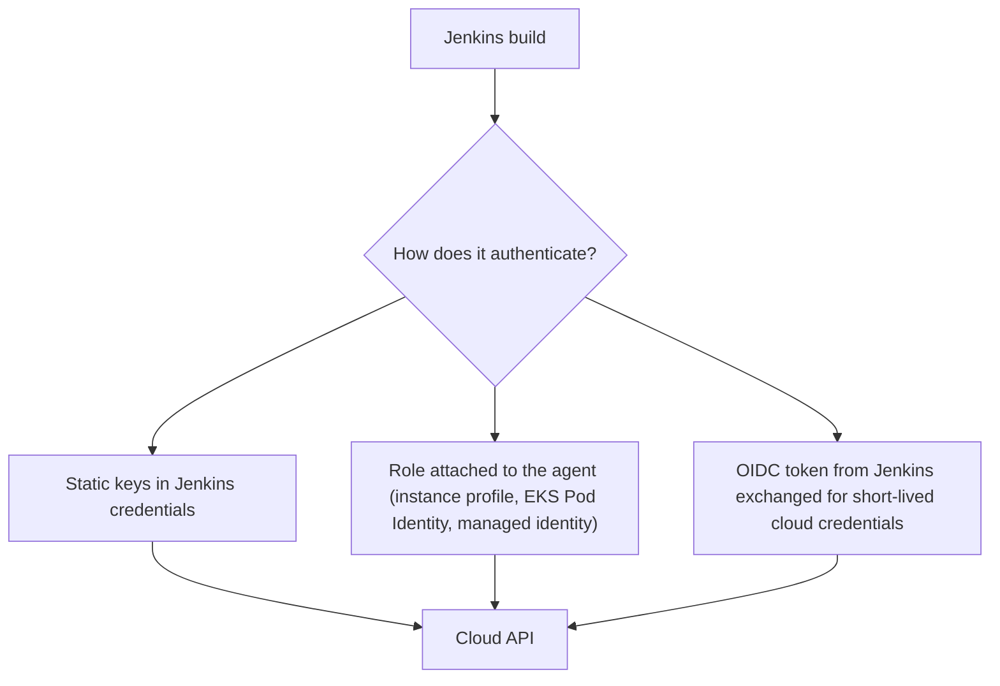

# Deploying to AWS and Azure

## Introduction

Sooner or later a Jenkins pipeline needs to talk to a cloud provider: push an image to a registry, update an ECS service, publish a Lambda function, or roll out a new version of an Azure web app. The commands are usually one or two lines of `aws` or `az` CLI. The real design decision is **how Jenkins proves who it is** to the cloud.

Picture a building with a security desk. You can give the courier (Jenkins) a permanent key to the front door (static access keys), which works until the key is copied. You can let the courier use a staff badge issued to the delivery van itself (an IAM role attached to the agent machine). Or the courier can show a signed letter from their employer that the desk verifies on the spot, and receive a visitor badge valid for one hour (OIDC federation). The third option is the most work to set up and the safest to run.

This page covers:

- The three ways to authenticate Jenkins to AWS and Azure, with trade-offs
- Running the official CLIs in container agents
- Deploying to Amazon ECS, AWS Lambda and Amazon S3
- Deploying to Azure App Service and Azure Container Apps
- Which Jenkins plugins are still worth using, and which have been retired

For cloud concepts such as IAM roles and service principals, see the [Cloud tutorial](/docs/devops/cloud). For agents that *run* in the cloud, see [Cloud Agents on AWS and Azure](../6-jenkins-agents/5-jenkins-cloud-agents.mdx).

:::info Versions change
Plugin versions, CLI versions and image tags on this page were checked in October 2026. Cloud services and plugins change often. Check [plugins.jenkins.io](https://plugins.jenkins.io), the [AWS CLI reference](https://docs.aws.amazon.com/cli/latest/) and the [Azure CLI reference](https://learn.microsoft.com/cli/azure/) before you copy versions.
:::

## Three Ways to Authenticate



| Method | How it works | Pros | Cons |
| --- | --- | --- | --- |
| Static keys or client secrets | AWS access key or Azure service principal secret stored as a Jenkins credential | Works from anywhere; simplest | Long-lived secret; must rotate; leaks are serious |
| Agent identity | The agent VM or pod has an IAM role or Azure managed identity | No secret in Jenkins | Every job on that agent gets the same rights; agent must run in that cloud |
| OIDC federation | Jenkins signs a short-lived token; AWS STS or Microsoft Entra ID exchanges it for temporary credentials | No stored secret; per-job trust rules | More setup; the cloud must reach Jenkins' public keys |

A sensible progression: start with static keys only for experiments, use agent identity for dedicated deploy agents, and move to OIDC federation for production.

## AWS: Static Keys with Credentials Binding

The **AWS Credentials** plugin (`aws-credentials`) adds an "AWS Credentials" credential type and a binding for `withCredentials`:

```groovy
withCredentials([[$class: 'AmazonWebServicesCredentialsBinding',
                  credentialsId: 'aws-deployer-staging',
                  roleArn: 'arn:aws:iam::111122223333:role/orders-deployer',
                  roleSessionName: "jenkins-${env.BUILD_NUMBER}"]]) {
    sh 'aws sts get-caller-identity'
}
```

Example output:

```text
{
    "UserId": "AROAEXAMPLEID:jenkins-42",
    "Account": "111122223333",
    "Arn": "arn:aws:sts::111122223333:assumed-role/orders-deployer/jenkins-42"
}
```

The binding sets `AWS_ACCESS_KEY_ID` and `AWS_SECRET_ACCESS_KEY`, and also `AWS_SESSION_TOKEN` when `roleArn` is used. Assuming a role is good practice even with static keys: the stored IAM user can do nothing except assume that role, and the role carries the real permissions.

:::note withAWS
The **Pipeline: AWS Steps** plugin (`pipeline-aws`) offers a `withAWS(region: ..., role: ...)` wrapper and steps such as `s3Upload`. It is still maintained, but every step it offers has an `aws` CLI equivalent. Using the CLI in a container keeps your pipeline independent of plugin upgrades, which matters given Jenkins' plugin maintenance burden (see [Avoiding Plugin Sprawl](../7-jenkins-plugins/2-jenkins-plugin-dependency-hell.mdx)).
:::

## AWS: OIDC Federation without Stored Keys

The **OpenID Connect Provider** plugin (`oidc-provider`) turns Jenkins into an OIDC identity provider. A build can request an **ID token**, a signed JWT whose `sub` claim is by default the job URL. AWS STS checks the signature and your trust policy, then returns temporary credentials.

Setup outline:

1. Install `oidc-provider` and create a credential of type **OpenID Connect id token as file** with ID `aws-oidc` and audience `sts.amazonaws.com`. Saving it shows the issuer URL, typically `https://jenkins.example.com/oidc`.
2. In AWS IAM, add an **OIDC identity provider** for that issuer URL. AWS must be able to fetch the issuer's discovery document. If your Jenkins is not internet-reachable, the plugin supports publishing two static JSON files at an alternate issuer, such as an S3 bucket.
3. Create a role whose trust policy only accepts tokens for one job:

```json
{
  "Version": "2012-10-17",
  "Statement": [
    {
      "Effect": "Allow",
      "Principal": {
        "Federated": "arn:aws:iam::111122223333:oidc-provider/jenkins.example.com/oidc"
      },
      "Action": "sts:AssumeRoleWithWebIdentity",
      "Condition": {
        "StringEquals": {
          "jenkins.example.com/oidc:aud": "sts.amazonaws.com",
          "jenkins.example.com/oidc:sub": "https://jenkins.example.com/job/deploy-production/job/orders-api-prod/"
        }
      }
    }
  ]
}
```

4. In the pipeline, bind the token file and let the AWS CLI do the exchange. The CLI reads `AWS_ROLE_ARN` and `AWS_WEB_IDENTITY_TOKEN_FILE` automatically:

```groovy
pipeline {
    agent {
        kubernetes {
            defaultContainer 'aws'
            yaml '''
apiVersion: v1
kind: Pod
spec:
  containers:
    - name: aws
      image: amazon/aws-cli:2.37.12
      command: ["sleep"]
      args: ["infinity"]
'''
        }
    }
    environment {
        AWS_REGION   = 'eu-west-1'
        AWS_ROLE_ARN = 'arn:aws:iam::111122223333:role/orders-deployer-prod'
    }
    stages {
        stage('Who am I') {
            steps {
                withCredentials([file(credentialsId: 'aws-oidc', variable: 'AWS_WEB_IDENTITY_TOKEN_FILE')]) {
                    sh 'aws sts get-caller-identity --query Arn --output text'
                }
            }
        }
    }
}
```

Example output:

```text
arn:aws:sts::111122223333:assumed-role/orders-deployer-prod/botocore-session-1760178133
```

Because the trust policy pins the `sub` claim to one job URL, a different job, even on the same controller, cannot assume this role. You can add more claims (for example the branch name) through the plugin's claim templates and match them in the trust policy. Read the plugin page carefully: anyone who can run a job that the trust policy accepts can obtain the role, so combine this with [folder permissions](../11-jenkins-security/2-jenkins-authorization.mdx).

## AWS Deployment Examples

The examples below run inside a `withCredentials` block like the one above.

### Amazon ECS: new image for a service

ECS services run task definitions. To deploy a new image, register a new task definition revision and point the service at it:

```bash
#!/usr/bin/env bash
# deploy/ecs-deploy.sh CLUSTER SERVICE IMAGE_REF
set -euo pipefail
CLUSTER="$1"; SERVICE="$2"; IMAGE_REF="$3"

# Render the task definition template checked into the repo
sed "s|__IMAGE__|${IMAGE_REF}|" deploy/taskdef.json > /tmp/taskdef.json

TASKDEF_ARN=$(aws ecs register-task-definition \
  --cli-input-json file:///tmp/taskdef.json \
  --query 'taskDefinition.taskDefinitionArn' --output text)
echo "Registered ${TASKDEF_ARN}"

aws ecs update-service --cluster "$CLUSTER" --service "$SERVICE" \
  --task-definition "$TASKDEF_ARN" --query 'service.deployments[0].status' --output text

echo "Waiting for the service to become stable..."
aws ecs wait services-stable --cluster "$CLUSTER" --services "$SERVICE"
echo "Service ${SERVICE} is stable on ${TASKDEF_ARN}"
```

Example output:

```text
Registered arn:aws:ecs:eu-west-1:111122223333:task-definition/orders-api:58
PRIMARY
Waiting for the service to become stable...
Service orders-api is stable on arn:aws:ecs:eu-west-1:111122223333:task-definition/orders-api:58
```

`aws ecs wait services-stable` polls until the deployment completes, and fails after its built-in number of attempts. Enable the ECS **deployment circuit breaker** with rollback on the service, so ECS itself reverts if new tasks keep failing.

### AWS Lambda: update function code

```bash
aws lambda update-function-code \
  --function-name orders-webhook \
  --zip-file fileb://build/function.zip \
  --publish --query 'Version' --output text
aws lambda wait function-updated --function-name orders-webhook
```

Example output:

```text
17
```

`--publish` creates a numbered version. Pointing an alias such as `live` at the new version (`aws lambda update-alias`) gives you a one-command rollback: point the alias back at the old version.

### Amazon S3: static website

```bash
aws s3 sync build/ "s3://shop-frontend-prod/" --delete
aws cloudfront create-invalidation --distribution-id E1EXAMPLE --paths "/index.html"
```

## Azure: What Happened to the Azure Plugins?

Microsoft **retired its Jenkins plugins for Azure on 29 February 2024**, including Azure Credentials, Azure App Service and Azure Container Instances plugins. Microsoft's current guidance is to use the **Azure CLI** from your pipelines. Older tutorials that use `azureWebAppPublish` or `azureCLI` steps from those plugins are out of date. See Microsoft's [Jenkins plug-ins for Azure](https://learn.microsoft.com/azure/developer/jenkins/plug-ins-for-azure) page for the status of each plugin.

In practice this means: run `az` in a container, and log in with one of the three methods from the table at the top.

## Azure: Service Principal with a Secret

Create a service principal scoped to one resource group, then store its client ID and secret as a Jenkins **Username with password** credential:

```bash
az ad sp create-for-rbac --name jenkins-orders-deployer \
  --role Contributor \
  --scopes /subscriptions/<subscription-id>/resourceGroups/rg-orders-staging
```

```groovy
withCredentials([usernamePassword(credentialsId: 'azure-sp-staging',
                                  usernameVariable: 'AZURE_CLIENT_ID',
                                  passwordVariable: 'AZURE_CLIENT_SECRET')]) {
    sh '''
        az login --service-principal \
          --username "$AZURE_CLIENT_ID" \
          --password "$AZURE_CLIENT_SECRET" \
          --tenant "$AZURE_TENANT_ID" --output none
        az account show --query name --output tsv
    '''
}
```

Example output:

```text
Shop Staging Subscription
```

`AZURE_TENANT_ID` can be a plain environment variable since it is not secret. Scope the role to a resource group, not the subscription, and prefer a narrower built-in role (such as Website Contributor) when one fits.

## Azure: Workload Identity Federation

The same `oidc-provider` plugin works with Microsoft Entra ID. Create an **OpenID Connect id token** credential with audience `api://AzureADTokenExchange`, then add a **federated credential** to your app registration or user-assigned managed identity with the Jenkins issuer URL and the job URL as the subject. The pipeline logs in with the token instead of a secret:

```groovy
withCredentials([string(credentialsId: 'azure-oidc', variable: 'ID_TOKEN')]) {
    sh '''
        az login --service-principal \
          --username "$AZURE_CLIENT_ID" \
          --tenant "$AZURE_TENANT_ID" \
          --federated-token "$ID_TOKEN" --output none
        az account set --subscription "$AZURE_SUBSCRIPTION_ID"
    '''
}
```

If your agents run on Azure VMs or AKS, a **managed identity** on the agent (`az login --identity`) is another secret-free option, with the same "every job on this agent" caveat as AWS instance roles.

## Azure Deployment Examples

### Azure App Service: deploy a ZIP package

```bash
az webapp deploy \
  --resource-group rg-orders-staging \
  --name orders-api-staging \
  --src-path build/orders-api.zip \
  --type zip
```

For safer production releases, deploy to a **staging slot** and swap:

```bash
az webapp deploy -g rg-orders-prod -n orders-api-prod --slot staging --src-path build/orders-api.zip --type zip
curl -fsS https://orders-api-prod-staging.azurewebsites.net/healthz
az webapp deployment slot swap -g rg-orders-prod -n orders-api-prod --slot staging --target-slot production
```

A slot swap is a built-in blue-green deployment. See [Blue-Green and Canary Deployments](./5-jenkins-blue-green-canary.mdx).

### Azure Container Apps: new image

```bash
az containerapp update \
  --resource-group rg-orders-staging \
  --name orders-api \
  --image "$IMAGE_REF" \
  --query properties.latestRevisionName --output tsv
```

Example output:

```text
orders-api--0000058
```

## Real-World Scenario

**Your company** runs its main shop on AWS (ECS) and a newly acquired analytics product on Azure App Service. Jenkins runs on EKS. An audit found 14 long-lived AWS access keys and 3 Azure client secrets in Jenkins credentials, two of them older than three years.

### The solution

1. Install `oidc-provider` and publish its discovery documents. Register the issuer in AWS IAM and in Entra ID.
2. For each production deploy job, create a role (AWS) or federated credential (Azure) whose trust rule matches that **job URL**.
3. Deploy jobs use container agents with pinned `amazon/aws-cli` and `mcr.microsoft.com/azure-cli` images and bind the ID token with `withCredentials`.
4. CI jobs that only push images get a separate, narrower role (ECR push only).
5. Delete the static keys once every job has moved.

### Why this approach

- **Nothing long-lived to leak.** A copied ID token expires quickly.
- **Per-job trust.** The cloud, not just Jenkins, decides which job gets which role.
- **One pattern for two clouds.** Both AWS and Azure accept the same plugin's tokens.

### When to use it, and when not to

OIDC federation needs the cloud to verify Jenkins' signing keys and some IAM work per job. For a small team with one dedicated deploy agent inside AWS, an instance role or EKS Pod Identity on that agent is simpler and still secret-free. Static keys are acceptable only for short experiments or for systems that support nothing else.

### Alternatives and trade-offs

| Approach | Pros | Cons | Best for |
| --- | --- | --- | --- |
| Static keys or secrets | Easy; works anywhere | Leaks, rotation work, audit findings | Experiments |
| Agent role or managed identity | No secrets in Jenkins | Shared by all jobs on the agent | Dedicated deploy agents in the same cloud |
| OIDC federation via `oidc-provider` | Short-lived, per-job trust | Setup effort; Jenkins issuer must be verifiable | Production deploys, multi-cloud |
| Secrets from Vault | Central rotation and audit | Another system | Organizations already using Vault ([External Secrets](../11-jenkins-security/4-jenkins-external-secrets.mdx)) |
| Cloud-native CD (CodeDeploy, Azure DevOps) | Tight cloud integration | Separate tool from Jenkins | Single-cloud teams starting fresh |

## Common Mistakes

1. **Using retired Azure plugins.** Use the Azure CLI. Remove retired plugins during your next [plugin review](../7-jenkins-plugins/0-jenkins-plugin-management.mdx).
2. **Admin-level cloud roles.** Scope roles to the resources a job deploys.
3. **Interpolating secrets in Groovy strings.** Use single-quoted `sh` scripts so the shell reads the variables.
4. **Trusting every Jenkins job.** An OIDC trust policy that only checks `aud` lets any job assume the role. Always match `sub`.
5. **Not waiting for the deployment.** Use `aws ecs wait services-stable`, `aws lambda wait function-updated`, or a health check after Azure deployments.
6. **Unpinned CLI images.** A new CLI release can change output formats. Pin versions and update them on purpose.

## Summary

- The key decision is **authentication**: static keys, agent identity, or OIDC federation.
- `aws-credentials` provides the `AmazonWebServicesCredentialsBinding` for `withCredentials`. `oidc-provider` lets Jenkins issue ID tokens for AWS and Azure.
- Run the **official CLIs in pinned containers** and keep deploy logic in scripts.
- Microsoft **retired** its Azure Jenkins plugins in 2024. Use `az` instead.
- Always wait for the cloud service to report a stable deployment.

## Exercises

1. Create a Jenkins pipeline that runs `aws sts get-caller-identity` using an AWS credential with `roleArn`. Then change it to use OIDC federation and compare the output.
2. Write the ECS deploy script for a sample service and run it against a test cluster. Break the image name on purpose and see how `services-stable` behaves.
3. Deploy a small ZIP app to an Azure App Service staging slot, check its health endpoint, then swap the slot.
4. Write an AWS trust policy that allows only builds of the `main` branch by adding a custom claim and matching it.

### Related pages

- [Credentials Management](../11-jenkins-security/3-jenkins-credentials.mdx)
- [Deploying to Kubernetes](./2-jenkins-deploy-to-kubernetes.mdx)
- [Running Terraform and Ansible](./4-jenkins-terraform-and-ansible.mdx)
- [Cloud Agents on AWS and Azure](../6-jenkins-agents/5-jenkins-cloud-agents.mdx)
