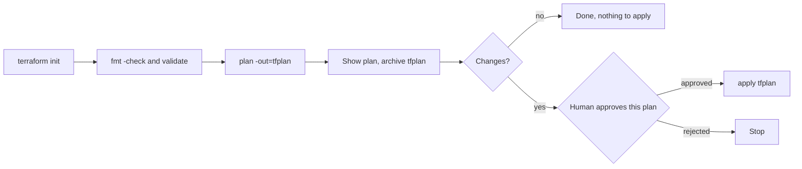

# Running Terraform and Ansible

## Introduction

Applications are not the only thing you deploy. The servers, networks, databases and clusters they run on also change, and those changes deserve the same review, testing and audit trail as code. Two popular tools handle most of this work:

- **Terraform** (and its open-source fork **OpenTofu**) creates and changes infrastructure through cloud APIs: "there should be a VPC, two subnets and a database."
- **Ansible** configures machines and runs procedures over SSH: "install nginx on these servers, copy this config, restart the service."

Jenkins is a common place to run both, because it already has credentials, agents, approval steps and logs. But infrastructure pipelines have different risks from application pipelines. A bad application deploy can usually be rolled back in minutes. A bad `terraform apply` can delete a database.

Think of Terraform like a building contractor who first gives you a written quote of exactly what they will build and demolish (the plan), and then only does what the signed quote says (applying the saved plan). Ansible is more like a maintenance crew with a checklist that they run room by room.

This page covers:

- A Terraform pipeline that plans, gets approval for **that exact plan**, then applies it
- State, locking and concurrency
- Running Ansible with the `ansiblePlaybook` step or plain shell
- Using check mode as a "plan" for Ansible
- When Jenkins is the wrong tool for infrastructure automation

For the tools themselves, see the [Terraform tutorial](/docs/devops/terraform) and the [Ansible tutorial](/docs/devops/ansible).

## The Terraform Pipeline Flow



The important rule: **apply the saved plan file**, not a fresh `terraform apply`. If you run `apply` without the plan file, Terraform computes a new plan at apply time. If someone else changed the infrastructure or the code in between, you would apply something nobody reviewed.

## Running Terraform in a Container

Use the official image and pin the version so every build uses the same Terraform:

```groovy
pipeline {
    agent {
        kubernetes {
            defaultContainer 'terraform'
            yaml '''
apiVersion: v1
kind: Pod
spec:
  containers:
    - name: terraform
      image: hashicorp/terraform:1.16
      command: ["sleep"]
      args: ["infinity"]
'''
        }
    }
    options {
        disableConcurrentBuilds()
        timestamps()
    }
    parameters {
        choice(name: 'TF_ENV', choices: ['staging', 'production'], description: 'Environment directory to plan')
    }
    environment {
        TF_IN_AUTOMATION = 'true'
        TF_INPUT         = '0'
        TF_DIR           = "infra/envs/${params.TF_ENV}"
    }
    stages {
        stage('Init and Validate') {
            steps {
                dir(env.TF_DIR) {
                    sh 'terraform init -no-color'
                    sh 'terraform fmt -check -recursive -no-color'
                    sh 'terraform validate -no-color'
                }
            }
        }
    }
}
```

Example output:

```text
Initializing the backend...
Successfully configured the backend "s3"!
Initializing provider plugins...
- Installing hashicorp/aws v6.x...
Terraform has been successfully initialized!
Success! The configuration is valid.
```

Notes:

- `TF_IN_AUTOMATION=true` tells Terraform to shorten messages that assume a human at a terminal.
- `TF_INPUT=0` makes Terraform fail instead of waiting for input that will never come.
- The `hashicorp/terraform` image's entrypoint is `terraform`, which is why the pod overrides `command` with `sleep`.
- The image tag `1.16` was current in October 2026. Pin the version your team uses and upgrade deliberately. For OpenTofu, use the `ghcr.io/opentofu/opentofu` image and the `tofu` command.

### Credentials for Terraform

Terraform providers read the usual cloud environment variables, so the methods from [Deploying to AWS and Azure](./3-jenkins-deploy-to-cloud.mdx) work unchanged. Wrap the plan and apply steps in the same `withCredentials` block, ideally with OIDC federation. A plan needs read access to everything Terraform manages; consider a **read-only role for plan** and a separate **write role for apply**, so pull request builds can plan but never change anything.

## Plan, Approve, Apply

Add these stages after **Init and Validate**:

```groovy
stage('Plan') {
    steps {
        dir(env.TF_DIR) {
            script {
                // 0 = no changes, 1 = error, 2 = changes present
                def rc = sh(script: 'terraform plan -no-color -out=tfplan -detailed-exitcode', returnStatus: true)
                if (rc == 1) {
                    error 'terraform plan failed'
                }
                env.TF_HAS_CHANGES = (rc == 2) ? 'true' : 'false'
            }
            sh 'terraform show -no-color tfplan > plan.txt'
            archiveArtifacts artifacts: 'plan.txt', fingerprint: true
            stash name: 'tfplan', includes: 'tfplan,.terraform/**,.terraform.lock.hcl'
        }
    }
}

stage('Approve') {
    when {
        beforeInput true
        allOf {
            branch 'main'
            environment name: 'TF_HAS_CHANGES', value: 'true'
        }
    }
    options { timeout(time: 2, unit: 'HOURS') }
    input {
        message 'Apply the archived plan.txt?'
        ok 'Apply'
        submitter 'infra-admins'
        submitterParameter 'APPROVER'
    }
    steps {
        echo "Plan approved by ${APPROVER}"
    }
}

stage('Apply') {
    when {
        allOf {
            branch 'main'
            environment name: 'TF_HAS_CHANGES', value: 'true'
        }
    }
    steps {
        dir(env.TF_DIR) {
            unstash 'tfplan'
            sh 'terraform apply -no-color tfplan'
        }
    }
}
```

Example output from the plan stage:

```text
Terraform will perform the following actions:

  # aws_db_instance.orders will be updated in-place
  ~ resource "aws_db_instance" "orders" {
      ~ instance_class = "db.t4g.medium" -> "db.t4g.large"
        id             = "orders-staging"
    }

Plan: 0 to add, 1 to change, 0 to destroy.
```

Example output from apply:

```text
aws_db_instance.orders: Modifying... [id=orders-staging]
aws_db_instance.orders: Modifications complete after 4m12s [id=orders-staging]

Apply complete! Resources: 0 added, 1 changed, 0 destroyed.
```

What this gives you:

- `-detailed-exitcode` lets the pipeline **skip approval** when nothing would change. Without it, people learn to click "Apply" without reading.
- The human-readable plan is **archived**, so the approver reads exactly what will happen, and the build keeps a record.
- `stash` and `unstash` carry the plan file to the apply stage (see [Stash, Unstash and Artifacts](../4-jenkins-pipeline-advanced/4-jenkins-stash-and-artifacts.mdx)). A plan file can contain sensitive values, so do not archive the binary `tfplan` itself unless your artifact storage is protected.
- Terraform refuses to apply a saved plan if the state has changed since it was created, which protects you from stale approvals.
- Because this example uses a pipeline-level `agent`, the agent pod stays up during the approval wait. That is fine for short waits. For approvals that can take hours, use `agent none` at the top and give the plan and apply stages their own agents, as shown in [Deployment Pipelines](./0-jenkins-deployment-pipelines.mdx). The `stash` already makes the plan file portable between agents.

:::warning Plan output can leak secrets
Terraform redacts values marked `sensitive`, but not everything that is secret is marked. Review what your `plan.txt` contains before archiving it in a Jenkins instance many people can read.
:::

## State and Locking

Terraform keeps a **state file** that maps your code to real resources. In Jenkins:

- **Always use a remote backend** (S3, Azure Storage, GCS, HCP Terraform). Never keep state in the Jenkins workspace: workspaces are deleted and are not shared between agents.
- **Use the backend's locking.** The S3 backend supports native locking with `use_lockfile = true`, and the Azure backend locks with blob leases. If two builds run at once, the second waits or fails instead of corrupting state.
- **Add a Jenkins lock as well** for long sequences like plan, approve, apply, so a second build cannot plan in between:

```groovy
options {
    lock(resource: "terraform-${params.TF_ENV}")
}
```

Put this in the pipeline-level `options`, and the whole build holds the lock, including the approval wait. That is usually what you want for infrastructure.

## Running Ansible

There are two ways to run Ansible from Jenkins.

### Option A: the ansiblePlaybook step

The **Ansible** plugin (`ansible`) provides the `ansiblePlaybook` step, which builds the `ansible-playbook` command line for you and handles SSH keys and vault passwords from Jenkins credentials:

```groovy
stage('Configure web servers') {
    steps {
        ansiblePlaybook(
            playbook: 'ansible/site.yml',
            inventory: 'ansible/inventories/staging/hosts.ini',
            credentialsId: 'ansible-ssh-staging',
            vaultCredentialsId: 'ansible-vault-pass',
            limit: 'web',
            tags: 'nginx',
            colorized: true,
            extraVars: [
                app_version: env.APP_VERSION,
                release_notes_url: [value: env.BUILD_URL, hidden: false]
            ]
        )
    }
}
```

`credentialsId` refers to an **SSH Username with private key** credential, and `vaultCredentialsId` to a Secret text or Secret file holding the vault password. `extraVars` values are masked in logs by default, and the `hidden: false` form shows a value. `colorized: true` requires the AnsiColor plugin. The plugin needs `ansible-playbook` on the agent, configured as a tool installation or on the `PATH`.

### Option B: plain shell in a container

Many teams skip the plugin and run Ansible from a container image that has a pinned `ansible-core` version and the collections they need:

```groovy
stage('Configure web servers') {
    agent {
        docker { image 'registry.example.com/tools/ansible:2.20' }
    }
    steps {
        withCredentials([
            sshUserPrivateKey(credentialsId: 'ansible-ssh-staging', keyFileVariable: 'SSH_KEY', usernameVariable: 'SSH_USER'),
            file(credentialsId: 'ansible-vault-pass-file', variable: 'VAULT_PASS_FILE')
        ]) {
            sh '''
                ansible-playbook ansible/site.yml \
                  -i ansible/inventories/staging/hosts.ini \
                  --private-key "$SSH_KEY" -u "$SSH_USER" \
                  --vault-password-file "$VAULT_PASS_FILE" \
                  --limit web --tags nginx \
                  -e app_version="$APP_VERSION"
            '''
        }
    }
}
```

Example output:

```text
PLAY [web] *********************************************************************
TASK [nginx : Install nginx] ***************************************************
ok: [web-1]
ok: [web-2]
TASK [nginx : Deploy site config] **********************************************
changed: [web-1]
changed: [web-2]
PLAY RECAP *********************************************************************
web-1 : ok=6  changed=1  unreachable=0  failed=0  skipped=0
web-2 : ok=6  changed=1  unreachable=0  failed=0  skipped=0
```

| Option | Pros | Cons | Best for |
| --- | --- | --- | --- |
| `ansiblePlaybook` step | Credential handling built in; less shell code | Another plugin to maintain; Ansible must be on the agent | Teams that already use the plugin |
| Shell in a container | Same command as on a laptop; versions pinned in the image | You write the credential wiring | Most new pipelines |

### Check mode as an Ansible "plan"

Ansible has no plan file, but `--check --diff` shows what would change without changing it. Run it before the real run and gate on it, just like a Terraform plan:

```bash
ansible-playbook ansible/site.yml -i ansible/inventories/production/hosts.ini --check --diff --limit web
```

Example output:

```text
TASK [nginx : Deploy site config] **********************************************
--- before: /etc/nginx/conf.d/shop.conf
+++ after: /tmp/shop.conf.j2
@@ -3 +3 @@
-    proxy_read_timeout 30s;
+    proxy_read_timeout 60s;
changed: [web-1]
```

Check mode is only as good as your modules: `shell` and `command` tasks are skipped in check mode unless written carefully, so a clean check run is a hint, not a guarantee.

## Terraform and Ansible Together

A common flow: Terraform creates the machines, then Ansible configures them. Pass Terraform outputs to Ansible instead of hand-editing inventories:

```groovy
stage('Export inventory') {
    steps {
        dir(env.TF_DIR) {
            sh 'terraform output -json web_private_ips > ../../../ansible/web_ips.json'
        }
        sh 'python3 ansible/scripts/json_to_inventory.py ansible/web_ips.json > ansible/inventories/generated.ini'
    }
}
```

Better still, use a **dynamic inventory** plugin for your cloud (for example `amazon.aws.aws_ec2`), which finds hosts by tags, so no file handoff is needed.

## Real-World Scenario

**Your infrastructure team** of three manages AWS networking, RDS databases and a fleet of EC2 web servers for an e-commerce site. Changes are made from laptops with `terraform apply`. Last month two engineers applied at the same time, and a mistyped variable resized the production database during business hours.

### The solution

1. Terraform code moves into one repository with `infra/envs/staging` and `infra/envs/production`, using the S3 backend with locking.
2. A multibranch Jenkins pipeline runs **init, validate and plan** on every pull request with a read-only role, and posts the plan summary as a build description.
3. On `main`, the pipeline plans again, archives `plan.txt`, waits for an `infra-admins` approval, and applies the saved plan with a write role. A pipeline-wide `lock` stops concurrent runs.
4. A second stage runs Ansible check mode, then the real playbook against the web servers, using a dynamic inventory.
5. Laptop credentials are reduced to read-only.

### Why this approach

- **Reviewed changes only.** What was approved is exactly what is applied.
- **No concurrent applies,** thanks to backend locking plus a Jenkins lock.
- **Same tool for apps and infra,** so the team reuses existing agents, credentials and notifications.

### When to use it, and when not to

Jenkins works well for infrastructure pipelines when you already run it and the number of Terraform root modules is modest. Purpose-built tools add features Jenkins lacks: plan comments on pull requests, policy checks, drift detection, and per-workspace permissions. If you manage hundreds of workspaces, look at them. For Ansible at scale, AWX or Red Hat Ansible Automation Platform provide inventories, schedules and role-based access to playbooks.

### Alternatives and trade-offs

| Approach | Pros | Cons | Best for |
| --- | --- | --- | --- |
| Terraform from laptops | Fast for one person | No review, no locking discipline, no audit | Personal sandboxes only |
| Jenkins pipeline (this page) | Reuses Jenkins; flexible | You build PR comments, policy and drift checks yourself | Small to medium teams already on Jenkins |
| Atlantis | Plan and apply driven by PR comments | Another service to run; Terraform only | Teams that live in pull requests |
| HCP Terraform, Spacelift, env0 | Policy, drift detection, UI | Cost; vendor dependence | Many workspaces, larger organizations |
| AWX or Ansible Automation Platform | Inventories, RBAC, schedules for Ansible | Separate system | Heavy Ansible usage |

## Common Mistakes

1. **`terraform apply -auto-approve` without a saved plan.** You apply something nobody reviewed.
2. **State in the workspace.** Use a remote backend with locking.
3. **One all-powerful role for plan and apply.** Pull request builds should only be able to read.
4. **Approving without reading.** Archive a readable plan and skip approval when there are no changes.
5. **Unpinned Terraform and provider versions.** Pin the image tag, commit `.terraform.lock.hcl`, and upgrade on purpose.
6. **Secrets in `extraVars` or plan output.** Use vault and sensitive variables, and check what lands in logs.
7. **Trusting check mode blindly.** Skipped `shell` tasks can hide real changes.

## Summary

- Run Terraform in a **pinned container**, with `TF_IN_AUTOMATION` and `TF_INPUT=0`.
- **Plan, archive, approve, then apply the saved plan.** Use `-detailed-exitcode` to skip empty approvals.
- Use a **remote backend with locking** plus a Jenkins `lock` around the whole flow.
- Run Ansible with `ansiblePlaybook` or plain shell in a container, and use `--check --diff` as a preview.
- Consider dedicated tools when the number of workspaces or playbooks grows large.

## Exercises

1. Create a tiny Terraform configuration (for example, the `local_file` resource) and build a Jenkins pipeline that plans, archives `plan.txt`, waits for approval and applies the saved plan.
2. Change nothing and rerun the pipeline. Confirm the approval stage is skipped because of `-detailed-exitcode`.
3. Run a simple Ansible playbook against a local container or VM from Jenkins, first with `--check --diff`, then for real.
4. Pass a Terraform output into an Ansible run, either with a generated inventory file or `-e`.

### Related pages

- [Environments and Promotion](./1-jenkins-environments-and-promotion.mdx)
- [Manual Input and Approvals](../4-jenkins-pipeline-advanced/2-jenkins-input-and-approvals.mdx)
- [Deploying to AWS and Azure](./3-jenkins-deploy-to-cloud.mdx)
- [Rollbacks](./6-jenkins-rollbacks.mdx)
