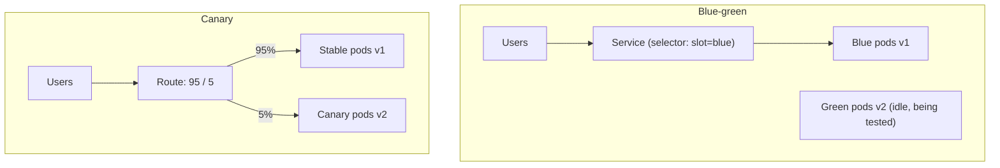

# Blue-Green and Canary Deployments

## Introduction

A normal rolling update replaces old pods with new ones a few at a time. That is fine most days, but it has two weaknesses: during the rollout users hit a mix of old and new versions, and if the new version is subtly broken (slow, or wrong for 2% of requests), every user eventually gets it before anyone notices.

Two release strategies reduce that risk:

- **Blue-green**: run the new version (green) next to the old one (blue), test green privately, then switch all traffic at once. Switching back is just as fast.
- **Canary**: send a small share of real traffic (say 5%) to the new version, watch error rates and latency, and increase the share step by step only if the numbers stay healthy.

The names come from real life. Blue-green is like a theater with two stages: you set up the next scene on the second stage, then rotate. A canary is the bird miners took underground: if it got sick, the miners left before they did.

Jenkins does not route traffic itself. It **orchestrates**: deploy the new version, run checks, flip a switch or change a weight, wait, check again, and stop or reverse if something looks wrong. This page shows how to do that on Kubernetes, first with plain manifests and then by handing the heavy lifting to **Argo Rollouts**.

For the general theory, see [Blue-Green Deployment](../../cicd/6-cicd-deployment-strategies/0-cicd-blue-green-deployment.mdx) and [Canary Deployment](../../cicd/6-cicd-deployment-strategies/1-cicd-canary-deployment.mdx) in the CI/CD tutorial. For Kubernetes basics see [Deploying to Kubernetes](./2-jenkins-deploy-to-kubernetes.mdx).

## Strategies at a Glance



| Strategy | Exposure to a bad release | Rollback speed | Extra capacity | Complexity |
| --- | --- | --- | --- | --- |
| Rolling update | Grows to 100% during rollout | Minutes (another rollout) | Small (surge pods) | Lowest |
| Blue-green | 0% until the switch, then 100% | Seconds (switch back) | Double during release | Medium |
| Canary | Small percentage, grows gradually | Seconds (weight to 0) | Small | Highest, needs good metrics |

## Blue-Green on Kubernetes with Jenkins

The simplest blue-green setup uses two Deployments and one Service whose selector decides which one is live.

```yaml
# k8s/bluegreen.yaml (the green Deployment is identical except for name and slot)
apiVersion: apps/v1
kind: Deployment
metadata:
  name: orders-api-blue
  namespace: shop
spec:
  replicas: 3
  selector:
    matchLabels: { app: orders-api, slot: blue }
  template:
    metadata:
      labels: { app: orders-api, slot: blue }
    spec:
      containers:
        - name: orders-api
          image: registry.example.com/shop/orders-api@sha256:1111
          readinessProbe:
            httpGet: { path: /healthz, port: 8080 }
---
apiVersion: v1
kind: Service
metadata:
  name: orders-api
  namespace: shop
spec:
  selector: { app: orders-api, slot: blue }
  ports:
    - port: 80
      targetPort: 8080
---
apiVersion: v1
kind: Service
metadata:
  name: orders-api-preview
  namespace: shop
spec:
  selector: { app: orders-api, slot: green }
  ports:
    - port: 80
      targetPort: 8080
```

The `orders-api-preview` Service always points at the idle slot, so tests can reach the new version before users do.

The Jenkins pipeline figures out which slot is live, deploys to the other one, tests it through the preview Service, and switches:

```groovy
pipeline {
    agent { label 'deploy' }
    parameters {
        string(name: 'IMAGE_REF', description: 'Image with digest to release')
    }
    environment {
        NS = 'shop'
    }
    stages {
        stage('Find idle slot') {
            steps {
                withKubeConfig(credentialsId: 'k8s-prod-deployer', serverUrl: 'https://k8s-prod.example.com:6443') {
                    script {
                        env.LIVE = sh(script: 'kubectl -n $NS get svc orders-api -o jsonpath="{.spec.selector.slot}"',
                                      returnStdout: true).trim()
                        env.IDLE = (env.LIVE == 'blue') ? 'green' : 'blue'
                        echo "Live slot: ${env.LIVE}, deploying to: ${env.IDLE}"
                    }
                }
            }
        }
        stage('Deploy to idle slot') {
            steps {
                withKubeConfig(credentialsId: 'k8s-prod-deployer', serverUrl: 'https://k8s-prod.example.com:6443') {
                    sh '''
                        kubectl -n $NS set image deployment/orders-api-$IDLE orders-api="$IMAGE_REF"
                        kubectl -n $NS scale deployment/orders-api-$IDLE --replicas=3
                        kubectl -n $NS rollout status deployment/orders-api-$IDLE --timeout=300s
                        kubectl -n $NS patch svc orders-api-preview \
                          -p "{\\"spec\\":{\\"selector\\":{\\"app\\":\\"orders-api\\",\\"slot\\":\\"$IDLE\\"}}}"
                    '''
                }
            }
        }
        stage('Test idle slot') {
            steps {
                sh './tests/smoke.sh http://orders-api-preview.shop.svc.cluster.local'
            }
        }
        stage('Switch traffic') {
            steps {
                withKubeConfig(credentialsId: 'k8s-prod-deployer', serverUrl: 'https://k8s-prod.example.com:6443') {
                    sh '''
                        kubectl -n $NS patch svc orders-api \
                          -p "{\\"spec\\":{\\"selector\\":{\\"app\\":\\"orders-api\\",\\"slot\\":\\"$IDLE\\"}}}"
                        echo "Traffic now on $IDLE. Previous slot $LIVE kept running for fast rollback."
                    '''
                }
            }
        }
    }
}
```

Example output:

```text
Live slot: blue, deploying to: green
deployment.apps/orders-api-green image updated
deployment.apps/orders-api-green scaled
deployment "orders-api-green" successfully rolled out
service/orders-api-preview patched
smoke test passed: 12/12 checks
service/orders-api patched
Traffic now on green. Previous slot blue kept running for fast rollback.
```

The old slot keeps running. A rollback is a single `kubectl patch` back to `blue`. Once you are confident (an hour later, or at the start of the next release), scale the old slot down to save capacity.

:::note Test from inside the cluster
The test stage calls a cluster-internal DNS name, so it only works if the agent runs inside the cluster, for example as a [Kubernetes pod agent](../6-jenkins-agents/4-jenkins-kubernetes-agents.mdx). From an external agent, run the test as a temporary pod, as shown on the previous Kubernetes page.
:::

### Blue-green beyond Kubernetes

The same idea exists in most platforms, and Jenkins drives each with a CLI call:

- **Azure App Service**: deployment slots and `az webapp deployment slot swap` ([Deploying to AWS and Azure](./3-jenkins-deploy-to-cloud.mdx)).
- **AWS ECS**: blue-green deployments for ECS services, either with native ECS blue/green or with CodeDeploy, depending on how the service is set up. Check the current AWS documentation for your setup.
- **Load balancers**: two target groups and a listener rule that you switch.

## Canary on Kubernetes with Gateway API Weights

Canary releases need **weighted traffic splitting**. Kubernetes Services cannot do that precisely, so you need a gateway, ingress controller, or service mesh. The portable option today is the **Gateway API** `HTTPRoute` with weighted `backendRefs`, supported by many gateway implementations.

:::caution Ingress NGINX is retired
Many older canary tutorials use `nginx.ingress.kubernetes.io/canary-weight` annotations. The Ingress NGINX project was [retired in March 2026](https://kubernetes.io/blog/2025/11/11/ingress-nginx-retirement/) and no longer receives security fixes. The Kubernetes project recommends migrating to Gateway API.
:::

```yaml
# k8s/route.yaml
apiVersion: gateway.networking.k8s.io/v1
kind: HTTPRoute
metadata:
  name: orders-api
  namespace: shop
spec:
  parentRefs:
    - name: public-gateway
      namespace: gateway-system
  hostnames: ["api.shop.example.com"]
  rules:
    - backendRefs:
        - name: orders-api-stable
          port: 80
          weight: 100
        - name: orders-api-canary
          port: 80
          weight: 0
```

The pipeline deploys the canary Deployment, then walks through the weights. At each step it waits and checks a metric gate:

```groovy
def setCanaryWeight(int canary) {
    int stable = 100 - canary
    sh """
        kubectl -n shop patch httproute orders-api --type=json -p '[
          {"op": "replace", "path": "/spec/rules/0/backendRefs/0/weight", "value": ${stable}},
          {"op": "replace", "path": "/spec/rules/0/backendRefs/1/weight", "value": ${canary}}
        ]'
    """
    echo "Traffic split: stable ${stable}% / canary ${canary}%"
}

pipeline {
    agent { label 'deploy' }
    parameters { string(name: 'IMAGE_REF', description: 'Image with digest') }
    stages {
        stage('Deploy canary') {
            steps {
                withKubeConfig(credentialsId: 'k8s-prod-deployer', serverUrl: 'https://k8s-prod.example.com:6443') {
                    sh 'kubectl -n shop set image deployment/orders-api-canary orders-api="$IMAGE_REF"'
                    sh 'kubectl -n shop rollout status deployment/orders-api-canary --timeout=300s'
                }
            }
        }
        stage('Progressive traffic') {
            steps {
                withKubeConfig(credentialsId: 'k8s-prod-deployer', serverUrl: 'https://k8s-prod.example.com:6443') {
                    script {
                        try {
                            for (w in [5, 25, 50]) {
                                setCanaryWeight(w)
                                sleep(time: 10, unit: 'MINUTES')
                                sh './deploy/check-canary.sh orders-api-canary'
                            }
                        } catch (err) {
                            setCanaryWeight(0)
                            error "Canary failed and was rolled back: ${err.message}"
                        }
                    }
                }
            }
        }
        stage('Promote') {
            steps {
                withKubeConfig(credentialsId: 'k8s-prod-deployer', serverUrl: 'https://k8s-prod.example.com:6443') {
                    sh 'kubectl -n shop set image deployment/orders-api-stable orders-api="$IMAGE_REF"'
                    sh 'kubectl -n shop rollout status deployment/orders-api-stable --timeout=600s'
                    script { setCanaryWeight(0) }
                }
            }
        }
    }
}
```

The gate script queries Prometheus for the canary's error ratio and fails if it is above a threshold:

```bash
#!/usr/bin/env bash
# deploy/check-canary.sh SERVICE - fail if 5xx ratio over 5 minutes is above 1%
set -euo pipefail
SVC="$1"
PROM="${PROM_URL:-http://prometheus.monitoring.svc:9090}"
QUERY="sum(rate(http_requests_total{service=\"${SVC}\",code=~\"5..\"}[5m])) / sum(rate(http_requests_total{service=\"${SVC}\"}[5m]))"
RATIO=$(curl -fsS --get "${PROM}/api/v1/query" --data-urlencode "query=${QUERY}" \
  | python3 -c 'import json,sys; r=json.load(sys.stdin)["data"]["result"]; print(r[0]["value"][1] if r else "0")')
echo "canary 5xx ratio: ${RATIO}"
python3 -c "import sys; sys.exit(0 if float('${RATIO}') <= 0.01 else 1)" || { echo "error ratio too high" >&2; exit 1; }
```

Example output:

```text
Traffic split: stable 95% / canary 5%
canary 5xx ratio: 0.0012
Traffic split: stable 75% / canary 25%
canary 5xx ratio: 0.0430
error ratio too high
Traffic split: stable 100% / canary 0%
ERROR: Canary failed and was rolled back: script returned exit code 1
```

The metric name `http_requests_total` and its labels depend on how your application is instrumented. Adjust the query to your metrics.

### The limits of doing canaries in Jenkins

This works, but notice what Jenkins is now responsible for:

- The build holds an agent and an executor for the whole canary, possibly an hour or more.
- If the Jenkins controller restarts mid-canary, the pipeline may resume, or may not, depending on durability settings. Traffic stays at whatever weight it was.
- Metric analysis lives in shell scripts each team writes again.

That is why many teams let a Kubernetes controller run the canary and have Jenkins only start it and watch it.

## Handing Off to Argo Rollouts

[Argo Rollouts](https://argoproj.github.io/rollouts/) is a Kubernetes controller that replaces a Deployment with a `Rollout` resource that knows blue-green and canary steps, traffic routing (including Gateway API through a plugin) and automated metric analysis. The rollout runs in the cluster, so it continues even if Jenkins goes down.

```yaml
# k8s/rollout.yaml (abbreviated)
apiVersion: argoproj.io/v1alpha1
kind: Rollout
metadata:
  name: orders-api
  namespace: shop
spec:
  replicas: 6
  selector:
    matchLabels: { app: orders-api }
  template:
    metadata:
      labels: { app: orders-api }
    spec:
      containers:
        - name: orders-api
          image: registry.example.com/shop/orders-api@sha256:1111
  strategy:
    canary:
      steps:
        - setWeight: 5
        - pause: { duration: 10m }
        - setWeight: 25
        - pause: { duration: 10m }
        - setWeight: 50
        - pause: {}
```

The final `pause: {}` with no duration waits for a manual promotion. Jenkins now only needs the `kubectl argo rollouts` plugin in its tools image:

```groovy
stage('Start canary') {
    steps {
        withKubeConfig(credentialsId: 'k8s-prod-deployer', serverUrl: 'https://k8s-prod.example.com:6443') {
            sh 'kubectl argo rollouts -n shop set image orders-api orders-api="$IMAGE_REF"'
        }
    }
}
stage('Approve full rollout') {
    input { message 'Canary at 50% looks good. Promote to 100%?' }
    steps {
        withKubeConfig(credentialsId: 'k8s-prod-deployer', serverUrl: 'https://k8s-prod.example.com:6443') {
            sh 'kubectl argo rollouts -n shop promote orders-api'
            sh 'kubectl argo rollouts -n shop status orders-api --timeout 20m'
        }
    }
}
```

`kubectl argo rollouts status` watches until the rollout is healthy and exits with an error if it degrades or the timeout passes, which fails the Jenkins stage. `kubectl argo rollouts abort orders-api` sends all traffic back to the stable version. With an `AnalysisTemplate`, the controller can run the Prometheus check itself and abort automatically.

## Real-World Scenario

**Your team** runs a payments API on Kubernetes. A release last quarter had a bug that only affected one card type, around 3% of requests. A rolling update shipped it to everyone within four minutes, and it took 40 minutes to notice and roll back. Management wants "smaller blast radius" without slowing releases much.

### The solution

1. Install Argo Rollouts and convert the `payments-api` Deployment to a `Rollout` with canary steps of 5%, 25% and 50%, each with a 10-minute pause and an `AnalysisTemplate` that checks the error rate per card type.
2. The Jenkins deploy job builds and verifies the image as before, then runs `kubectl argo rollouts set image`.
3. Jenkins waits with `status --timeout`. If analysis fails, the controller aborts and Jenkins marks the build failed and notifies the team.
4. A final `input` stage lets the on-call engineer promote to 100% during business hours.

### Why this approach

- The **canary logic runs in the cluster**, so a Jenkins restart cannot leave traffic half-shifted.
- **Analysis is declarative** and reviewed like code, instead of ad-hoc shell scripts.
- Jenkins keeps doing what it is good at: building, gating, recording and notifying.

### When to use it, and when not to

Canaries need **enough traffic** to produce meaningful metrics in a few minutes and **good per-version metrics**. For an internal tool with ten requests an hour, a 5% canary tells you nothing; use blue-green with a solid smoke test instead. Blue-green needs **double capacity** during releases and careful handling of database schema changes, since both versions share the database. Neither strategy helps with changes that are not backward compatible.

### Alternatives and trade-offs

| Approach | Pros | Cons | Best for |
| --- | --- | --- | --- |
| Rolling update | Built into Kubernetes; no extra setup | Everyone gets a bad release | Low-risk services |
| Blue-green with Jenkins and Service selectors | Simple; instant switch and rollback | Double capacity; all-or-nothing exposure | Services with good smoke tests, low traffic |
| Canary scripted in Jenkins | No new controller | Long-running builds; fragile on restarts | Experiments, a few services |
| Argo Rollouts or Flagger driven by Jenkins | In-cluster, automated analysis | Another controller to run | High-traffic Kubernetes services |
| Feature flags | Per-user control, no redeploy | Code complexity; flag cleanup | Business logic changes |

## Common Mistakes

1. **Canary without metrics.** If you cannot tell canary errors from stable errors, the canary only delays the incident.
2. **Too little traffic.** A 5% canary on a quiet service may see no requests at all during the pause.
3. **Incompatible database changes.** Both versions run at the same time. Use expand-and-contract migrations ([Rollbacks](./6-jenkins-rollbacks.mdx)).
4. **Scaling down blue immediately.** Keep the old slot until you are confident, or rollback is no longer instant.
5. **Long canaries holding executors.** Move the waiting into an in-cluster controller.
6. **Using retired tools.** New canaries should not depend on Ingress NGINX annotations.

## Summary

- **Blue-green** switches all traffic between two full environments; rollback is a switch back.
- **Canary** shifts traffic gradually and gates each step on metrics.
- Jenkins can orchestrate both with `kubectl` and Gateway API weights, but long canaries are better run by **Argo Rollouts** or similar, with Jenkins starting and watching them.
- Pick a strategy based on traffic volume, metric quality, capacity and database compatibility.

## Exercises

1. Set up the blue-green manifests in a local cluster and write a Jenkins pipeline that deploys to the idle slot and switches the Service.
2. Add a rollback stage that switches back to the previous slot if a post-switch smoke test fails.
3. Install a Gateway API implementation locally and use `kubectl patch` to shift weights between two Services. Measure the split with a loop of `curl` requests.
4. Install Argo Rollouts, convert a Deployment to a Rollout, and drive it from Jenkins with `set image`, `promote` and `status`.

### Related pages

- [Deploying to Kubernetes](./2-jenkins-deploy-to-kubernetes.mdx)
- [Rollbacks](./6-jenkins-rollbacks.mdx)
- [Jenkins with GitOps and Argo CD](./7-jenkins-gitops.mdx)
- [Monitoring Jenkins](../12-jenkins-administration/3-jenkins-monitoring.mdx)
