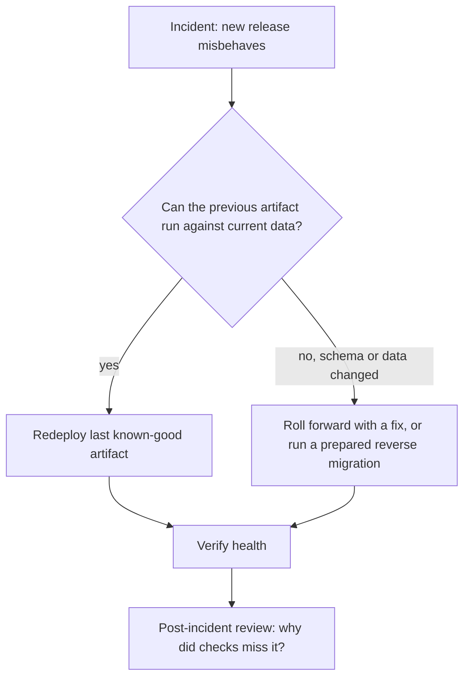
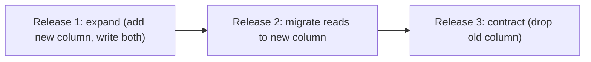

# Rollbacks

## Introduction

Every deployment pipeline eventually ships something broken. What separates a five-minute blip from a two-hour outage is usually not how good the tests were, but **how fast and how safely you can get back to a working version**.

A **rollback** returns production to a previous known-good state. A **roll forward** fixes the problem by shipping a new version quickly. Both are valid. The important thing is to decide *in advance* which one you will use, and to make it a boring, practiced procedure rather than an improvised one at 3 a.m.

Think of a rollback like the "undo" in a document editor, with a catch: undo only works for what the editor tracked. If you also emailed the document to fifty people (ran a database migration, sent messages to a queue, called a payment provider), undo cannot take that back. Good rollback design is mostly about knowing what your "undo" covers.

This page covers:

- Why rollbacks start at build time, with artifact identity
- A parameterized redeploy job as the universal rollback
- Platform rollbacks: `kubectl rollout undo`, `helm rollback`, Lambda aliases, Argo CD
- Automatic rollback in `post` blocks, and when not to automate
- Database migrations and other changes that cannot simply be undone
- Rolling forward

## What a Rollback Needs



To roll back, you need three things:

1. **The previous artifact still exists**, with an immutable identity (digest or SHA tag). If your registry cleanup policy deleted it, there is nothing to roll back to.
2. **You know which artifact was last good.** That means deployment records, not memory.
3. **The old artifact is compatible** with the current state of databases, queues and configuration.

The first two are covered by [Deployment Pipelines](./0-jenkins-deployment-pipelines.mdx) and [Environments and Promotion](./1-jenkins-environments-and-promotion.mdx). The third is a design discipline covered below.

## The Universal Rollback: Redeploy a Known-Good Version

If your deploy job takes the artifact as a parameter, **a rollback is just a deploy of an older artifact**. You do not need a separate "rollback pipeline" with its own untested code path.

```groovy
// deploy/orders-api: parameterized deploy job
pipeline {
    agent { label 'deploy' }
    options { disableConcurrentBuilds() }
    parameters {
        choice(name: 'TARGET_ENV', choices: ['staging', 'production'])
        string(name: 'IMAGE_REF', description: 'Image with digest')
        booleanParam(name: 'IS_ROLLBACK', defaultValue: false, description: 'Tick when redeploying an older version')
        string(name: 'REASON', defaultValue: '', description: 'Incident or ticket, required for rollbacks')
    }
    stages {
        stage('Validate') {
            steps {
                script {
                    if (params.IS_ROLLBACK && !params.REASON?.trim()) {
                        error 'A rollback needs a REASON (incident or ticket ID)'
                    }
                }
            }
        }
        stage('Deploy') {
            steps {
                lock(resource: "orders-api-${params.TARGET_ENV}") {
                    sh './deploy/deploy.sh "$TARGET_ENV" "$IMAGE_REF"'
                    sh './deploy/smoke-test.sh "$TARGET_ENV"'
                }
            }
        }
    }
    post {
        success {
            script {
                def kind = params.IS_ROLLBACK ? 'ROLLBACK' : 'deploy'
                currentBuild.description = "${kind} ${params.TARGET_ENV}: ${params.IMAGE_REF.take(60)}"
            }
        }
    }
}
```

To make it fast in an emergency, provide a way to find the last good version. A small helper script that lists recent successful production deploys from the Jenkins REST API works well:

```python
#!/usr/bin/env python3
"""List recent successful production deploys from a Jenkins deploy job."""
import base64
import json
import os
import sys
import urllib.request

JENKINS = os.environ.get("JENKINS_URL", "https://jenkins.example.com")
JOB = "job/deploy/job/orders-api"
USER = os.environ["JENKINS_USER"]
TOKEN = os.environ["JENKINS_TOKEN"]  # API token, not a password

url = f"{JENKINS}/{JOB}/api/json?tree=builds[number,result,description,timestamp]{{0,30}}"
req = urllib.request.Request(url)
auth = base64.b64encode(f"{USER}:{TOKEN}".encode()).decode()
req.add_header("Authorization", f"Basic {auth}")

with urllib.request.urlopen(req, timeout=10) as resp:
    builds = json.load(resp)["builds"]

for b in builds:
    desc = b.get("description") or ""
    if b["result"] == "SUCCESS" and "production" in desc:
        print(f"#{b['number']:>4}  {desc}")
sys.exit(0)
```

Example output:

```text
#  212  deploy production: registry.example.com/shop/orders-api@sha256:9b1e...
#  205  deploy production: registry.example.com/shop/orders-api@sha256:41af...
#  199  ROLLBACK production: registry.example.com/shop/orders-api@sha256:7c03...
```

The `tree` parameter limits the API response to the fields you need and `{0,30}` limits it to 30 builds. See [REST API and CLI](../12-jenkins-administration/8-jenkins-rest-api-and-cli.mdx).

## Platform-Native Rollbacks

Most platforms keep their own history, and their rollback command can be faster than a full redeploy. Use them for speed, but remember that they bypass your pipeline's checks and records unless you call them *from* Jenkins.

### Kubernetes Deployments

```bash
kubectl -n shop rollout history deployment/orders-api
kubectl -n shop rollout undo deployment/orders-api
kubectl -n shop rollout status deployment/orders-api --timeout=180s
```

Example output:

```text
deployment.apps/orders-api
REVISION  CHANGE-CAUSE
41        <none>
42        <none>
deployment.apps/orders-api rolled back
deployment "orders-api" successfully rolled out
```

`rollout undo` returns to the previous ReplicaSet's pod template. It only covers the Deployment's pod spec, not ConfigMaps, Secrets or other resources. Kubernetes keeps `revisionHistoryLimit` old ReplicaSets (10 by default).

### Helm releases

```bash
helm history orders-api -n shop --max 5
helm rollback orders-api 13 -n shop --wait --timeout 5m
```

Example output:

```text
REVISION  UPDATED                   STATUS      CHART             APP VERSION  DESCRIPTION
12        Fri Oct  9 14:02:11 2026  superseded  orders-api-1.7.0  1.7.0        Upgrade complete
13        Sat Oct 10 09:15:40 2026  superseded  orders-api-1.7.1  1.7.1        Upgrade complete
14        Sun Oct 11 10:42:13 2026  deployed    orders-api-1.8.0  1.8.0        Upgrade complete
Rollback was a success! Happy Helming!
```

Helm rollback restores **all** resources in the release to the old revision, which is broader than `kubectl rollout undo`. With `--rollback-on-failure` on upgrades (see [Deploying to Kubernetes](./2-jenkins-deploy-to-kubernetes.mdx)), Helm already rolls back failed upgrades automatically.

### Other platforms

| Platform | Rollback mechanism |
| --- | --- |
| AWS Lambda | Point the alias back: `aws lambda update-alias --function-name f --name live --function-version 16` |
| AWS ECS | `aws ecs update-service --task-definition orders-api:57`, or the deployment circuit breaker with rollback enabled |
| Azure App Service | Swap the slots back: `az webapp deployment slot swap` |
| Blue-green on Kubernetes | Patch the Service selector back to the old slot ([Blue-Green and Canary](./5-jenkins-blue-green-canary.mdx)) |
| Argo CD | Revert the commit in the config repo; `argocd app rollback` only works when auto-sync is off ([GitOps](./7-jenkins-gitops.mdx)) |
| Terraform | No rollback command. Revert the code and run a new plan and apply |

## Automatic Rollback in the Pipeline

You can make the pipeline roll back on its own when post-deploy verification fails:

```groovy
stage('Deploy to Production') {
    steps {
        script {
            // Remember what is running before we change it
            env.PREVIOUS_IMAGE = sh(
                script: 'kubectl -n shop get deploy orders-api -o jsonpath="{.spec.template.spec.containers[0].image}"',
                returnStdout: true).trim()
            echo "Previous image: ${env.PREVIOUS_IMAGE}"
        }
        sh 'kubectl -n shop set image deployment/orders-api orders-api="$IMAGE_REF"'
        sh 'kubectl -n shop rollout status deployment/orders-api --timeout=300s'
        sh './deploy/smoke-test.sh production'
    }
    post {
        failure {
            echo "Verification failed, rolling back to ${env.PREVIOUS_IMAGE}"
            sh 'kubectl -n shop set image deployment/orders-api orders-api="$PREVIOUS_IMAGE"'
            sh 'kubectl -n shop rollout status deployment/orders-api --timeout=300s'
        }
    }
}
```

Example output on a failed release:

```text
Previous image: registry.example.com/shop/orders-api@sha256:41af...
deployment.apps/orders-api image updated
deployment "orders-api" successfully rolled out
smoke test failed: GET /orders/health returned 500
Verification failed, rolling back to registry.example.com/shop/orders-api@sha256:41af...
deployment.apps/orders-api image updated
deployment "orders-api" successfully rolled out
```

The stage still ends as failed, which is correct: the release did not succeed, and the team should be notified.

Using `set image` with the recorded previous image rather than `rollout undo` makes the rollback explicit and repeatable, even if someone else changed the Deployment in between.

### When to automate, and when not to

| Automate the rollback when | Keep a human in the loop when |
| --- | --- |
| The check is clear-cut (health endpoint, error rate) | The release included a data migration |
| The previous version is known to be compatible | Rolling back could cause data loss or duplicate side effects |
| Time matters more than diagnosis | The failure might be in the environment, not the release |
| The deploy is stateless | Several services were released together |

## Database Changes: The Real Rollback Problem

Application code is easy to roll back. Data is not. If version 1.8 renamed a column and wrote new rows, version 1.7 may crash against the new schema.

The standard answer is **expand and contract** (also called parallel change):



- Each release is compatible with the version before it, so each can be rolled back on its own.
- Destructive steps (dropping a column) happen only after the previous release has been stable for a while.
- Run migrations as a **separate pipeline stage** before the app deploy, with their own logs and, for production, their own approval.

```groovy
stage('Migrate database') {
    steps {
        withCredentials([usernamePassword(credentialsId: 'orders-db-migrator-prod',
                                          usernameVariable: 'DB_USER', passwordVariable: 'DB_PASS')]) {
            sh './deploy/migrate.sh production'   // for example Flyway, Liquibase, Alembic
        }
    }
}
```

Never put "roll back the schema" in an automatic `post { failure }` block. A reverse migration that drops data is not something to run unattended.

## Rolling Forward

Sometimes the fastest safe path is a fix, not a rollback: the bug is a one-line change, or the old version is incompatible with migrated data. Rolling forward is reasonable when:

- Your pipeline is fast (build to production in minutes, not hours)
- The fix is small and well understood
- The impact while you wait is tolerable

Jenkins can support this with an **expedited path**: the same pipeline, but a parameter that skips slow non-essential stages (for example, a full performance suite) while keeping the safety checks. Avoid a separate "hotfix pipeline" that skips tests; that is where the next incident comes from.

## Keeping Rollback Targets Available

A rollback fails instantly if the thing you want to roll back to is gone. Two retention settings work against you here.

**Jenkins build retention.** `buildDiscarder` deletes old builds and their archived release records. Keep deploy jobs' history longer than CI history:

```groovy
options {
    // Deploy job: keep a long history of who deployed what
    buildDiscarder(logRotator(numToKeepStr: '500', artifactNumToKeepStr: '100'))
}
```

**Registry retention.** Container registries often have lifecycle policies such as "keep the last 30 images." A busy CI pipeline can push 30 images in a day, which would delete last week's production image. Exclude production releases from cleanup, for example by adding a `prod-` prefixed tag to every image that reaches production and writing the lifecycle rule to keep those.

```bash
# After a successful production deploy: add a protected tag to the same digest
docker buildx imagetools create --tag "registry.example.com/shop/orders-api:prod-$BUILD_NUMBER" "$IMAGE_REF"
```

Adding a tag does not create a new image. Both tags point to the same digest, so what you roll back to is exactly what ran before.

## Real-World Scenario

**Your team** releases a ride-booking API several times a day. Last Friday, release 3.14 broke surge pricing. The on-call engineer did not know which image was previously live, tried `kubectl rollout undo` twice (which went back two versions, one too far), and the service bounced between versions for 25 minutes.

### The solution

1. The deploy job records `PREVIOUS_IMAGE` and the new image in the build description and posts both to the team's Slack channel on success.
2. The deploy job gains `IS_ROLLBACK` and `REASON` parameters. The runbook says: copy the previous image from Slack or the helper script, run the deploy job with it, done.
3. Post-deploy checks run a pricing smoke test; on failure, the `post { failure }` block rolls back automatically, because the service is stateless.
4. Database changes follow expand and contract, and migrations run in their own stage with approval.
5. Once a quarter the team runs a **rollback drill** in staging.

### Why this approach

- **One code path** for deploys and rollbacks means the rollback path is tested every day.
- **Recorded previous versions** remove the guesswork of `rollout undo`.
- **Automatic rollback** covers the common case; humans handle data-affecting cases.

### When to use it, and when not to

Automatic rollback is excellent for stateless services with reliable health checks. It is risky for services that write data in formats older versions cannot read, or that trigger external side effects (emails, payments). There, prefer feature flags to disable the new behavior, or roll forward.

### Alternatives and trade-offs

| Approach | Pros | Cons | Best for |
| --- | --- | --- | --- |
| Redeploy previous artifact via deploy job | Same tested path; full audit trail | Slower than platform-native undo | Default for most teams |
| Platform-native undo (`rollout undo`, `helm rollback`) | Fast, one command | Can bypass records; scope varies | Emergencies, called from a Jenkins job |
| Automatic rollback in `post` | Fastest recovery | Can hide flaky checks; dangerous with data changes | Stateless services |
| Blue-green switch back | Seconds | Needs double capacity | Services already using blue-green |
| Feature flag off | No deploy at all | Only for flagged code | New features behind flags |
| Roll forward | Fixes the real problem | Needs a fast, trusted pipeline | Small fixes, incompatible data |

## Common Mistakes

1. **Deleting old artifacts too aggressively.** Keep at least the last several production images and artifacts.
2. **No record of what was live.** Write the previous and new versions into build descriptions or deploy records.
3. **A separate, untested rollback script.** Reuse the deploy job with an older artifact.
4. **Rolling back code but not config.** `rollout undo` does not restore ConfigMaps or Secrets.
5. **Automatic schema rollbacks.** Use expand and contract and keep humans in charge of data.
6. **Never practicing.** Run rollback drills in staging so the procedure works when it matters.

## Summary

- Rollbacks depend on **immutable artifacts**, **deployment records** and **backward-compatible changes**.
- Make the deploy job parameterized so a **rollback is a redeploy** of a known-good artifact.
- Use platform-native rollbacks for speed, ideally run from Jenkins so they are recorded.
- Automate rollbacks for stateless services with clear checks. Keep humans in the loop for data changes.
- Use **expand and contract** migrations, and consider rolling forward when that is safer.

## Exercises

1. Add `IS_ROLLBACK` and `REASON` parameters to your deploy job and make the build fail when a rollback has no reason.
2. Write the helper script that lists recent successful production deploys using the Jenkins REST API and an API token.
3. Add an automatic rollback in `post { failure }` that restores the recorded previous image, then test it with a deliberately broken release.
4. Plan an expand-and-contract migration for renaming a column, as three separate releases, and describe how each can be rolled back.

### Related pages

- [Deployment Pipelines](./0-jenkins-deployment-pipelines.mdx)
- [Blue-Green and Canary Deployments](./5-jenkins-blue-green-canary.mdx)
- [Post Conditions](../3-jenkins-pipeline-basics/7-jenkins-post-conditions.mdx)
- [Troubleshooting Jenkins](../12-jenkins-administration/7-jenkins-troubleshooting.mdx)
