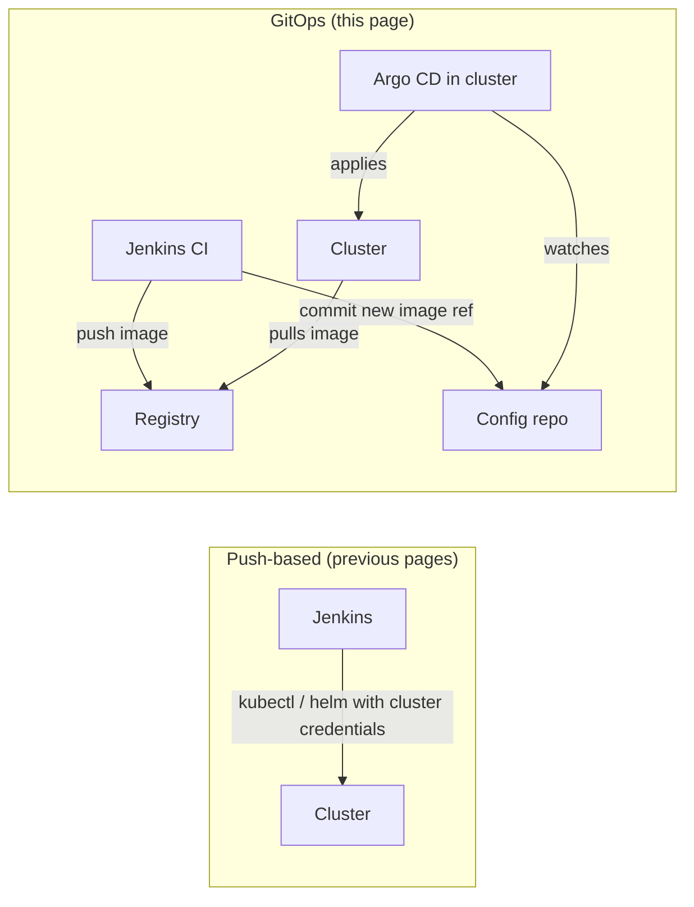

# Jenkins with GitOps and Argo CD

## Introduction

In the earlier pages of this section, Jenkins **pushes** changes into Kubernetes: it holds cluster credentials and runs `kubectl` or `helm`. **GitOps** flips that around. The desired state of each environment lives in a Git repository, and a controller running **inside** the cluster continuously **pulls** that state and makes the cluster match it.

**Argo CD** is the most widely used GitOps controller for Kubernetes (Flux is the other popular one). With GitOps, Jenkins does not disappear. It keeps doing what it is good at: building, testing, scanning and publishing images. Its last step changes from "deploy to the cluster" to "**update a file in Git**."

An analogy: in push-based deployment, Jenkins is a delivery driver with keys to every warehouse. With GitOps, Jenkins just updates the shared order list (Git). Each warehouse has its own manager (Argo CD) who reads the list and arranges the shelves to match, and who also puts things back if someone moves them without updating the list.

This page covers:

- How responsibilities split between Jenkins and Argo CD
- Repository layout for application code and environment configuration
- A Jenkins pipeline that updates the config repo safely
- Waiting for Argo CD from Jenkins (optional)
- Promotion through pull requests, and rollback with `git revert`
- Argo CD Image Updater and other alternatives

## Push vs Pull



What changes:

| Concern | Push from Jenkins | GitOps with Argo CD |
| --- | --- | --- |
| Cluster credentials | Stored in Jenkins | Stay inside the cluster |
| Source of truth | Jenkins build history plus the cluster | The config repo |
| Drift (manual `kubectl edit`) | Undetected until next deploy | Detected, and optionally reverted |
| Rollback | Redeploy an old artifact | `git revert` |
| Audit trail | Jenkins builds | Git commits and pull requests |
| Non-Kubernetes targets | Supported | Not covered by Argo CD |

## Repository Layout

Most teams keep application code and environment configuration in **separate repositories**. If CI committed manifest changes into the app repo, each commit would trigger another CI build, and app developers would need write access to production configuration.

```text
orders-api/                      (app repo, built by Jenkins)
  src/ ...
  Dockerfile
  Jenkinsfile

shop-deploy/                     (config repo, watched by Argo CD)
  apps/orders-api/
    base/
      deployment.yaml
      service.yaml
      kustomization.yaml
    overlays/
      staging/kustomization.yaml
      production/kustomization.yaml
```

The overlay pins the image. This is the line Jenkins changes:

```yaml
# shop-deploy/apps/orders-api/overlays/staging/kustomization.yaml
apiVersion: kustomize.config.k8s.io/v1beta1
kind: Kustomization
namespace: shop-staging
resources:
  - ../../base
images:
  - name: orders-api
    newName: registry.example.com/shop/orders-api
    digest: sha256:41af0c2d9e8b7a6f5e4d3c2b1a0f9e8d7c6b5a4f3e2d1c0b9a8f7e6d5c4b3a2f
```

## The Argo CD Application

An Argo CD `Application` tells Argo CD which path of which repo to sync into which namespace:

```yaml
# Applied once by the platform team
apiVersion: argoproj.io/v1alpha1
kind: Application
metadata:
  name: orders-api-staging
  namespace: argocd
spec:
  project: shop
  source:
    repoURL: https://github.com/example/shop-deploy.git
    targetRevision: main
    path: apps/orders-api/overlays/staging
  destination:
    server: https://kubernetes.default.svc
    namespace: shop-staging
  syncPolicy:
    automated:
      prune: true
      selfHeal: true
    syncOptions:
      - CreateNamespace=true
```

- `automated` makes Argo CD sync whenever the repo changes.
- `prune: true` deletes resources that were removed from Git.
- `selfHeal: true` reverts manual changes made directly in the cluster.

Argo CD polls Git every few minutes by default. Add a webhook from your Git host to Argo CD for near-instant syncs. See the [Argo CD documentation](https://argo-cd.readthedocs.io/en/stable/) for installation and webhooks. Argo CD 3.x was current at the time of writing.

## The Jenkins Side: Update the Config Repo

The CI pipeline builds and pushes the image as in [Building and Pushing Docker Images](../9-jenkins-build-and-test/7-jenkins-docker-image-builds.mdx), then updates the staging overlay. It needs `git` and `kustomize` on the agent, plus a credential that can push to the config repo. The `gitUsernamePassword` binding from the Git plugin configures Git authentication for the block, so the token never appears in a URL.

```groovy
pipeline {
    agent { label 'docker' }
    environment {
        CONFIG_REPO = 'https://github.com/example/shop-deploy.git'
        OVERLAY     = 'apps/orders-api/overlays/staging'
    }
    stages {
        stage('Build and Push') {
            steps {
                script {
                    // build-and-push.sh prints "registry/...@sha256:..."
                    env.IMAGE_REF = sh(script: './ci/build-and-push.sh', returnStdout: true).trim()
                }
            }
        }
        stage('Update staging config') {
            when { branch 'main' }
            steps {
                dir('shop-deploy') {
                    withCredentials([gitUsernamePassword(credentialsId: 'github-deploy-bot', gitToolName: 'Default')]) {
                        sh '''
                            git clone --depth 1 "$CONFIG_REPO" .
                            git config user.name  "jenkins-bot"
                            git config user.email "jenkins-bot@example.com"

                            cd "$OVERLAY"
                            kustomize edit set image orders-api="$IMAGE_REF"
                            cd - > /dev/null

                            if git diff --quiet; then
                              echo "Config already at $IMAGE_REF, nothing to commit"
                              exit 0
                            fi

                            git commit -am "orders-api: deploy ${IMAGE_REF##*@} to staging (build $BUILD_NUMBER)"
                            for attempt in 1 2 3; do
                              if git push origin HEAD:main; then
                                exit 0
                              fi
                              echo "push rejected, rebasing (attempt $attempt)"
                              git pull --rebase origin main
                            done
                            echo "could not push after 3 attempts" >&2
                            exit 1
                        '''
                    }
                }
            }
        }
    }
}
```

Example output:

```text
Cloning into '.'...
[main 8c41d2e] orders-api: deploy sha256:41af0c2d... to staging (build 214)
 1 file changed, 1 insertion(+), 1 deletion(-)
To https://github.com/example/shop-deploy.git
   3f0e9aa..8c41d2e  HEAD -> main
```

Details that matter:

- **Retry on push rejection.** Many services' pipelines commit to the same config repo. When two push at once, one is rejected; `pull --rebase` and retry handles it because each commit touches a different file.
- **No-op detection.** Rebuilding the same commit should not create empty commits.
- **A useful commit message** with the image digest and build number links Git history back to Jenkins.
- **A narrow credential.** The bot token should be able to push to the config repo only, ideally only to the paths it manages (enforced with branch protection and CODEOWNERS on the Git host).

## Optional: Wait for Argo CD in Jenkins

After the commit, the Jenkins build turns green, but the cluster may not have changed yet. If you want the build to reflect the real deployment outcome, for example to run integration tests against staging next, wait for Argo CD to sync **that commit** and report healthy.

```bash
#!/usr/bin/env bash
# ci/wait-argocd.sh APP EXPECTED_SHA - wait until Argo CD runs the expected revision and is healthy
set -euo pipefail
APP="$1"; EXPECTED="$2"
ARGS=(--server "$ARGOCD_SERVER" --grpc-web)   # ARGOCD_AUTH_TOKEN is read from the environment

for i in $(seq 1 60); do
  argocd app get "$APP" "${ARGS[@]}" --refresh -o json > /tmp/app.json
  REV=$(python3 -c 'import json; print(json.load(open("/tmp/app.json"))["status"]["sync"]["revision"])')
  if [ "$REV" = "$EXPECTED" ]; then
    echo "Argo CD synced $APP to $REV"
    argocd app wait "$APP" "${ARGS[@]}" --health --timeout 600
    exit 0
  fi
  echo "waiting for $APP to reach $EXPECTED (currently $REV)"
  sleep 10
done
echo "timed out waiting for revision $EXPECTED" >&2
exit 1
```

```groovy
stage('Wait for staging') {
    when { branch 'main' }
    agent {
        // small tools image with the argocd CLI (v3.5.x) and python3
        docker { image 'registry.example.com/tools/argocd-cli:3.5' }
    }
    environment {
        ARGOCD_SERVER     = 'argocd.example.com'
        ARGOCD_AUTH_TOKEN = credentials('argocd-ci-readonly')
    }
    steps {
        sh './ci/wait-argocd.sh orders-api-staging "$CONFIG_SHA"'
    }
}
```

The official `quay.io/argoproj/argocd` image contains the CLI, but this script also uses `python3` to read JSON, so the example uses a small in-house tools image. `CONFIG_SHA` is the commit you pushed; capture it with `git rev-parse HEAD` in the previous stage and store it in `env.CONFIG_SHA`. The Argo CD token belongs to a **project role or account that can only read** these applications. Jenkins does not need sync rights because Argo CD syncs automatically.

Example output:

```text
waiting for orders-api-staging to reach 8c41d2e... (currently 3f0e9aa...)
Argo CD synced orders-api-staging to 8c41d2e...
Name:               argocd/orders-api-staging
Health Status:      Healthy
```

Many teams skip this stage and instead rely on Argo CD notifications to report failed syncs. Waiting gives you a single build result that covers the whole path, at the cost of a Jenkins dependency on Argo CD's API.

## Promotion with Pull Requests

Staging updates can be automatic. For production, a **pull request** to the config repo is a natural approval step: reviewers see the exact diff (one digest changes), approvals are recorded by the Git host, and branch protection enforces who can merge.

```groovy
stage('Propose production release') {
    when { branch 'main' }
    steps {
        dir('shop-deploy-prod') {
            withCredentials([gitUsernamePassword(credentialsId: 'github-deploy-bot', gitToolName: 'Default'),
                             string(credentialsId: 'github-deploy-bot-token', variable: 'GH_TOKEN')]) {
                sh '''
                    git clone --depth 1 "$CONFIG_REPO" .
                    git config user.name "jenkins-bot"; git config user.email "jenkins-bot@example.com"
                    BRANCH="release/orders-api-$BUILD_NUMBER"
                    git checkout -b "$BRANCH"
                    (cd apps/orders-api/overlays/production && kustomize edit set image orders-api="$IMAGE_REF")
                    git commit -am "orders-api: promote ${IMAGE_REF##*@} to production"
                    git push origin "$BRANCH"
                    gh pr create --repo example/shop-deploy --base main --head "$BRANCH" \
                      --title "Promote orders-api build $BUILD_NUMBER to production" \
                      --body "Image: $IMAGE_REF. Staging verified by $BUILD_URL"
                '''
            }
        }
    }
}
```

Example output:

```text
Switched to a new branch 'release/orders-api-214'
[release/orders-api-214 b72e01c] orders-api: promote sha256:41af0c2d... to production
https://github.com/example/shop-deploy/pull/388
```

This uses the GitHub CLI (`gh`), which reads `GH_TOKEN`. On GitLab, use `glab` or the merge request API instead. Once merged, Argo CD syncs production. Compare this with the Jenkins-only promotion patterns in [Environments and Promotion](./1-jenkins-environments-and-promotion.mdx).

## Rollback in GitOps

Because Git is the source of truth, a rollback is a **revert commit**:

```bash
git revert --no-edit 8c41d2e
git push origin main
```

Argo CD syncs the previous digest within a minute or two (or immediately with a webhook). The revert is reviewed, recorded and repeatable. Avoid `argocd app rollback` for apps with automated sync: Argo CD refuses to roll back such applications, and even with sync disabled, the next sync would reapply whatever Git says. See [Rollbacks](./6-jenkins-rollbacks.mdx) for the broader picture, including database changes.

## Alternative: Argo CD Image Updater

Instead of Jenkins committing image changes, **Argo CD Image Updater** can watch your registry and update applications itself, optionally writing the change back to Git. In current releases (v1.x) it is configured with an `ImageUpdater` custom resource rather than the annotations older tutorials show. With it, Jenkins only builds and pushes images.

Trade-off: you lose the explicit link "this Jenkins build caused this deploy," and the updater picks images by tag rules (semver, newest build), so your tagging must be disciplined. It works well for many similar services in dev environments. For production, an explicit commit or pull request from Jenkins is often easier to audit. Check the [Image Updater documentation](https://argocd-image-updater.readthedocs.io/) for its current configuration format.

## Real-World Scenario

**Your platform team** supports 40 microservices on three Kubernetes clusters. Jenkins currently deploys with `helm upgrade` using kubeconfigs stored in Jenkins. A security review flagged that compromising Jenkins would give an attacker admin access to every cluster. Engineers also make "temporary" `kubectl edit` fixes in production that nobody records.

### The solution

1. Install Argo CD in each cluster. Create a `shop-deploy` config repo with an overlay per service and environment, and one `Application` per service and environment (or an `ApplicationSet` that generates them).
2. Jenkins pipelines, through a [shared library](../8-jenkins-shared-libraries/7-jenkins-pipeline-templates.mdx) step, build and push images, then commit to the staging overlay with retry.
3. Production promotion opens a pull request on `shop-deploy`. The service owners and SRE review and merge.
4. `selfHeal: true` is enabled, so manual edits are reverted; the runbook says "change Git."
5. Kubeconfig credentials are deleted from Jenkins. Jenkins keeps only a Git bot token and a read-only Argo CD token.

### Why this approach

- **Smaller attack surface:** Jenkins can no longer change clusters directly.
- **Drift is visible and corrected** instead of silently accumulating.
- **Git history is the deployment history,** with reviews for production.

### When to use it, and when not to

GitOps fits teams with several Kubernetes clusters or many services, and teams that want strong audit trails. It adds a system to run and learn, and it only covers what Argo CD can sync (Kubernetes resources). For a single small cluster with a handful of services, push-based deploys from Jenkins are simpler. For VMs, serverless functions or databases, you still need Jenkins (or Terraform) for those parts.

### Alternatives and trade-offs

| Approach | Pros | Cons | Best for |
| --- | --- | --- | --- |
| Jenkins pushes with kubectl or Helm | One tool; immediate feedback | Cluster credentials in Jenkins; no drift detection | Small setups |
| Jenkins CI plus Argo CD (this page) | Pull-based, drift correction, Git audit | Two systems; async feedback | Multi-service Kubernetes platforms |
| Jenkins CI plus Flux | Similar to Argo CD; lighter UI | Smaller UI story | Teams preferring Flux's controller model |
| Argo CD Image Updater | Jenkins only builds | Weaker build-to-deploy traceability | Many similar services, dev environments |
| Dedicated promotion tools (for example Kargo) | Structured multi-stage promotion | Yet another component | Complex promotion across many environments |

## Common Mistakes

1. **Committing manifests to the app repo from CI.** This causes CI loops and mixes permissions. Use a separate config repo.
2. **Using mutable tags in Git.** `newTag: latest` defeats GitOps; Git no longer describes what runs. Pin digests.
3. **Ignoring push conflicts.** With many pipelines, concurrent pushes are normal. Rebase and retry.
4. **Giving Jenkins Argo CD admin rights.** A read-only token is enough to wait for sync.
5. **Rolling back in the Argo CD UI.** Revert in Git, or the next sync undoes your rollback.
6. **Keeping old kubeconfigs in Jenkins "just in case."** Remove them, or the security benefit is lost.
7. **Assuming a green Jenkins build means deployed.** Without a wait stage, it only means "committed." Rely on Argo CD notifications or add the wait.

## Summary

- With GitOps, **Jenkins builds and commits**, and **Argo CD pulls and applies**.
- Keep a **separate config repo**, pin images by **digest**, and push with **retry on conflict**.
- Optionally wait for Argo CD to sync the exact commit, using a read-only token.
- **Promote with pull requests** and **roll back with `git revert`**.
- Consider Argo CD Image Updater or promotion tools when you have many similar services.

## Exercises

1. Install Argo CD in a local cluster, create a config repo with a Kustomize overlay, and an `Application` with automated sync.
2. Write a Jenkins pipeline that updates the overlay's image digest and pushes the commit with the `gitUsernamePassword` binding.
3. Run two copies of the pipeline at the same time against the same config repo and confirm the retry logic handles the push conflict.
4. Make a manual `kubectl scale` change in the cluster and watch `selfHeal` revert it. Then roll back a release with `git revert`.

### Related pages

- [Deploying to Kubernetes](./2-jenkins-deploy-to-kubernetes.mdx)
- [Environments and Promotion](./1-jenkins-environments-and-promotion.mdx)
- [Rollbacks](./6-jenkins-rollbacks.mdx)
- [Capstone: Production CI/CD Platform with Jenkins](../14-jenkins-projects/6-jenkins-capstone.mdx)
