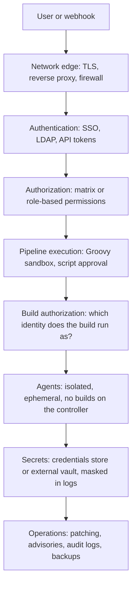
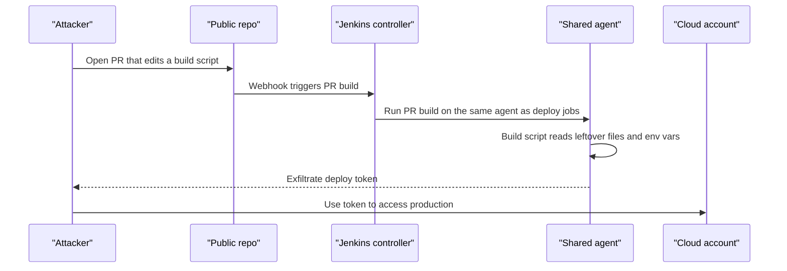

# Jenkins Security Overview

## Introduction

A Jenkins controller is one of the most valuable machines in a company. It can read every repository it builds. It holds the credentials that push to production, sign releases and publish packages. It runs code on dozens of agents. An attacker who controls Jenkins usually controls the software supply chain.

That makes Jenkins a favourite target. Public Jenkins instances with open sign-up, unpatched CLI bugs, or "Anyone can do anything" authorization have been used for crypto mining, source code theft and lateral movement into cloud accounts. The fixes are rarely exotic. Most incidents come from a handful of well-known mistakes.

This section of the tutorial goes layer by layer through Jenkins security:

| Page | Question it answers |
| --- | --- |
| This page | What are we protecting, from whom, and which layers exist? |
| [Authentication and SSO](./1-jenkins-authentication.mdx) | Who is this user? |
| [Authorization and Role-Based Access](./2-jenkins-authorization.mdx) | What may this user (and this build) do? |
| [Credentials Management](./3-jenkins-credentials.mdx) | How do pipelines use secrets without leaking them? |
| [External Secrets with Vault and Cloud Secret Managers](./4-jenkins-external-secrets.mdx) | Should secrets live outside Jenkins at all? |
| [Script Security and Sandboxing](./5-jenkins-script-security.mdx) | How does Jenkins stop a Jenkinsfile from taking over the controller? |
| [Securing Agents and the Controller](./6-jenkins-securing-agents.mdx) | How do we keep builds away from the controller and from each other? |
| [Security Advisories and Hardening](./7-jenkins-security-advisories.mdx) | How do we stay patched and harden the whole instance? |

An analogy helps. Think of Jenkins as a bank branch. **Authentication** is the ID check at the door. **Authorization** decides who may enter the vault, the back office, or only the lobby. **Credentials** are the cash in the vault. **Script security** stops a customer's paperwork from containing instructions the clerk blindly follows. **Agent isolation** keeps the cash-counting machines in a separate room. **Patching** is fixing the locks when the manufacturer announces a flaw. You need all of them; a great vault door does not help if the back window is open.

:::note
This page is a map. It names the controls and explains why they matter. The following pages show configuration and code for each layer.
:::

## What Makes Jenkins a Special Target

Several properties of Jenkins make it more sensitive than a typical web application.

1. **It runs code by design.** Every build executes scripts written by developers, and every Pipeline is a Groovy program. A web app that accidentally runs user code has a bug; Jenkins runs user code as its main feature.
2. **It holds high-value secrets.** Cloud keys, deploy SSH keys, registry tokens, signing keys and database passwords tend to collect on the controller over the years.
3. **It reaches everywhere.** Agents sit inside private networks. Deploy jobs talk to production. The controller can usually reach your Git server, artifact repository and cloud APIs.
4. **It is extended by plugins.** A typical controller runs dozens to hundreds of plugins, each written by different maintainers with different levels of activity. Every plugin adds code that runs with full controller privileges.
5. **It has a long history.** Jenkins dates back to Hudson (2005). Some old defaults and old plugins were designed when "everyone on the team is trusted" was a normal assumption.

None of this means Jenkins is insecure. The Jenkins security team publishes regular advisories and core has strong defaults today (security enabled, CSRF protection, agent-to-controller access control always on). It means that **how you configure and operate Jenkins** decides how safe it is.

## The Threat Model

Before choosing controls, list who might attack and what they want.

| Attacker | Typical entry point | What they want |
| --- | --- | --- |
| Anonymous internet user | Exposed web UI, open sign-up, unpatched CVE | Remote code execution, crypto mining, secrets |
| Outside contributor | Pull request to a public repo with a modified Jenkinsfile or build script | Secrets injected into PR builds, a foothold on agents |
| Low-privilege insider | Job/Configure on one job, Replay, a shared agent | Credentials belonging to other teams, production access |
| Compromised developer laptop | A stolen API token or session | Whatever that user can do, then escalation |
| Malicious or vulnerable plugin | Plugin update or an abandoned plugin with a known flaw | Code running inside the controller |
| Compromised dependency in a build | A poisoned npm, PyPI or Maven package | Secrets in the build environment, persistence on the agent |

Notice that most rows are **not** "a hacker breaks the login page". They are people or code that already have some legitimate access and use Jenkins features to get more. That is why permissions, sandboxing and isolation matter as much as passwords.

### The crown jewels

Rank what you protect, so you know where to spend effort:

1. **`JENKINS_HOME` on the controller.** It contains job configs, build logs, the encrypted credentials store and the keys that decrypt it (`secrets/master.key` and friends). Read access to these files is close to game over.
2. **Credentials** used by deploy and release jobs.
3. **The ability to run code on the controller** (Script Console, unsandboxed Groovy, plugin installation).
4. **Agents with privileged access**, such as agents that can reach production or have Docker socket access.
5. **Build integrity**: the guarantee that an artifact really came from reviewed source.

## Defense in Depth: The Layers



Each layer limits the damage when the one above it fails.

| Layer | Main controls | If it fails |
| --- | --- | --- |
| Network edge | HTTPS, reverse proxy, no public exposure unless required, inbound agent port closed or fixed | Anyone can try every other attack |
| Authentication | SSO via OIDC or SAML, LDAP, no open sign-up, MFA at the identity provider | Attackers log in as real users |
| Authorization | Matrix or Role-based strategy, least privilege, few admins | Every user is effectively an admin |
| Pipeline execution | Groovy sandbox, careful script approval, trusted libraries only from protected repos | A Jenkinsfile can read any file or secret on the controller |
| Build authorization | Authorize Project plugin, folder-scoped credentials | Builds run as SYSTEM and can start or read anything |
| Agents | 0 executors on built-in node, ephemeral agents, separate agents per trust level | One build can read another team's workspace or secrets |
| Secrets | Credentials binding, external secret managers, short-lived tokens | Leaked keys work forever |
| Operations | LTS upgrades, plugin updates, advisory monitoring, audit trail | Known CVEs stay exploitable |

## Secure Defaults You Already Have

Modern Jenkins (the 2.5xx LTS line, currently 2.580.1 as of September 2026) ships with much safer defaults than older versions. Check your version on the [LTS changelog](https://www.jenkins.io/changelog-stable/); these details change over time.

- **Security is always on.** The old "Enable security" checkbox was removed in Jenkins 2.214 / LTS 2.222.1.
- **The setup wizard creates an admin user** and selects "Logged-in users can do anything" with no anonymous read access.
- **CSRF protection** is enabled by default.
- **Agent → controller access control** is always enabled since 2.326, so agents cannot freely read controller files.
- **The TCP inbound agent port** is disabled by default in most packages. The official Docker image exposes port 50000, but you can choose to use WebSocket instead.
- **Pipeline Groovy runs in a sandbox** when the Jenkinsfile comes from source control.
- **The markup formatter escapes HTML** in descriptions by default.
- **User content** (workspace files, archived artifacts) is served with a strict Content-Security-Policy header.

:::caution
"Logged-in users can do anything" is the wizard default, but it is only safe when every account holder is fully trusted. As soon as more than a small team logs in, switch to a matrix or role-based strategy. See [Authorization and Role-Based Access](./2-jenkins-authorization.mdx).
:::

## A Quick Self-Assessment

You can get a first look at your security posture from the Script Console (`/script`). This read-only script prints the main settings. Run it only as an administrator on a controller you own.

```groovy
import jenkins.model.Jenkins

def j = Jenkins.get()
println "Jenkins version:        ${Jenkins.VERSION}"
println "Security realm:         ${j.securityRealm.getClass().simpleName}"
println "Authorization strategy: ${j.authorizationStrategy.getClass().simpleName}"
println "CSRF crumb issuer:      ${j.crumbIssuer?.getClass()?.simpleName ?: 'NONE'}"
println "Built-in executors:     ${j.numExecutors}"
println "Inbound agent TCP port: ${j.slaveAgentPort}  (-1 = disabled)"
println "Markup formatter:       ${j.markupFormatter.getClass().simpleName}"
println "Plugins installed:      ${j.pluginManager.plugins.size()}"
```

Example output:

```text
Jenkins version:        2.580.1
Security realm:         HudsonPrivateSecurityRealm
Authorization strategy: FullControlOnceLoggedInAuthorizationStrategy
CSRF crumb issuer:      DefaultCrumbIssuer
Built-in executors:     2
Inbound agent TCP port: 50000  (-1 = disabled)
Markup formatter:       EscapedMarkupFormatter
Plugins installed:      87
```

Reading this output:

- `HudsonPrivateSecurityRealm` is Jenkins' own user database. Fine for a small team, but SSO is better for a company.
- `FullControlOnceLoggedInAuthorizationStrategy` is "Logged-in users can do anything". Every user is effectively an admin.
- `Built-in executors: 2` means builds can run on the controller. Set this to 0.
- Port 50000 is open. If your agents can use WebSocket, disable it.

The point of this script is not the script itself. It shows that **an administrator can read and change everything** from the Script Console, which is exactly why administrator access must be rare.

:::warning
The Script Console runs arbitrary code inside the controller JVM. Anyone with Overall/Administer can use it to decrypt every stored credential. Treat admin accounts like root on your production servers.
:::

## How an Attack Chains Together

Real incidents rarely use one bug. They chain small weaknesses. Here is a common pattern for a CI system that "worked fine for years":



Each step was possible because one control was missing:

| Step | Missing control | Fix |
| --- | --- | --- |
| PR build ran attacker code with secrets | PR builds treated like branch builds | Separate PR jobs, no credentials for untrusted PRs, trust settings in branch sources |
| Same agent as deploy jobs | No isolation by trust level | Ephemeral agents, separate labels or clouds for deploy |
| Leftover files on agent | Static, long-lived agent | Fresh pod or VM per build |
| Long-lived token | Static cloud key in Jenkins | Short-lived credentials via OIDC or Vault dynamic secrets |

## Who Owns Which Layer

Security fails when every team assumes another team handles it. A simple ownership table avoids that.

| Area | Typical owner | Examples of their decisions |
| --- | --- | --- |
| Identity provider | IT or platform security | MFA policy, group membership, offboarding |
| Jenkins global security settings | Jenkins administrators | Security realm, authorization strategy, agent ports, CSP |
| Folder permissions | Jenkins admins plus team leads | Who can build, configure or replay jobs in a folder |
| Credentials in a folder | Owning team | Which secrets exist, rotation, scope |
| Jenkinsfiles | Application teams | Using `withCredentials` correctly, no secrets in logs |
| Shared libraries | Platform team | Code review on trusted library repos |
| Agents and clouds | Platform or infrastructure team | Images, isolation, network policy |
| Patching | Jenkins administrators | LTS upgrades, plugin updates, advisory response |

Write this table down for your organization. The gaps you discover are often more important than any single setting.

## Security Settings as Code: A Preview

Every control in this section can be expressed in Jenkins Configuration as Code (JCasC) YAML, which you keep in Git and review like any other change. Here is a small preview of what a secured baseline looks like. Each block is explained on later pages.

```yaml
jenkins:
  numExecutors: 0                 # no builds on the controller
  slaveAgentPort: -1              # TCP inbound port disabled; agents use WebSocket
  markupFormatter: plainText      # descriptions cannot contain HTML
  crumbIssuer:
    standard:
      excludeClientIPFromCrumb: false
  securityRealm:
    oic:                          # SSO through OpenID Connect (oic-auth plugin)
      clientId: "jenkins"
      clientSecret: "${OIDC_CLIENT_SECRET}"
      serverConfiguration:
        wellKnown:
          wellKnownOpenIDConfigurationUrl: "https://sso.example.com/.well-known/openid-configuration"
  authorizationStrategy:
    roleBased:                    # role-strategy plugin
      roles:
        global:
          - name: "admin"
            permissions: ["Overall/Administer"]
            entries:
              - group: "jenkins-admins"
          - name: "reader"
            permissions: ["Overall/Read"]
            entries:
              - group: "authenticated"
security:
  scriptApproval:
    forceSandbox: true            # nobody can opt out of the Groovy sandbox
```

You can validate the YAML syntax locally before handing it to Jenkins:

```bash
python3 -c "import yaml,sys; yaml.safe_load(open('jenkins.yaml')); print('jenkins.yaml: valid YAML')"
```

Output:

```text
jenkins.yaml: valid YAML
```

:::tip
Valid YAML is not the same as a valid JCasC file. Jenkins checks the keys when it applies the configuration. Use **Manage Jenkins > Configuration as Code > View Configuration** on a test controller to see the exact keys your installed plugins expect, and read [Configuration as Code (JCasC)](../12-jenkins-administration/0-jenkins-configuration-as-code.mdx).
:::

## Security Is Also About Build Integrity

Keeping attackers out is only half of the job. The other half is being able to trust what Jenkins produces. If someone can change a build without review, they can ship malicious code that your users install.

Questions to ask about build integrity:

- **Can someone change what a build does without code review?** Replay, Job/Configure on Pipeline jobs, and unreviewed shared library branches all allow this.
- **Can a build's artifact be swapped after it is built?** Archived artifacts and registries need write protection.
- **Can you prove which commit an artifact came from?** Record the commit SHA, sign artifacts and images, and keep build logs.
- **Are your build tools and dependencies pinned?** A floating `latest` image or unpinned dependency is a supply chain risk.

Jenkins provides pieces of this (fingerprints, build records, credentials for signing), and external tools such as Sigstore cosign add signing and provenance. The general CI/CD view of supply chain security is covered in the [CI/CD tutorial](/docs/devops/cicd).

## Real-World Scenario

Your company runs a SaaS helpdesk product. Jenkins started five years ago on a VM under someone's desk. Today it has 40 users, 300 jobs, 120 plugins and deploys to production on AWS. A new security lead asks you for a Jenkins security plan that can be delivered in one quarter without stopping releases.

### Step 1: Inventory

Collect facts first:

- Jenkins core version and how far behind the current LTS it is.
- Number of users with Overall/Administer.
- Authorization strategy and security realm.
- Credentials count and which jobs use each.
- Whether the built-in node has executors.
- Plugins with open security warnings (Manage Jenkins shows these as admin monitors).

### Step 2: Prioritize by risk and effort

| Priority | Action | Effort | Risk reduced |
| --- | --- | --- | --- |
| 1 | Upgrade to current LTS and update plugins with warnings | Medium | Known CVEs |
| 2 | Put Jenkins behind SSO, disable local sign-up | Low | Stolen or weak passwords |
| 3 | Reduce admins to 2–3 people, move teams to folder roles | Medium | Insider escalation |
| 4 | Set built-in node executors to 0 | Low | Builds reading `JENKINS_HOME` |
| 5 | Move deploy credentials to folder scope, then to Vault or AWS Secrets Manager | Medium | Secret sprawl |
| 6 | Separate PR builds onto ephemeral Kubernetes agents without credentials | Medium | Supply chain attacks via PRs |
| 7 | Manage security settings with JCasC and review changes in Git | Medium | Configuration drift |

### Step 3: Make it stick

Security work decays when it is done by hand. Put the result into code: plugins in `plugins.txt`, settings in JCasC YAML, jobs in Jenkinsfiles. See [Configuration as Code (JCasC)](../12-jenkins-administration/0-jenkins-configuration-as-code.mdx) and [Managing Plugins as Code](../7-jenkins-plugins/3-jenkins-plugin-installation-manager.mdx).

### Why this approach

It fixes the cheapest, highest-impact problems first (patching, SSO, admins), then the structural ones (isolation, secrets). It keeps releases flowing because each step can be rolled out folder by folder.

### When to use it, when not

This plan fits any self-hosted Jenkins that has grown organically. For a brand-new installation, do the reverse: start with JCasC, SSO, folders and ephemeral agents from day one. It is much cheaper than retrofitting.

### Alternatives and trade-offs

| Approach | Pros | Cons | Best for |
| --- | --- | --- | --- |
| Harden self-hosted Jenkins (this plan) | Keeps existing pipelines, full control | Ongoing patching and plugin work | Teams with a Jenkins investment and ops skills |
| Commercial Jenkins distribution (for example CloudBees CI) | Vendor support, extra RBAC and HA features | License cost, still Jenkins underneath | Large enterprises with many controllers |
| Move to a hosted CI (GitHub Actions, GitLab CI) | Vendor patches the platform | Migration effort, different security model, runner security is still yours | Teams with simple pipelines already on those platforms |
| Leave as is | No effort now | High and growing risk | Nobody |

## Common Mistakes

- **Exposing Jenkins to the internet "temporarily".** Scanners find it within hours. Put it behind a VPN, an identity-aware proxy or at least SSO.
- **Too many administrators.** Every admin can read every secret. Keep the list short and named.
- **Building on the controller.** A build on the built-in node can read `JENKINS_HOME` directly.
- **Approving every script approval request.** Some method signatures give full control of the controller.
- **Treating PR builds like trusted builds.** Code from a fork must not see production secrets.
- **Skipping plugin updates.** Many advisories are in plugins, not core.
- **Configuring security by clicking.** Nobody can review or roll back changes made in the UI.

## A One-Page Baseline Checklist

Use this as a starting point. Each item links to the page that explains it.

- [ ] Running a supported LTS release with Java 21 or newer ([Security Advisories and Hardening](./7-jenkins-security-advisories.mdx))
- [ ] No open sign-up; users come from SSO or LDAP ([Authentication and SSO](./1-jenkins-authentication.mdx))
- [ ] Matrix or role-based authorization, with 2–5 named admins ([Authorization and Role-Based Access](./2-jenkins-authorization.mdx))
- [ ] Builds run with a real identity, not SYSTEM ([Authorization and Role-Based Access](./2-jenkins-authorization.mdx))
- [ ] Credentials scoped to folders, used only through bindings ([Credentials Management](./3-jenkins-credentials.mdx))
- [ ] Production secrets in an external manager where possible ([External Secrets](./4-jenkins-external-secrets.mdx))
- [ ] Sandbox enforced, script approvals reviewed ([Script Security and Sandboxing](./5-jenkins-script-security.mdx))
- [ ] Built-in node has 0 executors; agents are ephemeral ([Securing Agents and the Controller](./6-jenkins-securing-agents.mdx))
- [ ] Security settings stored as JCasC in Git

## Summary

- Jenkins runs code, holds secrets and reaches production, so it is a top target.
- Most real attacks come from users or code with some access who escalate, not from guessing passwords.
- Security is layered: network, authentication, authorization, sandboxing, build authorization, agent isolation, secrets, and operations.
- Modern Jenkins has safe defaults, but "Logged-in users can do anything" and builds on the built-in node are not production settings.
- Prioritize patching, SSO, fewer admins and controller isolation, then move secrets and settings into code.

## Exercises

1. Run the self-assessment script on a test controller (for example the Docker one from [Installing Jenkins with Docker](../1-jenkins-installation/0-jenkins-install-docker.mdx)). Write down each setting and whether you would change it for production.
2. Draw the threat model table for your own team's Jenkins. Which attacker row worries you most, and which layer would stop it?
3. List every credential in your controller and the jobs that use it. How many are used by more than one team?
4. Read one recent advisory on the [Jenkins security advisories page](https://www.jenkins.io/security/advisories/) and check whether any affected plugin is installed on your controller.

**Next:** start with identity in [Authentication and SSO](./1-jenkins-authentication.mdx). For the official reference, see the [Securing Jenkins handbook](https://www.jenkins.io/doc/book/security/).
