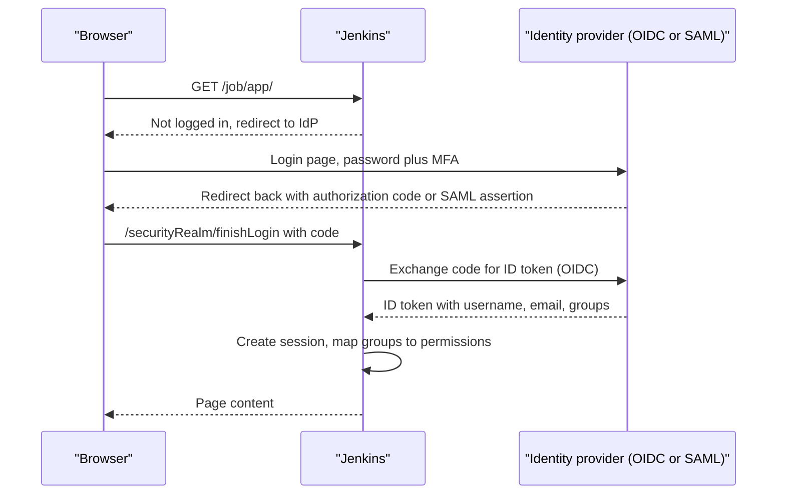

# Authentication and SSO

## Introduction

Authentication answers one question: **who is this?** Before Jenkins can decide what someone may do, it has to know who they are. In Jenkins this job belongs to the **security realm**.

Jenkins keeps authentication and authorization as two separate settings, both under **Manage Jenkins > Security**:

- **Security Realm**: where users, passwords and group memberships come from (authentication).
- **Authorization Strategy**: what those users and groups may do (authorization, covered in [Authorization and Role-Based Access](./2-jenkins-authorization.mdx)).

Think of a company office building. The security realm is the badge reader at the front door: it confirms your identity, usually by asking a central HR system. The authorization strategy is the list of which floors your badge opens. Changing who works at the company (HR) should not require reprogramming every door, and changing the door rules should not require re-issuing badges.

This page covers:

- the security realms available and when to use each,
- connecting Jenkins to an identity provider with OpenID Connect or SAML,
- LDAP and Active Directory,
- API tokens for scripts and tools,
- how not to lock yourself out, and how to recover if you do.

## How Login Works in Jenkins



The key outputs of authentication are a **username** and a list of **groups**. Authorization rules then refer to those names. If group information does not arrive correctly, permissions will look "broken" even though the authorization strategy is fine. Most SSO problems are group-mapping problems.

## The Security Realm Options

| Realm | Plugin | Where users live | Good for |
| --- | --- | --- | --- |
| Jenkins' own user database | Built in | `JENKINS_HOME/users` | Labs, very small teams |
| LDAP | `ldap` | LDAP directory (OpenLDAP, 389, also AD via LDAP) | Companies with a directory but no SSO |
| Active Directory | `active-directory` | Microsoft AD domain | Windows-centric companies, on-premises |
| OpenID Connect | `oic-auth` | Any OIDC provider (Okta, Keycloak, Auth0, Google, Entra ID, Authentik) | Most modern SSO setups |
| SAML 2.0 | `saml` | Any SAML IdP (Okta, ADFS, Entra ID, OneLogin) | Enterprises standardized on SAML |
| GitHub Authentication | `github-oauth` | GitHub accounts and org/team membership | Open source or GitHub-centric teams |
| Microsoft Entra ID | `azure-ad` | Entra ID (previously Azure AD) | Microsoft 365 organizations |
| Unix user/group database | Built in | The controller's OS accounts | Rarely; ties Jenkins to one host |
| Delegate to servlet container | Built in | The embedded web server | Rarely needed today |

Plugin IDs were checked against the Jenkins update center in October 2026. Plugins are renamed and retired over time, so confirm on [plugins.jenkins.io](https://plugins.jenkins.io/) before you install.

:::tip
If your company already has an identity provider, use it through **OpenID Connect** unless there is a specific reason to choose something else. You get MFA, central offboarding and group management for free, and Jenkins never sees user passwords.
:::

### Jenkins' own user database

The setup wizard creates the first admin in the built-in database. It is simple and works offline, but:

- passwords are managed in Jenkins, separately from everything else,
- there is no MFA,
- offboarding means someone must remember to delete the Jenkins account,
- groups are not supported, so permissions are granted per user.

If you keep it, at least turn off sign-up. In JCasC:

```yaml
jenkins:
  securityRealm:
    local:
      allowsSignup: false
      users:
        - id: "admin"
          password: "${JENKINS_ADMIN_PASSWORD}"
```

:::warning
`allowsSignup: true` lets anyone who can reach the login page create an account. Combined with "Logged-in users can do anything", that means anyone on the network can become an administrator. This combination has been behind many compromised public Jenkins instances.
:::

## OpenID Connect (Recommended for SSO)

The **OpenId Connect Authentication** plugin (`oic-auth`) lets users log in with any OIDC provider. Setup has two halves: register Jenkins at the provider, then configure the plugin.

### Step 1: Register Jenkins as a client at the provider

In your identity provider, create a confidential web application client with:

| Setting | Value |
| --- | --- |
| Redirect (login) URI | `https://jenkins.example.com/securityRealm/finishLogin` |
| Post-logout redirect URI | `https://jenkins.example.com/OicLogout` |
| Scopes | `openid profile email` (plus a groups scope if your IdP needs one) |
| Grant type | Authorization code |

Write down the **client ID** and **client secret**. Configure the provider to include a **groups** claim in the ID token or the userinfo response. The exact name of that setting differs by provider (for example Keycloak uses a "group membership" mapper, Okta uses a "groups claim" filter).

### Step 2: Configure the plugin with JCasC

```yaml
jenkins:
  securityRealm:
    oic:
      serverConfiguration:
        wellKnown:
          wellKnownOpenIDConfigurationUrl: "https://sso.example.com/realms/eng/.well-known/openid-configuration"
      clientId: "jenkins"
      clientSecret: "${OIDC_CLIENT_SECRET}"
      userNameField: "preferred_username"
      groupsFieldName: "groups"
      properties:
        - "pkce"
        - escapeHatch:
            username: "breakglass"
            secret: "${OIDC_ESCAPE_HATCH_SECRET}"
            group: "jenkins-admins"
```

What each part does:

- **`wellKnown`** points to the provider's discovery document, so Jenkins learns the authorization, token and userinfo endpoints automatically.
- **`clientSecret`** comes from an environment variable or a JCasC secret source, never from the YAML file itself. See [External Secrets](./4-jenkins-external-secrets.mdx).
- **`userNameField`** and **`groupsFieldName`** are JMESPath expressions into the token claims. Usually they are just claim names.
- **`pkce`** enables Proof Key for Code Exchange, an extra protection for the authorization code flow.
- **`escapeHatch`** defines a local break-glass login that still works if the identity provider is down or misconfigured.

The keys above follow the plugin's [configuration documentation](https://github.com/jenkinsci/oic-auth-plugin/blob/master/docs/configuration/README.md). The plugin evolves quickly; if JCasC rejects a key, export your working configuration from **Manage Jenkins > Configuration as Code > View Configuration** and copy the exact structure.

:::note
OIDC replaces password login in the browser. Scripts and tools that call the Jenkins API cannot use basic auth with an SSO password. They must use **API tokens** (see below).
:::

### Testing the groups claim

The most common SSO problem is "I can log in but I have no permissions". Check what Jenkins actually received:

1. Log in as the user.
2. Open `https://jenkins.example.com/whoAmI/`.
3. Look at the **Authorities** list.

Example output:

```text
Name:            alice
IsAuthenticated? true
Authorities:
  "authenticated"
  "jenkins-admins"
  "team-payments"
```

If your groups are missing, the IdP is not sending the claim, or `groupsFieldName` points at the wrong field. Fix it there before touching authorization rules.

## SAML 2.0

The **SAML** plugin (`saml`) is the right choice when your IdP only offers SAML, or your security team mandates it. Configuration needs the IdP metadata (as a URL or XML) and the names of the attributes that carry display name, email and groups.

```yaml
jenkins:
  securityRealm:
    saml:
      idpMetadataConfiguration:
        url: "https://idp.example.com/app/jenkins/sso/saml/metadata"
        period: 60                       # minutes between metadata refreshes
      displayNameAttributeName: "http://schemas.xmlsoap.org/ws/2005/05/identity/claims/name"
      groupsAttributeName: "http://schemas.xmlsoap.org/claims/Group"
      emailAttributeName: "email"
      maximumAuthenticationLifetime: 86400
      binding: "urn:oasis:names:tc:SAML:2.0:bindings:HTTP-Redirect"
```

On the IdP side, register Jenkins with:

- Assertion Consumer Service URL: `https://jenkins.example.com/securityRealm/finishLogin`
- Entity ID: by default the Jenkins URL plus `securityRealm/finishLogin` (check the plugin's metadata page at `/securityRealm/metadata` on your controller)

## LDAP and Active Directory

If your organization has a directory but no SSO, Jenkins can authenticate against it directly with the **LDAP** plugin (`ldap`) or the **Active Directory** plugin (`active-directory`). Users type their directory password into Jenkins, which checks it with the directory.

```yaml
jenkins:
  securityRealm:
    ldap:
      configurations:
        - server: "ldaps://ldap.example.com:636"
          rootDN: "dc=example,dc=com"
          managerDN: "cn=jenkins-bind,ou=service,dc=example,dc=com"
          managerPasswordSecret: "${LDAP_BIND_PASSWORD}"
          userSearchBase: "ou=people"
          userSearch: "uid={0}"
          groupSearchBase: "ou=groups"
      cache:
        size: 100
        ttl: 300
      userIdStrategy: CaseInsensitive
      groupIdStrategy: CaseInsensitive
```

Notes:

- Always use **`ldaps://`** (or StartTLS) so passwords are not sent in clear text.
- The bind account (`managerDN`) should be a read-only service account.
- The `cache` block avoids an LDAP lookup on every request. A short TTL means group changes take effect sooner.
- Case-insensitive IDs prevent `Alice` and `alice` from being treated as two users.

| LDAP / AD direct | OIDC / SAML via IdP |
| --- | --- |
| Jenkins sees the user's password | Jenkins never sees passwords |
| No MFA unless the directory adds it | MFA enforced at the IdP |
| Works without an extra SSO product | Needs an identity provider |
| Each app connects to the directory | One central login for all apps |

## GitHub Authentication

The **GitHub Authentication** plugin (`github-oauth`) lets people log in with their GitHub account. GitHub organizations and teams become Jenkins groups, written as `org` or `org*team`.

```yaml
jenkins:
  securityRealm:
    github:
      githubWebUri: "https://github.com"
      githubApiUri: "https://api.github.com"
      clientID: "Iv1.0123456789abcdef"
      clientSecret: "${GITHUB_OAUTH_SECRET}"
      oauthScopes: "read:org,user:email"
```

This fits open source projects and teams that live entirely in GitHub. It ties Jenkins logins to personal GitHub accounts, so for companies with an IdP, OIDC is usually the better choice (your IdP can still federate to GitHub if needed).

## API Tokens for Scripts and Tools

Browsers use SSO sessions. Scripts, the [REST API and CLI](../12-jenkins-administration/8-jenkins-rest-api-and-cli.mdx), and other tools use **API tokens**. Each user creates tokens under their own profile (**user menu > Security > API Token**). A token:

- authenticates as that user, with that user's permissions,
- can be revoked individually,
- does not need a CSRF crumb for API calls,
- shows when it was last used (if usage statistics are enabled).

Example: trigger a build with a token.

```bash
export JENKINS_URL="https://jenkins.example.com"
export JENKINS_USER="ci-bot"
export JENKINS_TOKEN="$(cat ~/.jenkins-token)"

curl -fsS -X POST -u "${JENKINS_USER}:${JENKINS_TOKEN}" \
  "${JENKINS_URL}/job/payments/job/api/job/main/build"
echo "exit code: $?"
```

Example output:

```text
exit code: 0
```

Check who the token authenticates as:

```bash
curl -fsS -u "${JENKINS_USER}:${JENKINS_TOKEN}" "${JENKINS_URL}/whoAmI/api/json" | python3 -m json.tool
```

Example output:

```text
{
    "_class": "hudson.security.WhoAmI",
    "anonymous": false,
    "authenticated": true,
    "authorities": [
        "authenticated"
    ],
    "name": "ci-bot"
}
```

With SSO realms, the groups shown for token calls can differ from browser sessions, because Jenkins may not be able to look up groups without an interactive login. Test the permissions of automation users explicitly.

Recommended token settings in JCasC:

```yaml
security:
  apiToken:
    creationOfLegacyTokenEnabled: false
    tokenGenerationOnCreationEnabled: false
    usageStatisticsEnabled: true
```

These disable the old "legacy" token type and stop Jenkins from auto-creating a token for every new user. Exact keys can change between versions; confirm with a configuration export.

:::caution
Use a dedicated service account for automation, not a person's token. When that person leaves, their account is disabled at the IdP, and every script using their token breaks or, worse, keeps working if the account is not cleaned up in Jenkins.
:::

## Don't Lock Yourself Out

Changing the security realm is the classic way to lose access to Jenkins. Protect yourself:

1. **Test on a non-production controller first.** A Docker container from [Installing Jenkins with Docker](../1-jenkins-installation/0-jenkins-install-docker.mdx) is enough.
2. **Keep a second admin session open** while you change settings, and test login in a private browser window before closing it.
3. **Configure a break-glass account**, such as the OIDC escape hatch, stored in your password manager.
4. **Manage the realm with JCasC**, so a bad change can be reverted in Git and reapplied.

If you are locked out anyway, an administrator with file system access to `JENKINS_HOME` can recover. The documented method is to temporarily disable security in `config.xml` and restart, then fix the configuration and re-enable it. Follow the official [Disable security](https://www.jenkins.io/doc/book/security/access-control/disable/) instructions closely, and keep the controller off the network while security is disabled.

## Real-World Scenario

Your company (300 engineers) uses Okta with MFA. Jenkins currently uses its own user database with 60 accounts, several belonging to people who left. The security team wants every internal tool behind SSO by the end of the quarter.

### The solution

1. **In Okta**, create an OIDC web app for Jenkins with the redirect URIs above, a `groups` claim filtered to groups starting with `jenkins-`, and assign the `jenkins-users` group.
2. **In Jenkins (test controller)**, install `oic-auth`, apply the JCasC `oic` realm, and confirm `/whoAmI/` shows the expected groups.
3. **Rewrite authorization** in terms of groups (`jenkins-admins`, `team-payments`, and so on) instead of individual usernames. Usernames from OIDC may differ from the old local IDs (for example `alice@example.com` vs `alice`).
4. **Create service accounts** for automation, with API tokens stored in a secret manager.
5. **Roll out to production** in a maintenance window, with the escape hatch configured and tested.
6. **Delete the old local accounts** after a week.

### Why this approach

The company already pays for and trusts Okta. OIDC brings MFA, central offboarding and group management to Jenkins with one plugin and no password storage in Jenkins.

### When to use it, when not

Use OIDC SSO whenever an IdP exists. Do not bother for a throwaway lab controller, and avoid it for an air-gapped environment that cannot reach the IdP (use LDAP inside that network instead).

### Alternatives and trade-offs

| Approach | Pros | Cons | Best for |
| --- | --- | --- | --- |
| OIDC (`oic-auth`) | Modern, MFA at IdP, simple setup, works with most IdPs | Needs an IdP; groups claim must be configured | Most companies |
| SAML (`saml`) | Widely supported by enterprise IdPs | XML metadata and certificates are fiddlier | SAML-only enterprises |
| LDAP / AD direct | No extra SSO product | Jenkins handles passwords, no MFA by default | On-premises, no IdP |
| GitHub OAuth | Teams map naturally from GitHub | Depends on personal GitHub accounts | Open source projects |
| Built-in database | Zero dependencies | No MFA, manual offboarding | Labs and demos |
| Auth at a reverse proxy only | Central control at the edge | Jenkins sees no user identity unless the proxy passes it, breaks API clients | Extra layer in front of SSO, not a replacement |

## Common Mistakes

- **Leaving sign-up enabled** on the built-in database.
- **Mapping permissions to usernames instead of groups**, so every hire and departure needs a Jenkins change.
- **Forgetting the groups claim**, then granting broad permissions to `authenticated` to "make it work".
- **No break-glass access**, so an IdP outage locks every admin out during an incident.
- **Using personal API tokens in shared automation.**
- **LDAP without TLS**, which sends passwords across the network unencrypted.
- **Putting the client secret in the JCasC file** committed to Git.

## Summary

- The security realm authenticates users; the authorization strategy decides their permissions. They are configured separately.
- Prefer SSO through OpenID Connect (`oic-auth`) or SAML (`saml`), so MFA and offboarding happen at your identity provider.
- Check `/whoAmI/` to see the username and groups Jenkins received; most SSO issues are group-mapping issues.
- LDAP and Active Directory work well where no IdP exists; always use TLS.
- Scripts use per-user API tokens, preferably for dedicated service accounts.
- Plan for lockouts: test first, keep a break-glass account, and manage the realm as code.

## Exercises

1. Run a Keycloak container next to a test Jenkins, create an OIDC client and log in through `oic-auth`. Confirm the groups on `/whoAmI/`.
2. Create a service account with an API token and use `curl` to trigger a build and read `/whoAmI/api/json`.
3. Write the JCasC `securityRealm` block for your company's identity provider, with all secrets referenced as variables.
4. Deliberately misconfigure the realm on a test controller, then recover using the escape hatch or the documented disable-security procedure.

**Related pages:** [Authorization and Role-Based Access](./2-jenkins-authorization.mdx), [Configuration as Code (JCasC)](../12-jenkins-administration/0-jenkins-configuration-as-code.mdx), and the official [Access Control](https://www.jenkins.io/doc/book/security/access-control/) handbook page.
