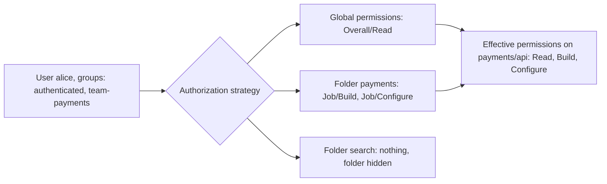

# Authorization and Role-Based Access

## Introduction

Once Jenkins knows **who** a user is ([Authentication and SSO](./1-jenkins-authentication.mdx)), the **authorization strategy** decides **what** they may do: see a job, start a build, change a configuration, read a credential, or administer the whole controller.

Authorization in Jenkins has two sides that beginners often mix up:

1. **User authorization**: what a person (or API token) can do in the UI and API.
2. **Build authorization**: what a running build can do, such as triggering other jobs or running on a particular agent. By default builds run as the all-powerful internal **SYSTEM** user.

Think of a hospital. Doctors, nurses and visitors get different badges (user authorization). But there is also the question of what an automated delivery robot may do once it is inside: can it open the pharmacy? The robot's permissions (build authorization) need their own rules, or it ends up with a master key.

This page covers:

- the built-in strategies and why most are not for production,
- matrix-based and project-based matrix authorization,
- role-based authorization with the Role-based Authorization Strategy plugin,
- permissions that are effectively admin,
- build authorization with the Authorize Project plugin,
- a multi-team setup with folders.

## The Authorization Strategies

| Strategy | Plugin | Who can do what | Production use? |
| --- | --- | --- | --- |
| Anyone can do anything | Built in | Everyone, including anonymous, is admin | Never |
| Legacy mode | Built in | "admin" role users are admin, everyone else can read | No |
| Logged-in users can do anything | Built in | Every authenticated user is admin; optional anonymous read | Only tiny fully trusted teams |
| Matrix-based security | `matrix-auth` | Global table of users/groups by permission | Yes |
| Project-based Matrix Authorization Strategy | `matrix-auth` | Global table plus per-folder, per-job and per-agent tables | Yes |
| Role-Based Strategy | `role-strategy` | Named roles assigned to users/groups; item roles matched by regex | Yes |

The Jenkins handbook recommends matrix-based security as a starting point for production. Both `matrix-auth` and `role-strategy` are actively maintained and installed on a large share of controllers (plugin versions checked October 2026).



## Permissions Jenkins Knows About

Permissions are named `Group/Permission`. The common ones:

| Permission | Allows |
| --- | --- |
| `Overall/Read` | Basic access; needed for almost everything else |
| `Overall/Administer` | Everything, including Script Console and plugin installation |
| `Overall/Manage` | A subset of admin settings that excludes security-critical ones |
| `Overall/SystemRead` | Read-only view of global configuration (optional permission) |
| `Job/Read`, `Job/Discover` | See a job; Discover only reveals that it exists |
| `Job/Build`, `Job/Cancel` | Start or stop builds |
| `Job/Configure`, `Job/Create`, `Job/Delete`, `Job/Move` | Change jobs |
| `Job/Workspace` | Browse workspace files |
| `Run/Replay`, `Run/Delete`, `Run/Update` | Replay a Pipeline with edited code, delete or edit build records |
| `Credentials/View`, `Credentials/Create`, `Credentials/Update`, `Credentials/Delete` | Manage stored credentials |
| `Agent/Build`, `Agent/Configure`, `Agent/Connect`, `Agent/Create` | Use and manage agents |
| `View/Read`, `View/Configure` | Use and edit list views |
| `SCM/Tag` | Create SCM tags from Jenkins |

Two optional permissions deserve a note:

- **Overall/Manage** is enabled by default since Jenkins 2.542 (earlier versions needed a system property or plugin). It lets "junior admins" change things like tool installations without full admin power.
- **Overall/SystemRead** requires the system property `jenkins.security.SystemReadPermission=true` or a plugin. It suits read-only auditors and teams that manage configuration as code.

Check the [permissions reference](https://www.jenkins.io/doc/book/security/access-control/permissions/) for your version; this list changes.

### Permissions that are effectively admin

Some permissions look small but let a user escalate:

| Permission | Why it is dangerous |
| --- | --- |
| `Overall/Administer` | Script Console, plugin uploads, can decrypt every secret |
| `Agent/Configure`, `Agent/Create` | Point jobs at a machine the user controls and capture files, env vars and credentials |
| `Job/Configure` on a Pipeline with credentials | Change the script to print or send secrets anywhere |
| `Run/Replay` | Run an edited Pipeline using that job's credentials, without a commit |
| `Credentials/View` | See credential metadata; with some plugins, more than you expect |
| `Job/Workspace` | Read source code and build outputs, possibly config files with secrets |

:::warning
Anyone who can change what a job runs can use every credential that job can use. Grant `Job/Configure` and `Run/Replay` only to people you would trust with those credentials directly.
:::

## Matrix-Based Authorization

The **Matrix Authorization Strategy** plugin (`matrix-auth`) shows a table: rows are users or groups, columns are permissions. Two special names exist:

- **anonymous**: anyone not logged in,
- **authenticated**: anyone logged in.

### Global matrix in JCasC

```yaml
jenkins:
  authorizationStrategy:
    globalMatrix:
      entries:
        - group:
            name: "jenkins-admins"
            permissions:
              - "Overall/Administer"
        - group:
            name: "authenticated"
            permissions:
              - "Overall/Read"
              - "Job/Read"
              - "View/Read"
        - group:
            name: "developers"
            permissions:
              - "Job/Build"
              - "Job/Cancel"
```

Newer `matrix-auth` versions use explicit `user:` and `group:` entries. Older configurations used a flat `permissions:` list of strings like `"Overall/Read:authenticated"`; if you find that format, migrate it, because the ambiguous form cannot tell a user from a group with the same name.

### Project-based matrix with folders

**Project-based Matrix Authorization Strategy** adds tables on folders, jobs and agents. Combined with folders, this gives clean team boundaries: global permissions stay minimal, and each team's folder grants their group more.

```yaml
jenkins:
  authorizationStrategy:
    projectMatrix:
      entries:
        - group:
            name: "jenkins-admins"
            permissions:
              - "Overall/Administer"
        - group:
            name: "authenticated"
            permissions:
              - "Overall/Read"
jobs:
  - script: >
      folder('payments') {
        properties {
          authorizationMatrix {
            inheritanceStrategy {
              inheritingGlobal()
            }
            entries {
              group {
                name('team-payments')
                permissions(['Job/Read', 'Job/Build', 'Job/Cancel', 'Job/Configure', 'Job/Workspace', 'Credentials/View'])
              }
            }
          }
        }
      }
```

The `jobs` block uses [Job DSL](../12-jenkins-administration/1-jenkins-job-dsl.mdx) through JCasC to create the folder with its permissions. Inheritance strategies:

| Strategy | Meaning |
| --- | --- |
| `inheriting()` | Inherit from the parent folder (default) |
| `inheritingGlobal()` | Inherit only global permissions, skip parent folders |
| `nonInheriting()` | Ignore everything above, except that admins stay admins |

A folder with `nonInheriting()` and no `Job/Read` for `authenticated` is **hidden** from everyone except its team and admins.

## Role-Based Authorization

The **Role-based Authorization Strategy** plugin (`role-strategy`) groups permissions into named **roles** and assigns roles to users or groups. It has three role types:

- **Global roles**: apply everywhere (for example `admin`, `reader`).
- **Item roles**: apply to jobs and folders whose full name matches a **regular expression** (for example `payments/.*`).
- **Agent roles**: apply to agents whose name matches a pattern.

```yaml
jenkins:
  authorizationStrategy:
    roleBased:
      roles:
        global:
          - name: "admin"
            description: "Jenkins administrators"
            permissions:
              - "Overall/Administer"
            entries:
              - group: "jenkins-admins"
          - name: "reader"
            description: "Every employee can log in and see the dashboard"
            permissions:
              - "Overall/Read"
            entries:
              - group: "authenticated"
        items:
          - name: "payments-dev"
            description: "Payments team builds and configures its own jobs"
            pattern: "payments(/.*)?"
            permissions:
              - "Job/Read"
              - "Job/Build"
              - "Job/Cancel"
              - "Job/Configure"
              - "Job/Workspace"
              - "Run/Replay"
            entries:
              - group: "team-payments"
          - name: "payments-viewer"
            description: "Support can read build results"
            pattern: "payments(/.*)?"
            permissions:
              - "Job/Read"
            entries:
              - group: "support"
        agents:
          - name: "deploy-agents"
            description: "Only release managers may use deploy agents"
            pattern: "deploy-.*"
            permissions:
              - "Agent/Build"
            entries:
              - group: "release-managers"
```

Things to notice:

- The pattern `payments(/.*)?` matches the folder **and** everything inside it. The pattern `payments/.*` would match the jobs but not the folder itself, so users could not open it. Patterns are case-sensitive unless you add `(?i)`.
- Global roles override item roles: if `reader` granted `Job/Build`, every user could build every job.
- Agent roles matter only when build authorization is configured (see below), because builds running as SYSTEM can use any agent.

### Matrix vs role-based

| Aspect | Project matrix (`matrix-auth`) | Role-based (`role-strategy`) |
| --- | --- | --- |
| Where rules live | On each folder/job | One central role table |
| Matching | Explicit folder tree | Regex on item names |
| Many similar teams | Repeat per folder (or generate with Job DSL) | One role per team, or macros |
| Risk | Rules spread across folders | A sloppy regex grants too much |
| Audit | Check each folder | Read one page |
| Good for | Folder-per-team layouts, managed by Job DSL | Central security team, naming conventions |

Both are fine. Pick one and stay consistent; mixing tools confuses everyone.

## Build Authorization

Every build runs as some identity. By default that identity is **SYSTEM**, which has every permission. That matters because many features check the build's identity:

- the `build` step that triggers other jobs,
- which agents the build may use (`Agent/Build`),
- which credentials a build can look up,
- plugins that perform their own access checks.

With builds running as SYSTEM, a user who can configure one job can trigger **any** other job, including someone else's deploy job.

The **Authorize Project** plugin (`authorize-project`) lets you choose the identity:

| Strategy | Build runs as |
| --- | --- |
| Run as SYSTEM | Full permissions (the default without the plugin) |
| Run as User who Triggered Build | The user who clicked Build; timer and SCM triggers run as anonymous |
| Run as anonymous | Anonymous, with very few permissions |
| Run as Specific User | A named user (requires that user's password or token, or admin rights to configure) |

Configure a global default with JCasC:

```yaml
security:
  queueItemAuthenticator:
    authenticators:
      - global:
          strategy: "triggeringUsersAuthorizationStrategy"
```

Or allow projects to choose, while disabling SYSTEM:

```yaml
security:
  queueItemAuthenticator:
    authenticators:
      - project:
          enabledStrategies:
            - "org.jenkinsci.plugins.authorizeproject.strategy.TriggeringUsersAuthorizationStrategy"
            - "org.jenkinsci.plugins.authorizeproject.strategy.SpecificUsersAuthorizationStrategy"
          disabledStrategies:
            - "org.jenkinsci.plugins.authorizeproject.strategy.SystemAuthorizationStrategy"
            - "org.jenkinsci.plugins.authorizeproject.strategy.AnonymousAuthorizationStrategy"
```

:::caution
The Jenkins handbook notes that Authorize Project has known limitations and has not always been actively developed. It is still the documented option for build authorization in core Jenkins. Test it carefully: SCM-triggered builds running as anonymous will fail if anonymous cannot use the agents or credentials they need. A common pattern is "Run as Specific User" with a per-team service account.
:::

## Pipeline-Level Checks

Some authorization happens inside the Jenkinsfile itself. The most common is restricting who may approve a manual gate:

```groovy
pipeline {
    agent any
    stages {
        stage('Deploy to production') {
            input {
                message 'Deploy to production?'
                ok 'Deploy'
                submitter 'release-managers'
            }
            steps {
                sh './deploy.sh production'
            }
        }
    }
}
```

`submitter` takes user IDs or group names that the security realm provides. If the group name is wrong, nobody can approve except administrators. See [Manual Input and Approvals](../4-jenkins-pipeline-advanced/2-jenkins-input-and-approvals.mdx).

Also note: the Jenkinsfile lives in the repository, so whoever can merge to the branch can change `submitter`. Protect the branch with code review in your Git host.

## Checking Effective Permissions

To check what someone can do without logging in as them, an admin can use the Script Console:

```groovy
import jenkins.model.Jenkins
import hudson.model.User
import hudson.model.Item
import hudson.security.ACL

def user = User.getById('alice', false)
def job  = Jenkins.get().getItemByFullName('payments/api/main')

ACL.as2(user.impersonate2()).withCloseable {
    println "Read:      ${job.hasPermission(Item.READ)}"
    println "Build:     ${job.hasPermission(Item.BUILD)}"
    println "Configure: ${job.hasPermission(Item.CONFIGURE)}"
}
```

Example output:

```text
Read:      true
Build:     true
Configure: false
```

`impersonate2()` looks up the user's groups through the security realm; for some SSO realms group information is only available after the user has logged in at least once. For day-to-day checks, many teams simply keep a test user per role.

## Real-World Scenario

Your company has one Jenkins controller shared by four teams: payments, search, mobile and platform. Today it uses "Logged-in users can do anything". The mobile team recently deleted a payments job by accident, and an auditor asked who can deploy to production.

### The solution

1. **Folders per team**: `payments/`, `search/`, `mobile/`, `platform/`, each with folder-scoped credentials.
2. **Role-based strategy** with: a global `reader` role (`Overall/Read` for `authenticated`), a global `admin` role for three named platform engineers, item roles `<team>-dev` with pattern `<team>(/.*)?`, and an agent role so only `release-managers` may build on `deploy-.*` agents.
3. **Build authorization**: Authorize Project with "Run as Specific User", one service account per team, so a payments build can only trigger payments jobs and only use payments agents.
4. **Deploy gates**: `input` with `submitter 'release-managers'` on production stages.
5. **Everything in JCasC**, reviewed by the platform team in pull requests.

### Why this approach

Folders give each team a clear boundary for jobs **and** credentials. Roles keep the rules on one page that the auditor can read. Build authorization closes the "trigger someone else's deploy" gap that user permissions alone cannot.

### When to use it, when not

Use this for any controller shared by more than one team. For one small team that trusts each other fully, a global matrix with a few groups is enough. If teams need very different plugins or Jenkins versions, separate controllers per team may be simpler than fine-grained permissions.

### Alternatives and trade-offs

| Approach | Pros | Cons | Best for |
| --- | --- | --- | --- |
| Logged-in users can do anything | Zero setup | Everyone is admin | Single trusted team, lab |
| Global matrix | Simple, one table | No per-team boundaries | Small orgs with one team |
| Project matrix with folders | Precise, folder-local | Rules spread out; needs Job DSL to stay manageable | Folder-per-team setups |
| Role-based strategy | Central, readable, regex-based | Regex mistakes can over-grant | Many teams with naming conventions |
| One controller per team | Strong isolation, independent upgrades | More controllers to patch and run | Large orgs, very different needs |

## Common Mistakes

- **Granting broad permissions to `authenticated`** because SSO groups were not set up. Fix the groups instead.
- **Forgetting the folder itself in role patterns**, so users see "access denied" on the folder.
- **Giving `Run/Replay` or `Job/Configure` on deploy jobs** to people who should not have production credentials.
- **Ignoring build authorization**, so every build can trigger every other job as SYSTEM.
- **Too many admins.** Keep `Overall/Administer` to a short named list.
- **Granting `Agent/Configure`** to developers; they can point builds at their own machines.
- **Managing permissions by hand** in the UI, with no review and no history.

## Summary

- Authorization decides what authenticated users and running builds may do.
- Use `matrix-auth` (global or project-based) or `role-strategy` in production; never "Anyone can do anything".
- Folders plus folder-level permissions are the cleanest way to separate teams.
- Some permissions (`Job/Configure`, `Run/Replay`, `Agent/Configure`) are close to admin because they expose credentials.
- Builds run as SYSTEM by default; the Authorize Project plugin lets them run as a user or service account.
- Keep the rules in JCasC and check effective permissions with test users or `/whoAmI/`.

## Exercises

1. On a test controller, configure a global matrix where `authenticated` can only read, then add a folder that grants one group `Job/Build`. Log in as a user in that group and confirm what they see.
2. Convert the same rules to `role-strategy` YAML. Test a pattern that misses the folder itself and observe the result.
3. Install Authorize Project, set builds to run as the triggering user, and try to trigger a job you cannot build from a Pipeline using the `build` step.
4. List every user and group with `Overall/Administer` on your real controller. Can you justify each one?

**Related pages:** [Credentials Management](./3-jenkins-credentials.mdx) (folder-scoped credentials), [Securing Agents and the Controller](./6-jenkins-securing-agents.mdx), and the handbook pages on [Access Control](https://www.jenkins.io/doc/book/security/access-control/) and [Access Control for Builds](https://www.jenkins.io/doc/book/security/build-authorization/).
