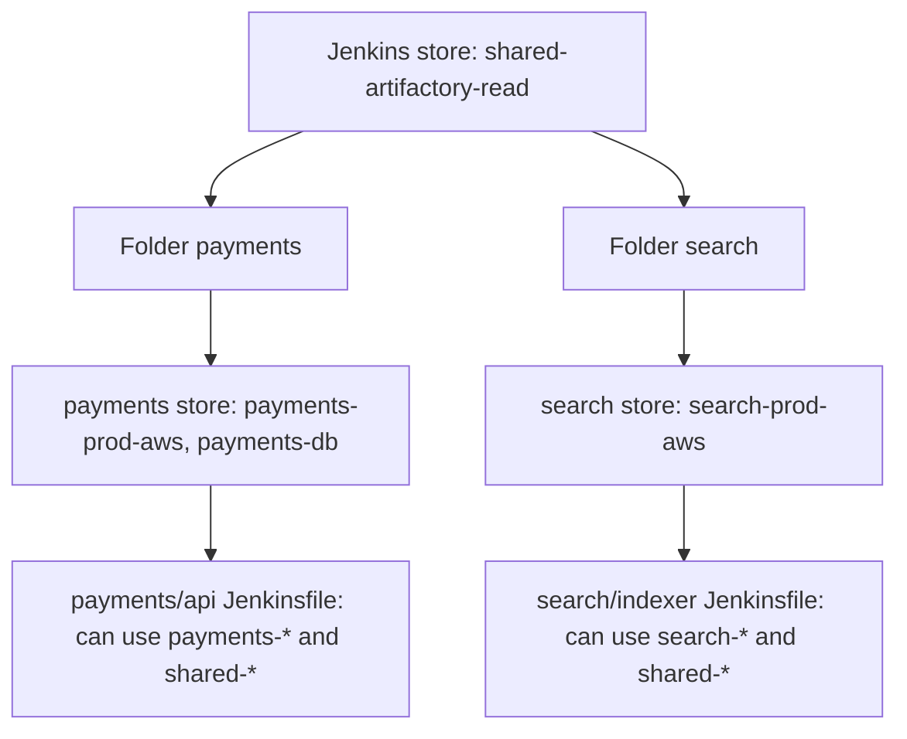

# Credentials Management

## Introduction

Pipelines need secrets. They pull from private Git repositories, push images to registries, call cloud APIs, sign packages and deploy to servers. The worst place for those secrets is the Jenkinsfile itself, which is committed to Git, copied into forks and visible to everyone with read access.

Jenkins solves this with the **Credentials** plugin (`credentials`) and the **Credentials Binding** plugin (`credentials-binding`). Secrets are stored once, encrypted, under a stable **ID**. Pipelines refer to the ID, and Jenkins injects the secret only for the steps that need it, masking it in the console log.

An analogy: a hotel safe deposit box. Guests do not carry the hotel's master key. They ask the front desk for "box 42", sign for it, use it, and give it back. The ID is the box number; the binding step is the front desk; the masking is the staff looking away while you open it.

This page covers:

- credential types, scopes and stores (including folder stores),
- using credentials in Declarative and Scripted Pipelines,
- the string interpolation trap that leaks secrets,
- what masking does and does not protect,
- defining credentials with JCasC, and how they are encrypted at rest,
- organizing credentials for many teams.

If you would rather keep secrets outside Jenkins entirely, read this page first and then [External Secrets with Vault and Cloud Secret Managers](./4-jenkins-external-secrets.mdx).

## Credential Types

| Type | Holds | Typical use | Binding |
| --- | --- | --- | --- |
| Secret text | One string | API tokens, webhook secrets | `string` |
| Username with password | Username and password | Registry login, basic auth, Git over HTTPS | `usernamePassword` |
| Secret file | A file | `kubeconfig`, service account JSON, `.npmrc` | `file` |
| SSH Username with private key | Username, private key, optional passphrase | Git over SSH, deploy to servers | `sshUserPrivateKey` or `sshagent` |
| Certificate | PKCS#12 keystore and password | Client TLS, code signing | `certificate` |
| Docker Host Certificate Authentication | Docker client certs | Talking to a remote Docker daemon over TLS | `dockerCert` |
| GitHub App | App ID and private key | GitHub API and checkout via GitHub Branch Source | Used by SCM plugins |

Plugins add more types (for example Vault, AWS or Kubernetes credentials).

## Scopes, Domains and Stores

Three ideas decide **where** a credential lives and **who** can use it.

### Scope

| Scope | Usable by |
| --- | --- |
| **System** | Only Jenkins itself and its plugins (for example the agent SSH launcher, email server login). Not available to jobs. |
| **Global** | Jobs in the store's context and everything below it. |

Use **System** for credentials that only Jenkins infrastructure needs. A Pipeline cannot read a System-scoped credential, which is exactly what you want for, say, the key Jenkins uses to launch SSH agents.

### Stores

| Store | Where | Visible to |
| --- | --- | --- |
| Jenkins (system) store | **Manage Jenkins > Credentials > System** | Every job on the controller (Global scope) |
| Folder store | **Folder > Credentials** | Jobs inside that folder and its subfolders |
| User store | **User > Credentials** | Builds running as that user (with build authorization) |
| External providers | Vault, AWS, Azure, Kubernetes plugins | Depends on the provider |



**Folder stores are the most important tool for multi-team Jenkins.** A credential stored in the `payments` folder simply does not exist for jobs in `search`. Combined with folder permissions from [Authorization and Role-Based Access](./2-jenkins-authorization.mdx), teams manage their own secrets without seeing anyone else's.

### Domains

Domains group credentials and can restrict them to hostnames or URL schemes (for example `*.github.com`). They are mostly a hint for plugins that pick credentials automatically. Most teams use the default **Global credentials (unrestricted)** domain and rely on folders for separation.

### IDs

Give every credential a meaningful, stable ID, because Pipelines refer to it and **the ID cannot be changed later**. A good convention is `<team>-<env>-<system>-<kind>`, for example `payments-prod-aws-deploy` or `shared-artifactory-read`. If you leave the ID empty, Jenkins generates a random UUID that nobody can remember.

## Using Credentials in Declarative Pipeline

### The credentials() helper

The simplest way is the `credentials()` helper in an `environment` block:

```groovy
pipeline {
    agent any
    environment {
        REGISTRY = credentials('shared-registry-push')   // username with password
        SONAR_TOKEN = credentials('payments-sonar-token') // secret text
    }
    stages {
        stage('Login') {
            steps {
                sh 'echo "$REGISTRY_PSW" | docker login registry.example.com -u "$REGISTRY_USR" --password-stdin'
            }
        }
        stage('Scan') {
            steps {
                sh 'sonar-scanner -Dsonar.token="$SONAR_TOKEN"'
            }
        }
    }
}
```

For a **username with password** credential, `credentials()` creates three variables: `REGISTRY` (`user:password`), `REGISTRY_USR` and `REGISTRY_PSW`. For **secret text** you get the value, and for a **secret file** you get the path of a temporary file.

Example console output:

```text
[Pipeline] withEnv
[Pipeline] {
[Pipeline] stage
[Pipeline] { (Login)
[Pipeline] sh
+ echo ****
+ docker login registry.example.com -u **** --password-stdin
Login Succeeded
```

Notice the `****`. The Credentials Binding plugin replaces any occurrence of the secret values in the log with asterisks.

:::tip
Put `credentials()` in a **stage-level** `environment` block when only one stage needs the secret. The narrower the scope, the fewer steps can leak it.
:::

### withCredentials

`withCredentials` binds secrets only inside its block, which is the most precise option:

```groovy
pipeline {
    agent { label 'linux' }
    stages {
        stage('Deploy') {
            steps {
                withCredentials([
                    file(credentialsId: 'payments-prod-kubeconfig', variable: 'KUBECONFIG'),
                    string(credentialsId: 'payments-slack-webhook', variable: 'SLACK_URL')
                ]) {
                    sh 'kubectl --kubeconfig "$KUBECONFIG" apply -f k8s/'
                    sh 'curl -fsS -X POST -H "Content-Type: application/json" -d "{\\"text\\":\\"deployed\\"}" "$SLACK_URL"'
                }
            }
        }
    }
}
```

The other common bindings:

```groovy
withCredentials([usernamePassword(credentialsId: 'shared-nexus',
                                  usernameVariable: 'NEXUS_USER',
                                  passwordVariable: 'NEXUS_PASS')]) {
    sh 'mvn -s ci-settings.xml deploy'   // settings.xml reads ${env.NEXUS_USER} and ${env.NEXUS_PASS}
}

withCredentials([sshUserPrivateKey(credentialsId: 'deploy-ssh',
                                   keyFileVariable: 'SSH_KEY',
                                   usernameVariable: 'SSH_USER')]) {
    sh 'ssh -i "$SSH_KEY" -o StrictHostKeyChecking=yes "$SSH_USER@app01.example.com" ./restart.sh'
}

withCredentials([certificate(credentialsId: 'codesign-cert',
                             keystoreVariable: 'KEYSTORE',
                             passwordVariable: 'KEYSTORE_PASS')]) {
    sh 'jarsigner -keystore "$KEYSTORE" -storepass "$KEYSTORE_PASS" target/app.jar codesign'
}
```

For Git over SSH with several commands, the **SSH Agent** plugin (`ssh-agent`) is often cleaner. It loads the key into an `ssh-agent` for the block:

```groovy
sshagent(credentials: ['deploy-ssh']) {
    sh 'git push origin HEAD:refs/tags/v1.4.0'
}
```

Use the **Snippet Generator** (**Pipeline Syntax** link in any Pipeline job) to generate exact syntax for the bindings your plugins provide. See [Snippet Generator and Pipeline Syntax Tools](../3-jenkins-pipeline-basics/9-jenkins-pipeline-syntax-generator.mdx).

## The String Interpolation Trap

This is the most common way Jenkins users leak secrets, and Jenkins warns about it in the build log.

```groovy
// WRONG: Groovy double quotes interpolate the secret into the command string
withCredentials([string(credentialsId: 'api-token', variable: 'TOKEN')]) {
    sh "curl -H 'Authorization: Bearer ${TOKEN}' https://api.example.com/deploy"
}

// RIGHT: single quotes, the shell reads $TOKEN from its environment
withCredentials([string(credentialsId: 'api-token', variable: 'TOKEN')]) {
    sh 'curl -H "Authorization: Bearer $TOKEN" https://api.example.com/deploy'
}
```

With double quotes, Groovy builds the full command text **before** the shell runs it. The secret becomes part of the script that is sent to the agent, may show up in process listings (`ps`) on the agent, and appears in the Pipeline's internal data. Jenkins prints a warning:

```text
Warning: A secret was passed to "sh" using Groovy String interpolation, which is insecure.
		 Affected argument(s) used the following variable(s): [TOKEN]
		 See https://jenkins.io/redirect/groovy-string-interpolation for details.
```

The same rule protects against **command injection**: never put build parameters or branch names into a double-quoted `sh` string. Pass them through `environment` or `withEnv` and let the shell expand them.

| Pattern | Secret in Groovy string? | Safe? |
| --- | --- | --- |
| `sh 'cmd "$TOKEN"'` | No | Yes |
| `sh "cmd ${TOKEN}"` | Yes | No |
| `sh "cmd \$TOKEN"` (escaped dollar) | No | Yes, but easy to get wrong |
| `sh """cmd ${env.TOKEN}"""` | Yes | No |

## What Masking Does Not Protect

Masking is a convenience, not a security boundary. It replaces exact matches of the secret in the console log. It does **not** stop:

- a script that **encodes** the secret (`echo $TOKEN | base64`) or prints it character by character,
- a script that **sends** the secret to an external server,
- secrets **written to files** that are later archived as artifacts,
- **short or common values**: a password like `admin` will be masked everywhere it appears, and very short secrets are a sign of a weak secret anyway,
- secrets that a tool **transforms** (for example URL-encoded with `%` characters) before printing.

The rule: **anyone who can change the code that runs inside `withCredentials` can read the secret.** That includes people who can push to the branch, edit the job, or use Replay. Permissions and branch protection are your real defence; masking only prevents accidental exposure.

:::warning
Builds from untrusted pull requests must never run with production credentials. The GitHub and Bitbucket branch sources have "trust" settings that decide whether a fork's Jenkinsfile is used. Keep the defaults that only trust contributors with write access, and run PR builds in a folder without deploy credentials. See [Pull Request Builds](../5-jenkins-scm-integration/4-jenkins-pull-request-builds.mdx).
:::

## Credentials as Code with JCasC

You can define credentials in JCasC YAML. The YAML must reference secret **values** through variables, never contain them:

```yaml
credentials:
  system:
    domainCredentials:
      - credentials:
          - usernamePassword:
              scope: GLOBAL
              id: "shared-registry-push"
              username: "ci-pusher"
              password: "${REGISTRY_PUSH_PASSWORD}"
              description: "Push to registry.example.com"
          - string:
              scope: GLOBAL
              id: "payments-sonar-token"
              secret: "${SONAR_TOKEN}"
              description: "SonarQube token for payments"
          - basicSSHUserPrivateKey:
              scope: SYSTEM
              id: "agent-ssh-launcher"
              username: "jenkins"
              description: "Used only by the SSH agent launcher"
              privateKeySource:
                directEntry:
                  privateKey: "${readFile:/run/secrets/agent_ssh_key}"
```

The `${VAR}` values are resolved by JCasC when the configuration is applied, from environment variables, files (`readFile`), or secret sources such as Vault. The `${readFile:...}` form is good for Docker or Kubernetes secrets mounted as files.

Validate the YAML structure locally before applying it:

```bash
python3 - <<'EOF'
import yaml
doc = yaml.safe_load(open("credentials.yaml"))
creds = doc["credentials"]["system"]["domainCredentials"][0]["credentials"]
for c in creds:
    kind, body = next(iter(c.items()))
    print(f"{body['id']:<24} {kind:<24} scope={body['scope']}")
EOF
```

Example output:

```text
shared-registry-push     usernamePassword         scope=GLOBAL
payments-sonar-token     string                   scope=GLOBAL
agent-ssh-launcher       basicSSHUserPrivateKey   scope=SYSTEM
```

## How Jenkins Stores Credentials

Credentials in the Jenkins stores are encrypted on disk in `JENKINS_HOME` (for example `credentials.xml` and folder `config.xml` files). The encryption keys live in `JENKINS_HOME/secrets/`, chiefly `master.key` and `hudson.util.Secret`.

Consequences:

- **Anyone with file system access to `JENKINS_HOME` can decrypt everything**, because the keys sit next to the data. Protect the controller's disk and backups accordingly.
- **Administrators can decrypt everything** through the Script Console.
- **Backups contain both data and keys.** Encrypt backups and restrict who can restore them. See [Backup and Restore](../12-jenkins-administration/2-jenkins-backup-and-restore.mdx).
- **Copying `credentials.xml` to another controller does not work** without the matching keys, by design.

This is one of the strongest arguments for external secret managers: the high-value secrets are not sitting on the controller at all.

## Tracking and Rotating Credentials

- **Usage tracking**: the Credentials plugin can record which jobs and builds used a credential (fingerprints). Look at the credential's page to see where it is used before deleting or rotating it.
- **Rotation**: update the secret in place, keeping the ID, so Pipelines do not change. Prefer credentials that expire (short-lived tokens, GitHub App credentials instead of personal access tokens).
- **Ownership**: put an owner and purpose in the description, for example `owner: payments, purpose: prod deploy, rotate: quarterly`.

## Real-World Scenario

Your company's Jenkins has 140 credentials, all in the global store. Every job can use every credential. A contractor working on a marketing site job could, in principle, read the production database password. An audit asks you to fix this without breaking 300 jobs.

### The solution

1. **Inventory**: export the list of credential IDs and the jobs that use them (credential usage tracking plus a search of Jenkinsfiles for `credentialsId` and `credentials(`).
2. **Classify**: shared read-only (artifact repository read, public registry pull), team-specific, and infrastructure-only.
3. **Move team-specific credentials into folder stores** with the **same ID**. Because lookup walks up from the job's folder, Jenkinsfiles keep working unchanged.
4. **Change infrastructure-only credentials to System scope** so no job can use them.
5. **Fix interpolation**: search for `sh "` lines that reference credential variables and switch to single quotes.
6. **Define the new layout in JCasC and Job DSL** so it is reviewable.

### Why this approach

Folder stores give per-team isolation using only core plugins, and keeping the same IDs makes the migration invisible to Jenkinsfiles.

### When to use it, when not

Use folder-scoped credentials on any controller with more than one team. If your organization already runs Vault or a cloud secret manager, consider moving production secrets there instead of reorganizing them in Jenkins.

### Alternatives and trade-offs

| Approach | Pros | Cons | Best for |
| --- | --- | --- | --- |
| Global store only | Simple | Every job sees every secret | Single small team |
| Folder stores | Built in, per-team isolation, same IDs | Secrets still on the controller | Multi-team controllers |
| External provider (Vault, AWS, Azure) | Central rotation, audit, nothing at rest in Jenkins | Extra system to run, network dependency | Organizations with a secret manager |
| Short-lived credentials (OIDC, dynamic secrets) | Leaks expire quickly | More setup, needs cloud or Vault support | Cloud deploys |

## Common Mistakes

- **Secrets in Jenkinsfiles, parameters or environment blocks as plain strings.** Always use the credentials store.
- **Double-quoted `sh` strings with secrets.** Use single quotes.
- **`set -x` in shell scripts** that print commands, increasing the chance of leaking transformed secrets.
- **Archiving files that contain secrets**, such as a generated `.npmrc` or `settings.xml`.
- **System-wide credentials for team-specific secrets.**
- **Random UUID credential IDs**, which make Jenkinsfiles unreadable.
- **Personal access tokens** of individual employees used by shared jobs.
- **Assuming masking is protection** against malicious code.

## Summary

- Store secrets in Jenkins credentials and reference them by ID; never in the Jenkinsfile.
- Use System scope for infrastructure secrets and folder stores for team secrets.
- Bind secrets as narrowly as possible with `withCredentials` or a stage-level `credentials()` helper.
- Use single-quoted `sh` strings so the shell, not Groovy, expands secrets.
- Masking prevents accidents only; anyone who can change the build can read its secrets.
- Credentials are encrypted with keys stored in `JENKINS_HOME`, so protect the disk, backups and admin access.

## Exercises

1. Create a secret text credential and use it in a Pipeline twice: once with single quotes and once with double quotes. Compare the console output and the interpolation warning.
2. Create two folders, each with a credential called `deploy-token` holding different values. Show that a job in each folder gets its own value.
3. Write a JCasC `credentials` block for three credentials using `${...}` variables and validate it with the Python snippet above.
4. Find every `sh "` line in your team's Jenkinsfiles that references a credential variable and fix it.

**Next:** [External Secrets with Vault and Cloud Secret Managers](./4-jenkins-external-secrets.mdx). Official reference: [Using credentials](https://www.jenkins.io/doc/book/using/using-credentials/) and [Handling credentials in a Jenkinsfile](https://www.jenkins.io/doc/book/pipeline/jenkinsfile/#handling-credentials).
