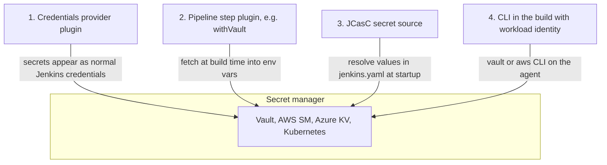

# External Secrets with Vault and Cloud Secret Managers

## Introduction

The Jenkins credentials store ([Credentials Management](./3-jenkins-credentials.mdx)) works, but it has limits. Secrets are copied into Jenkins, encrypted with keys that live on the same disk, rotated by hand, and audited only through Jenkins. If your company already runs a secret manager such as **HashiCorp Vault**, **AWS Secrets Manager**, **Azure Key Vault** or **Kubernetes Secrets**, it usually makes sense to keep the secrets there and let Jenkins **fetch** them when a build needs them.

An analogy: instead of every shop in a mall keeping its own cash safe, they use the bank across the street. The bank has guards, audit trails and the ability to cancel cards instantly. Shops keep only what they need for the next few minutes.

Benefits of an external secret manager:

- **One source of truth.** The same secret is used by Jenkins, applications and other tools, and rotated in one place.
- **Central audit.** The secret manager logs who read which secret and when.
- **Less at rest on the controller.** A stolen `JENKINS_HOME` backup does not contain production secrets.
- **Dynamic, short-lived secrets.** Vault can issue database credentials or cloud tokens that expire after minutes.

Costs:

- another critical system that must be available when builds run,
- Jenkins still needs **some** credential to authenticate to the secret manager (the "secret zero" problem),
- extra plugins to keep updated.

This page shows the main integration patterns and when each fits.

## Four Integration Patterns



| Pattern | How Pipelines see secrets | Example plugins or tools |
| --- | --- | --- |
| 1. Credentials provider | Normal credential IDs, used with `withCredentials` | `aws-secrets-manager-credentials-provider`, `azure-keyvault`, `kubernetes-credentials-provider` |
| 2. Pipeline step | A wrapper step that sets env vars | `hashicorp-vault-plugin` (`withVault`), `azure-keyvault` (`withAzureKeyvault`) |
| 3. JCasC secret source | Not for Pipelines; for Jenkins' own configuration | `configuration-as-code` with Vault, AWS SM, environment or file sources |
| 4. CLI with workload identity | Whatever the build script fetches | `vault` CLI, `aws` CLI, cloud SDKs on the agent |

Pattern 1 is the most transparent: existing Jenkinsfiles keep using credential IDs, and the secret just comes from a different place.

## Pattern 1: Credentials Providers

### AWS Secrets Manager

The **AWS Secrets Manager Credentials Provider** plugin (`aws-secrets-manager-credentials-provider`) shows secrets from Secrets Manager as **read-only** Jenkins credentials. Tags on each secret tell Jenkins what type of credential it is.

Create a secret text credential:

```bash
aws secretsmanager create-secret \
  --name 'payments-sonar-token' \
  --secret-string 'example-not-a-real-token' \
  --description 'SonarQube token for payments jobs' \
  --tags 'Key=jenkins:credentials:type,Value=string'
```

Create a username/password credential:

```bash
aws secretsmanager create-secret \
  --name 'shared-registry-push' \
  --secret-string 'example-password' \
  --tags 'Key=jenkins:credentials:type,Value=usernamePassword' \
         'Key=jenkins:credentials:username,Value=ci-pusher'
```

| Tag `jenkins:credentials:type` | Jenkins credential type | Extra tags |
| --- | --- | --- |
| `string` | Secret text | |
| `usernamePassword` | Username with password | `jenkins:credentials:username` |
| `sshUserPrivateKey` | SSH key | `jenkins:credentials:username` |
| `certificate` | PKCS#12 certificate | |
| `file` | Secret file | `jenkins:credentials:filename` (optional) |

The Jenkins controller needs an IAM identity (for example an EC2 instance profile or an EKS service account role) with `secretsmanager:ListSecrets` and `secretsmanager:GetSecretValue`, plus `kms:Decrypt` if you use a customer-managed KMS key. A minimal policy, restricted to secrets with the Jenkins tag:

```json
{
  "Version": "2012-10-17",
  "Statement": [
    {
      "Effect": "Allow",
      "Action": "secretsmanager:ListSecrets",
      "Resource": "*"
    },
    {
      "Effect": "Allow",
      "Action": "secretsmanager:GetSecretValue",
      "Resource": "*",
      "Condition": {
        "StringLike": { "aws:ResourceTag/jenkins:credentials:type": "*" }
      }
    }
  ]
}
```

Optional plugin settings in JCasC, for example to list only tagged secrets:

```yaml
unclassified:
  awsCredentialsProvider:
    cache: true
    client:
      region: "eu-west-1"
    listSecrets:
      filters:
        - key: "tag-key"
          values:
            - "jenkins:credentials:type"
```

Pipelines use the secret name as the credential ID, exactly like a local credential:

```groovy
pipeline {
    agent any
    stages {
        stage('Scan') {
            steps {
                withCredentials([string(credentialsId: 'payments-sonar-token', variable: 'SONAR_TOKEN')]) {
                    sh 'sonar-scanner -Dsonar.token="$SONAR_TOKEN"'
                }
            }
        }
    }
}
```

:::note
The plugin caches credential metadata (by default for a few minutes), so a newly created secret may not appear immediately. A `jenkins:credentials:folder` tag can limit a secret to specific Jenkins folders. Check the [plugin page](https://plugins.jenkins.io/aws-secrets-manager-credentials-provider/) for the current list of tags; it has grown over time.
:::

### Azure Key Vault

The **Azure Key Vault** plugin (`azure-keyvault`) works both as a credentials provider and as a Pipeline step. As a provider, tags on Key Vault secrets set the type (`type=string`, `type=username`, `type=secretFile`, `type=sshUserPrivateKey`, `type=certificate`) and optional `jenkinsID` and `description`.

```bash
az keyvault secret set --vault-name payments-kv \
  --name payments-db-password \
  --value 'example-password' \
  --tags type=username username=payments_app jenkinsID=payments-db description="Payments DB login"
```

Authentication can use a service principal credential or, better, an Azure **managed identity** of the VM or AKS workload running Jenkins. JCasC for the plugin:

```yaml
unclassified:
  azureKeyVault:
    keyVaultURL: "https://payments-kv.vault.azure.net"
    credentialID: "azure-sp-jenkins"
```

### Kubernetes Secrets

If Jenkins runs in Kubernetes, the **Kubernetes Credentials Provider** plugin (`kubernetes-credentials-provider`) turns labelled Kubernetes Secrets in the controller's namespace into Jenkins credentials. That lets you manage them with tools you already use, such as External Secrets Operator, Sealed Secrets or Helm.

```yaml
apiVersion: v1
kind: Secret
metadata:
  name: payments-sonar-token
  namespace: jenkins
  labels:
    jenkins.io/credentials-type: secretText
  annotations:
    jenkins.io/credentials-description: "SonarQube token for payments"
type: Opaque
stringData:
  text: example-not-a-real-token
```

The controller's service account needs RBAC permission to `get`, `list` and `watch` Secrets in its namespace. Remember that Kubernetes Secrets are only base64-encoded by default; enable encryption at rest in the cluster and restrict who can read Secrets in that namespace.

### Google Cloud Secret Manager

A **GCP Secrets Manager Credentials Provider** plugin exists (`gcp-secrets-manager-credentials-provider`), using labels such as `jenkins-credentials-type`. As of October 2026 its latest release is from 2022, so check its maintenance status before depending on it. On GKE, Pattern 4 (the `gcloud` CLI with Workload Identity) or syncing secrets into Kubernetes and using the Kubernetes provider are common alternatives.

## Pattern 2: HashiCorp Vault with withVault

The **HashiCorp Vault** plugin (`hashicorp-vault-plugin`) adds a `withVault` step that reads secrets from Vault paths into environment variables for a block.

### Vault side: an AppRole for Jenkins

HashiCorp recommends the **AppRole** auth method for machines. A minimal setup with the Vault CLI:

```bash
# 1. Policy: read-only access to payments CI secrets
vault policy write jenkins-payments - <<'EOF'
path "secret/data/ci/payments/*" {
  capabilities = ["read"]
}
EOF

# 2. AppRole bound to that policy, with short-lived tokens
vault auth enable approle
vault write auth/approle/role/jenkins-payments \
    token_policies="jenkins-payments" \
    token_ttl=20m token_max_ttl=1h secret_id_ttl=720h

# 3. Values Jenkins needs
vault read -field=role_id auth/approle/role/jenkins-payments/role-id
vault write -f -field=secret_id auth/approle/role/jenkins-payments/secret-id

# 4. A secret to read
vault kv put secret/ci/payments/sonar token=example-not-a-real-token
```

Example output (IDs shortened):

```text
Success! Uploaded policy: jenkins-payments
Success! Enabled approle auth method at: approle/
Success! Data written to: auth/approle/role/jenkins-payments
8f3c1c2a-...-role-id
2b9d7e41-...-secret-id
====== Secret Path ======
secret/data/ci/payments/sonar
```

Store the role ID and secret ID in Jenkins as a **Vault App Role Credential** (a credential type the plugin adds), for example with ID `vault-approle-payments`, ideally in the `payments` folder store.

### Jenkins side: global Vault configuration

```yaml
unclassified:
  hashicorpVault:
    configuration:
      vaultUrl: "https://vault.example.com:8200"
      vaultCredentialId: "vault-approle-payments"
      engineVersion: 2
```

The configuration can also be set per folder, so each team's folder uses its own AppRole.

### Pipeline usage

```groovy
pipeline {
    agent any
    stages {
        stage('Scan') {
            steps {
                withVault(vaultSecrets: [
                    [path: 'secret/ci/payments/sonar', engineVersion: 2, secretValues: [
                        [envVar: 'SONAR_TOKEN', vaultKey: 'token']
                    ]]
                ]) {
                    sh 'sonar-scanner -Dsonar.token="$SONAR_TOKEN"'
                }
            }
        }
    }
}
```

Values are masked in the log like credential bindings. The same interpolation rule applies: use single-quoted `sh` strings.

:::tip
The plugin also provides Vault credential types that can be used as normal credentials, and Vault credential bindings. Use the Snippet Generator to see the exact options for your plugin version, and read the [plugin README](https://github.com/jenkinsci/hashicorp-vault-plugin) for the authentication methods it supports (AppRole, token, GitHub token, AWS IAM, GCP, Kubernetes).
:::

## Pattern 3: JCasC Secret Sources

Jenkins' own configuration also contains secrets: the OIDC client secret, the LDAP bind password, SMTP credentials. JCasC resolves `${...}` placeholders when it applies `jenkins.yaml`. Sources include:

- **environment variables**: `${OIDC_CLIENT_SECRET}`,
- **files**: `${readFile:/run/secrets/oidc_client_secret}`, ideal for Docker and Kubernetes mounted secrets,
- **Vault**: the Vault plugin acts as a JCasC secret source when variables such as `CASC_VAULT_URL`, `CASC_VAULT_PATHS` and an auth method (`CASC_VAULT_APPROLE` plus `CASC_VAULT_APPROLE_SECRET`, or `CASC_VAULT_KUBERNETES_ROLE`) are set on the controller,
- other plugins provide sources for AWS Secrets Manager and similar services.

Example: Jenkins in Kubernetes reading the OIDC secret from a mounted file:

```yaml
jenkins:
  securityRealm:
    oic:
      clientId: "jenkins"
      clientSecret: "${trim:${readFile:/run/secrets/jenkins/oidc-client-secret}}"
      serverConfiguration:
        wellKnown:
          wellKnownOpenIDConfigurationUrl: "https://sso.example.com/.well-known/openid-configuration"
```

`trim` removes a trailing newline that many tools add to secret files. See the JCasC [secrets documentation](https://github.com/jenkinsci/configuration-as-code-plugin/blob/master/docs/features/secrets.adoc) for all helpers.

## Pattern 4: Workload Identity and Short-Lived Credentials

The strongest option avoids long-lived secrets entirely. The agent gets an identity from its platform, and the build exchanges it for short-lived credentials:

- **AWS**: an EKS pod with IAM Roles for Service Accounts or EKS Pod Identity, or an EC2 agent with an instance profile. The AWS CLI and SDKs pick up temporary credentials automatically.
- **Azure**: AKS workload identity or a VM managed identity.
- **Google Cloud**: GKE Workload Identity.
- **Vault**: the Kubernetes auth method, where a pod's service account token logs in to Vault.

A Kubernetes pod agent that deploys to AWS without any stored key:

```groovy
pipeline {
    agent {
        kubernetes {
            yaml '''
apiVersion: v1
kind: Pod
spec:
  serviceAccountName: payments-deployer   # annotated with an IAM role
  containers:
  - name: aws
    image: amazon/aws-cli:2.17.0
    command: ["sleep"]
    args: ["infinity"]
'''
        }
    }
    stages {
        stage('Who am I') {
            steps {
                container('aws') {
                    sh 'aws sts get-caller-identity --query Arn --output text'
                }
            }
        }
    }
}
```

Example output:

```text
arn:aws:sts::123456789012:assumed-role/payments-deployer/botocore-session-1760180000
```

There is no secret in Jenkins to steal. The trade-off: you must keep untrusted builds off pods with that service account, because any build that runs there gets the role. See [Kubernetes Pod Agents](../6-jenkins-agents/4-jenkins-kubernetes-agents.mdx) and [Securing Agents and the Controller](./6-jenkins-securing-agents.mdx).

## The Secret Zero Problem

Every pattern needs Jenkins to prove its identity to the secret manager. Options, from weakest to strongest:

| Bootstrap method | Where the first secret lives | Notes |
| --- | --- | --- |
| Static Vault token in Jenkins | Jenkins credentials store | Simple, but a long-lived master key |
| AppRole role ID and secret ID | Jenkins credentials store | Can limit secret ID TTL, IP ranges and number of uses |
| Cloud instance or pod identity | Nowhere; the platform vouches | Best when available |
| Kubernetes service account token | Projected token in the pod | Short-lived, rotated automatically |

## Real-World Scenario

Your company runs Jenkins on EKS and already uses AWS Secrets Manager for application secrets. Jenkins has 90 credentials copied by hand from Secrets Manager, and rotations regularly break builds because someone forgets to update Jenkins.

### The solution

1. Give the Jenkins controller pod an IAM role (IRSA or EKS Pod Identity) with `ListSecrets` and `GetSecretValue` limited to tagged secrets.
2. Install `aws-secrets-manager-credentials-provider`.
3. Tag the existing secrets with `jenkins:credentials:type` and use the **same names** as the current Jenkins credential IDs.
4. Delete the duplicated credentials from Jenkins one folder at a time; Jenkinsfiles keep working because IDs are unchanged.
5. For deploy jobs, stop using stored AWS keys at all. Run them on a dedicated pod template with its own IAM role (Pattern 4).

### Why this approach

Secrets Manager is already the source of truth and has rotation and CloudTrail auditing. A credentials provider removes the copy step without touching Jenkinsfiles.

### When to use it, when not

Use a provider when a secret manager already exists. If your organization has no secret manager, adding one only for Jenkins may not be worth it; folder-scoped Jenkins credentials are a reasonable choice for small setups.

### Alternatives and trade-offs

| Approach | Pros | Cons | Best for |
| --- | --- | --- | --- |
| Jenkins credentials store | No extra system | Secrets copied into Jenkins, manual rotation | Small teams |
| Credentials provider (AWS, Azure, Kubernetes) | Same IDs, no Jenkinsfile changes, central rotation | Read-only in Jenkins, cache delay, plugin dependency | Orgs with a cloud secret manager |
| `withVault` step | Fine-grained paths per build, dynamic secrets | Jenkinsfiles must use the step | Vault users |
| Workload identity | No stored secrets at all | Needs cloud or Kubernetes setup; isolation of agents is critical | Cloud deployments |
| Fetch with CLI in build scripts | Works with any manager | Secrets not masked unless you do it yourself | Edge cases, tools without plugins |

## Common Mistakes

- **A root Vault token in Jenkins.** Use AppRole or Kubernetes auth with a narrow policy.
- **One identity for all teams.** Use separate AppRoles, IAM roles or folders per team.
- **Ignoring availability.** If Vault is down, builds fail; monitor it and plan for outages.
- **Printing secrets fetched by CLI.** Plugin steps mask values; your own `vault kv get` output does not.
- **Running untrusted PR builds on agents with cloud roles.**
- **Relying on an unmaintained provider plugin** for critical secrets.

## Summary

- External secret managers centralize storage, rotation and audit, and keep high-value secrets off the controller.
- Credentials providers (AWS, Azure, Kubernetes) make external secrets look like normal credential IDs.
- The Vault plugin's `withVault` step reads specific paths into environment variables for a block.
- JCasC resolves `${...}` placeholders from environment variables, files and secret sources for Jenkins' own configuration.
- Workload identity removes stored secrets entirely, but makes agent isolation critical.
- Always solve "secret zero" with the strongest bootstrap identity available.

## Exercises

1. Run Vault in dev mode (`vault server -dev`) next to a test Jenkins, create an AppRole and read a secret with `withVault`.
2. On a kind or minikube cluster, install Jenkins with the Kubernetes Credentials Provider and create a labelled Secret. Use it from a Pipeline.
3. Write an IAM policy that lets Jenkins read only secrets tagged for a single folder.
4. Map every secret your team's Jenkins uses to one of the four patterns and justify the choice.

**Related pages:** [Credentials Management](./3-jenkins-credentials.mdx), [Configuration as Code (JCasC)](../12-jenkins-administration/0-jenkins-configuration-as-code.mdx), [Cloud Agents on AWS and Azure](../6-jenkins-agents/5-jenkins-cloud-agents.mdx), and the [Terraform tutorial](/docs/devops/terraform) for provisioning Vault and cloud IAM as code.
