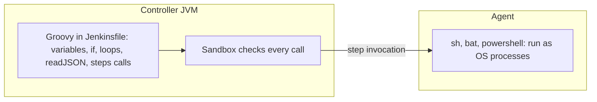
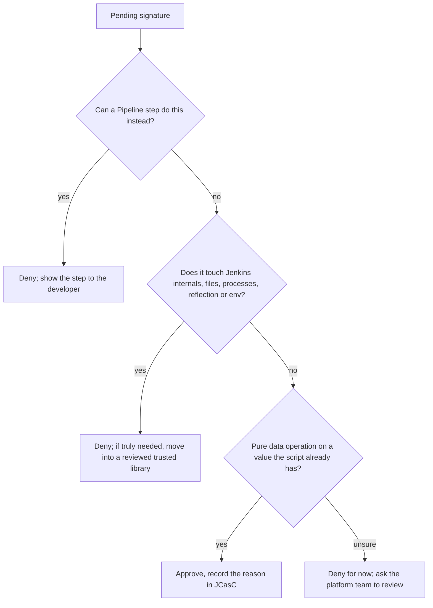

# Script Security and Sandboxing

## Introduction

A Jenkinsfile is a Groovy program, and the Groovy part of it runs **inside the Jenkins controller's JVM**. Only the `sh`, `bat` and similar steps run on agents. That raises an obvious question: if anyone who can push a Jenkinsfile can run Groovy on the controller, what stops them from reading every secret, deleting jobs or running shell commands on the controller host?

The answer is the **Script Security** plugin (`script-security`), which provides two mechanisms:

1. **The Groovy sandbox.** Scripts run with every method call, constructor and field access checked against an allow list. Anything not on the list is rejected.
2. **In-process Script Approval.** An administrator can approve individual method signatures for sandboxed scripts, or whole scripts that run outside the sandbox.

An analogy: a sandbox is a kitchen where trainee cooks may use any approved appliance, but the gas main and the alarm system are behind a locked panel. If a recipe needs something unusual, the head chef must approve that specific appliance. Approving the "master key to the building" because a trainee asked for it would defeat the whole arrangement.

This page explains:

- where Pipeline code actually runs,
- how the sandbox works and what a rejection looks like,
- how to handle approval requests safely, and which ones to refuse,
- trusted vs untrusted shared libraries,
- Script Console, Replay and Job DSL,
- how to write Pipelines that rarely need approvals.

## Where Pipeline Code Runs



| Code | Runs on | Checked by sandbox? |
| --- | --- | --- |
| `def x = readJSON file: 'a.json'`, `if`, loops, string methods | Controller | Yes |
| `sh 'make test'` | Agent (as an OS process) | No, the shell can do anything the agent user can |
| `new File('/etc/passwd').text` | Controller | Yes, and rejected |
| `Jenkins.get().getItems()` | Controller | Yes, and rejected |

So the sandbox protects the **controller** from Groovy code. It does not limit what shell commands do on the agent. Agent isolation is a separate layer: [Securing Agents and the Controller](./6-jenkins-securing-agents.mdx).

## When Is a Script Sandboxed?

| Script source | Sandboxed? |
| --- | --- |
| Jenkinsfile from SCM (Pipeline from SCM, Multibranch, Organization Folders) | **Always** |
| Pipeline script typed into the job config | Yes, if "Use Groovy Sandbox" is checked (the default); otherwise needs whole-script approval |
| Folder-level shared library | Always (untrusted) |
| Global untrusted shared library | Yes |
| Global trusted shared library | **No**, full access |
| Script Console (`/script`) | No; only administrators can use it |
| Job DSL seed scripts | Depends on the Job DSL script security setting |

Because Jenkinsfiles from SCM are always sandboxed, a developer who can push to a repository cannot escape to the controller unless an administrator approves something dangerous, or a sandbox bug exists. Sandbox bypasses have been found in the past and fixed in security advisories, which is one more reason to keep `script-security` and `workflow-cps` updated ([Security Advisories and Hardening](./7-jenkins-security-advisories.mdx)).

## What a Rejection Looks Like

Here is a Pipeline that tries to list all jobs on the controller:

```groovy
pipeline {
    agent any
    stages {
        stage('Peek') {
            steps {
                script {
                    def names = jenkins.model.Jenkins.get().getAllItems().collect { it.fullName }
                    echo "Jobs: ${names}"
                }
            }
        }
    }
}
```

The build fails:

```text
[Pipeline] script
[Pipeline] {
[Pipeline] }
[Pipeline] // script
Scripts not permitted to use staticMethod jenkins.model.Jenkins get. Administrators can decide whether to approve or reject this signature.
org.jenkinsci.plugins.scriptsecurity.sandbox.RejectedAccessException: Scripts not permitted to use staticMethod jenkins.model.Jenkins get
Finished: FAILURE
```

At the same time, a pending request appears under **Manage Jenkins > In-process Script Approval**:

```text
Signatures already approved: (none)
Pending signature approvals:
  staticMethod jenkins.model.Jenkins get       [Approve] [Deny]
```

This is the sandbox working correctly. A Jenkinsfile has no business reading the entire controller.

## Signatures and How to Read Them

Approval requests are **signatures** with one of these forms:

| Form | Example | Meaning |
| --- | --- | --- |
| `method` | `method java.net.URI getHost` | Instance method on a class |
| `staticMethod` | `staticMethod java.lang.System getenv java.lang.String` | Static method |
| `new` | `new java.io.File java.lang.String` | Constructor |
| `field` | `field hudson.model.Run number` | Field get or set |
| `staticField` | `staticField java.lang.System out` | Static field |

Some signatures are harmless (`method java.net.URI getHost` just parses a URL string). Others hand over the controller.

### Signatures you should essentially never approve

| Signature (examples) | Why it is dangerous |
| --- | --- |
| `staticMethod jenkins.model.Jenkins get` / `getInstance` | Full access to every job, credential and setting through the Jenkins object |
| `method java.lang.String execute` / `staticMethod org.codehaus.groovy.runtime.ProcessGroovyMethods execute java.lang.String` | Runs a shell command **on the controller** |
| `new java.io.File java.lang.String` with read/write methods | Reads `JENKINS_HOME`, including `secrets/` |
| `method groovy.lang.GroovyObject invokeMethod java.lang.String java.lang.Object` | Calls any method by name, bypassing the allow list |
| `staticMethod java.lang.System getenv` | Controller environment variables may hold secrets |
| `method hudson.model.Run getEnvironment` and anything that walks other builds | Reads other jobs' data |
| `method java.lang.Class forName` / reflection methods | Reflection defeats the allow list |

The approval page marks some signatures as dangerous with a warning. Treat the warning as "no", not as "think about it".

:::warning
Approving a signature is **global**. It applies to every sandboxed script on the controller, written by anyone, not just the job that asked. Approving `Jenkins.get` for one convenient job lets every Jenkinsfile in every repository take over the controller.
:::

### "Approve assuming permissions check"

Some getters perform their own permission checks, for example `method hudson.model.ItemGroup getItems` only returns items the current user can read. Since builds often run as SYSTEM, approving it normally would expose all items. **Approve assuming permissions check** allows the call only when the script runs as a real user, where the permission check means something. Use it only when you know the method really does check permissions.

## Whole-Script Approval

When a script runs **outside** the sandbox, an administrator must approve the exact script text. Jenkins stores a hash of the approved text, so any edit needs approval again. Scripts saved by administrators are **not** auto-approved in current versions of Script Security, to prevent social-engineering tricks.

Whole-script approval makes sense for a small number of admin-owned scripts that rarely change. It does not scale to developer Pipelines, and the reviewer must read the entire script carefully every time.

## Forcing the Sandbox

In highly secured environments, you can hide the "Use Groovy Sandbox" checkbox from non-administrators and block new entries in the approval queue with **Force the use of the sandbox globally in the system**. In JCasC:

```yaml
security:
  scriptApproval:
    forceSandbox: true
    approvedSignatures:
      - "method java.net.URI getHost"
      - "new java.net.URI java.lang.String"
```

Managing approvals in JCasC is useful: every approved signature is reviewed in a pull request, with a reason in the commit message, instead of being clicked in a UI and forgotten. Check a configuration export to see the exact keys your Script Security version supports.

## Trusted vs Untrusted Shared Libraries

[Shared libraries](../8-jenkins-shared-libraries/0-jenkins-shared-libraries-introduction.mdx) change the picture.

| Library type | Configured by | Sandbox | Risk |
| --- | --- | --- | --- |
| Global **trusted** library | Administrators | **No** | Anyone who can push to the library repo gets full controller access |
| Global untrusted library | Users with Overall/Manage | Yes | Same as a Jenkinsfile |
| Folder-level library | Folder configurers | Yes (always untrusted) | Same as a Jenkinsfile |

A trusted library is the right place for code that legitimately needs internal APIs (for example reading build metadata across jobs for a dashboard). But the library's Git repository becomes as sensitive as the controller itself:

- protect the default branch and require reviews from the platform team,
- pin the library version used by default (`@Library('company-lib@v3.2.0')` or a default version in the configuration),
- do not allow "Allow default version to be overridden" for trusted libraries unless you trust every branch,
- keep the library small; put ordinary helper logic in untrusted libraries.

```groovy
@Library('company-pipeline-lib@v3.2.0') _

companyBuild(language: 'java', deployTo: 'staging')
```

A frequent anti-pattern is making a library "trusted" only to avoid script approvals. That trades a few approval clicks for giving every library committer admin power.

## Script Console, Replay and Job DSL

### Script Console

**Manage Jenkins > Script Console** (`/script`) runs unsandboxed Groovy on the controller, and agents have their own script console too. Only `Overall/Administer` can use it. It is invaluable for troubleshooting, and it is also the reason admin accounts are so sensitive: one line of Groovy can decrypt any stored credential.

Good practice:

- keep troubleshooting scripts in a reviewed Git repository instead of pasting from the internet,
- prefer read-only scripts and JCasC for changes,
- record usage with the **Audit Trail** plugin (`audit-trail`).

### Replay

**Replay** lets a user re-run a Pipeline build with edited Groovy, without committing. The edited code is still sandboxed, but it runs with the job's credentials. Treat `Run/Replay` as equivalent to "can read this job's secrets". See [Restart from Stage and Replay](../4-jenkins-pipeline-advanced/7-jenkins-restart-and-replay.mdx).

### Job DSL

The Job DSL plugin integrates with Script Security (since Job DSL 1.60). With **Enable script security for Job DSL scripts** turned on (under **Manage Jenkins > Security**), seed scripts written by non-administrators run in the sandbox or need approval. Leave it enabled unless only administrators can edit seed jobs and the DSL repository. See [Job DSL](../12-jenkins-administration/1-jenkins-job-dsl.mdx).

## Writing Sandbox-Friendly Pipelines

Most approval requests come from Pipelines doing too much in Groovy. The [Pipeline best practices](https://www.jenkins.io/doc/book/pipeline/pipeline-best-practices/) say the same thing: Groovy should **orchestrate**, and real work should happen in shell steps on agents.

| Instead of | Use |
| --- | --- |
| `new File(...)` | `readFile`, `writeFile`, `fileExists` steps |
| `JsonSlurper` | `readJSON` / `writeJSON` from `pipeline-utility-steps` |
| `"curl ...".execute()` | `sh 'curl ...'` on an agent |
| `Jenkins.get()...` to find other jobs | The `build` step, parameters, or the REST API from a script |
| Complex parsing in Groovy | A Python or shell script in the repository, called with `sh` |
| `System.getenv('X')` | `env.X` |

Example: parsing a version from `package.json` without any approvals.

```groovy
pipeline {
    agent { label 'linux' }
    stages {
        stage('Version') {
            steps {
                script {
                    def pkg = readJSON file: 'package.json'
                    env.APP_VERSION = pkg.version
                }
                sh 'echo "Building version $APP_VERSION"'
            }
        }
    }
}
```

Example output:

```text
[Pipeline] readJSON
[Pipeline] sh
+ echo 'Building version 2.4.1'
Building version 2.4.1
```

`readJSON` comes from the Pipeline Utility Steps plugin (`pipeline-utility-steps`), and its return value is already allowed in the sandbox.

## Handling an Approval Request: A Decision Guide

When a developer asks "can you approve this?", walk through the same questions every time.



Examples of typical requests and decisions:

| Request | Decision | Reason |
| --- | --- | --- |
| `method java.net.URI getHost` | Approve | Parses a string the script already has |
| `staticMethod java.time.LocalDate now` | Approve | Reads the clock; harmless |
| `method java.lang.String execute` | Deny | Runs commands on the controller; use `sh` |
| `new java.io.File java.lang.String` | Deny | Use `readFile` / `writeFile` |
| `staticMethod jenkins.model.Jenkins get` | Deny | Full controller access |
| `method hudson.model.Run getPreviousBuild` | Usually deny | Walks build history; use `currentBuild.previousBuild` which is already allowed |

Many "missing" methods already have a safe whitelisted equivalent through Pipeline globals like `currentBuild`, `env` and `params`. Check the **Global Variable Reference** link on the Pipeline Syntax page before asking for approval.

## Sandbox Quirks You Will Meet

The sandbox sits on top of Pipeline's CPS (continuation-passing style) Groovy engine, which lets Pipelines survive controller restarts. That combination produces some surprises:

- **Rejections can appear late.** A method used only in a rarely taken branch fails only when that branch runs, sometimes deep into a release.
- **Some Groovy idioms are not allowed**, or behave differently under CPS (certain closures in `sort`, `each` on maps in older versions). Plain `for` loops are safest.
- **`@NonCPS` does not bypass the sandbox.** It changes how the method is executed (not resumable), not what it may call.
- **Approved signatures do not survive "everything"**: an approval is for one exact signature. A different overload (different argument types) is a new request.

Testing shared library code with JenkinsPipelineUnit catches many problems before they reach the controller; see [Testing Shared Libraries](../8-jenkins-shared-libraries/6-jenkins-library-testing.mdx).

## Real-World Scenario

Your platform team inherits a controller with 214 approved signatures. Nobody knows why most of them were approved. Several are marked dangerous, including `staticMethod jenkins.model.Jenkins getInstance` and `method java.lang.String execute`. A penetration tester showed that any developer could read all credentials through a Jenkinsfile.

### The solution

1. **Export the current approvals** (from the approval page or `scriptApproval.xml` in `JENKINS_HOME`) and commit the list to Git for history.
2. **Find which jobs need them**: revoke dangerous approvals on a staging copy of the controller and run the main Pipelines; the rejection messages tell you which jobs depend on what.
3. **Rewrite those Pipelines** with steps (`readJSON`, `sh`, `build`) or move legitimate internal-API code into a small, reviewed trusted library.
4. **Clear all approvals in production** and re-add only the reviewed safe list through JCasC.
5. **Enable `forceSandbox`** so new requests cannot accumulate silently.

### Why this approach

Approvals are global, so a single dangerous one compromises the controller. Rebuilding the list from zero with a review trail is safer than trying to judge 214 unexplained entries.

### When to use it, when not

Do this for any controller where non-admins can write Pipelines. On a single-admin controller where only that admin writes Pipelines, the risk is lower, but the cleanup still makes upgrades and audits easier.

### Alternatives and trade-offs

| Approach | Pros | Cons | Best for |
| --- | --- | --- | --- |
| Approve requests as they come | Fast for developers | Dangerous approvals accumulate | Nobody, long term |
| Strict sandbox, rewrite Pipelines | Strongest controller protection | Some refactoring work | Shared controllers |
| Small trusted library for internal APIs | Keeps power where it is needed | Library repo becomes admin-sensitive | Platform teams with code review |
| Disable sandbox (whole-script approval) | Full Groovy power | Every change needs admin review; doesn't scale | A few admin-only jobs |
| Permissive Script Security plugin | No approval friction | Effectively removes protection; plugin is old (last release 2021) | Never in shared environments |

## Common Mistakes

- **Approving whatever a failed build asks for**, especially `Jenkins.get`, `execute`, reflection and file access.
- **Marking libraries trusted** to avoid approvals.
- **Letting anyone push to the trusted library repository.**
- **Doing heavy work in Groovy** instead of shell steps, which causes both approval requests and controller CPU load.
- **Granting Run/Replay widely**, forgetting that replayed code uses the job's credentials.
- **Disabling Job DSL script security** while non-admins can edit seed jobs.
- **Never reviewing the approval list** after the first setup.

## Summary

- Pipeline Groovy runs on the controller; the sandbox checks every call against an allow list.
- Jenkinsfiles from SCM are always sandboxed; trusted global libraries and the Script Console are not.
- Approvals are global. Some signatures (`Jenkins.get`, `execute`, file and reflection APIs) give away the controller.
- Manage approvals in JCasC, enable `forceSandbox` where possible, and review the list regularly.
- Write Pipelines that orchestrate with steps and push real work to `sh` on agents.

## Exercises

1. In a test controller, run the "Peek" Pipeline above and look at the approval request. Deny it, then rewrite the Pipeline so it does not need Jenkins internals.
2. Export your controller's approved signatures and classify each as safe, unsure or dangerous.
3. Configure a folder-level shared library and a global trusted library. Try calling `Jenkins.get()` from each and compare the results.
4. Add `forceSandbox: true` and an `approvedSignatures` list to a JCasC file and apply it to a test controller.

**Related pages:** [Groovy Essentials for Pipelines](../4-jenkins-pipeline-advanced/5-jenkins-groovy-for-pipelines.mdx), [Shared Library Structure](../8-jenkins-shared-libraries/1-jenkins-library-structure.mdx), and the official [In-process Script Approval](https://www.jenkins.io/doc/book/managing/script-approval/) documentation.
