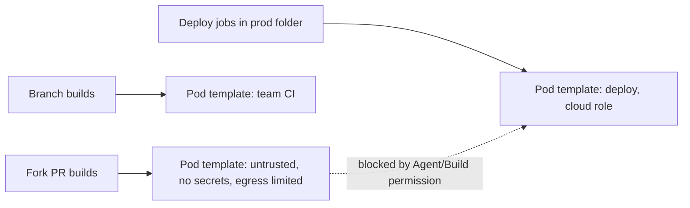

# Securing Agents and the Controller

## Introduction

Every build runs somebody's code: application code, test code, build scripts and thousands of third-party dependencies. You should assume that sooner or later some of that code is malicious, for example through a compromised npm package or a hostile pull request. The question is how much damage it can do.

Two boundaries decide that:

1. **Controller vs builds.** A build must never be able to read or change the controller's files (`JENKINS_HOME`, with its job configs, credentials and encryption keys).
2. **Build vs build.** A build for one team, or one pull request, must not be able to read another build's workspace, secrets or artifacts, or leave something behind for the next build.

Think of a shared workshop. The office with the safe and the payroll (the controller) must be locked away from the workbenches. And the workbenches should be wiped clean, or better replaced, between jobs, so one customer's project cannot tamper with the next.

This page covers:

- why builds must not run on the built-in node,
- agent-to-controller access control,
- securing agent connections (WebSocket, TCP port, SSH host keys),
- separating agents by trust level and using ephemeral agents,
- Docker and Kubernetes agent hardening,
- hardening the controller host itself.

Background on how agents work is in [Controller and Agents](../6-jenkins-agents/0-jenkins-controller-and-agents.mdx).

## Boundary 1: Keep Builds Off the Controller

### Set built-in executors to 0

A build that runs on the **built-in node** runs as the same OS user as Jenkins, in the same file system. It can simply read `JENKINS_HOME/secrets/` and `credentials.xml`. The Jenkins handbook is direct: builds should not run on the built-in node.

Set the number of executors on the built-in node to 0 (**Manage Jenkins > Nodes > Built-In Node > Configure**), or in JCasC:

```yaml
jenkins:
  numExecutors: 0
  mode: EXCLUSIVE   # if executors are ever added back, only run jobs that explicitly target it
```

Pipelines still use the controller for the lightweight Groovy orchestration (the "flyweight executor"), which is fine: that code is sandboxed ([Script Security and Sandboxing](./5-jenkins-script-security.mdx)). What matters is that `sh` steps and other heavy work happen on agents.

If you must keep a few admin jobs on the controller, use the **Job Restrictions** plugin (`job-restrictions`) to limit which jobs may run there.

### Agent-to-controller access control

Agents talk to the controller over the **Remoting** protocol. In the past, an agent could ask the controller to read or write files freely. A compromised agent (and the build running on it) could therefore attack the controller.

The **agent → controller access control** subsystem blocks this. It has been **always enabled since Jenkins 2.326** and can no longer be turned off. If you run an older version, upgrade; if you see documentation telling you to disable "Agent → Controller Security", it is outdated.

What this does not cover: an agent still receives everything the controller sends for its builds, including bound credentials. Agents remain a trust boundary for **their own** builds.

## Boundary 2: Builds vs Builds

### Separate agents by trust level

Builds with different trust levels should not share agents.

| Trust level | Examples | Agent pool |
| --- | --- | --- |
| Untrusted | PRs from forks, open source contributions | Ephemeral pods, no credentials, no network to internal systems |
| Internal CI | Branch builds and internal PRs | Ephemeral pods or VMs per team |
| Privileged | Releases, deploys, signing | Dedicated agents or pod templates with deploy identity; only specific jobs can use them |

Enforce the separation with labels **and** permissions:

- labels (`agent { label 'deploy' }`) route builds, but anyone who can edit a Jenkinsfile can change the label,
- agent permissions (`Agent/Build` in a role-based or matrix strategy) plus build authorization ([Authorization and Role-Based Access](./2-jenkins-authorization.mdx)) actually stop unauthorized jobs from using the deploy agents,
- the Job Restrictions plugin can restrict nodes to jobs whose names match a pattern.



### Prefer ephemeral agents

Static agents keep state between builds: workspaces, caches, Docker images, files in `/tmp`, background processes, even modified tools. A malicious build can leave a backdoor for the next one, or read what an earlier build left behind.

**Ephemeral agents** (a fresh container, pod or VM per build) remove most of that risk. The Jenkins handbook recommends clouds that "create a new agent for every build". In practice:

- **Kubernetes plugin**: a pod per build, deleted afterwards ([Kubernetes Pod Agents](../6-jenkins-agents/4-jenkins-kubernetes-agents.mdx)),
- **EC2 / Azure VM agents** with one build per instance ([Cloud Agents on AWS and Azure](../6-jenkins-agents/5-jenkins-cloud-agents.mdx)),
- **Docker agents** for single builds ([Docker Agents](../6-jenkins-agents/3-jenkins-docker-agents.mdx)).

If you must use static agents, clean workspaces (`cleanWs()` in `post`), use separate OS users per trust level, and rebuild the machines regularly from an image.

## Securing Agent Connections

### Inbound agents: WebSocket or a fixed TCP port

Inbound agents connect **to** the controller. They can do it in two ways:

| Transport | Port | Notes |
| --- | --- | --- |
| WebSocket (since 2.217) | The normal HTTPS port | Works through reverse proxies and load balancers; no extra firewall hole |
| TCP inbound port | Usually 50000 | Must be opened in the firewall; random or fixed |

Prefer WebSocket and disable the TCP port when nothing uses it:

```yaml
jenkins:
  slaveAgentPort: -1     # -1 disables the TCP inbound agent port
```

Start an inbound agent over WebSocket:

```bash
java -jar agent.jar \
  -url https://jenkins.example.com/ \
  -name linux-build-01 \
  -secret @/etc/jenkins-agent/secret \
  -workDir /home/jenkins/agent \
  -webSocket
```

Example output:

```text
INFO: Using /home/jenkins/agent/remoting as a remoting work directory
INFO: WebSocket connection open
INFO: Connected
```

Notes:

- the agent **secret** is like a password for that node name. Keep it in a file readable only by the agent user (the `@file` form avoids exposing it in the process list),
- if you keep the TCP port, use **fixed** mode so firewall rules stay valid, and allow it only from your agent networks,
- the TCP port answers HTTP requests with diagnostic information such as the Jenkins version, another reason not to expose it publicly.

Details: [Inbound (JNLP) Agents](../6-jenkins-agents/2-jenkins-inbound-agents.mdx).

### SSH agents: verify host keys

For [SSH agents](../6-jenkins-agents/1-jenkins-ssh-agents.mdx), the controller connects out to the agent. Configure a host key verification strategy such as **Known hosts file** or **Manually provided key** rather than "Non verifying", so a machine in the middle cannot impersonate the agent and capture builds and credentials. Store the controller's SSH private key as a **System**-scoped credential so no job can use it.

The same applies to Git: under **Manage Jenkins > Security**, the Git client plugin offers a **Git Host Key Verification Configuration**. Use known hosts or accept-first-connection rather than no verification.

## Hardening Docker Agents

Docker is convenient, and easy to make insecure.

| Risk | Why | Mitigation |
| --- | --- | --- |
| Mounting `/var/run/docker.sock` into build containers | Access to the Docker socket is effectively root on the host | Use rootless Docker, a remote BuildKit, Kaniko or Buildah; or dedicate the host to one trust level |
| `--privileged` containers | Can escape to the host | Avoid; use rootless builders |
| Running builds as root in the container | Easier escapes and file permission problems | `USER` a non-root user in the agent image |
| Unpinned images (`latest`) | Supply chain risk, non-reproducible | Pin by version or digest, scan images |

A minimal non-root agent image based on the official inbound agent:

```dockerfile
FROM jenkins/inbound-agent:latest-jdk21
USER root
RUN apt-get update \
 && apt-get install -y --no-install-recommends make git \
 && rm -rf /var/lib/apt/lists/*
USER jenkins
```

The official image already runs as the `jenkins` user; switching to root only for installation and back again keeps that property. In production, pin the base tag to a specific version (check [Docker Hub](https://hub.docker.com/r/jenkins/inbound-agent/tags) for current tags) instead of a moving `latest-jdk21` tag.

## Hardening Kubernetes Pod Agents

Kubernetes gives you strong isolation tools. Use them.

```yaml
apiVersion: v1
kind: Pod
metadata:
  labels:
    jenkins/trust: untrusted
spec:
  serviceAccountName: jenkins-agent-untrusted   # no cloud role, no RBAC rights
  automountServiceAccountToken: false
  securityContext:
    runAsNonRoot: true
    runAsUser: 1000
    fsGroup: 1000
    seccompProfile:
      type: RuntimeDefault
  containers:
    - name: build
      image: maven:3.9-eclipse-temurin-21
      command: ["sleep"]
      args: ["infinity"]
      securityContext:
        allowPrivilegeEscalation: false
        capabilities:
          drop: ["ALL"]
      resources:
        requests: { cpu: "500m", memory: "1Gi" }
        limits:   { memory: "2Gi" }
```

Use it in a Pipeline:

```groovy
pipeline {
    agent {
        kubernetes {
            yamlFile 'ci/pod-untrusted.yaml'
            defaultContainer 'build'
        }
    }
    stages {
        stage('Test') {
            steps {
                sh 'id && mvn -B -q test'
            }
        }
    }
}
```

Example output:

```text
+ id
uid=1000 gid=0(root) groups=0(root),1000
[INFO] Tests run: 42, Failures: 0, Errors: 0, Skipped: 0
```

Additional cluster-level controls:

- **Separate namespaces** for agents and the controller, and per trust level.
- **Pod Security Admission** with the `restricted` profile on agent namespaces.
- **NetworkPolicies** so untrusted agents cannot reach the controller's internal endpoints, cloud metadata (`169.254.169.254`) or internal services; allow only what builds need (the controller URL, artifact repositories).
- **Resource limits and quotas** so one runaway build cannot starve others.
- **Pod templates defined by admins** (in JCasC) for privileged pods, rather than letting any Jenkinsfile define pods with `serviceAccountName: deployer`. Whoever can write the pod YAML can pick the service account.

:::caution
If Jenkinsfiles can define arbitrary pod YAML, any developer can request a privileged pod or a powerful service account in that namespace. Restrict what the agent namespace allows with Pod Security Admission and RBAC, so a malicious pod spec is rejected by Kubernetes itself.
:::

## Hardening the Controller Host

The controller deserves production-server treatment:

- **Supported Java and LTS**: run a current LTS (2.580.1 as of September 2026) on Java 21 or 25, per the [Java support policy](https://www.jenkins.io/doc/book/platform-information/support-policy-java/).
- **TLS everywhere**: terminate HTTPS at a reverse proxy or load balancer, and set the Jenkins URL to the `https://` address.
- **Not on the public internet** unless required; put it behind a VPN, private network or identity-aware proxy. If GitHub webhooks need to reach it, allow only the webhook path or use a relay.
- **Non-root service user** owning `JENKINS_HOME` with restrictive permissions (`chmod 700`).
- **Encrypted disks and backups**, since they contain credentials and keys.
- **Minimal plugins** ([Avoiding Plugin Sprawl](../7-jenkins-plugins/2-jenkins-plugin-dependency-hell.mdx)).
- **Disabled services you don't use**: TCP agent port, SSH server plugin (`sshd`) for the CLI.
- **Resource root URL** for user content: serving workspace files and archived HTML reports from a separate domain lets reports use JavaScript without weakening the main UI's protection.

A quick check of the controller container's user and home permissions:

```bash
docker exec jenkins sh -c 'id; stat -c "%A %U %n" /var/jenkins_home /var/jenkins_home/secrets'
```

Example output:

```text
uid=1000(jenkins) gid=1000(jenkins) groups=1000(jenkins)
drwxr-xr-x jenkins /var/jenkins_home
drwx------ jenkins /var/jenkins_home/secrets
```

## Workspace, Cache and Artifact Hygiene

Even with good agent isolation, data can leak through what builds leave behind or share.

| Shared thing | Risk | Mitigation |
| --- | --- | --- |
| Workspaces on static agents | Next build reads source or generated secrets | `cleanWs()` in `post { always }`, or ephemeral agents |
| Shared dependency caches (`~/.m2`, `~/.npm`, a PVC) | Cache poisoning: a malicious build plants a modified package | Separate caches per trust level; read-only caches for untrusted builds |
| Archived artifacts | Files containing secrets become downloadable by anyone with Job/Read | Never archive config files with secrets; review `archiveArtifacts` patterns |
| Stashes | Visible to later stages, possibly on other agents | Stash only what is needed |
| Docker layer cache on a shared host | Layers from one build reused by another | BuildKit with per-team cache keys, or no shared daemon |

A safe `post` block for static agents:

```groovy
pipeline {
    agent { label 'linux-static' }
    stages {
        stage('Build') {
            steps {
                sh 'make build'
            }
        }
    }
    post {
        always {
            archiveArtifacts artifacts: 'dist/*.tar.gz', fingerprint: true
            cleanWs()
        }
    }
}
```

`cleanWs()` comes from the Workspace Cleanup plugin (`ws-cleanup`). Restricting `archiveArtifacts` to a specific pattern avoids archiving files such as `.npmrc` by accident.

## Real-World Scenario

Your company runs an open source SDK on GitHub plus private services, all on one Jenkins controller on Kubernetes. Today, fork PRs and release builds share the same pod template, which uses a service account that can push to the production container registry. A security review flags this as critical.

### The solution

1. **Three pod templates in JCasC**: `untrusted` (no service account token, NetworkPolicy allowing only the controller and package mirrors), `ci` (per-team), `release` (service account with registry push rights).
2. **Namespaces**: `jenkins` (controller), `jenkins-agents-untrusted`, `jenkins-agents-trusted`. Pod Security `restricted` on both agent namespaces.
3. **Folders**: `oss-prs/` for fork PR builds, with no credentials; `release/` for release jobs.
4. **Permissions**: only the `release/` folder's service account user has `Agent/Build` on the release cloud template; build authorization runs jobs as that user.
5. **Built-in node** set to 0 executors; TCP agent port disabled; agents connect over WebSocket.

### Why this approach

Fork PRs run code from strangers. Putting them in a pod with no secrets, no service account token and limited network means the worst case is a wasted build. Release capability stays in a separately authorized place.

### When to use it, when not

Use trust-level separation whenever any build runs code you do not fully trust (public PRs, third-party dependencies you have not vetted, multiple teams). For a single small team with private repos, one ephemeral pod template plus 0 controller executors is usually enough.

### Alternatives and trade-offs

| Approach | Pros | Cons | Best for |
| --- | --- | --- | --- |
| Static shared agents | Simple, warm caches | State leaks between builds, hard to isolate | Small trusted teams |
| Ephemeral pods, one template | Clean per build, cheap | All builds share one identity and network | Single team on Kubernetes |
| Ephemeral pods per trust level | Strong separation | More templates and policies to maintain | Mixed trust, open source plus private |
| Separate controllers per trust level | Strongest isolation, even of the controller | More controllers to patch and run | Regulated or very large orgs |
| Hosted runners for untrusted PRs | Outsource the riskiest builds | Split CI tooling | Open source projects |

## Common Mistakes

- **Leaving executors on the built-in node** "for quick jobs".
- **Mounting the Docker socket** into every build container.
- **Exposing TCP port 50000 to the internet.**
- **Non-verifying SSH host key strategy** for agents and Git.
- **One service account for all pods**, including fork PRs.
- **Letting Jenkinsfiles choose privileged pod specs** without cluster policies.
- **No NetworkPolicy**, so builds can reach the cloud metadata endpoint and steal node credentials.
- **Treating the controller like a dev box**, with shells for many people and unencrypted backups.

## Summary

- Builds on the built-in node can read controller secrets; set its executors to 0.
- Agent-to-controller access control is always on since 2.326; agents still see the secrets of their own builds.
- Prefer WebSocket inbound agents and disable or fix the TCP port; verify SSH host keys.
- Separate agents by trust level and make them ephemeral.
- Harden Docker and Kubernetes agents: non-root, no Docker socket, restricted pod security, NetworkPolicies, minimal service accounts.
- Treat the controller host as a crown-jewel server: current LTS and Java, TLS, private network, protected `JENKINS_HOME` and backups.

## Exercises

1. On a test controller, set built-in executors to 0 and connect an inbound agent with `-webSocket`. Disable the TCP port and confirm the agent stays connected.
2. Write a NetworkPolicy that allows an untrusted agent pod to reach only the Jenkins controller service and a package mirror. Test that `curl http://169.254.169.254` times out from the pod.
3. Create two pod templates (untrusted and release) and use role-based agent permissions so only one folder can use the release template.
4. Audit your agents: which ones are static, which run as root, and which have the Docker socket mounted?

**Related pages:** [Choosing an Agent Strategy](../6-jenkins-agents/7-jenkins-agent-strategies.mdx), [Labels, Executors and Scheduling](../6-jenkins-agents/6-jenkins-labels-and-executors.mdx), the [Kubernetes tutorial](/docs/devops/kubernetes), and the handbook pages on [Controller Isolation](https://www.jenkins.io/doc/book/security/controller-isolation/) and [Securing Builds](https://www.jenkins.io/doc/book/security/securing-builds/).
