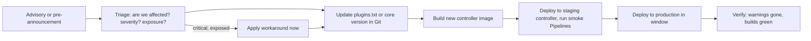

# Security Advisories and Hardening

## Introduction

Every piece of software has vulnerabilities. What matters is how quickly you learn about them and how quickly you can patch. Jenkins is no exception: the project publishes security advisories several times a year for core, and much more often for plugins. Between mid-2025 and September 2026 alone, advisories covered Jenkins core several times and dozens of plugins, including widely used ones such as Credentials Binding, Script Security, LDAP, SAML, Git client and GitHub Branch Source.

An unpatched Jenkins is one of the easiest targets in a company network, because attackers can read the public advisories as easily as you can. The January 2024 CLI file-read vulnerability (CVE-2024-23897) is a good example: details and working exploits were public within days, and internet scans for vulnerable Jenkins instances followed.

An analogy: advisories are recall notices for your car. The manufacturer tells you which part is faulty and how to fix it. Ignoring the letter does not make the brakes safer, and thieves read the same recall notices.

This page covers:

- how Jenkins security advisories work and how to follow them,
- in-product warnings and automated checks,
- a patching process that is fast but safe,
- a hardening checklist for the whole instance.

## How Jenkins Security Advisories Work

The **Jenkins security team** coordinates fixes with core and plugin maintainers, then publishes advisories at [jenkins.io/security/advisories](https://www.jenkins.io/security/advisories/).

Each advisory lists:

- **Issues** with an internal ID (`SECURITY-1234`), a CVE ID (the Jenkins project is a CVE Numbering Authority), a description and a CVSS severity,
- **Affected versions** of core and plugins,
- **Fixed versions**, or a note that **no fix is available** yet,
- sometimes a **workaround** you can apply before upgrading.

Advisories are announced through several channels:

| Channel | What you get |
| --- | --- |
| [jenkinsci-advisories](https://groups.google.com/g/jenkinsci-advisories) Google group | Email for each advisory, plus a **pre-announcement** for most advisories, typically a few days ahead |
| RSS feed of the advisories page | Machine-readable notifications |
| oss-security mailing list | Excerpts for the wider security community |
| CVE records | Picked up by vulnerability scanners |
| **Inside Jenkins** | Admin monitors warning about installed vulnerable versions |

The pre-announcement does not name the affected plugins, but says whether core is affected and gives the highest severity and the popularity of affected plugins. That is enough to book a maintenance window.

:::tip
Subscribe at least two people to the jenkinsci-advisories group, and route the RSS feed into your team chat. Advisories are usually published on a weekday; if your patching depends on one person reading email, it will be late during holidays.
:::

### Unfixed plugin vulnerabilities

Many plugins are maintained by volunteers. When a maintainer does not respond, the security team may publish the vulnerability **without a fix**. The advisory then says something like "As of publication of this advisory, there is no fix." For you this means:

- the plugin is vulnerable indefinitely, unless someone adopts it,
- the only options are removing it, replacing it, or accepting and mitigating the risk (for example with tighter permissions).

This is a strong reason to keep the plugin list short; see [Avoiding Plugin Sprawl and Dependency Problems](../7-jenkins-plugins/2-jenkins-plugin-dependency-hell.mdx).

## A Famous Example: CVE-2024-23897

| Field | Value |
| --- | --- |
| Advisory | [2024-01-24](https://www.jenkins.io/security/advisory/2024-01-24/), SECURITY-3314 |
| Component | Jenkins core CLI |
| Problem | The CLI's argument parser replaced `@file` arguments with file contents, so attackers could read files on the controller |
| Severity | Critical |
| Affected | Weekly up to 2.441, LTS up to 2.426.2 |
| Fixed | Weekly 2.442, LTS 2.426.3 and 2.440.1 |
| Workaround | Disable CLI access until you can upgrade |

What made it severe was the chain: reading files such as the encryption keys in `JENKINS_HOME/secrets/` could lead to decrypting secrets and, in some configurations, to remote code execution. Users with Overall/Read could read whole files; anonymous users could read the first lines of files. Instances with anonymous read access enabled were especially exposed.

Lessons:

- **Patch speed matters.** Exploits appeared soon after publication.
- **Defense in depth matters.** Controllers not reachable from the internet, without anonymous read access, were far harder to attack.
- **Workarounds buy time**, but they are not a fix.

## In-Product Warnings

Jenkins downloads security warnings from the update site and shows them to administrators as banners and on **Manage Jenkins**, for both core and plugins. They link to the advisory.

You can hide individual warnings under **Manage Jenkins > Security > Hidden security warnings**, but treat a hidden warning as a documented risk acceptance, not as housekeeping.

Plugin pages on [plugins.jenkins.io](https://plugins.jenkins.io/) also show:

- previous security warnings,
- whether the plugin is **up for adoption** (no active maintainer),
- whether it is **deprecated**,
- a **health score** based on factors such as recent releases and use of current APIs.

## Automating the Check

The update center publishes the same warnings as JSON. You can check a list of plugin versions (for example the `plugins.txt` you use with the plugin installation manager, see [Managing Plugins as Code](../7-jenkins-plugins/3-jenkins-plugin-installation-manager.mdx)) in CI, before a vulnerable version reaches production.

`plugins.txt`:

```text
# plugin-id:version
credentials-binding:728.v902a_273b_8947
coverage:3.3348
script-security:1433.v17c58a_e45cc1
matrix-auth:3.3
```

`check_warnings.py`:

```python
"""Report Jenkins security warnings that match the plugin versions in plugins.txt."""
import json
import re
import sys
import urllib.request

UC_URL = "https://updates.jenkins.io/current/update-center.actual.json"


def load_plugins(path):
    plugins = {}
    with open(path) as f:
        for line in f:
            line = line.split("#", 1)[0].strip()
            if ":" in line:
                name, version = line.split(":", 1)
                plugins[name.strip()] = version.strip()
    return plugins


def main(plugins_file, core_version):
    with urllib.request.urlopen(UC_URL, timeout=60) as resp:
        uc = json.load(resp)

    installed = load_plugins(plugins_file)
    installed["core"] = core_version
    deprecated = uc.get("deprecations", {})
    found = 0

    for warning in uc.get("warnings", []):
        name = warning["name"]
        version = installed.get(name)
        if version is None:
            continue
        for rng in warning["versions"]:
            if re.fullmatch(rng["pattern"], version):
                found += 1
                print(f"[{warning['id']}] {name} {version}: {warning['message']}")
                print(f"    last affected: {rng.get('lastVersion', '?')}  {warning['url']}")

    for name in installed:
        if name in deprecated:
            print(f"[DEPRECATED] {name}: {deprecated[name]['url']}")

    latest = {n: p["version"] for n, p in uc["plugins"].items()}
    outdated = [n for n, v in installed.items() if n in latest and latest[n] != v]
    print(f"\n{found} active warning(s); {len(outdated)} plugin(s) not on the latest version")


if __name__ == "__main__":
    if len(sys.argv) != 3:
        sys.exit("usage: check_warnings.py plugins.txt CORE_VERSION")
    main(sys.argv[1], sys.argv[2])
```

Run it against an older LTS version:

```bash
python3 check_warnings.py plugins.txt 2.568.2
```

Example output (October 2026; your results will differ as new advisories appear):

```text
[core-2_580] core 2.568.2: Multiple security vulnerabilities in Jenkins 2.579 and earlier, LTS 2.568.2 and earlier
    last affected: LTS 2.568.2  https://www.jenkins.io/security/advisory/2026-09-02/
[SECURITY-4118] coverage 3.3348: Stored XSS vulnerability
    last affected: 3.3358.v9487dde48783  https://www.jenkins.io/security/advisory/2026-09-16/#SECURITY-4118

2 active warning(s); 1 plugin(s) not on the latest version
```

Each warning has a regular expression `pattern` describing affected versions, which the script matches against your versions. Exit with a non-zero code when `found > 0` if you want the CI job to fail.

Run this as a scheduled Jenkins job (or in the pipeline that builds your custom Jenkins image), so new advisories are flagged even when nobody reads email:

```groovy
pipeline {
    agent { label 'linux' }
    triggers { cron('H 7 * * 1-5') }   // weekday mornings
    stages {
        stage('Check advisories') {
            steps {
                sh 'python3 ci/check_warnings.py jenkins/plugins.txt "$(cat jenkins/core-version.txt)"'
            }
        }
    }
}
```

## A Patching Process That Works



| Severity and exposure | Target time to patch (example policy) |
| --- | --- |
| Critical, controller reachable by untrusted users | Same day; workaround immediately |
| High | Within a few days |
| Medium or low | Next regular maintenance window |
| No fix available | Remove or replace the plugin; restrict permissions meanwhile |

These targets are an example; set your own in agreement with your security team.

What makes fast patching possible:

- **Jenkins as code**: core version, `plugins.txt` and JCasC in Git, built into a container image. Rolling forward or back is a redeploy. See [Configuration as Code (JCasC)](../12-jenkins-administration/0-jenkins-configuration-as-code.mdx).
- **A staging controller** with the same image and a set of representative Pipelines.
- **Backups** you have actually restored at least once ([Backup and Restore](../12-jenkins-administration/2-jenkins-backup-and-restore.mdx)).
- **Staying close to current LTS**, so security updates are small steps and not a two-year jump. See [Upgrading Jenkins and LTS Releases](../1-jenkins-installation/6-jenkins-upgrading.mdx).

## Hardening Checklist

Patching fixes known bugs. Hardening reduces the impact of the unknown ones. Work through these areas; most items link to a page in this section.

### Access

- [ ] SSO or LDAP; no sign-up on the built-in database ([Authentication and SSO](./1-jenkins-authentication.mdx))
- [ ] No permissions for `anonymous` (not even Overall/Read) unless you run a public instance on purpose
- [ ] Matrix or role-based authorization with a short admin list ([Authorization and Role-Based Access](./2-jenkins-authorization.mdx))
- [ ] Build authorization configured, so builds do not run as SYSTEM
- [ ] API tokens for automation belong to service accounts; legacy tokens disabled

### Builds and secrets

- [ ] Built-in node has 0 executors ([Securing Agents and the Controller](./6-jenkins-securing-agents.mdx))
- [ ] Ephemeral agents, separated by trust level
- [ ] Credentials in folder stores or an external manager ([Credentials Management](./3-jenkins-credentials.mdx))
- [ ] Sandbox enforced and approvals reviewed ([Script Security and Sandboxing](./5-jenkins-script-security.mdx))
- [ ] Global environment variable filters considered for build parameters (available since Jenkins 2.248)

### Web UI protections

- [ ] **CSRF protection** on (default). Do not disable it to "fix" scripts; use API tokens instead.
- [ ] **Markup formatter** set to plain text, or **Safe HTML** from the OWASP Markup Formatter plugin (`antisamy-markup-formatter`) if you need formatting. Never allow raw HTML.
- [ ] **Content Security Policy** for the Jenkins UI: available in core since 2.539, disabled by default. After upgrading, leave enforcement off while Jenkins collects violation reports from users' browsers, fix or replace incompatible plugins, then enforce.
- [ ] **Resource Root URL** configured (**Manage Jenkins > System > Serve resource files from another domain**) if teams publish HTML reports, instead of relaxing the user-content CSP.

### Services and network

- [ ] HTTPS only, behind a reverse proxy or load balancer
- [ ] Not reachable from the internet, or only through an identity-aware proxy
- [ ] TCP inbound agent port disabled or fixed and firewalled; agents use WebSocket
- [ ] SSH server plugin (`sshd`) not installed or disabled unless needed for the CLI

### Operations

- [ ] Current LTS on a supported Java (21 or 25), patched within your policy
- [ ] Plugins minimal, none deprecated or up for adoption without a plan
- [ ] Everything in JCasC and Git
- [ ] Audit logging with the **Audit Trail** plugin (`audit-trail`), shipped to central logging
- [ ] Encrypted backups, restore tested

A JCasC fragment covering several of these:

```yaml
jenkins:
  numExecutors: 0
  slaveAgentPort: -1
  markupFormatter: plainText
  crumbIssuer:
    standard:
      excludeClientIPFromCrumb: false
  disableRememberMe: false
security:
  apiToken:
    creationOfLegacyTokenEnabled: false
    tokenGenerationOnCreationEnabled: false
    usageStatisticsEnabled: true
  scriptApproval:
    forceSandbox: true
unclassified:
  location:
    url: "https://jenkins.example.com/"
```

Check the keys against **Manage Jenkins > Configuration as Code > View Configuration** on your version before applying; some keys move between releases. CSP and the Resource Root URL also have JCasC keys, which you can copy from the same export after configuring them once in the UI.

## Real-World Scenario

Your company runs Jenkins 2.4xx LTS from 2024 with 160 plugins, installed manually. A pre-announcement says that a critical core issue will be fixed next Wednesday. The last upgrade took two weeks because plugins broke.

### The solution

**This week (emergency path):**

1. Read the pre-announcement and confirm core is affected.
2. Check exposure: the controller is on the internal network, but contractors can reach it. Temporarily restrict access at the reverse proxy to the VPN.
3. Take a backup and plan a Wednesday evening window.
4. On Wednesday, apply the patch or the advisory's workaround. Because you are two years behind, the fixed version may require a much newer Java or plugin set; if so, apply the workaround and isolate the controller further while preparing the full upgrade.

**Next quarter (structural fix):**

1. Export the current plugin list into `plugins.txt` and remove unused plugins (aim for fewer than 80).
2. Build a container image with the current LTS, `plugins.txt` and JCasC.
3. Stand up a staging controller from that image and migrate Pipelines folder by folder.
4. Add the advisory check job and subscribe the team to jenkinsci-advisories.
5. Agree on a patch policy: critical within one day, high within a week, LTS upgrades every release.

### Why this approach

The emergency path limits exposure immediately without risking a rushed two-year upgrade. The structural fix turns future patches into a routine image rebuild, which is the only sustainable way to keep up with Jenkins' advisory frequency.

### When to use it, when not

This applies to any long-lived Jenkins. If you are building a new controller, start with the structural setup from day one. If your organization cannot commit people to regular patching, that is a serious argument for a hosted CI service; see [Total Cost of Running Jenkins](../13-jenkins-best-practices/4-jenkins-cost-and-maintenance.mdx).

### Alternatives and trade-offs

| Approach | Pros | Cons | Best for |
| --- | --- | --- | --- |
| Manual updates via the UI | No setup | Slow, untested, no rollback | Tiny labs |
| Jenkins as code with image builds | Fast, reviewable, easy rollback | Initial investment | Most teams |
| Weekly release line | Fixes arrive soonest | More change, more regressions | Teams that can test continuously |
| LTS line (recommended) | Stable, security backports | Some fixes slightly later | Production |
| Commercial distribution with support | Vendor-tested plugin sets, support SLAs | License cost | Large enterprises |
| Migrate to hosted CI | Platform patched for you | Migration effort, different trade-offs | Teams without Jenkins operators |

## Common Mistakes

- **Nobody subscribed to advisories**, so patches wait until someone notices a banner.
- **Hiding warnings** instead of fixing them.
- **Falling far behind LTS**, which turns a security patch into a risky major upgrade.
- **Keeping plugins with unfixed vulnerabilities** because "we might need it".
- **Disabling CSRF protection** to make an old script work.
- **Allowing raw HTML** in job descriptions, an easy stored-XSS vector.
- **No staging controller**, so every update is tested in production.

## Summary

- The Jenkins security team publishes advisories for core and plugins regularly, with pre-announcements on the jenkinsci-advisories group.
- Jenkins shows warnings for installed vulnerable versions; the update center JSON lets you check versions automatically.
- Some plugin vulnerabilities never get fixed; remove or replace those plugins.
- Fast patching depends on Jenkins as code, a staging controller and staying close to LTS.
- Hardening (SSO, least privilege, isolation, CSRF, safe markup, CSP, private network, audit logs) limits damage from unknown bugs.

## Exercises

1. Subscribe to the jenkinsci-advisories group or RSS feed, and read the most recent advisory. Which issues would affect your controller?
2. Run `check_warnings.py` against your controller's plugin list. You can get the list from the Script Console with `Jenkins.get().pluginManager.plugins.each { println "${it.shortName}:${it.version}" }`.
3. Write a patch policy for your team with target times per severity, and test it with a dry run on a staging controller.
4. On a test controller running 2.539 or newer, browse your main pages with CSP enforcement still off, review the violation reports Jenkins collects, then enable enforcement and check that the pages still work.

**Related pages:** [Jenkins Security Overview](./0-jenkins-security-overview.mdx), [Upgrading Jenkins and LTS Releases](../1-jenkins-installation/6-jenkins-upgrading.mdx), [Monitoring Jenkins](../12-jenkins-administration/3-jenkins-monitoring.mdx), and the official pages on [security advisories](https://www.jenkins.io/security/advisories/) and [securing Jenkins](https://www.jenkins.io/doc/book/security/).
