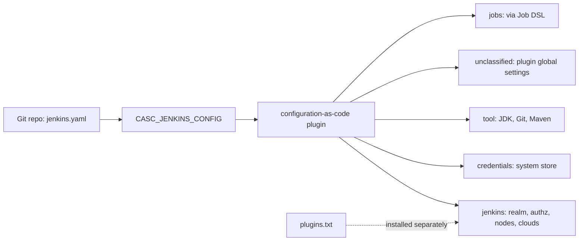
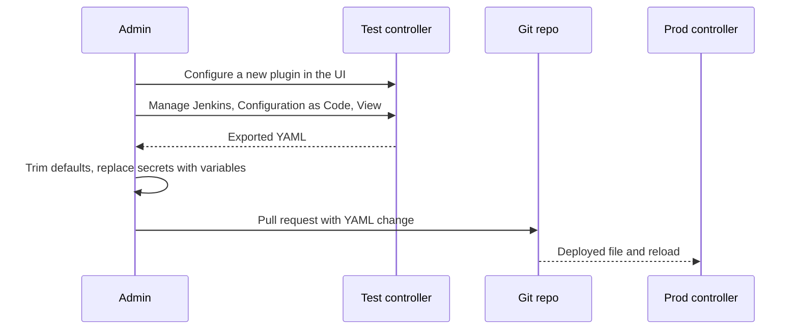

# Configuration as Code (JCasC)

## Introduction

Every setting you change under **Manage Jenkins** ends up as an XML file inside `JENKINS_HOME`. Click enough buttons over a few years and you get a controller that nobody can rebuild: the security realm was set by someone who left, the Slack token was pasted in 2023, and the tool installations differ between the "real" Jenkins and the test one.

**Jenkins Configuration as Code (JCasC)** fixes this. The `configuration-as-code` plugin reads one or more YAML files and applies them to the controller at startup (and on demand). The YAML describes the *desired state*: system message, executors, security realm, credentials, tool installations, plugin settings. Commit it to Git and your controller becomes reproducible.

Think of it like an `/etc` directory managed by Ansible instead of edited by hand. The server still stores its own state, but the source of truth is a reviewed file in version control.

In this page you will:

1. Understand what JCasC manages and what it does not.
2. Write a working `jenkins.yaml` with security, credentials and plugin settings.
3. Feed secrets into it safely.
4. Export your current configuration to bootstrap a file.
5. Reload configuration without restarting, and wire it into Docker and Helm.

:::note Versions
JCasC is a plugin, not part of core. At the time of writing the plugin is at version `2134.x` and requires a recent Jenkins LTS. Check [plugins.jenkins.io/configuration-as-code](https://plugins.jenkins.io/configuration-as-code/) for the current release.
:::

## What JCasC Manages (and What It Does Not)



| Area | Managed by JCasC? | Notes |
| --- | --- | --- |
| Global system settings (URL, message, executors) | Yes | Root keys `jenkins` and `unclassified` |
| Security realm and authorization | Yes | Under `jenkins` |
| System credentials | Yes | Root key `credentials` |
| Tool installations | Yes | Root key `tool` |
| Plugin global settings (Slack, Git, Kubernetes cloud) | Yes, if the plugin supports it | Most popular plugins do |
| **Installing plugins** | **No** | Use `plugins.txt` and the plugin installation manager ([Managing Plugins as Code](../7-jenkins-plugins/3-jenkins-plugin-installation-manager.mdx)) |
| **Jobs** | Indirectly | The `jobs` root key runs [Job DSL](./1-jenkins-job-dsl.mdx) scripts |
| Build history, workspaces | No | That is data, not configuration. See [Backup and Restore](./2-jenkins-backup-and-restore.mdx) |

The split matters: a fully codified Jenkins is usually **three files**: a `plugins.txt`, a `jenkins.yaml`, and Job DSL seed scripts (or multibranch pipelines discovered from your Git server).

## How the Plugin Finds Your YAML

JCasC looks for configuration in this order:

1. The `CASC_JENKINS_CONFIG` environment variable, or the `casc.jenkins.config` Java system property.
2. If neither is set, `$JENKINS_HOME/jenkins.yaml`.

`CASC_JENKINS_CONFIG` is a **comma-separated list** of sources. Each can be:

- a file path (`/var/jenkins_home/casc/jenkins.yaml`) or `file://` URI,
- a directory (scanned recursively for `.yml` and `.yaml` files),
- an HTTP or HTTPS URL.

When several files are found, they are **merged**. Files must be complementary: if two files set the same value differently, JCasC raises a `ConfiguratorException` instead of guessing which wins. That keeps the result independent of file order.

```bash
# A directory of files, one per concern
export CASC_JENKINS_CONFIG=/var/jenkins_home/casc
ls /var/jenkins_home/casc
```

Example output:

```text
01-core.yaml
02-security.yaml
03-credentials.yaml
04-tools.yaml
05-notifications.yaml
```

Splitting by concern keeps pull requests small and lets different teams own different files.

## Your First jenkins.yaml

Start small. This file sets the system message, turns off executors on the controller, and sets the Jenkins URL.

```yaml
jenkins:
  systemMessage: "Managed by JCasC. Changes made in the UI will be overwritten."
  numExecutors: 0
  mode: EXCLUSIVE
  quietPeriod: 5
  scmCheckoutRetryCount: 2

unclassified:
  location:
    url: "https://jenkins.example.com/"
    adminAddress: "Jenkins <jenkins@example.com>"
```

There are four core root keys you will use constantly:

- **`jenkins`**: core settings, security realm, authorization, nodes and clouds.
- **`unclassified`**: global settings contributed by plugins that do not fit elsewhere (Jenkins location, Slack, Git, Mailer, many more).
- **`credentials`**: the system credentials store.
- **`tool`**: tool installations such as JDK, Git and Maven.

Plugins can add further root keys (for example `security` for some security-related plugin settings, and `jobs` from Job DSL).

### Adding Security

```yaml
jenkins:
  securityRealm:
    local:
      allowsSignup: false
      users:
        - id: "admin"
          password: "${ADMIN_PASSWORD}"
  authorizationStrategy:
    loggedInUsersCanDoAnything:
      allowAnonymousRead: false
```

This is the simplest workable setup: local users and "logged-in users can do anything". Real teams usually switch to SSO and role-based or matrix authorization, covered in [Authentication and SSO](../11-jenkins-security/1-jenkins-authentication.mdx) and [Authorization and Role-Based Access](../11-jenkins-security/2-jenkins-authorization.mdx). The JCasC pattern stays the same: you only swap the block under `securityRealm` and `authorizationStrategy`.

### Adding Credentials

```yaml
credentials:
  system:
    domainCredentials:
      - credentials:
          - usernamePassword:
              scope: GLOBAL
              id: "github-bot"
              username: "acme-ci-bot"
              password: "${GITHUB_BOT_TOKEN}"
              description: "GitHub token for the CI bot"
          - string:
              scope: GLOBAL
              id: "slack-bot-token"
              secret: "${SLACK_BOT_TOKEN}"
              description: "Slack bot token"
          - basicSSHUserPrivateKey:
              scope: GLOBAL
              id: "deploy-ssh"
              username: "deploy"
              description: "SSH key for deployment hosts"
              privateKeySource:
                directEntry:
                  privateKey: "${readFile:/run/secrets/deploy_ssh_key}"
```

Notice that **no secret value is in the file**. Every secret is a `${...}` reference resolved at load time. More on that below.

### Adding Tools and Plugin Settings

```yaml
tool:
  git:
    installations:
      - name: "Default"
        home: "git"
  jdk:
    installations:
      - name: "jdk21"
        home: "/opt/java/openjdk"

unclassified:
  slackNotifier:
    teamDomain: "acme"
    tokenCredentialId: "slack-bot-token"
    botUser: true
```

The `slackNotifier` block is contributed by the Slack plugin. Every plugin that supports JCasC defines its own keys, which is why you should never guess them (see "Discovering the Right Keys" below).

## Secrets: Never Commit Them

JCasC resolves `${...}` expressions when it loads the file. The syntax is shell-like:

| Expression | Meaning |
| --- | --- |
| `${VAR}` | Value of a secret source or environment variable named `VAR` |
| `${VAR:-default}` | Use `default` if `VAR` is not set |
| `^${VAR}` | Escape: produce the literal text `${VAR}` (useful for Groovy or shell snippets inside YAML) |
| `${readFile:/path}` | Contents of a file (alias `file:`) |
| `${trim:${readFile:/path}}` | File contents without trailing whitespace |
| `${base64:...}` | Base64-encode a value |
| `${decodeBase64:...}` | Decode a Base64 value |
| `${json:key:${VAR}}` | Extract `key` from a JSON value |

Where do the values come from? JCasC checks several **secret sources**:

- **Files in `/run/secrets/`**: a file named `GITHUB_BOT_TOKEN` provides `${GITHUB_BOT_TOKEN}`. Docker secrets and Kubernetes secret volumes both fit this pattern. Change the folder with the `SECRETS` environment variable.
- **A properties file**: `/run/secrets/secrets.properties` by default (`SECRETS_FILE` to change).
- **HashiCorp Vault**: set `CASC_VAULT_URL`, `CASC_VAULT_PATHS` and one auth method (token, user and password, or AppRole).
- **Environment variables**: they work, but the JCasC docs warn they are a poor place for secrets because jobs running on the controller and admins can read the process environment.

:::warning
By default an unresolved variable becomes an empty string, which can silently set an empty password. Set `CASC_STRICT_SECRET_RESOLUTION=true` so a missing secret (without a `:-` default) aborts the reload and keeps the previous configuration.
:::

### Escaping in Practice

A system message that should literally show `${BUILD_NUMBER}`, or a Groovy script embedded in YAML, needs the caret escape:

```yaml
jenkins:
  systemMessage: "Use ^${BUILD_NUMBER} in your artifact names"
```

Without the caret, JCasC would try to resolve `BUILD_NUMBER` at load time and replace it with an empty string.

## Discovering the Right Keys

You almost never write JCasC from scratch. Use the tools the plugin provides:

1. **View or export current configuration.** Configure something once in the UI on a test controller, then open **Manage Jenkins > Configuration as Code** and choose **View Configuration** (or **Download Configuration**). You get YAML for everything JCasC understands.
2. **Reference documentation.** The **Documentation** link at the bottom of the Configuration as Code page lists every key supported by the plugins *installed on that controller*.
3. **JSON schema.** The plugin can produce a JSON schema for editor validation.



:::caution
Exported YAML is noisy. It includes every default value and sometimes masked or encrypted secrets. Delete what you did not intentionally set, and replace secret values with `${...}` references before committing.
:::

## Applying Changes

### At Startup

The usual path: mount the YAML, set `CASC_JENKINS_CONFIG`, start Jenkins. A Docker example:

```dockerfile
FROM jenkins/jenkins:lts-jdk21
ENV JAVA_OPTS="-Djenkins.install.runSetupWizard=false"
ENV CASC_JENKINS_CONFIG=/var/jenkins_home/casc
COPY --chown=jenkins:jenkins plugins.txt /usr/share/jenkins/ref/plugins.txt
RUN jenkins-plugin-cli -f /usr/share/jenkins/ref/plugins.txt
COPY --chown=jenkins:jenkins casc/ /var/jenkins_home/casc/
```

`plugins.txt` must include `configuration-as-code` plus every plugin your YAML configures. Setting `jenkins.install.runSetupWizard=false` skips the setup wizard, since JCasC already creates the admin user.

```bash
docker build -t acme/jenkins:2026-10 .
docker run -d --name jenkins -p 8080:8080 \
  -v jenkins_home:/var/jenkins_home \
  -v "$PWD/secrets:/run/secrets:ro" \
  acme/jenkins:2026-10
docker logs jenkins 2>&1 | grep -i casc
```

Example output:

```text
INFO	i.j.p.casc.ConfigurationAsCode#configure: Configuration as Code: loading from /var/jenkins_home/casc
```

The exact log text varies between plugin versions, but you should see JCasC report where it loaded from. If the YAML has an unknown key, startup logs a clear error naming it.

### Reloading Without a Restart

You can re-apply the YAML on a running controller in several ways:

| Method | How |
| --- | --- |
| UI | **Manage Jenkins > Configuration as Code > Reload existing configuration** |
| CLI | `java -jar jenkins-cli.jar -s "$JENKINS_URL" -auth @creds reload-jcasc-configuration` |
| HTTP (admin) | `POST $JENKINS_URL/configuration-as-code/reload` with an admin API token |
| HTTP (token) | `POST $JENKINS_URL/reload-configuration-as-code/?casc-reload-token=...` (only when `CASC_RELOAD_TOKEN` is set) |

```bash
curl -X POST -u "admin:$JENKINS_API_TOKEN" \
  "https://jenkins.example.com/configuration-as-code/reload"
echo "exit=$?"
```

Example output:

```text
exit=0
```

### On Kubernetes with Helm

The `jenkinsci/jenkins` Helm chart has JCasC built in. You add YAML snippets under `controller.JCasC.configScripts`, and a sidecar (`controller.sidecars.configAutoReload.enabled`, on by default) watches ConfigMaps and triggers a reload when they change.

```yaml
controller:
  installPlugins:
    - kubernetes
    - workflow-aggregator
    - git
    - configuration-as-code
    - slack
  JCasC:
    defaultConfig: true
    configScripts:
      welcome-message: |
        jenkins:
          systemMessage: "Managed by Helm and JCasC"
      slack: |
        unclassified:
          slackNotifier:
            teamDomain: "acme"
            tokenCredentialId: "slack-bot-token"
            botUser: true
```

Each key under `configScripts` becomes a separate YAML file, merged with the chart's default configuration (which sets up the Kubernetes cloud). See [Installing Jenkins on Kubernetes](../1-jenkins-installation/2-jenkins-install-kubernetes.mdx) for the full install.

## Validating Before You Deploy

A typo in YAML can lock everyone out (for example a broken `securityRealm`). Add cheap checks to the pull request:

```bash
python3 - <<'EOF'
import sys, yaml, pathlib
for f in sorted(pathlib.Path("casc").glob("*.yaml")):
    try:
        yaml.safe_load(f.read_text())
        print(f"OK   {f}")
    except yaml.YAMLError as e:
        print(f"FAIL {f}: {e}")
        sys.exit(1)
EOF
```

Example output:

```text
OK   casc/01-core.yaml
OK   casc/02-security.yaml
OK   casc/03-credentials.yaml
```

YAML syntax is only the first layer. The real test is booting a throwaway controller from the same image and YAML, which you can do in CI:

```bash
docker run -d --name casc-test -p 18080:8080 \
  -v "$PWD/test-secrets:/run/secrets:ro" acme/jenkins:candidate
sleep 60
docker logs casc-test 2>&1 | grep -E "SEVERE|ConfiguratorException" && exit 1
curl -sf -o /dev/null -w "%{http_code}\n" http://localhost:18080/login
```

Example output:

```text
200
```

## Real-World Scenario

Your company runs one Jenkins controller for 40 developers. Last quarter the VM's disk failed. The backup restored jobs, but nobody could remember which plugin settings, tool paths and credential IDs had been changed since the backup, and it took two days to get builds green again. Your manager asks for "a Jenkins we can rebuild in an hour."

**The plan:**

1. Boot a copy of the current controller from the latest backup in a test environment.
2. Export its configuration from **Manage Jenkins > Configuration as Code**.
3. Split the export into `01-core.yaml`, `02-security.yaml`, `03-credentials.yaml`, `04-tools.yaml`, `05-plugins.yaml`. Delete default values. Replace every secret with a `${...}` reference backed by files in `/run/secrets` (populated from your secret manager).
4. Generate `plugins.txt` from the running controller (see [Managing Plugins as Code](../7-jenkins-plugins/3-jenkins-plugin-installation-manager.mdx)).
5. Build a Docker image that bakes in plugins and YAML. Boot it in CI on every pull request as a smoke test.
6. Define jobs with multibranch pipelines or [Job DSL](./1-jenkins-job-dsl.mdx), so they are code too.
7. Set `systemMessage` to warn that UI changes are overwritten. Restrict **Administer** to a small group.

The result: rebuilding the controller is `docker run` plus restoring build history, if you even need history.

**Why this approach:** the outage was caused by *configuration drift*, not by lost data. JCasC makes configuration reviewable, diffable and repeatable, which is exactly the missing piece.

**When to use it:** any controller that matters, any team that runs more than one controller (test and prod), and anyone on Kubernetes, where pods are expected to be replaceable.

**When not to (yet):** a personal sandbox Jenkins you will throw away, or a controller using an old plugin with no JCasC support. In that case you can still codify most of the system and leave a short manual runbook for the rest.

### Alternatives and Trade-offs

| Approach | Pros | Cons | Best for |
| --- | --- | --- | --- |
| Click-ops in the UI | Fast to start, no learning curve | Drift, no review, painful rebuilds | Short-lived sandboxes |
| Back up `JENKINS_HOME` only | Restores everything including history | Restores old mistakes too, no diff or review | Data protection (still needed alongside JCasC) |
| Groovy init scripts (`init.groovy.d`) | Full power of the Jenkins API | Imperative, brittle across versions, hard to review | Gaps JCasC cannot cover |
| **JCasC YAML** | Declarative, reviewed in Git, reloadable, supported by most plugins | Keys differ per plugin, plugin install is separate | Most production controllers |
| Managed or commercial offerings | Vendor handles parts of the config | Cost, lock-in | Large enterprises with budget |

## Common Mistakes

1. **Committing secrets.** Exported YAML may contain encrypted values like `"{AQAAABAAAAAQ...}"`. They are encrypted with that controller's own key, so they will not even work elsewhere, and they still leak information. Replace them with `${...}`.
2. **Forgetting the plugin.** If a plugin is not installed, its YAML keys are unknown and startup fails. Keep `plugins.txt` and YAML in the same repository and change them together.
3. **Editing in the UI anyway.** The next reload silently undoes the change. Put a clear system message in place and make the YAML the only path for changes.
4. **One giant file.** It becomes a merge-conflict magnet. Split by concern.
5. **No smoke test.** A broken security realm can lock you out. Boot a test controller from every change.
6. **Empty secrets.** Without `CASC_STRICT_SECRET_RESOLUTION=true`, a missing secret becomes an empty string.
7. **Unescaped `${...}` in embedded scripts.** Use `^${...}` when you want the literal text.

## Summary

- JCasC turns Jenkins global configuration into YAML that lives in Git.
- Root keys: `jenkins`, `unclassified`, `credentials`, `tool`, plus plugin-specific ones like `jobs`.
- `CASC_JENKINS_CONFIG` points at files, directories or URLs. Multiple files are merged and must not conflict.
- Secrets are referenced with `${...}` and come from `/run/secrets`, a properties file, Vault or (least preferred) environment variables.
- Export existing configuration and use the in-app documentation instead of guessing keys.
- Reload via UI, CLI or HTTP. The Helm chart reloads automatically through a sidecar.
- JCasC does not install plugins or store build history. Pair it with `plugins.txt`, Job DSL or multibranch jobs, and backups.

## Further Learning

### Exercises

1. Run `jenkins/jenkins:lts-jdk21` with the `configuration-as-code` plugin, configure a system message in the UI, then export the YAML and find your setting in it.
2. Write a `jenkins.yaml` that creates a local admin user whose password comes from `/run/secrets/ADMIN_PASSWORD`, and boot a container with it. Then delete the secret file and restart with `CASC_STRICT_SECRET_RESOLUTION=true`. What happens?
3. Split your YAML into three files and deliberately set `systemMessage` in two of them. Read the error.
4. Add a CI job that builds your Jenkins image and checks `/login` returns 200.

### Related Pages

- [Job DSL](./1-jenkins-job-dsl.mdx): define jobs as code and run them from the `jobs` key.
- [Managing Plugins as Code](../7-jenkins-plugins/3-jenkins-plugin-installation-manager.mdx)
- [Credentials Management](../11-jenkins-security/3-jenkins-credentials.mdx)
- [External Secrets with Vault and Cloud Secret Managers](../11-jenkins-security/4-jenkins-external-secrets.mdx)
- [Project: Fully Codified Jenkins Instance](../14-jenkins-projects/5-jenkins-project-jenkins-as-code.mdx)
- Official docs: [Configuration as Code plugin](https://plugins.jenkins.io/configuration-as-code/)
