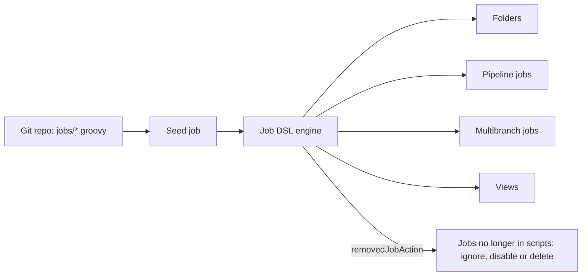
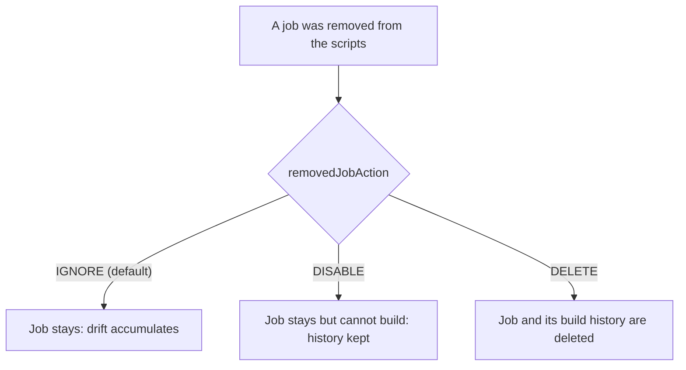

# Job DSL

## Introduction

[Configuration as Code (JCasC)](./0-jenkins-configuration-as-code.mdx) handles the controller's global settings. But what about the jobs themselves? A team with 80 repositories does not want to click "New Item" 80 times, and certainly not again after a controller rebuild.

The **Job DSL** plugin (`job-dsl`) lets you describe jobs, folders and views in a Groovy-based DSL. A special job, traditionally called the **seed job**, runs those scripts and creates, updates or removes the jobs they describe.

An analogy: Job DSL is a cookie cutter. You describe the shape once (a pipeline job pointing at a repository with a Jenkinsfile), then stamp out as many as you need with a loop. If you change the cutter, re-running the seed job reshapes every cookie.

In this page you will:

1. Write a first Job DSL script and run it from a seed job.
2. Generate folders, pipeline jobs and multibranch jobs in a loop.
3. Run Job DSL from a Pipeline with the `jobDsl` step and decide what happens to removed jobs.
4. Run Job DSL from JCasC at startup.
5. Learn when Job DSL is the right tool and when multibranch or organization folders already solve the problem.

:::note Versions
The Job DSL plugin is at version `3732.x` at the time of writing. The DSL available on *your* controller depends on installed plugins. Your controller has an API viewer at `JENKINS_URL/plugin/job-dsl/api-viewer/index.html`, which is the authoritative reference. A limited online version lives at [jenkinsci.github.io/job-dsl-plugin](https://jenkinsci.github.io/job-dsl-plugin/).
:::

## How Job DSL Works



Key ideas:

- A Job DSL script is **Groovy that produces job configuration** (`config.xml`). It does not run builds.
- The seed job records which items it generated. On the next run it can compare and remove items that disappeared from the scripts.
- Job DSL is **idempotent**: running the same script twice produces the same jobs.

### Job DSL vs a Jenkinsfile

Beginners often mix these up:

| | Job DSL script | Jenkinsfile |
| --- | --- | --- |
| Describes | Which jobs exist and how they are configured | What one job does when it runs |
| Runs | When the seed job runs | On every build of that job |
| Typical content | `pipelineJob('app') { ... }` | `pipeline { stages { ... } }` |
| Lives in | A central "jobs" repo | Each application repository |

They work together: Job DSL creates a pipeline job, and that job reads a Jenkinsfile from the application repository.

## Your First Script

```groovy
// jobs/hello.groovy
folder('platform') {
    displayName('Platform Team')
    description('Jobs owned by the platform team. Generated by Job DSL.')
}

pipelineJob('platform/hello-world') {
    description('Generated by Job DSL. Do not edit in the UI.')
    definition {
        cps {
            script('''
                pipeline {
                    agent any
                    stages {
                        stage('Hello') {
                            steps { echo 'Hello from a generated job' }
                        }
                    }
                }
            '''.stripIndent())
            sandbox(true)
        }
    }
}
```

This creates a folder and a pipeline job with an inline script. Inline scripts are fine for a demo. In real use, point the job at a Jenkinsfile in Git, as in the next example.

### Creating the Seed Job

The classic way:

1. **New Item > Freestyle project**, name it `seed`.
2. Under **Source Code Management**, point it at the repository holding `jobs/*.groovy`.
3. Add the build step **Process Job DSLs**, choose **Look on Filesystem**, and set **DSL Scripts** to `jobs/**/*.groovy`.
4. Save and build.

Example console output:

```text
Processing DSL script jobs/hello.groovy
Added items:
    GeneratedJob{name='platform'}
    GeneratedJob{name='platform/hello-world'}
Finished: SUCCESS
```

:::caution Script security
Job DSL scripts run on the controller. When security is enabled, Job DSL scripts are subject to [script security](../11-jenkins-security/5-jenkins-script-security.mdx): scripts either run in the Groovy sandbox or need administrator approval. Treat write access to the jobs repository as a privileged permission.
:::

## Pipeline Jobs from Git

Most generated jobs should read their Jenkinsfile from source control. This example is adapted from the plugin's documentation:

```groovy
pipelineJob('platform/billing-service') {
    description('Billing service CI. Generated by Job DSL.')
    logRotator {
        numToKeep(30)
        artifactNumToKeep(5)
    }
    definition {
        cpsScm {
            scm {
                git {
                    remote {
                        url('https://github.com/acme/billing-service.git')
                        credentials('github-bot')
                    }
                    branch('*/main')
                }
            }
            scriptPath('Jenkinsfile')
            lightweight()
        }
    }
}
```

`lightweight()` lets Jenkins fetch only the Jenkinsfile instead of cloning the whole repository just to read it.

## Generating Many Jobs with a Loop

Job DSL is plain Groovy, so loops, lists and maps work. This is where it pays off.

```groovy
// jobs/services.groovy
def services = [
    [name: 'billing-service',  team: 'payments', branch: 'main'],
    [name: 'invoice-service',  team: 'payments', branch: 'main'],
    [name: 'catalog-service',  team: 'shop',     branch: 'main'],
    [name: 'search-service',   team: 'shop',     branch: 'develop'],
]

services.collect { it.team }.unique().each { team ->
    folder(team) {
        description("Jobs for the ${team} team. Generated by Job DSL.")
    }
}

services.each { svc ->
    pipelineJob("${svc.team}/${svc.name}") {
        description("CI for ${svc.name}. Generated by Job DSL.")
        logRotator { numToKeep(30) }
        definition {
            cpsScm {
                scm {
                    git {
                        remote {
                            url("https://github.com/acme/${svc.name}.git")
                            credentials('github-bot')
                        }
                        branch("*/${svc.branch}")
                    }
                }
                scriptPath('Jenkinsfile')
                lightweight()
            }
        }
    }
}
```

Example output from the seed job:

```text
Processing DSL script jobs/services.groovy
Added items:
    GeneratedJob{name='payments'}
    GeneratedJob{name='shop'}
    GeneratedJob{name='payments/billing-service'}
    GeneratedJob{name='payments/invoice-service'}
    GeneratedJob{name='shop/catalog-service'}
    GeneratedJob{name='shop/search-service'}
Finished: SUCCESS
```

Adding a service is now a one-line pull request.

### Reading the List from a File

Keeping data separate from logic is cleaner. Put the list in YAML or JSON in the same repository, and read it with `readFileFromWorkspace`, which Job DSL provides:

```groovy
import groovy.json.JsonSlurper

def services = new JsonSlurper().parseText(readFileFromWorkspace('services.json'))

services.each { svc ->
    pipelineJob("${svc.team}/${svc.name}") {
        definition {
            cpsScm {
                scm { git { remote { url(svc.repo) }; branch('*/main') } }
                scriptPath('Jenkinsfile')
            }
        }
    }
}
```

```json
[
  {"name": "billing-service", "team": "payments", "repo": "https://github.com/acme/billing-service.git"},
  {"name": "catalog-service", "team": "shop", "repo": "https://github.com/acme/catalog-service.git"}
]
```

:::tip
With the sandbox enabled, classes like `JsonSlurper` may need script approval. If that becomes a hassle, keep the data as a Groovy list in its own script file.
:::

## Multibranch Pipelines

For repositories with feature branches and pull requests, generate a multibranch job instead of a plain pipeline job. This form comes from the Job DSL JCasC documentation:

```groovy
multibranchPipelineJob('shop/storefront') {
    branchSources {
        git {
            id = 'storefront'
            remote('https://github.com/acme/storefront.git')
            credentialsId('github-bot')
        }
    }
    orphanedItemStrategy {
        discardOldItems {
            numToKeep(20)
        }
    }
}
```

For GitHub-specific features (pull request discovery, checks), use the GitHub branch source in the DSL. Its exact options depend on the installed `github-branch-source` version, so look them up in your controller's API viewer under `multibranchPipelineJob > branchSources`. See [Multibranch Pipelines](../5-jenkins-scm-integration/1-jenkins-multibranch-pipelines.mdx) for how multibranch jobs behave.

## Running Job DSL from a Pipeline

Instead of a freestyle seed job, you can make the seed itself a Pipeline with the `jobDsl` step. This lets you add validation stages, notifications and code review gates.

```groovy
// Jenkinsfile in the jobs repository
pipeline {
    agent any
    options { disableConcurrentBuilds() }
    stages {
        stage('Generate jobs') {
            steps {
                jobDsl(
                    targets: 'jobs/**/*.groovy',
                    removedJobAction: 'DISABLE',
                    removedViewAction: 'DELETE',
                    lookupStrategy: 'SEED_JOB',
                    sandbox: true
                )
            }
        }
    }
}
```

The important parameters:

| Parameter | Values | What it controls |
| --- | --- | --- |
| `targets` | Newline-separated paths, wildcards allowed | Which scripts to run |
| `scriptText` | Groovy string | Inline script instead of files |
| `removedJobAction` | `IGNORE`, `DISABLE`, `DELETE` | What to do with jobs that were generated before but are no longer in the scripts |
| `removedViewAction` | `IGNORE`, `DELETE` | Same for views |
| `lookupStrategy` | `JENKINS_ROOT`, `SEED_JOB` | Whether relative job names resolve from the root or from the seed job's folder |
| `ignoreExisting` | boolean | Do not overwrite jobs that already exist |
| `sandbox` | boolean | Run the script in the Groovy sandbox |
| `additionalParameters` | map | Pass values into the scripts as variables |

### Choosing a removedJobAction



`DISABLE` is a safe starting point: an accidental deletion in a pull request will not wipe build history, and you can clean up disabled jobs later. Switch to `DELETE` once you trust your review process.

## Running Job DSL from JCasC

The Job DSL plugin adds a `jobs` root key to JCasC. Jobs are created when the configuration is applied, without a separate seed job:

```yaml
jobs:
  - script: |
      folder('platform')
  - file: /var/jenkins_home/casc/jobs/seed.groovy
  - providedEnv:
      OWNER: "platform-team"
  - file: /var/jenkins_home/casc/jobs/owned-job.groovy
```

`providedEnv` passes values into the following scripts as variables. Relative `file` paths resolve from the Jenkins process's working directory (not necessarily `JENKINS_HOME`), so prefer absolute paths.

A common, clean pattern is to let JCasC create **only the seed job**, and let the seed job (a Pipeline with code review) create everything else:

```yaml
jobs:
  - script: |
      pipelineJob('seed') {
          description('Generates all other jobs. Created by JCasC.')
          definition {
              cpsScm {
                  scm {
                      git {
                          remote {
                              url('https://github.com/acme/jenkins-jobs.git')
                              credentials('github-bot')
                          }
                          branch('*/main')
                      }
                  }
                  scriptPath('Jenkinsfile')
              }
          }
      }
```

This keeps the JCasC file small and puts job changes into their own reviewed repository.

## Testing Job DSL Scripts

A broken script can disable or delete dozens of jobs. Protect yourself:

1. **Review in pull requests.** The jobs repository should require approval, like application code.
2. **Run against a test controller.** Boot a disposable Jenkins (see the smoke test in [Configuration as Code](./0-jenkins-configuration-as-code.mdx)) and run the seed there first.
3. **Unit-test with Gradle.** The Job DSL project publishes a Gradle example (`job-dsl-gradle-example` in the `sheehan` GitHub account, linked from the plugin wiki) that runs scripts in a test harness and writes the generated XML. It is useful for large job repositories, though it takes some setup.
4. **Diff the XML.** Some teams generate `config.xml` files in CI and show the diff in the pull request.

## Real-World Scenario

Your platform team supports 60 microservice repositories. Each service needs the same three things in Jenkins: a multibranch CI job, a nightly security scan job, and a "deploy to production" job restricted to the release managers. Today they are created by hand, they have drifted (some keep 10 builds, some keep 500), and a new service waits two days for a ticket to be handled.

**Solution:**

1. Create a `jenkins-jobs` repository with `services.yaml` listing each service, its team and its repository URL.
2. Write `jobs/services.groovy` that loops over the list and generates, for each service, a team folder, a multibranch CI job, a nightly scan `pipelineJob` with a cron trigger, and a deploy `pipelineJob`.
3. Create the seed job from JCasC. The seed is a Pipeline using `jobDsl` with `removedJobAction: 'DISABLE'`.
4. Developers add a service by opening a pull request with three lines of YAML. After merge, a webhook triggers the seed job.

**Why this approach:** the jobs are not all discoverable by convention (the nightly scan and the deploy job are extra), so a plain organization folder is not enough. Job DSL captures the company standard once and applies it everywhere.

**When to use Job DSL:**

- You need many jobs with a consistent shape, especially jobs that are not just "build each branch".
- You want job configuration reviewed and recoverable.
- You have freestyle or parameterized jobs that must remain while you migrate to pipelines.

**When not to use it:**

- If every repository just needs "build each branch and pull request", an [organization folder](../5-jenkins-scm-integration/5-jenkins-organization-folders.mdx) discovers them automatically with zero scripts.
- If you have five jobs, the overhead of a seed job may not be worth it.
- If what you really want to share is *build logic*, that belongs in a [shared library](../8-jenkins-shared-libraries/0-jenkins-shared-libraries-introduction.mdx), not in job definitions.

### Alternatives and Trade-offs

| Approach | Pros | Cons | Best for |
| --- | --- | --- | --- |
| Manual job creation | No tooling | Drift, slow, lost on rebuild | A handful of jobs |
| **Job DSL** | Any job type, loops, reviewable, idempotent | Groovy DSL to learn, script security approvals, API depends on plugins | Many jobs with custom shapes |
| Organization folders | Zero config per repo, auto-discovers repos and PRs | Only "multibranch per repo"; less control | Standard repo-per-service setups |
| Multibranch job per repo | Simple, branch and PR aware | Each one must still be created somehow | Few important repos |
| Jenkins CLI or REST `config.xml` uploads | Works without plugins | Raw XML, no diff-friendly abstraction | Scripts and one-off migrations |

## Common Mistakes

1. **Editing generated jobs in the UI.** The next seed run overwrites the change. Put "Generated by Job DSL" in every description.
2. **Using `removedJobAction: 'DELETE'` on day one.** A bad merge deletes jobs and their history. Start with `DISABLE`.
3. **Putting build logic in Job DSL.** Inline `script(...)` blocks grow into unreviewable pipelines. Point jobs at Jenkinsfiles and shared libraries instead.
4. **Guessing DSL methods.** Methods depend on installed plugins and versions. Use your controller's API viewer.
5. **Granting everyone write access to the jobs repo.** Job DSL runs on the controller, so it is an administrator-level lever.
6. **Concurrent seed runs.** Two runs at once can race. Use `disableConcurrentBuilds()` on the seed pipeline.

## Summary

- Job DSL generates jobs, folders and views from Groovy scripts. A seed job runs the scripts.
- It is idempotent and can disable or delete jobs that disappear from the scripts.
- Use loops and data files to stamp out consistent jobs for many repositories.
- The `jobDsl` step lets the seed be a reviewed Pipeline. `removedJobAction` decides how removals are handled.
- JCasC's `jobs` key can run Job DSL at startup. A good pattern is "JCasC creates the seed, the seed creates the rest".
- Prefer organization folders when every repository just needs branch and PR builds.

## Further Learning

### Exercises

1. Write a Job DSL script that creates a folder per team from a list of three teams, each with one pipeline job.
2. Convert your freestyle seed job into a Pipeline seed using `jobDsl` with `removedJobAction: 'DISABLE'`. Remove one service from the list and confirm the job is disabled, not deleted.
3. Open your controller's API viewer and find the options for `multibranchPipelineJob`. Add an orphaned item strategy that keeps 10 old branches.
4. Use JCasC's `jobs` key to create only the seed job on startup.

### Related Pages

- [Configuration as Code (JCasC)](./0-jenkins-configuration-as-code.mdx)
- [Multibranch Pipelines](../5-jenkins-scm-integration/1-jenkins-multibranch-pipelines.mdx) and [Organization Folders](../5-jenkins-scm-integration/5-jenkins-organization-folders.mdx)
- [Pipeline Templates for Many Teams](../8-jenkins-shared-libraries/7-jenkins-pipeline-templates.mdx)
- [Migrating Freestyle Jobs to Pipelines](../13-jenkins-best-practices/2-jenkins-migrating-freestyle.mdx)
- Official docs: [Job DSL plugin](https://plugins.jenkins.io/job-dsl/) and the [jobDsl step reference](https://www.jenkins.io/doc/pipeline/steps/job-dsl/)
